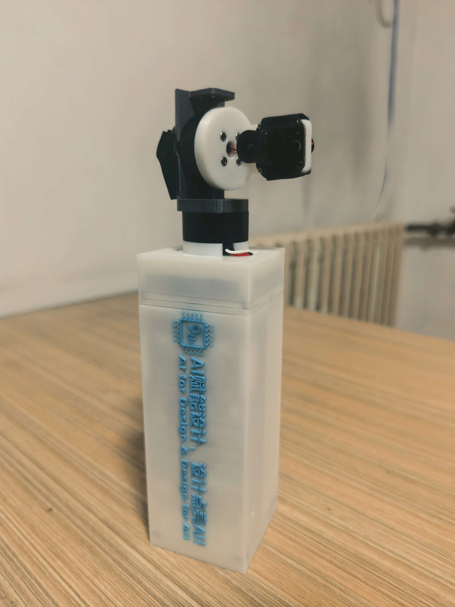
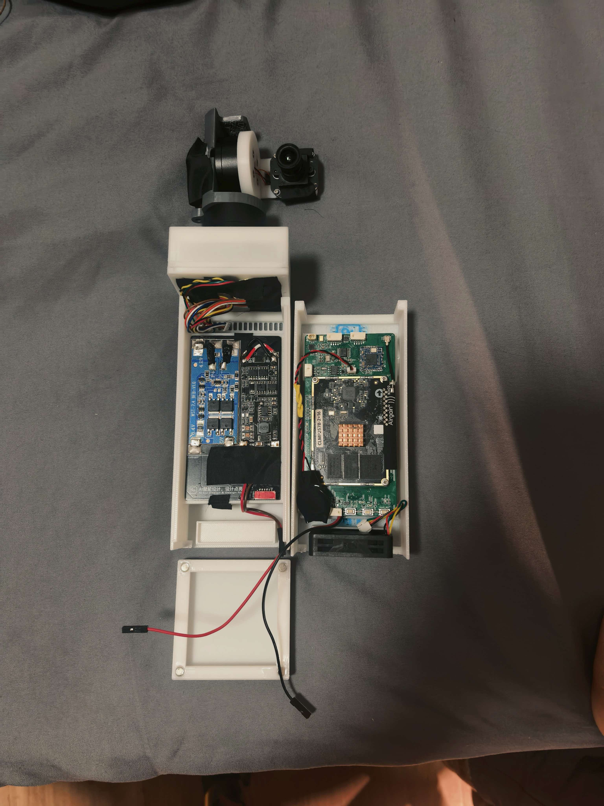
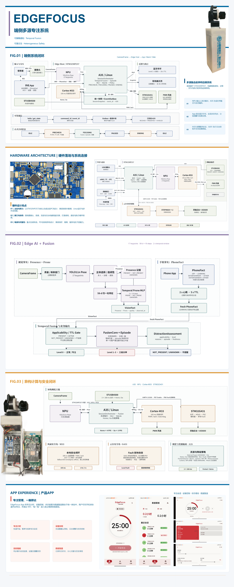
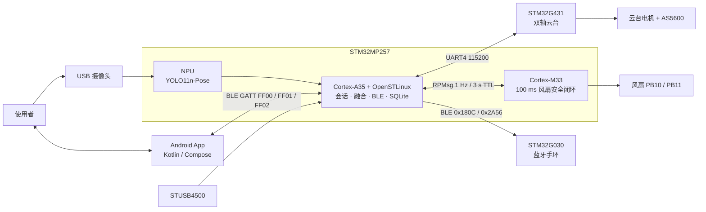

# EdgeFocus

**面向学习场景的端侧 AI 专注监督终端**

STM32MP257 · YOLO11n-Pose · OpenSTLinux · Android · STM32G431 云台 · STM32G030 手环

<p>
  
  
  
</p>

EdgeFocus 是一台完全本地运行的专注监督终端：摄像头画面在 STM32MP257 的 NPU 上完成姿态推理，手机 App 上报原始用机状态，主机把视觉事实、用机事实和时序行为融合成分神等级，再通过 App 与蓝牙手环进行低打扰提醒。视频与推理结果不出设备。

本仓库是参赛作品的**技术展示归档**，包含两套硬件版本（正点原子开发板 / 自研底板）的主机软件、Android App、云台与手环固件、STM32MP257 副核（M33）风扇控制、自研板 Linux 适配资料和硬件设计源文件。

---

## 1. 它解决什么问题

“有没有走神”很难从单帧画面直接判断。EdgeFocus 不猜测，而是把判断拆成可验证的事实：

| 事实来源 | 提供什么 | 不提供什么 |
| --- | --- | --- |
| NPU 视觉 | 人在 / 不在 / 未知、趴下概率、人体框与关键点 | 是否使用手机、最终分神等级 |
| Android App | 未使用 / 学习 / 娱乐 / 其他 | 最终分神等级 |
| 主机融合 | 持续性、时序、多源一致性、Level 0–3、原因与 episode | — |

正式会话只由主机 `SessionOrchestrator` 创建；PRECHECK 不计时、不入库；`NOT_PRESENT` / `UNKNOWN` 不产生分神提醒；静音模式只筛选提醒渠道，不降低严重程度。

## 2. 系统架构



**四个计算域的职责边界**

| 计算域 | 负责 | 不负责 |
| --- | --- | --- |
| Cortex-A35 / Linux | 会话生命周期、视觉编排、多源融合、BLE、SQLite、供电策略、Demo | 电机 FOC、风扇硬实时闭环 |
| NPU | YOLO11n-Pose 推理 | 会话、提醒、手机类别判断 |
| Cortex-M33 | 100 ms 风扇控制、转速监测、失联安全高转 | 云台、供电策略、产品会话 |
| STM32G431 | 云台对齐、HOLD、FOC、编码器、电流保护、本地 Fault 停机 | 分神判断、App 协议 |

## 3. 可演示主链路

```text
App 发起会话
  -> 主机创建 SessionRuntime（PRECHECK -> 正式会话）
  -> 摄像头采集 -> NPU 姿态推理 -> Presence / Prone / 关键点
  -> App 上报 PhoneFact（未使用 / 学习 / 娱乐 / 其他）
  -> 时序融合 -> Level 0–3 + 原因 + episode
  -> 提醒策略（冷却、渠道）-> App 弹窗 / 屏幕闪烁 / 手环振动
  -> 结束会话 -> 报告 / 历史 / 反馈
```

配套能力：

- **PRECHECK 云台构图**：G431 双轴搜索、手动租约、故障降级；正式会话内可选视觉跟踪。
- **M33 风扇安全闭环**：A35 每秒上报温度，M33 独占 PWM / 转速采样；3 秒失联进入安全高转；M33 与 Linux fallback 互斥。
- **Home / Go 性能策略**：外部供电时 Home（约 4 FPS），电池供电时 Go（约 3 FPS）；BLE、Fault、风扇与云台控制不降频。
- **Demo 运行域**：预录 NPU 与前端 pre-log 两套保底链路，不污染正式记录。
- **只读证据页**：浏览器展示视频、关键点、证据与近 30 秒时间线，仅用于演示与诊断。

## 4. 仓库结构

| 路径 | 内容 | 技术栈 |
| --- | --- | --- |
| [`android-app/`](android-app/) | Android 客户端（唯一主要交互渠道） | Kotlin、Jetpack Compose、Hilt、Room、KSP、BLE GATT |
| [`host/alientek/`](host/alientek/) | 正点原子 ATK-DLMP257B 版主机软件（最终版） | C++17、CMake、OpenCV、STAI_MPU、SQLite、BlueZ |
| [`host/self-developed/`](host/self-developed/) | 自研底板版主机软件（最终版，基于正点原子最终版演进） | C++17、CMake、STAI_MPU、SQLite、BlueZ、RPMsg |
| [`firmware/gimbal-g431/`](firmware/gimbal-g431/) | 双轴云台固件（协议 3.0） | STM32G431、HAL、CMake、arm-none-eabi |
| [`firmware/ble-band/`](firmware/ble-band/) | 蓝牙手环固件（STM32 主线 + ESP32 旧硬件参考） | STM32G030、E104-BT52、ESP-IDF |
| [`firmware/m33-fan-controller/`](firmware/m33-fan-controller/) | STM32MP257 副核 M33 风扇控制 + Linux bridge | Cortex-M33、OpenAMP / RPMsg、C++17 |
| [`linux/bsp/`](linux/bsp/) | 自研底板 Linux 适配资料（DTB / 脚本 / bring-up 记录） | OpenSTLinux、Device Tree、systemd |
| [`hardware/`](hardware/) | 硬件设计：EDA 源文件、网表、板卡与设备图 | 立创 EDA Pro、Telesis 网表 |
| [`docs/`](docs/) | 架构、协议、项目材料、UI 原型与图片 | Markdown、Mermaid、SVG |

## 5. 两套硬件版本

| | 正点原子版 | 自研底板版 |
| --- | --- | --- |
| 核心板 | ATK-DLMP257B（STM32MP257D，2 GB DDR） | 同一核心板 |
| 底板 | 厂商底板 | 自研载板：RTL8723DU Wi-Fi/BT、CH334R Hub、MAX98357A、ICS-43434、STUSB4500、MIPI DSI / SPI 屏、风扇 PB10/PB11 |
| 主机软件 | `host/alientek` | `host/self-developed` |
| 云台 | G431 副板（UART4） | 同左，协议升级到 3.0 |
| 状态 | 完成主链路与板端联调 | 完成 Bring-up、云台、M33 风扇与主链路 |

自研底板没有有线以太网，网络依赖 RTL8723DU；屏幕与音频仍驱动不稳定，故在自研版删除或替换相关功能。

## 6. 关键设计取舍

1. **时序融合优先于单帧分类**：视觉只给 Presence / Prone，手机类别只来自 App，融合层负责持续性、冷却与 episode。
2. **端侧闭环**：YOLO11n-Pose 量化后以 `.nb` 部署到 NPU，推理、存储、提醒全部本地完成。
3. **异构分工**：A35 做业务与融合，NPU 做推理，M33 做风扇安全环，G431 做电机实时控制；实时安全动作不依赖业务主循环。
4. **单一所有权**：相机、NPU、云台、风扇在同一时刻只有一个控制者；故障时局部降级而不是整机停机。
5. **双端协议冻结**：App ↔ 主机使用 FF00/FF01/FF02 JSON 命令与 push；主机 ↔ 手环使用 0x180C/0x2A56 定长帧。
6. **两套硬件复用同一套业务代码**：板级差异收敛在 `platform/` 与部署脚本，业务模块不感知底板型号。

## 7. 构建与运行

### Android App

```bash
cd android-app
# 新建 local.properties，写入 sdk.dir=<Android SDK 路径>
./gradlew assembleDebug
```

要求 JDK 17、Android SDK 34、minSdk 26。App 通过 BLE 连接主机广播名 `EdgeFocus`。

### 主机软件（C++17 / CMake）

```bash
cd host/self-developed        # 或 host/alientek
cmake -B build -DCMAKE_BUILD_TYPE=Release
cmake --build build -j
```

可选开关：`EDGEFOCUS_WITH_OPENCV`、`EDGEFOCUS_WITH_STAI_MPU`、`EDGEFOCUS_WITH_DEMO_HTTP`、`EDGEFOCUS_WITH_OPENH264`、`EDGEFOCUS_WITH_FAN_BRIDGE`、`EDGEFOCUS_BUILD_TESTS`。板端交叉编译需要 STM32MP2 SDK（见各模块 README 与 `deploy_to_board.py`）。

### 云台固件

```bash
cd firmware/gimbal-g431
cmake --preset Debug
cmake --build --preset Debug -j 4
```

### 手环固件

```bash
# STM32G030 主线
cd firmware/ble-band/stm32/STM32Band_test
cmake --preset Debug && cmake --build build/Debug

# ESP32 旧硬件（参考）
cd firmware/ble-band/esp32 && idf.py build
```

### M33 风扇固件

`firmware/m33-fan-controller/firmware-m33/atk/build_atk.ps1` 需要 Arm GNU 工具链与 ATK CubeMP2 源包，产物通过 `deploy_m33.py` 以 remoteproc ELF 部署。

### Linux 适配资料

`linux/bsp/` 提供设备树变体、启动备份、烧录与诊断脚本，不是完整系统镜像；使用前先读 [`linux/bsp/CODE_AGENT_ENTRY.md`](linux/bsp/CODE_AGENT_ENTRY.md)。

## 8. 文档索引

- 系统架构母文档：[`docs/architecture/edgefocus-complete-architecture.md`](docs/architecture/edgefocus-complete-architecture.md)
- 图表集：[A 核心图](docs/architecture/A-core-diagrams.md) · [B 工程图](docs/architecture/B-engineering-diagrams.md) · [C 完整图谱](docs/architecture/C-complete-diagram-atlas.md)
- 跨端协议：[`docs/protocols/`](docs/protocols/)（App↔主机、主机↔手环、P0 协议冻结清单）
- 主机当前架构：[`host/self-developed/docs/architecture/current-architecture.md`](host/self-developed/docs/architecture/current-architecture.md)
- App 架构：[`android-app/docs/architecture/edgefocus-app-architecture.md`](android-app/docs/architecture/edgefocus-app-architecture.md)
- 云台协议：[`firmware/gimbal-g431/docs/gimbal_uart_control_protocol.md`](firmware/gimbal-g431/docs/gimbal_uart_control_protocol.md)
- M33 风扇：[`firmware/m33-fan-controller/docs/stm32mp257-m33-fan-inventory.md`](firmware/m33-fan-controller/docs/stm32mp257-m33-fan-inventory.md)
- 硬件设计：[`hardware/README.md`](hardware/README.md)
- 全部文档入口：[`docs/README.md`](docs/README.md)

## 9. 迭代历史

`main` 分支是整理后的展示树；每个模块的原始提交历史保留在 `history/*` 分支：

| 分支 | 对应模块 |
| --- | --- |
| `history/android-app` | Android 客户端 |
| `history/boardcode` | 正点原子版主机 |
| `history/self-developed` | 自研底板版主机 |
| `history/gimbal-g431` | 云台固件 |
| `history/ble-band` | 手环固件 |

```bash
git log --oneline history/self-developed
git log --oneline --graph --all
```

历史分支保留原始提交信息与时间。

## 10. 第三方与许可

- **原创代码、文档与硬件设计**：Apache License 2.0，见 [`LICENSE`](LICENSE)。
- **模型权重** `models/**/*.nb`：由 Ultralytics YOLO11n-Pose 量化导出，按 **AGPL-3.0** 分发，见 [`MODEL_LICENSE.md`](MODEL_LICENSE.md) 与 [`LICENSES/AGPL-3.0.txt`](LICENSES/AGPL-3.0.txt)。
- **第三方组件**：STM32 HAL / CMSIS、OpenAMP、OpenCV、SQLite、BlueZ、ESP-IDF、AndroidX、openh264 等遵循其原始许可证，见 [`NOTICE.md`](NOTICE.md) 与 [`LICENSES/README.md`](LICENSES/README.md)。

> 模型与代码分开授权：`.nb` 不属于 Apache-2.0 内容；如果无法接受 AGPL-3.0，请移除模型文件或替换为许可兼容的模型。

---

<p align="center"><sub>EdgeFocus · 端侧 AI 专注监督终端 · 作品归档</sub></p>
