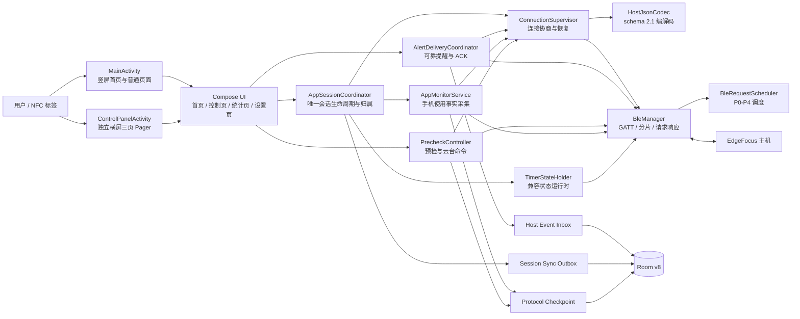
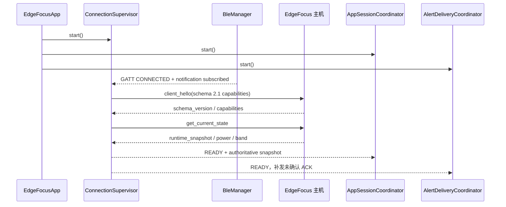
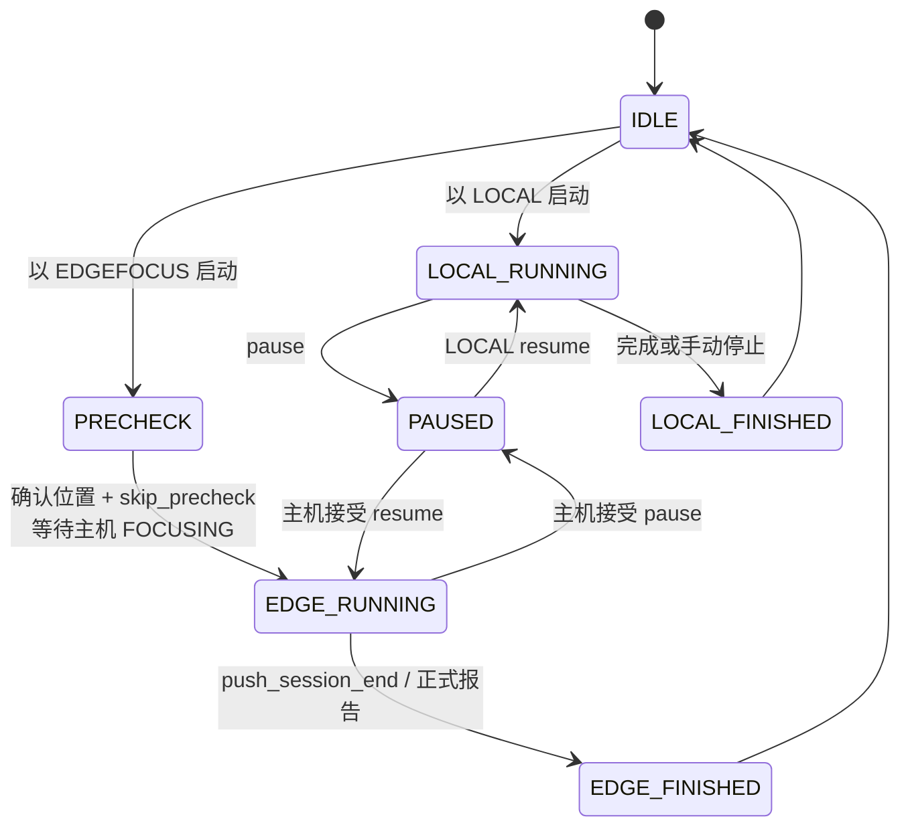
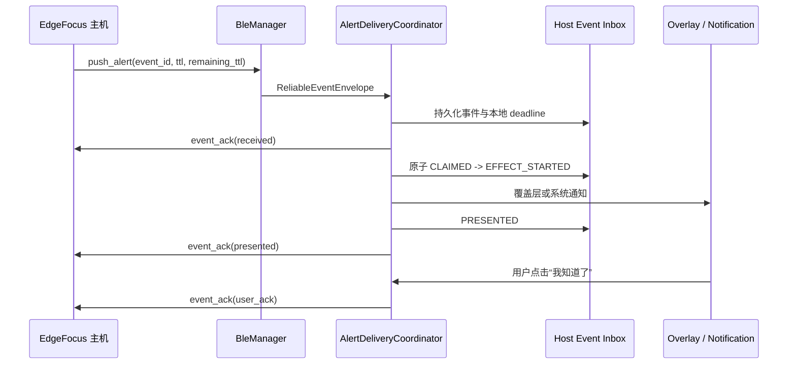
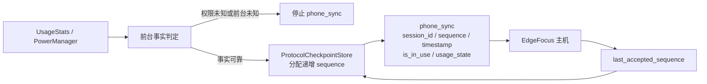
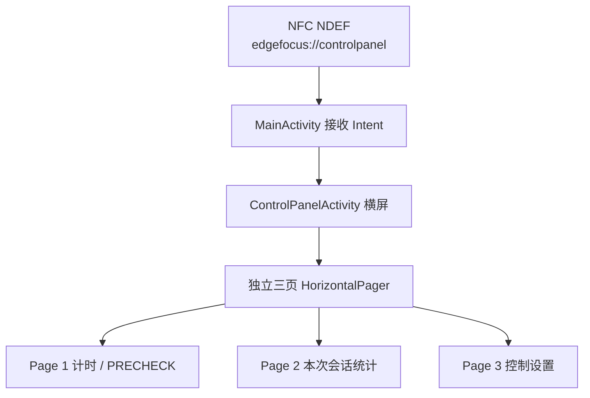

# EdgeFocus App 当前架构与完成度

> 文档日期：2026-07-16  
> 对应代码提交：`5eb0ac7` 及其后的架构文档提交  
> 适配目标：EdgeFocus 主机 schema 2.1、Redmi Note 10 Pro、MIUI 14.0.8、Android 13

## 1. 结论

当前版本已经完成本轮主机适配的主要功能代码，但不应称为“从零完全重写、已经真机验收的最终新架构”。准确说法是：

- 新的协议、可靠性和协调核心已经落地。
- 首页及 NFC 横屏三页控制面板已经接入同一个进程级会话。
- 旧的 `TimerStateHolder` 仍作为兼容运行时存在，尚未完全拆除。
- 自动化测试、Lint、Debug APK 构建已通过。
- 因 ADB 未检测到手机，Redmi + 实际主机端到端联调尚未执行。

因此，当前状态是“代码级适配完成、架构迁移主体完成、真机验收与兼容层收尾待完成”。

## 2. 系统总览

独立 Mermaid 源文件见 [edgefocus-app-overview.mmd](./edgefocus-app-overview.mmd)。

## 3. 分层与职责

### 3.1 展示层

- `MainActivity`：竖屏入口、普通导航、NFC/Deep Link 接收、全局提醒覆盖层。
- `ControlPanelActivity`：独立横屏 Activity，保留三页 Pager，不是首页横屏版。
- 横屏 Page 1：原有圆形计时器、图标式开始/暂停/停止、PRECHECK。
- 横屏 Page 2：本次会话统计和主机只读状态。
- 横屏 Page 3：控制面板设置。
- `BlackScreenSaver`：两种 Activity 共用；首次触摸只关闭黑屏层，不传递给底层按钮。
- `AlertOverlay`：主机可靠提醒在任意竖屏页面上的全局覆盖。

### 3.2 会话与业务协调层

- `AppSessionCoordinator`：应用进程中唯一的会话生命周期协调者。
  - 冻结 LOCAL/EDGEFOCUS 会话归属。
  - 统一启动、暂停、恢复、停止和 AppMonitor 生命周期。
  - 统一保存 Session，处理本地会话 Outbox 上传。
  - 只在主机正式报告到达后保存 EDGEFOCUS 权威结果。
- `AlertDeliveryCoordinator`：可靠事件入箱、去重、外部效果 at-most-once、分阶段 ACK。
- `PrecheckController`：精确 PRECHECK 命令、持久化云台 sequence、确认后等待主机进入 RUNNING/FOCUSING。

### 3.3 兼容运行时

- `TimerStateHolder` 仍承载计时状态、主机状态映射和部分 BLE 操作。
- 它是本次迁移中保留的兼容层，不是最终理想边界。
- 当前约 1256 行，是下一轮纯化架构时最主要的拆分对象。

### 3.4 协议与连接层

- `ConnectionSupervisor`：GATT 连接后执行 `client_hello` 和 `get_current_state`，成功后进入 READY。
- `HostJsonCodec`：schema 2.1 的强类型编解码。
- `BleRequestScheduler`：
  - P0：可靠 ACK、PRECHECK 关键控制。
  - P1：会话控制。
  - P2：状态读取。
  - P3：后台同步。
  - P4：可取消摄像头预览。
- `BleManager`：底层 GATT、MTU、分片、请求 ID、通知分发和自动重连入口。

### 3.5 持久化层

Room 数据库版本为 v8，开发期按约定允许破坏性迁移。

| 表 | 用途 |
|---|---|
| `sessions` | 本地和主机会话结果 |
| `app_usage` | 本地应用使用记录 |
| `settings` | 模式、屏保和 App 提醒设置 |
| `host_event_inbox` | 可靠主机事件、TTL、dispatch、ACK 阶段 |
| `sync_outbox` | LOCAL 会话待上传队列 |
| `protocol_checkpoints` | phone sequence 与 PRECHECK/gimbal sequence |

## 4. 启动与连接流程

只有完成 hello 和状态同步后，主机链路才被视为 READY；单纯 GATT CONNECTED 不代表业务可用。

## 5. 会话模型

规则：

- 打开 NFC 横屏控制面板只改变展示，不改变当前会话归属。
- LOCAL 会话由 App 计时并在完成时与 Outbox 同事务保存。
- EDGEFOCUS 会话以主机状态和正式报告为准；主机仅返回 IDLE 但没有匹配报告时，不伪造本地完成结果。
- Activity 重建、竖横屏页面切换不会创建第二个会话。

## 6. 可靠提醒流程

- `push_alert`：received → presented → user_ack。
- `push_session_end`：received → presented，永不发送 user_ack。
- TTL 使用手机 `elapsedRealtime + remaining_ttl_ms`，不拿主机 steady clock 直接比较。
- 外部声音/振动前先持久化 `EFFECT_STARTED`；进程或设备崩溃后不重复外部效果。

## 7. PhoneFact 数据流

判定约束：

- `MainActivity`、`ControlPanelActivity`、App 黑屏屏保：`is_in_use=false`。
- 系统界面、桌面、最近任务和系统非交互状态：`is_in_use=false`。
- Usage Access 缺失或无法可靠判断前台 App：不发送 phone_sync。
- LOCAL 会话只消费本地策略，不向主机发送 phone_sync。
- 协议不再发送 `distraction_level`、`app_name` 或 App 本地最终等级。

## 8. PRECHECK 与主机能力

PRECHECK 使用以下 schema 2.1 命令，并在发送前持久化递增 sequence：

- `precheck_skip_auto_adjust`
- `gimbal_nudge`
- `gimbal_center`
- `gimbal_stop`
- `gimbal_realign`
- `precheck_confirm_position`

位置确认成功后发送 `session_control(skip_precheck)`，并等待主机状态进入 FOCUSING/RUNNING。

摄像头预览为 750 ms 一次的 P4 请求；离开 PRECHECK 后取消排队请求。Base64 图像在 Compose 中实际解码绘制。

手环控制由 capability `band_proxy_control_v1` 门控。当前主机未声明该能力时，App 只显示连接状态，不提供扫描或重连按钮。

供电不再展示虚构电量，只显示：

- 主机 profile：HOME / GO。
- 外部供电事实：PRESENT / ABSENT / UNKNOWN。

## 9. NFC 与页面关系

该 URI 使用 Android 自定义 scheme，不依赖公网网站是否过期。

## 10. 当前完成度

| 范围 | 状态 | 说明 |
|---|---|---|
| schema 2.1 hello/state 协商 | 已实现并单测 | 真机待验收 |
| BLE P0-P4 调度、分片、恢复 | 已实现并单测 | MIUI 蓝牙行为待真机确认 |
| 唯一会话与 owner 冻结 | 已实现 | 仍通过 TimerStateHolder 兼容状态 |
| Inbox/Outbox/Checkpoint | 已实现 | Room v8，开发期破坏性迁移 |
| PhoneFact 与持久化 sequence | 已实现并单测 | UsageStats 行为待真机确认 |
| 可靠提醒与 ACK | 已实现并单测 | 通知权限、锁屏和振动待真机确认 |
| PRECHECK、云台、图片预览 | 已实现 | 需要实际主机摄像头/云台验收 |
| NFC 独立横屏三页控制面板 | 已实现 | 需要实际 NFC 标签验收 |
| Debug 构建、Lint | 通过 | APK 已生成 |
| Redmi + 主机端到端联调 | 未执行 | ADB 当时未发现设备 |

自动化结果：86 个 JVM 单元测试通过，0 失败；`assembleDebug` 和 `lintDebug` 通过。

## 11. 尚未完全“新架构化”的部分

1. `TimerStateHolder` 仍同时承担状态机、主机状态映射、计时与部分 BLE 操作，文件约 1256 行。
2. `HomeViewModel`、`ControlPanelViewModel` 中仍保留部分旧会话保存/监控兼容函数，实际主流程已经改由 `AppSessionCoordinator` 接管。
3. `AppSessionCoordinator`、`AlertDeliveryCoordinator` 和 `PrecheckController` 目前直接依赖 `BleManager`，尚未完全通过独立 `HostSessionClient` 接口隔离。
4. 当前测试重点是纯策略、协议编解码和构建检查；Room 事务、Activity 重建、通知点击和 BLE 真实链路仍需要 instrumentation/真机测试。

如果目标是“完全纯化的新架构”，下一步应先拆除上述兼容层，再以 Redmi 和真实主机完成最终验收。当前 APK 可以作为真机验收候选版，但不能在尚未联调时称为硬件最终验收版。

## 12. 关键代码索引

- `domain/session/AppSessionCoordinator.kt`：唯一会话与持久化协调。
- `domain/alert/AlertDeliveryCoordinator.kt`：可靠事件交付。
- `domain/precheck/PrecheckController.kt`：PRECHECK 精确命令。
- `data/ble/ConnectionSupervisor.kt`：连接协商与 READY 状态。
- `data/ble/HostJsonCodec.kt`：schema 2.1。
- `data/ble/BleRequestScheduler.kt`：P0-P4 请求调度。
- `data/session/HostEventInbox.kt`：可靠事件 Inbox。
- `data/session/SessionPersistenceStore.kt`：Session + Outbox 事务。
- `data/session/ProtocolCheckpointStore.kt`：sequence checkpoint。
- `service/AppMonitorService.kt`：PhoneFact 采集与发送。
- `data/TimerStateHolder.kt`：当前保留的兼容状态运行时。

