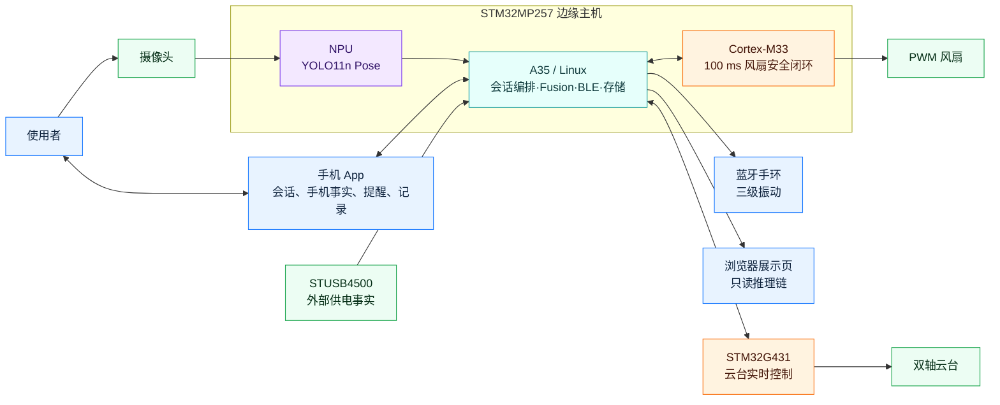
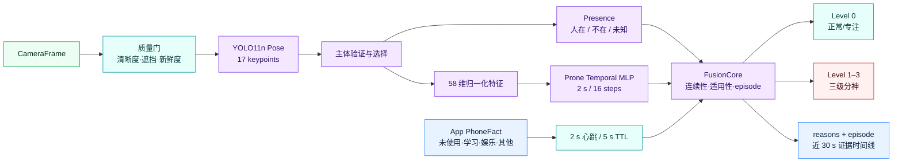
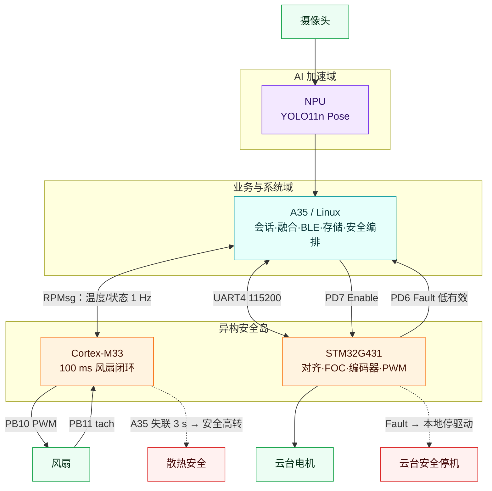
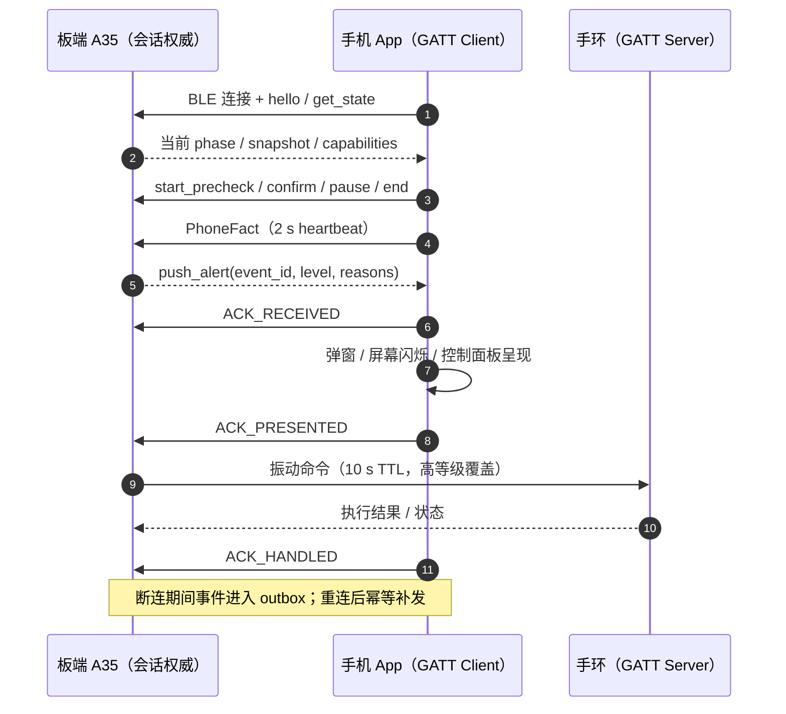

# A 套：4 张核心展示图

A 套优先回答“系统是什么、如何判断、为何异构、怎样触达”。每张图都能单独使用。

## A1 系统全景架构

回答：EdgeFocus 是一个怎样闭环的产品？

- 视觉、融合、会话与提醒全部在端侧闭环。
- App 是主要交互面，手环是低打扰提醒端。
- M33 与 G431 分担实时、安全和电机控制。

## A2 Edge AI 多源时序融合

回答：系统如何稳定地产生分神等级？

- 视觉只承担“人在、趴下”等可验证事实。
- 手机类别来自 App，不由摄像头猜测。
- 单帧结果经过时序、TTL 与 episode 后才形成等级。
- 学习类只弱化手机分支，不覆盖独立视觉证据。

## A3 异构计算与实时控制

回答：为什么系统同时使用 A35、NPU、M33 与 G431？

- A35 做策略和资源编排，实时核不承载产品业务。
- NPU 专注姿态推理，释放 CPU 资源。
- M33 和 G431 即使业务侧异常也保持安全动作。

## A4 跨设备可靠协同

回答：提醒和状态如何可靠地到达 App 与手环？

- 板端对 App 是 GATT Server；App 是 Client。
- 板端对手环是 GATT Client；手环是 Server。
- 三阶段 ACK 区分收到、呈现与处理。
- TTL、outbox、幂等和等级覆盖限制过期提醒。
