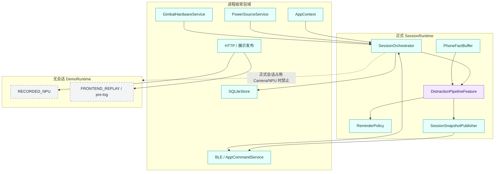
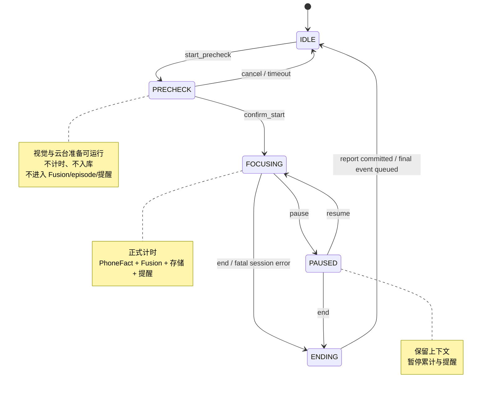
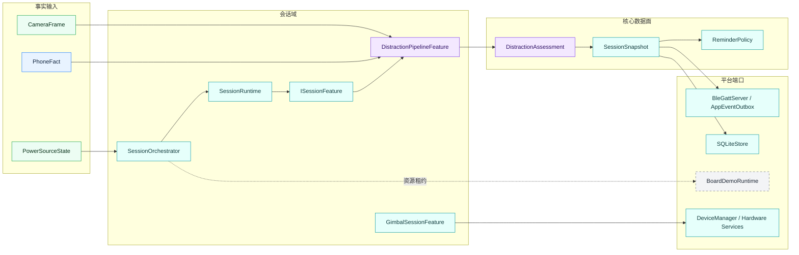
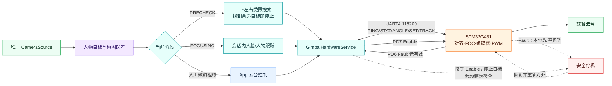
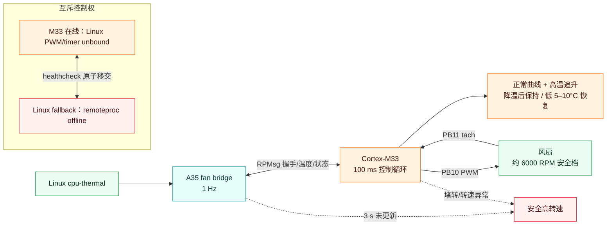
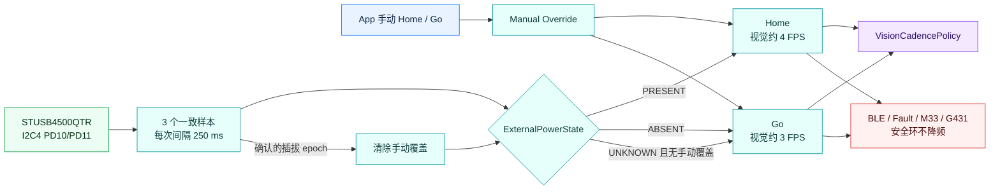
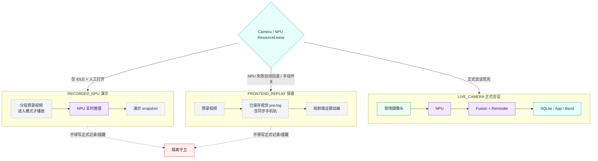
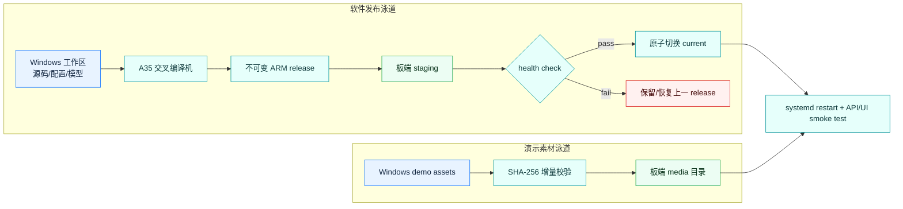

# B 套：9 张工程架构图

B 套用于说明进程边界、资源所有权、状态时序、安全回退与发布链。

## B1 主程序三个运行域



常驻服务负责接入与设备；SessionRuntime 只在正式会话存在；DemoRuntime 只在无正式会话时由页面启动。

## B2 正式会话状态机



App 页面把主机 `FOCUSING` 映射为 `RUNNING`；最终报告展示态属于 App，不是新的主机正式 phase。

## B3 软件模块与类型化数据面



跨模块只传类型化事实、判定和快照；兼容投影不得成为新的核心依赖。

## B4 可靠事件与断线恢复

```mermaid
sequenceDiagram
    participant App as App
    participant Gatt as BleGattServer
    participant Cmd as AppCommandService
    participant Orch as SessionOrchestrator
    participant Box as AppEventOutbox
    participant DB as SQLiteStore

    App->>Gatt: connect + hello(last_event_id)
    Gatt->>Cmd: negotiated capabilities
    Cmd->>Orch: get_state
    Orch-->>App: authoritative phase + snapshot
    App->>Cmd: session command(command_id)
    Cmd->>Orch: idempotent transition
    Orch->>DB: transaction / report state
    Orch->>Box: enqueue critical event(event_id)
    Box-->>App: notify push_alert / push_session_end
    App->>Box: ACK_RECEIVED → ACK_PRESENTED → ACK_HANDLED
    alt BLE disconnects
        Box->>Box: retain unhandled events
        App->>Gatt: reconnect + hello(last_event_id)
        Box-->>App: replay missing events only
    end
```

命令用 `command_id` 幂等；事件用 `event_id` 去重；主机状态始终覆盖 App 猜测状态。

## B5 云台视觉控制闭环



PD4 是 BOOT0，不是复位；云台故障只关闭跟踪，固定相机视觉与正式会话继续。

## B6 M33 风扇安全闭环



任何时刻只有一个控制者写 PB10/PB11；A35 失联不使风扇失控。

## B7 外部供电与 Home/Go 策略



系统只读取是否有外部供电，不显示不存在的电池电量；档位只改变业务节拍，不削弱安全链路。

## B8 正式会话与演示隔离



离开演示模式立即停止视频和推理；再次进入可任意选择片段，不继承上次播放器状态。

## B9 构建、发布与回滚



MP4 不进入源码包或 ARM release；软件与素材独立同步、独立校验。
