# C 套：完整架构图谱

C0 是唯一系统母图，不计入十二张专题图。C01–C12 各自回答一个问题，是 A/B 图和后续重绘稿的规范源。

## C0 完整系统母图

回答：EdgeFocus 从感知、决策到提醒和硬件控制如何形成完整闭环？

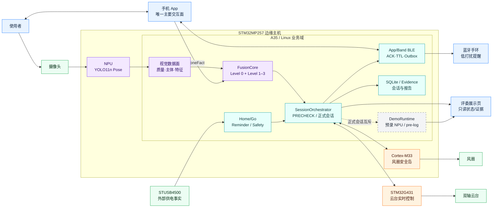

关键边界：摄像头与供电是输入；云台和风扇是受控执行器；App 双向交互；手环和展示页接收主机状态；Demo 不进入正式记录或提醒。

## C01 产品交互与信息流

回答：用户如何通过 App、主机、手环和展示页使用产品？

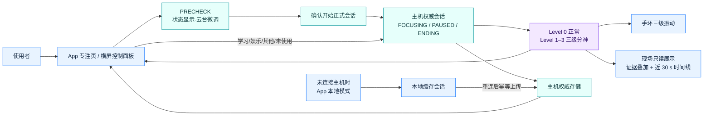

浏览器展示页不控制正式会话；App 生成本地模式结果，但连接主机后以主机作为权威存储，避免记录分裂。

## C02 软件运行域与类型化数据面

回答：主程序如何分域，并通过哪些稳定数据类型协作？

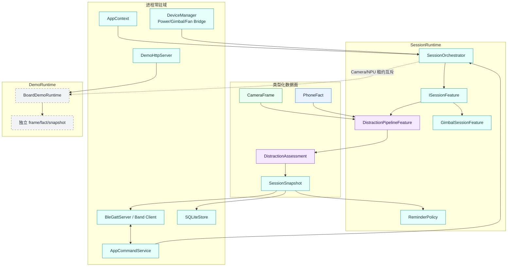

`CameraFrame → DistractionAssessment → SessionSnapshot` 是核心事实链；旧 JSON/兼容状态只允许作为边缘投影。

## C03 正式会话生命周期

回答：每个会话阶段允许哪些功能运行？

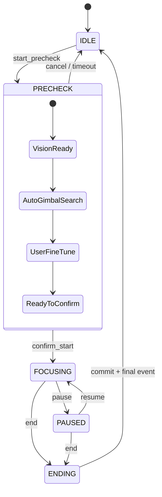

| Phase | Camera/NPU | Fusion/PhoneFact | 正式计时 | SQLite 会话记录 | 提醒 | 云台 |
|---|---:|---:|---:|---:|---:|---|
| IDLE | 按需关闭 | 否 | 否 | 否 | 否 | 保持/安全停机 |
| PRECHECK | 是 | 否 | 否 | 否 | 否 | 自动搜索 + 人工微调 |
| FOCUSING | 是 | 是 | 是 | 是 | 是 | 会话内跟踪 |
| PAUSED | 可低频 | 停止累计 | 暂停 | 保留 | 否 | 保持安全姿态 |
| ENDING | 停止并释放 | 收尾 | 停止 | 提交报告 | final event | 正常停止 |

PRECHECK 可以过视觉模型，但其结果不会进入正式 Fusion、episode、计时或记录。

## C04 Edge AI 感知、时序与 Fusion

回答：分神等级如何从可解释证据中产生？

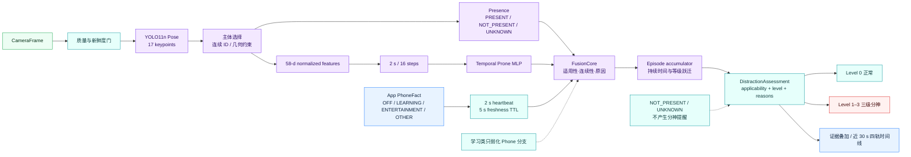

娱乐与其他类别互切不清空已累积的无关使用；切换到学习或未使用后才按策略清零或逐步下降。

## C05 App/手环跨设备可靠链

回答：连接、状态、提醒和断线恢复如何保持一致？

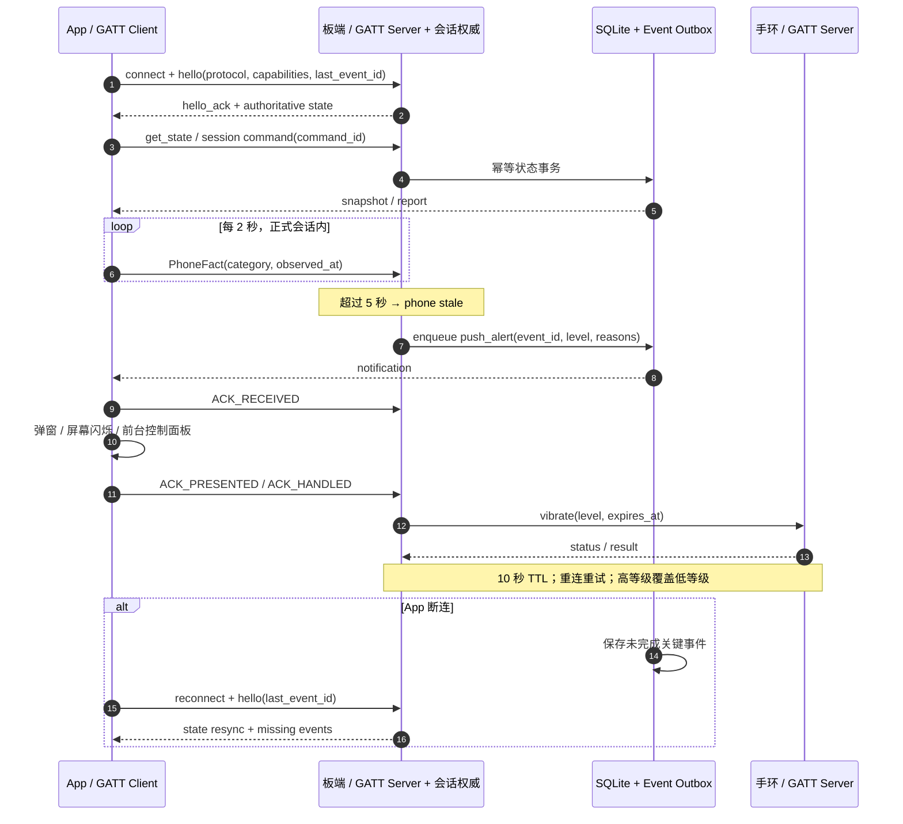

App 断连不停止主机会话；App 的 UI 状态必须从主机快照恢复，不能以本地按钮状态反推主机 phase。

## C06 A35/NPU/M33/G431 异构职责

回答：四个计算域如何分工并隔离故障？

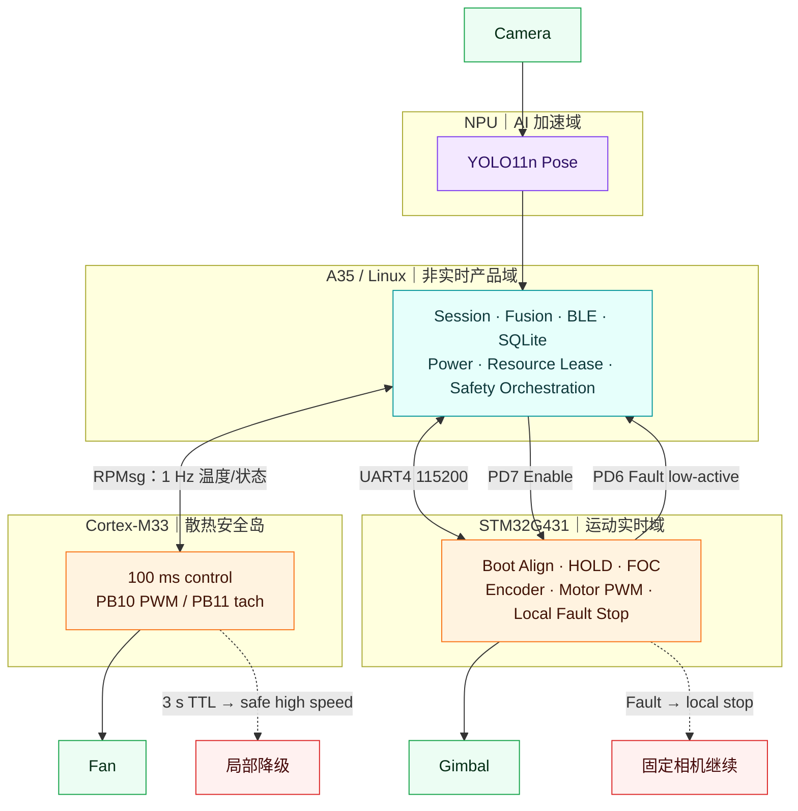

M33 不控制云台或供电，G431 不承担会话逻辑，A35 不直接生成电机相电流/PWM。

## C07 云台视觉控制与安全状态机

回答：云台如何完成预检、跟踪、人工控制和故障恢复？

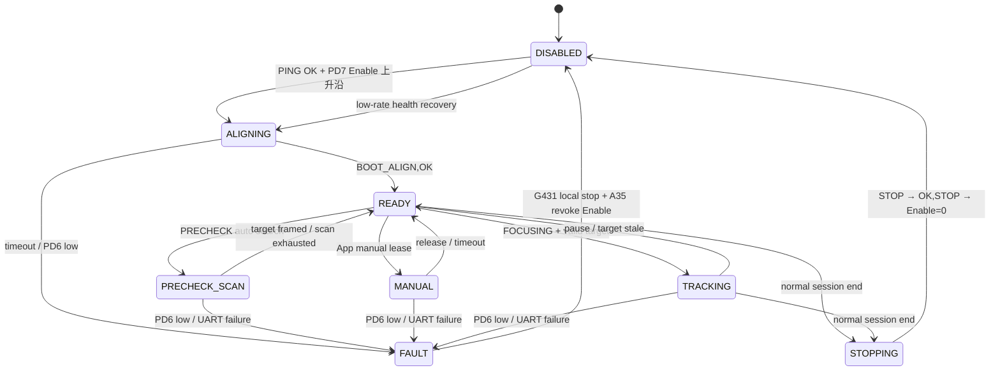

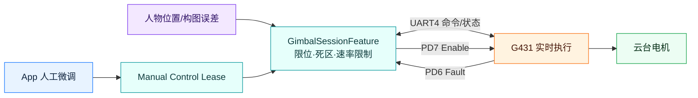

PD4 仅为 BOOT0 控制，不画成复位。故障路径不依赖先收到 STOP ACK；G431 本地先停驱动，A35 撤销 Enable 并停止目标下发。

## C08 M33 风扇闭环与启动回退

回答：散热如何跨核闭环，并在任一侧异常时保持安全？

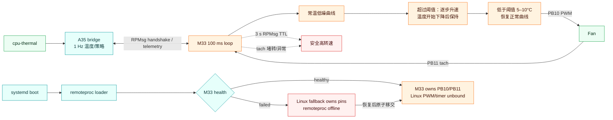

禁止 M33 与 Linux fallback 同时写 PWM/tach；所有权切换必须先释放旧控制者再启用新控制者。

## C09 外部供电与 Home/Go 性能策略

回答：外部供电如何改变业务性能，同时不降低安全能力？

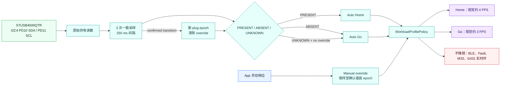

Home/Go 是工作负载档位，不是“插电/电池模式”的电量展示；硬件不具备电量读取时，产品不伪造百分比。

## C10 正式会话、预录 NPU 与 pre-log 隔离

回答：现场真实展示、预录推理和纯前端保底如何互不污染？

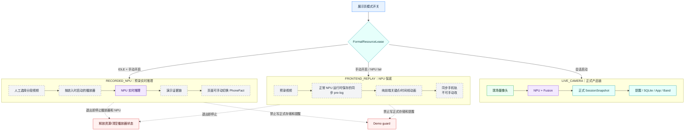

真实摄像头模式仍按正常会话启动；预录模式只是展示视觉推理链，不冒充正式会话。

## C11 故障降级矩阵

回答：每类故障由谁检测、如何降级、保留什么、怎样恢复？

| 故障域 | 检测信号 | 立即动作 | 保留能力 | 用户可见状态 | 自动恢复 / 责任域 |
|---|---|---|---|---|---|
| Camera / NPU | 打开失败、帧超时、推理 stale | 视觉置 UNKNOWN，停止使用旧证据 | 会话、手机事实、BLE | 视觉不可用/降级 | worker 限频重启 / A35 |
| PhoneFact | 超过 5 s TTL | 手机分支 stale | 独立视觉判断 | 手机状态未同步 | 心跳恢复即生效 / A35+App |
| App BLE | 断连、ACK 超时 | 关键事件进入 outbox | 推理、存储、手环 | App 重连中 | hello/get-state/幂等补发 / A35+App |
| 手环 BLE | 连接失败、10 s TTL | 重试或丢弃过期低优先级提醒 | App 提醒、正式会话 | 手环未连接 | 周期搜索、等级覆盖 / A35 |
| SQLite | 事务/磁盘错误 | 保留内存快照，不伪报已落盘 | 实时判断与提醒 | 记录保存异常 | 限次重试并上报 / Storage |
| G431 / Fault | PD6 低、UART/对齐失败 | G431 本地停驱动；A35 撤销 PD7并停止目标 | 固定相机视觉、会话 | 云台已降级 | 低频检查后重新对齐 / A35+G431 |
| M33 / RPMsg | 3 s TTL、health 失败 | 安全高转或互斥切 Linux fallback | 会话与 AI | 散热安全模式 | health 恢复后原子移交 / M33+A35 |
| STUSB4500 | I2C 失败、样本不一致 | UNKNOWN；无覆盖时 Go | 全部安全链 | 供电未知/Go | 周期采样，确认插拔清覆盖 / Power |
| Demo 资源冲突 | Camera/NPU lease 失败 | Demo 不启动或转 pre-log | 正式会话 | 演示资源占用 | 正式资源释放后再试 / DemoRuntime |
| 新 release | health check 失败 | 不切换或原子回滚 | 上一 release | 更新失败/已回滚 | 保留诊断 / Deploy |

安全优先级：散热安全与云台停机优先于体验；正式会话数据一致性优先于演示；过期证据一律失效而不是沿用。

## C12 构建、部署与回滚

回答：代码、模型与演示素材怎样安全到达板端？

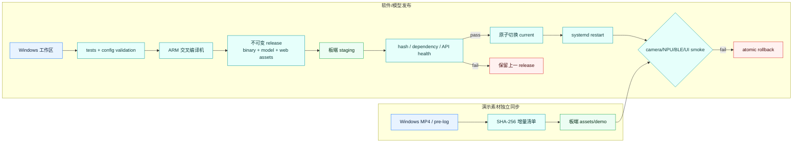

媒体文件不进入源码提交或 ARM release；软件回滚不会丢失独立素材，素材同步失败也不会替换正式程序。
