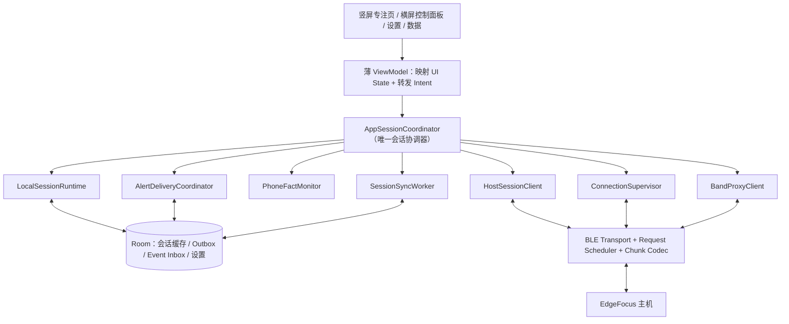
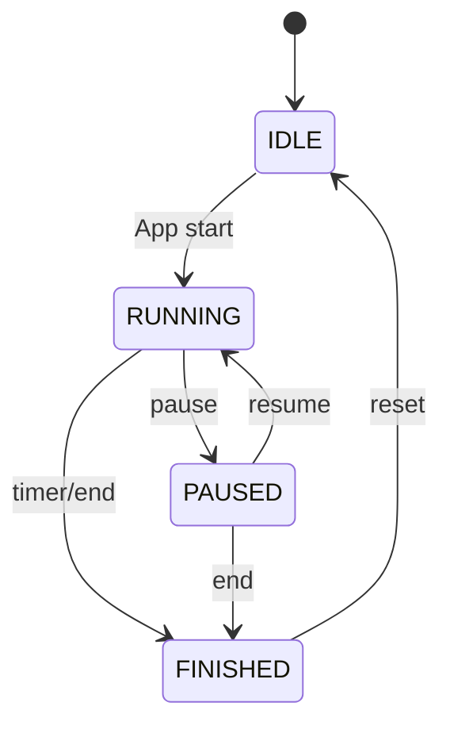
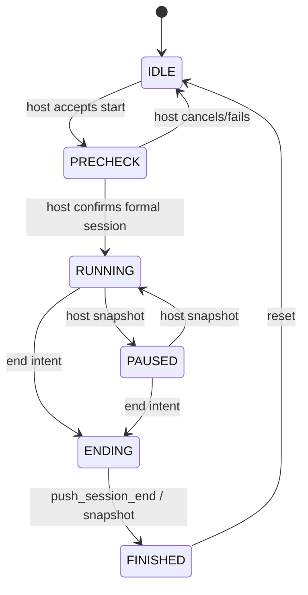

# EdgeFocus App 目标架构与修改规格

- 状态：设计基线，待用户审核
- 日期：2026-07-16
- 范围：Android App 的架构、页面职责、会话所有权、可靠性与功能收束
- 不包含：板端预录演示模式、纯前端演示模式、板端视觉模型实现
- 配套协议：[app-host-alignment-v3.md](../integration/app-host-alignment-v3.md)

## 1. 设计结论

App 保留 LOCAL 与 EDGEFOCUS 两种会话模式，但只保留一个会话协调器、一个状态源和一套页面组件。

- LOCAL：App 是当前会话运行权威，基于手机使用事实完成计时、提醒和结果生成；结果先持久化到 App，连接主机后幂等补传。
- EDGEFOCUS：主机是当前会话运行权威，App 只发送用户意图和手机原始事实，并展示主机快照、PRECHECK、提醒与结果。
- 持久记录：主机是跨模式的最终权威存储；App Room 是离线缓存、待同步队列和展示缓存。
- 页面：竖屏“专注页”和横屏“控制面板”布局不同，但消费同一状态、调用同一命令，不再分别拥有会话逻辑。
- 提醒：板载屏幕和声音已删除，屏幕弹窗/闪烁与声音由 App 执行，手环仍由主机代理执行。
- 预录演示：只属于主机展示页，不进入 App 协议和 App 产品页面。

## 2. 当前代码结论

### 2.1 保留

- `Settings.useEdgeFocusBoard` 作为模式选择，不增加每次开始前的模式弹窗。
- 主机模式未连接时禁用“开始”并显示原因，不自动降级到 LOCAL。
- `Session.source / synced / boardSessionId`、未同步查询、幂等 `upload_local_session` 与主机历史拉取方向。
- `client_hello / event_ack`、PRECHECK、外部供电/Home-Go、云台 capability gate 的协议方向。
- Debug BLE 模拟和日志页，但仅限 Debug 构建。

### 2.2 修改

- 将 `TimerStateHolder` 从“大一统运行类”拆为协调器和多个单一职责组件。
- 将会话保存、AppMonitor 生命周期、重连恢复从页面 ViewModel 移到进程级协调器。
- 将 BLE 传输、命令 facade、可靠事件、分片和业务状态解析分层。
- 竖屏与横屏共用 PRECHECK、提醒、连接状态、手环状态和会话命令。
- 手机上报改为原始事实心跳；App 不向主机上报分神等级。
- 主机模式断连时只显示陈旧快照，不在 App 本地暂停、结束或完成主机会话。

### 2.3 删除

- 电量百分比、充电状态、默认 `67%` 及旧 `power_source`。
- 板载屏幕、板载声音及其输出路由设置。
- “困倦/疲劳/建议休息”状态、文案、映射和测试。
- 正式链路中的 `phone_distraction_level`、旧 `reminder_ack` 和手机端最终等级。
- 无生产调用且不能重连的 `BleForegroundService` 现实现。
- 页面 ViewModel 各自保存会话、各自启停 `AppMonitorService` 的逻辑。

## 3. 目标组件图



## 4. 单一状态源

`AppSessionCoordinator` 是 `@Singleton`，向所有页面暴露一个不可变 `AppUiSnapshot`。页面不得自行推断会话完成、连接恢复或同步成功。

建议状态结构：

```text
AppUiSnapshot
├─ selected_mode: LOCAL | EDGEFOCUS
├─ connection: DISCONNECTED | CONNECTING | NEGOTIATING | READY | DEGRADED
├─ session
│  ├─ owner: APP | HOST
│  ├─ phase: IDLE | PRECHECK | RUNNING | PAUSED | ENDING | FINISHED
│  ├─ session_id
│  ├─ remaining_ms / target_ms
│  ├─ snapshot_revision / stale
│  └─ result
├─ precheck
├─ phone_fact
├─ alert
├─ band
├─ power
└─ sync
```

页面 ViewModel 只负责：

1. 将 `AppUiSnapshot` 映射成页面文案与可用性；
2. 转发 `Start/Pause/Resume/End/AckAlert/PrecheckAction`；
3. 保存纯页面状态，例如当前 Pager 页码。

## 5. 双模式所有权

| 事项 | LOCAL | EDGEFOCUS |
|---|---|---|
| 会话计时 | App | 主机 |
| 会话 ID | App 生成 UUID | 主机返回 |
| 视觉判断 | 无 | 主机 |
| 手机事实分类 | App | App 采集，主机融合 |
| 最终分神等级 | App 的本地手机策略 | 主机 |
| 提醒决策 | App | 主机 |
| App 屏幕/声音执行 | App | App 按 `push_alert` 执行 |
| 手环执行 | 无主机时不可用；有主机也不加入当前 LOCAL 会话 | 主机代理 |
| 当前会话结果生成 | App | 主机 |
| 最终记录存储 | 先 App，后补传主机 | 主机，App 缓存 |

规则：会话开始后 `owner` 冻结。LOCAL 会话中途连上主机，不迁移为 EDGEFOCUS；只允许后台补传已经结束的 LOCAL 记录。

## 6. 会话状态机

### 6.1 LOCAL



LOCAL 结果在进入 `FINISHED` 前以事务写入 Room，同时插入同步 Outbox。是否连接主机不影响本地完成。

### 6.2 EDGEFOCUS



App 发出的 pause/resume/end 只是 intent。只有主机响应或更新后的快照能改变 EDGEFOCUS phase。断连时禁止本地完成、禁止把倒计时到零当作主机会话结束。

## 7. 连接与恢复

连接建立不是 `GATT CONNECTED` 即可用，完整阶段为：

```text
DISCONNECTED → CONNECTING → SUBSCRIBED → NEGOTIATING → READY
```

READY 条件：

- GATT 已连接；
- notification 已订阅；
- `client_hello` 成功；
- 已收到或主动读取当前状态；
- 已建立本次 GATT 的本地 `connection_epoch`；若主机声明 `state_revision_v1`，同时记录 `boot_id + state_revision`。

恢复规则：

- LOCAL：连接变化不影响当前会话。
- EDGEFOCUS：断连后界面保留最后快照并标记“状态可能已过期”，会话控制按钮暂时禁用。
- 重连后重新协商，以主机快照覆盖 App 缓存；不得按 App 旧 phase 向主机回写。
- 当前主机 `schema_version=2.1` 尚无 `boot_id/state_revision`，App 必须能够直接配套：同一连接内按接收顺序应用，重连后强制 `get_current_state` 覆盖旧缓存。未来协商到 `state_revision_v1` 后再按 revision 丢弃乱序快照，不能把该可选能力写成当前连接的硬门槛。
- PRECHECK、RUNNING、PAUSED、ENDING 都必须支持恢复。
- 自动重连采用有上限退避；用户可在设置页主动重试主机连接。

## 8. 手机事实与本地监控

`PhoneFactMonitor` 负责前台应用类别和交互状态，不负责主机分神等级。

事实类别：

- 未使用：`active=false`；
- 学习：`active=true, category=learning`；
- 娱乐：`active=true, category=entertainment`；
- 其他/未知使用：`active=true, category=other`。

必须区分以下状态：

| 情况 | 处理 |
|---|---|
| App 自己在前台 | 未使用手机做无关事项 |
| App 纯黑屏保 | 未使用；不得记为 unknown app |
| 系统屏幕关闭/设备非交互 | 未使用或证据不可用；不得上报强干扰 |
| 缺少 Usage Access | `UNKNOWN_PERMISSION`，提示授权，不制造分神 |
| UsageEvents 短暂空洞 | 短期沿用有 TTL 的最近可信事实，过期后 UNKNOWN |
| 真实切到其他 App | 按用户配置映射 learning/entertainment/other |

EDGEFOCUS 正式进入 RUNNING 后立即发送一次，之后每 2 秒心跳；PRECHECK 不发送。LOCAL 则由本地策略消费，不发给主机。

## 9. 提醒交付

`AlertDeliveryCoordinator` 统一处理主机提醒和 LOCAL 提醒，页面不直接消费一次性 `lastAlert`。

### 9.1 前台

- SCREEN：在任意前台页面之上显示全局提醒层，可按等级使用弹窗、边框闪烁或全屏强调。
- SOUND：按事件音量播放一次；同一 `event_id` 不重复播放。
- 用户确认后关闭并发送 `user_ack`。

### 9.2 后台、黑屏系统锁定或 App 不可见

- 使用 Android 高优先级通知与振动；不依赖 Compose 页面存在。
- 通知点击回到当前会话页。
- `presented` 只在系统确认通知已投递或前台效果已启动后发送。

### 9.3 可靠性

- 关键事件先写入 Event Inbox，再 ACK `received`。
- 以 `event_id` 去重，执行记录持久化，重启/重放不重复出声或闪屏。
- 多提醒使用队列，不用单个覆盖槽。
- 事件过期后不再展示，但保留诊断结果。

## 10. 纯黑屏屏保与防锁屏

这是 App 内部功能，不是系统锁屏：

- App 任一正式前台 Activity 均设置 `FLAG_KEEP_SCREEN_ON`，无论屏保开关是否开启，都不允许系统自动锁屏。
- 屏保开启时，空闲达到用户设置时长后覆盖纯黑页面；CPU、BLE、会话和通知保持运行。
- 首次触摸只退出黑屏，不透传给底层按钮。
- 收到需要 SCREEN 的提醒时自动点亮 App 视觉层并展示提醒。
- 用户可在设置页关闭屏保或调整等待时间；建议默认 2 分钟，提供 30 秒、1/2/5/10 分钟。
- App 进入后台后不伪造黑屏前台，交给系统通知渠道。

## 11. PRECHECK

竖屏专注页和横屏控制面板复用同一个 `PrecheckPanel`：

- 显示真实低带宽预览图，不只显示宽高/序号；
- 显示画面时间、是否过期、相机/人物/距离/姿态提示；
- 自动云台搜索过程显示状态；
- 仅在 capability、session、manual lease 和安全门均满足时显示方向微调；
- 用户确认位置后再进入正式会话；
- 主机不允许跳过时隐藏“跳过”，不能本地伪装成功。

预览使用低优先级队列，不得阻塞事件 ACK、会话控制和 2 秒手机心跳。退出 PRECHECK 后停止请求预览。

## 12. 手环代理

App 不直接连接手环。主机作为 Central 管理手环，App 只查看状态并请求搜索/重连。

两个入口必须复用同一组件：

- 竖屏设置页；
- 横屏控制面板的设置页。

显示：可用性、连接状态、设备名、最后一次成功时间、当前重试、最近错误。允许用户执行“搜索并连接/重新连接”，但不能直接发送提醒帧、设置底层 MAC 或绕过主机队列。

## 13. 数据与同步

Room 建议新增：

```text
session_records       现有会话展示缓存
sync_outbox           LOCAL 会话待补传任务
event_inbox           主机关键事件去重与处理阶段
connection_checkpoint 最近 boot_id/revision，仅用于诊断与恢复
app_settings          模式、屏保、屏保时长、主机 MAC
```

`sync_outbox` 与 LOCAL 会话结果同事务写入。Worker 在网络/BLE READY、App 启动、主机重连时重试；主机按 `session_id` 幂等。成功后同事务标记 Session.synced 并保存 `boardSessionId`。

主机历史同步属于进程级仓库任务，不绑定 Dashboard 页面是否打开。冲突规则：

- EDGEFOCUS 记录以主机版本覆盖 App 缓存；
- LOCAL 上传前以 App 结果为准；上传确认后以主机返回 ID/存储确认补齐，不改写原统计；
- 同一 `session_id` 不重复计入今日统计。

## 14. 页面规格

### 14.1 竖屏专注页

- 保留模式、连接状态、时长和开始/暂停/继续/结束；
- EDGEFOCUS 未 READY 时禁用开始并显示原因；
- 主机开始后原地进入 PRECHECK；
- 会话中显示主机权威 phase、剩余时间和当前提醒，不暴露旧 risk/focus_state 数字；
- 蓝牙状态可点击进入主机连接详情。

### 14.2 横屏控制面板

- 与竖屏共用会话与 PRECHECK 行为；
- 增加本次会话统计和更完整的设备状态；
- 设置页提供 App 提醒表现、手环代理状态、Home/Go 临时切换；
- 删除板端屏幕/声音、虚假电量、困倦和手机端等级控件。

### 14.3 设置页

- 模式开关；
- 主机绑定、连接状态与主动重连；
- 手环代理状态与主动搜索/重连；
- 分心应用分类（学习/娱乐/其他）；
- 屏保开关与黑屏等待时间；
- App 声音/屏幕提醒设置。

### 14.4 数据页

- 本地与主机记录统一展示来源、同步状态和结果完整性；
- 证据不足/提前结束不可显示“全程专注”；
- 历史同步不依赖打开页面；
- 反馈只保留 `too_much / too_little / just_right` 一套枚举。

## 15. 建议代码边界

```text
data/ble/
  BleTransport
  BleRequestScheduler
  BleChunkCodec
  ConnectionSupervisor
data/session/
  SessionRepository
  SessionSyncOutbox
  HostEventInbox
domain/session/
  AppSessionCoordinator
  LocalSessionRuntime
  HostSessionClient
domain/phone/
  PhoneFactMonitor
domain/alert/
  AlertDeliveryCoordinator
domain/band/
  BandProxyClient
presentation/shared/
  PrecheckPanel
  AlertOverlay
  ConnectionStatus
  BandStatusPanel
```

## 16. 实施顺序

1. 协议模型、连接协商、状态 revision、事件 Inbox/ACK；
2. 唯一 `AppSessionCoordinator` 与双模式状态机；
3. LOCAL 结果事务 + Outbox 补传；
4. 手机事实心跳和锁屏/屏保语义；
5. 全局提醒交付；
6. 竖横屏共用 PRECHECK 与实际预览；
7. 手环代理页面与命令；
8. 删除旧电量、困倦、板端输出、手机端等级；
9. 数据页和设置页收束；
10. 集成测试、断线测试与实机联调。

## 17. 验收条件

- 页面切换、旋转或 Activity 重建不会生成第二个会话、重复保存或丢失会话 ID；
- LOCAL 离线结束后重启 App，后续连接仍能补传且只存一条；
- EDGEFOCUS 在 PRECHECK/RUNNING/PAUSED 任意阶段断连后不被 App 本地完成，重连后与主机一致；
- 黑屏屏保和系统非交互不会产生强手机干扰；
- 关键提醒重放不重复出声/闪屏，ACK 阶段可恢复；
- 竖屏与横屏均能完成同一 PRECHECK 流程并看到真实预览；
- 手环断线状态能在两处设置入口看到并主动请求主机重连；
- App 不再显示电量、困倦、板端屏幕/声音或手机端最终等级；
- 主机模式未连接时开始按钮保持禁用，本地模式仍可离线开始。
