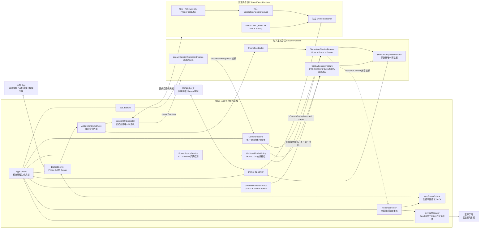
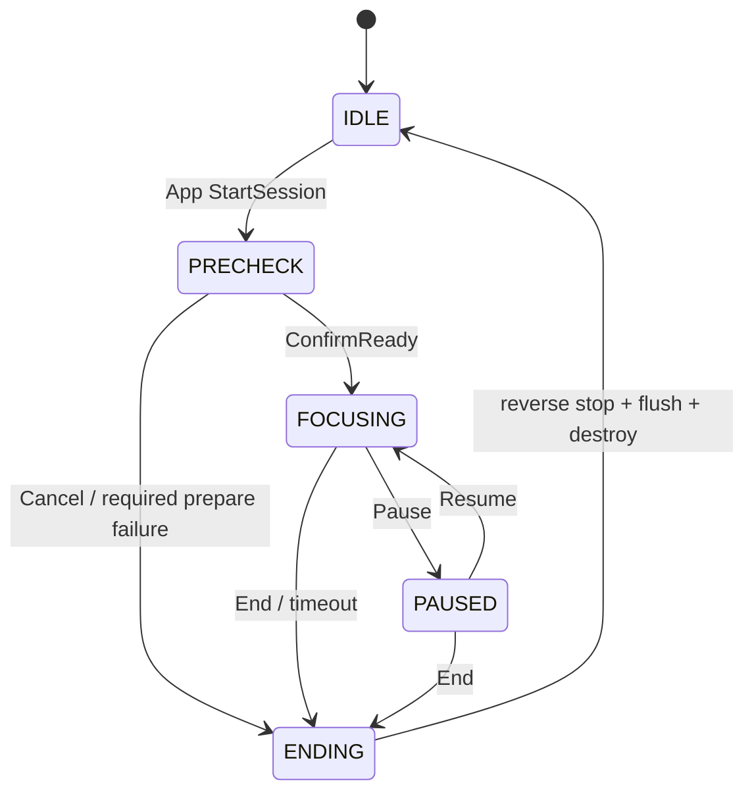
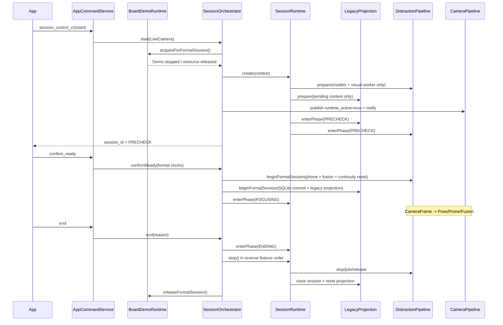
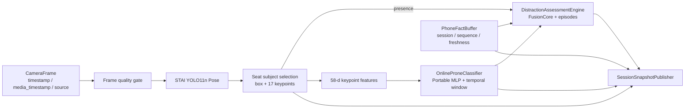
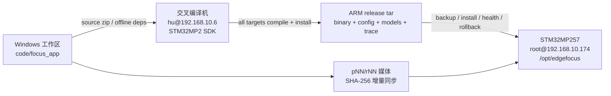
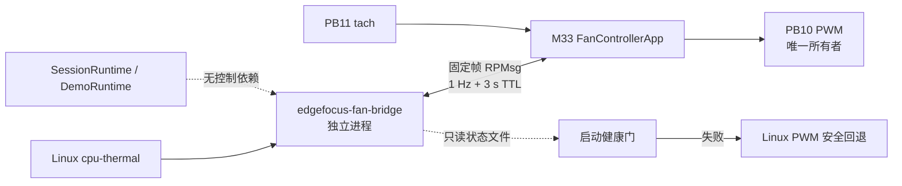
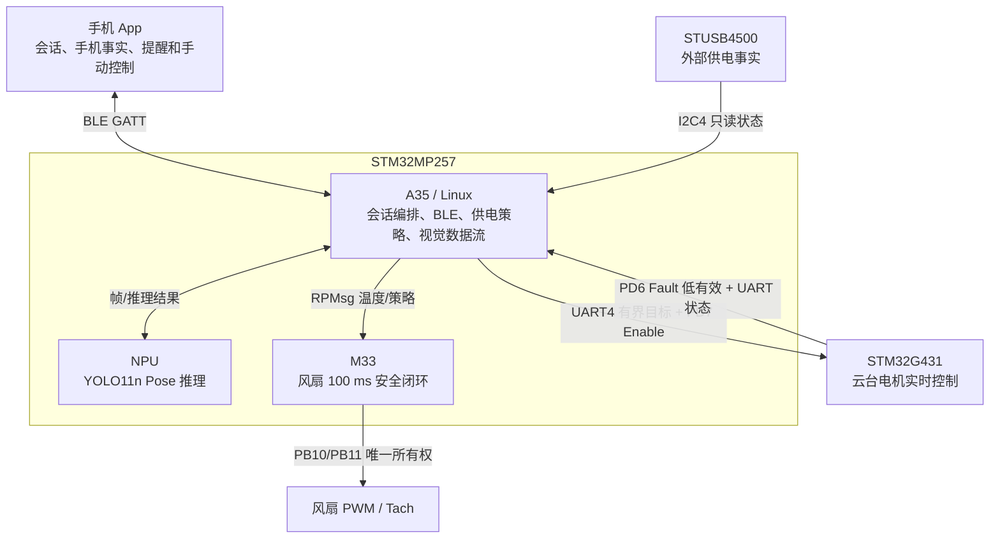

# EdgeFocus 主程序当前架构基线

- 更新时间：2026-07-17
- 适用仓库：`code/focus_app`
- 当前板端服务：`focus_app.service`
- 当前已验证发布：`/opt/edgefocus/releases/20260715-221512`

## 1. 文档定位

这份文档描述当前工作树和板端已验证版本的实际架构，供开发者与 agent 快速接手。
它不是理想化重构图，也不把历史规划当成已经落地的代码。

文档优先级：

1. [`edgefocus-complete-architecture.md`](edgefocus-complete-architecture.md)（最终产品架构与统一术语）。
2. 当前源码与测试。
3. 本文档（代码级运行边界与导航）。
4. [`app-band-protocol-v2.1.md`](../integration/app-band-protocol-v2.1.md)（正式跨设备协议）。
5. [`2026-07-14-focus-app-session-architecture.md`](../superpowers/specs/2026-07-14-focus-app-session-architecture.md)（会话架构设计依据）。
6. [`2026-07-14-cross-device-demo-and-bluetooth-contract.md`](../superpowers/specs/2026-07-14-cross-device-demo-and-bluetooth-contract.md)（展示与可靠通信设计依据）。
7. [`2026-07-16-main-gimbal-integration-design.md`](../superpowers/specs/2026-07-16-main-gimbal-integration-design.md)（当前正式云台搜索、追踪与安全停机依据）。

如果旧阶段记录与最终产品基线冲突，以完整架构母文档为准；代码差异应作为收敛任务，不得把旧阶段状态重新写入海报或产品说明。

## 2. 一句话架构

EdgeFocus 是一个运行在 STM32MP257 Linux/A35 侧的会话中心程序：进程级服务负责蓝牙、存储、外部供电检测、设备和展示接入；`SessionOrchestrator` 先创建隔离的 PRECHECK runtime，确认后才把它提交为正式专注会话；新视觉/手机 Fusion 核心产生唯一分神判定；云台由实测配置与运行时健康门自动决定是否参与；独立 `BoardDemoRuntime` 在无正式会话时提供预录 NPU 与 pre-log 回放。

## 3. 当前顶层组件图



## 4. 三个运行域和所有权

### 4.1 进程级常驻域

`main.cpp` 创建并由 `AppContext` 启停的主要模块：

| 模块 | 线程常驻 | 硬件/业务资源何时活跃 | 当前职责 |
|---|---:|---|---|
| `HealthMonitor` | 是 | 始终 | 进程存活日志 |
| `CameraPipeline` | 是 | typed runtime 处于 PRECHECK/FOCUSING/PAUSED | 唯一现场 `VideoCapture`、共享预览、FrameQueue |
| `DeviceManager` | 是 | BLE 按配置；动作按队列 | 手环连接与设备动作诊断 |
| `ReminderPolicy` | 是 | 仅 FOCUSING | 从兼容 BehaviorContext 生成提醒 |
| `SQLiteStore` | 是 | 按事件 | 会话、事件、报告持久化 |
| `PowerSourceService` | 是 | 始终低频只读 | 从 `/dev/i2c-1` 的 STUSB4500 `0x2A` 读取外部供电事实，不读取/伪造电量 |
| `WorkloadProfilePolicy` | 随进程对象存在 | 供电变化或 App 显式覆盖 | 外部供电默认 Home、无外部供电默认 Go；手动覆盖到下一次确认的供电转换 |
| `GimbalHardwareService` | 是 | 运行时健康门通过时运动；异常时固定相机降级 | 独占 UART4 与 PD4/PD6/PD7；I/O/Fault 异常时撤销 Enable，并低频检查恢复 |
| `BleGattServer` | 是 | BlueZ 可用时 | App GATT Server、命令、事件推送 |
| `BoardDemoRuntime` | 可选 | 无正式会话且人工启动 | 独立预录 NPU / 前端回放 |
| `DemoHttpServer` | 可选 | `--demo-http-port` | 展示页与 Demo 本地控制 |

“线程常驻”和“资源常驻”必须分开理解。IDLE 时 `CameraPipeline` 线程仍存在，但会关闭相机并等待会话变化；正式视觉模型只存在于活动 `DistractionPipelineFeature` 中。

### 4.2 正式 SessionRuntime

当前每次正式会话创建两个 required feature，并挂载一个可局部降级的云台 feature：

1. `DistractionPipelineFeature`
   - PRECHECK 只创建 Pose/Prone 模型与视觉 worker。
   - Confirm 时才创建 PhoneFact/Fusion session，并清空 PRECHECK 帧、主体框和 Prone/Fusion 连续性。
   - 消费唯一相机队列并更新 `SessionSnapshotPublisher`。
   - 暂时把正式 assessment 映射回旧 `BehaviorContext` 供提醒链消费。
2. `LegacySessionProjectionFeature`
   - PRECHECK 只保存待提交 context，不建立 SQLite row、不投影 `session.active`。
   - Confirm 时作为最后一个 required 初始化步骤建立 SQLite session row。
   - 把新 Phase 投影到旧 `SystemStateStore.session` 与 `FocusState`。
   - 唤醒/关闭 `ReminderPolicy` 等迁移消费者；相机已直接读取 typed runtime。
   - 它是迁移适配器，不是新增业务状态的入口。

3. `GimbalSessionFeature`（正式能力，可局部降级）
   - 只消费正式视觉快照，不打开第二个摄像头。
   - G431 对齐成功后才启动搜索计时；PRECHECK 先观察当前画面，再执行 yaw ±45° / pitch ±20° 常规搜索；仍未找到时按 50° 垂直视场生成全俯仰恢复节点，搜索第 72 秒停止排新节点、第 75 秒绝对结束。
   - Pose 快速触发后先读取实际角度并冻结；随后复用同一 `GimbalVisualTracker` 把肩部/上半身目标移入推理友好区域，连续两帧丢失则恢复原扫描节点。
   - 居中后再次冻结并在 1.2 秒内采集三帧构图分数；至少两帧合格才 HOLD 并交出手动租约。超时或无目标时验证回参考中位后进入手动。
   - FOCUSING 内根据 Pose 上半身目标执行闭环跟踪；PAUSED 只 HOLD 并清空旧追踪目标；Resume 从新视觉帧重新建立连续性。
   - 健康结束时先验证回参考中位，再执行 `STOP → OK,STOP → motion_off` 校验并禁用；停止操作幂等，Ending/feature stop/析构不会重复发命令。故障结束跳过回中，安全停机优先。
   - UART、PD6、对齐或运行状态任一失败，PRECHECK 运动与后续跟踪能力共同降级；硬件服务维持 PD7 安全态并低频探测。连续健康后重新对齐，再按当前 phase 恢复搜索或 HOLD。
   - App 命令必须携带当前 `session_id` 与严格递增 `sequence`，且只在 PRECHECK 生效。

云台 feature prepare/运行失败只使会话进入 degraded；G431 本地先停驱动，A35 撤销 Enable 并停止目标下发，主视觉/Fusion/BLE 继续运行。健康检查恢复后重新对齐，再按当前 phase 恢复 PRECHECK、HOLD 或跟踪。

required feature prepare 失败会终止会话启动；optional feature 失败只进入 degraded list。

### 4.3 DemoRuntime

`BoardDemoRuntime` 不复用正式会话的数据面，内部拥有：

- 独立 `FrameQueue`。
- 独立 `PhoneFactBuffer`。
- 独立 `SessionSnapshotPublisher`。
- 需要时创建独立 `DistractionPipelineFeature`，并关闭 compatibility publication。
- 独立 preview store 和播放游标。

正式会话 start hook 会先 `acquireForFormalSession()`：设置正式租约、停止 Demo、释放视频/NPU；正式会话结束后才释放租约。两个运行域不能并存。

## 5. 正式会话状态机



PRECHECK 会话本身没有固定超时：准备完成后可无限等待 App 重连，只有显式 `confirmReady`、显式取消、required prepare 失败或进程关闭才离开。云台约 75 秒的硬截止只结束自动搜索并交出 `manual_lease`，不会结束 PRECHECK 会话。

| Phase | 相机 | NPU/视觉 | Fusion/episode | 提醒 | 手机事实 |
|---|---|---|---|---|---|
| IDLE | 关闭 | 不存在 | 不存在 | 禁止 | 不接受正式 session fact |
| PRECHECK | 正常采集 | 约 4 FPS 视觉证据 | Phone/Fusion session 尚未建立 | 禁止 | 拒绝，返回 `formal_session_not_started` |
| FOCUSING | 正常采集 | Home 约 4 FPS；Go 约 3 FPS | 正式累计与分级 | 允许 | App 变化即时上报 + 2 秒心跳 |
| PAUSED | 约 1 FPS | 约 1 FPS presence/快速恢复 | 不累计正式 episode | 禁止 | 保持连接 |
| ENDING | 停止 | stop/join/释放模型 | 关闭 episode | 禁止新提醒 | endSession |

`SessionOrchestrator` 使用互斥锁串行化转移；重复 start 在已有会话时幂等返回当前 context。正式请求只允许 `SourceMode::LiveCamera`。

## 6. 正式启动与停止时序



## 7. 判定数据流与稳定契约



### 7.1 PhoneFact

关键字段：`session_id`、递增 `sequence`、板端接收单调时间、App 来源时间、`active`、`category`、`fresh_for_ms`。学习类只弱化手机分支，不覆盖独立 Prone 视觉证据。断连/过期产生 stale/unknown，不伪造未使用。

### 7.2 DistractionAssessment

- `applicability = ACTIVE | NOT_PRESENT | UNKNOWN`
- `level = 0..3 | null`
- `reasons[]`
- distraction/presence/prone episode
- `would_remind`

`NOT_PRESENT` 与 `UNKNOWN` 的 level 必须为 null，不应产生提醒。

### 7.3 SessionSnapshot

`SessionSnapshotPublisher` 是新会话数据的单写者和 UI/App/Demo 新接口的首选读取面。`updateEvidence()` 在一个临界区内更新 Visual、Phone 和可选 Assessment，防止跨帧拼接。

当前 `AppCommandService` 仍是兼容门面，部分响应混合新 snapshot 与旧 `SystemStateStore` 字段；新增协议字段应优先来自 snapshot，不要继续扩大旧对象。

## 8. 当前提醒与跨设备链

当前提醒链尚未完全摆脱兼容层：

```text
DistractionAssessment.level
  -> publishCompatibility(): BehaviorContext.risk_score 0/25/60/90
  -> ReminderPolicy: 重新映射 CommandLevel 0/1/2/3 + cooldown
  -> NotificationRouter
      -> App: SystemStateStore.pushEvent -> AppEventOutbox -> BleGattServer notify
      -> Band: DeviceManager -> BleBandController async queue -> BlueZ write
```

这是迁移桥，不是推荐的新扩展点。后续应让 ReminderPolicy 直接消费 `DistractionAssessment/ReminderSnapshot`，删除 level→risk→level 的往返映射。

### 8.1 App 通道

- 板端角色：BlueZ GATT Server。
- 能力协商：`client_hello`。
- 手机事实：`phone_sync`，2 秒心跳、5 秒 TTL。
- 关键事件：`AppEventOutbox` 有界保存、重发和 event ACK。
- App 承担提醒文字与声音呈现。

BlueZ GATT 应用注册与 BLE 广播注册分别确认；只有两者都成功时主机才视为可发现。广播注册失败按 2/5/10 秒退避重试，收到 BlueZ `Release` 后立即作废旧回调并重新注册；广播恢复不阻断已建立 GATT 连接的通知。进程监听 `org.bluez` D-Bus owner，bluetoothd 消失时同时作废 GATT 与广播注册，owner 恢复后先完整重注册 Application，再注册 Advertisement。

### 8.2 手环通道

- 板端角色：BlueZ GATT Client。
- `BleBandController` 独立 writer thread。
- 三级帧 `[0x01, pattern, level]`。
- 10 秒 TTL、断连保留最新有效事件、重连重试、更高等级覆盖 pending。

App 和手环共享板端蓝牙适配器，但协议角色、连接状态和送达语义独立。

## 9. 展示架构

### 9.1 模式

| 页面入口 | 后端模式 | 是否运行 NPU | 手机来源 | 正式记录/提醒 |
|---|---|---:|---|---|
| 现场摄像头 | `LIVE_CAMERA` 等待窗 | 仅正式会话启动后 | App 蓝牙，只读 | 正式会话允许 |
| 预录 NPU | `RECORDED_NPU` | 是，独立 pipeline | 页面手动演示事实 | 禁止 |
| 纯前端演示 | `FRONTEND_REPLAY` | 否，显示 `NPU BYPASSED` | pre-log 同步轨迹 | 禁止 |

### 9.2 预录 NPU

- 从 `assets/demo/pNN.mp4` 按文件名连续轮换。
- 视频逐帧进入与正式会话同类型的 Pose/Prone/Fusion pipeline。
- 片段切换调用 `resetContinuity()`，避免跨视频时序污染。
- 连续 2 秒无新 NPU 证据或输入无法打开时自动进入前端回放。

### 9.3 纯前端 pre-log

- 从 `assets/demo/no_npu/segments/rNN.mp4` 连续轮换。
- 同名 `rNN.trace.json` 是完整源视频经过板端正常 NPU 链预跑后机械切分的真实轨迹。
- 页面按 `<video>.currentTime` 同步 Visual、Phone、Assessment、证据叠加和近 30 秒四轨时间线。
- 视觉字段不得人工填写；仅手机事实时间表允许在 pre-log 采集时人工注入。
- r04/r05 因正常写字严重驼背被误报为趴下，已从本机和板端删除。当前剩余 10 组，编号允许有空缺。

## 10. 并发、队列与时钟

- 正式相机只有一个 `CameraPipeline`；禁止第二个 `VideoCapture` 抢设备。
- 正式 FrameQueue 容量 3，覆盖旧帧，目标是新鲜度而非逐帧必达。
- 推理 worker 每次调度前排空到最新帧；Home/Go 只改变应用层视觉采样节奏，不改变相机所有权、BLE、供电检测、Fault 检查或 G431 内部控制频率。
- `VisionCadencePolicy` 当前为 PRECHECK 250 ms、FOCUSING Home 250 ms、FOCUSING Go 333 ms、PAUSED 1000 ms；Prone 仍按真实 2 秒媒体窗口重采样。
- 模型、Fusion 和 PhoneFact session 由 `DistractionPipelineFeature` 创建和销毁。
- Session phase 转移由 `SessionOrchestrator` 锁串行化。
- `SessionSnapshotPublisher` 通过单锁维护原子 snapshot 和 sequence。
- TTL、cooldown、evidence age、episode 使用 `steady_clock`；持久化另存 wall clock。
- Demo 有自己的生命周期递归锁，模式切换先 stop/join，再改变所有权。
- 媒体播放使用 media timestamp；正式现场证据使用 monotonic timestamp。

## 11. 当前禁用与保留代码

### 当前产品裁剪与应急开关

- 云台：正式产品能力由运行时 UART/Fault/对齐健康门决定是否运动；`EDGEFOCUS_DISABLE_GIMBAL=1` 仅保留为紧急维修开关。
- 板载屏幕：`EDGEFOCUS_DISABLE_LCD=1`，产品 UI 在 App/浏览器。
- 板载声音：`EDGEFOCUS_DISABLE_SOUND=1`，声音在 App。
- 困倦/闭眼疲劳、旧左右转头和视觉手机判定：不进入新生产判定链。

### 为什么源码还在

Screen、Sound 和部分旧 UI/行为文件为兼容测试保留；“文件存在/被编译”不表示产品入口启用。云台属于当前正式产品能力，不归入历史禁用代码。

## 12. 构建与部署



正式入口：`deploy_to_board.py`。

- 交叉编译选项：OpenCV、STAI MPU、Demo HTTP 开启。
- 每次构建所有 ARM 测试目标，作为编译契约检查。
- 二进制、模型和配置安装到新 release，切换前备份当前版本。
- 启动 `focus_app.service` 并读取 Demo state 做健康检查；失败恢复旧版。
- MP4 不进入源码压缩包，按 SHA-256 原子同步。

正常服务环境为：

```text
EDGEFOCUS_DISABLE_LCD=1
EDGEFOCUS_LCD_BACKEND=offscreen
EDGEFOCUS_DISABLE_SOUND=1
EDGEFOCUS_VISION_MODE=real
```

若需要紧急固定相机模式，可临时增加 `EDGEFOCUS_DISABLE_GIMBAL=1`；正常 unit 不设置该变量，也不再使用 `EDGEFOCUS_GIMBAL_FEATURE`。

## 13. 代码导航

| 想修改什么 | 先读哪些文件 |
|---|---|
| 会话阶段/资源所有权 | `session/SessionOrchestrator.*`, `session/SessionRuntime.*`, `main.cpp` |
| 视觉模型/Prone/Fusion | `vision/DistractionPipelineFeature.*`, `core/distraction/`, `behavior/DistractionAssessmentEngine.*` |
| 手机事实 | `behavior/PhoneFactBuffer.*`, `network/AppCommandService.*` |
| 对外状态 | `session/SessionDomain.h`, `session/SessionSnapshotPublisher.*` |
| App 蓝牙/可靠事件 | `network/BleGattServer.*`, `network/AppEventOutbox.*` |
| 手环 | `device/DeviceManager.*`, `device/BleBandController.*` |
| 外部供电/Home-Go | `platform/power/*`, `vision/VisionCadencePolicy.h`, `network/AppCommandService.*` |
| 云台安全/PRECHECK | `platform/gimbal/*`, `device/GimbalPrecheckController.*`, `device/GimbalSessionFeature.*`, `config/gimbal-board.json` |
| 提醒策略 | `policy/ReminderPolicy.*`, `policy/NotificationRouter.*` |
| 演示模式/网页 | `demo/BoardDemoRuntime.*`, `network/DemoHttpServer.*`, `assets/demo/README.md` |
| SQLite/报告 | `storage/SQLiteStore.*`, `storage/ReportGenerator.*` |
| 板端构建部署 | `CMakeLists.txt`, `deploy_to_board.py` |

## 14. 已知技术债与禁止扩散区

1. **新判定 → 旧 risk → 新提醒等级的往返映射。** 新功能不得继续依赖 risk 常量。
2. **`SystemStateStore` 仍承担兼容总线。** 新领域状态优先进入类型化 snapshot/事件，不增加整对象读改写。
3. **CameraPipeline 已迁到 typed runtime，提醒和部分设备仍依赖兼容投影。** 移除 `LegacySessionProjectionFeature` 前还需迁移剩余消费者。
4. **AppCommandService 混合新旧响应。** 新 App 与本版板端按同一协议同步升级；电量/旧 `power_source` 不再兼容，Home/Go 只能通过显式 `set_power_profile` 修改。
5. **屏幕/声音遗留代码仍可编译。** 两者保持生产入口禁用；云台已是正式 optional session feature，只有 `EDGEFOCUS_DISABLE_GIMBAL=1` 紧急维修覆盖或运行时健康失败才固定相机降级。
6. **Demo 媒体同步不应把回放当成真实推理证据。** 页面来源标签不可隐藏。

## 15. 新能力接入规则

增加任何模块前，先回答：

1. 它是进程级常驻服务、正式会话 required/optional feature，还是 Demo-only？
2. 谁拥有硬件句柄，其他模块通过什么类型化接口访问？
3. 它在哪些 Phase 启停？IDLE/PAUSED 是否应降功耗？
4. 失败时是阻止会话启动、终止会话，还是降级继续？
5. 状态进入哪个 snapshot，是否需要 App/手环协议？
6. 如何在主机、板端和故障注入下验证？

风扇/M33 已按上述边界实现到受控上板阶段：`platform/fan/core/` 是主机可测控制核心与固定协议，`platform/fan/bridge/` 是独立 A35 服务，`firmware/m33/fan_controller/` 包含便携任务和 ATK OpenAMP/HAL 适配。它们不链接进 `focus_app` 的会话/判定域，bridge 状态未来只允许作为只读健康信息。



当前 remoteproc ELF、TIM17_CH1N/PB10 PWM、PB11 EXTI tach、100 ms 控制循环、A35 温度 bridge、3 秒失联安全态和 bridge 停止/重启恢复均已在 `192.168.10.174` 实测通过。CH1N 板级适配保持 Linux 原型的逻辑语义：数值越小风量越大；34,000 ns 常温档约 660～1,140 RPM，8,000 ns 安全档约 5,760～5,900 RPM。资源切换脚本、M33 loader、bridge、启动健康门和 Linux PWM fallback 已安装，开机链经两次完整 systemd reboot 和一次物理断电重上电验收；风扇继续独立于主程序会话生命周期。详细状态和启用/回滚命令见 [`../hardware/stm32mp257-m33-fan-inventory.md`](../hardware/stm32mp257-m33-fan-inventory.md) 与 [`../hardware/m33-fan-service-operations.md`](../hardware/m33-fan-service-operations.md)。

### 15.1 异构职责总图



边界原则：A35 负责非实时业务与安全编排，NPU 只负责感知计算，M33 独占风扇闭环，G431 独占云台电机闭环。M33 不承担云台或充电控制；A35 不生成高速电机波形；任何协处理器失联都不得阻塞正式会话的基础视觉/手机 Fusion。

## 16. 架构变更验收清单

- [ ] IDLE 时相机、NPU、正式 Fusion 和提醒不工作。
- [ ] 每次正式 start 创建新 session_id、新模型/时序/Fusion 状态。
- [ ] Demo 与正式会话不能同时占用视觉资源。
- [ ] PRECHECK 不创建 SQLite/Phone/Fusion/episode/报告；PAUSED 不累计正式分神 episode 或发送提醒。
- [ ] App 手机事实具有 session、sequence 和 5 秒 freshness。
- [ ] NOT_PRESENT/UNKNOWN 不产生等级和提醒。
- [ ] App/Band 送达状态不在实际传输前标记成功。
- [ ] 云台仅在实测配置与运行时健康门通过时启用；任一故障立即停用运动/跟踪并低频探测恢复。板载屏幕、板载声音保持禁用。
- [ ] `git diff --check`、相关 host tests、ARM 全目标编译通过。
- [ ] 板端服务健康，失败部署可回滚。
- [ ] 本文档与 `AGENTS.md` 已同步更新。
