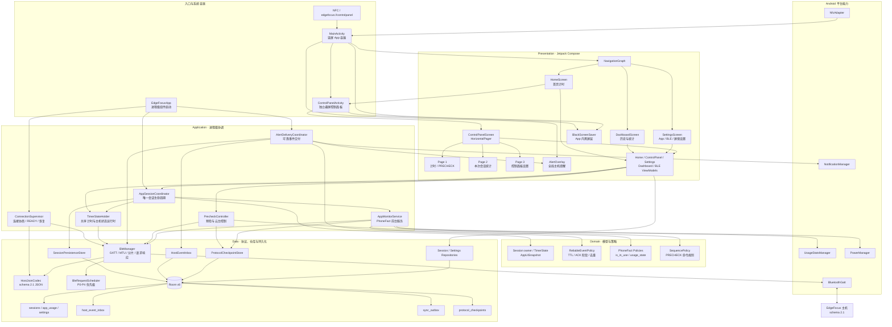
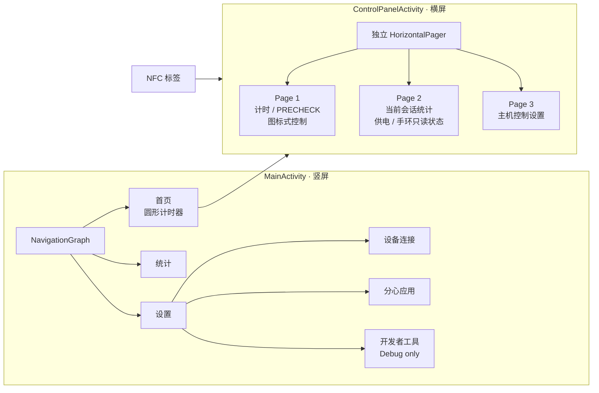
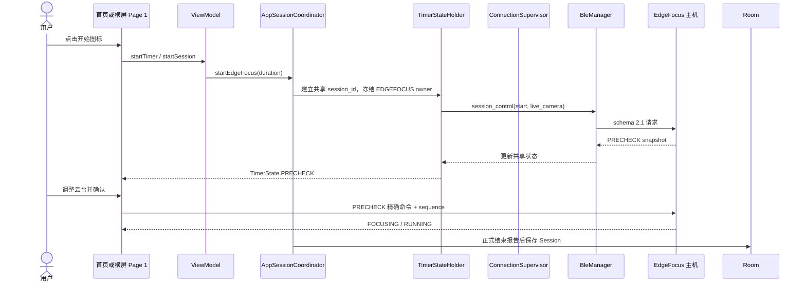
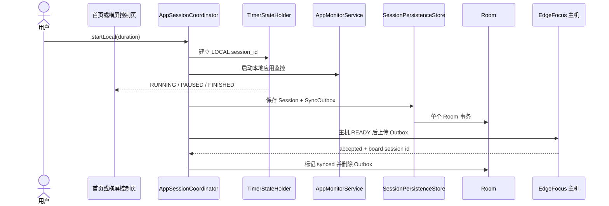
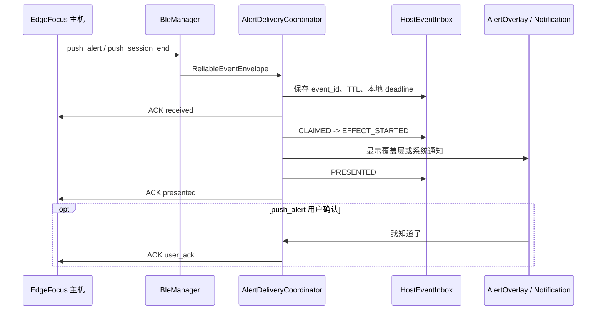
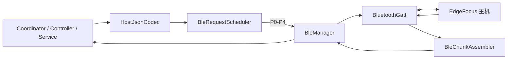
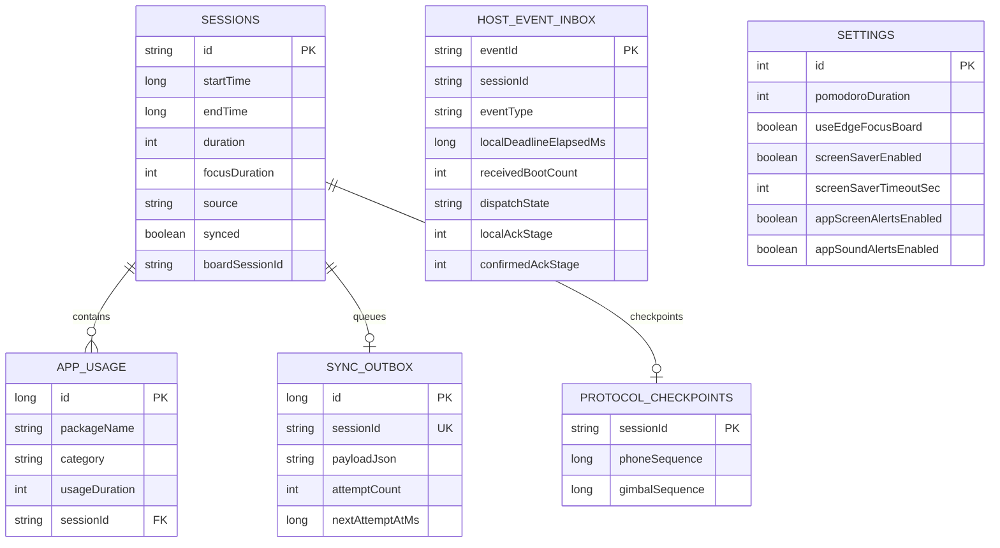

# EdgeFocus 新版 App 架构

> 版本：2026-07-16  
> 平台：Android 13 / Jetpack Compose / Hilt / Room / BLE GATT  
> 主机协议：EdgeFocus schema 2.1

## 1. 总体架构图



## 2. 页面架构



横屏控制面板是独立页面树，不是竖屏首页旋转后的横版；两个 Activity 读取同一个进程级会话状态。

## 3. 核心组件关系

| 组件 | 主要职责 | 主要依赖 |
|---|---|---|
| `EdgeFocusApp` | 启动进程级协调器、初始化设置 | Hilt、SettingsDao |
| `AppSessionCoordinator` | 唯一会话、owner 冻结、监控服务、Session/Outbox 保存 | TimerStateHolder、ConnectionSupervisor、SessionPersistenceStore |
| `TimerStateHolder` | 共享计时状态、主机状态映射、页面兼容状态 | BleManager、SettingsDao |
| `ConnectionSupervisor` | GATT 后 hello/state 协商、READY、自动重连 | BleManager、HostJsonCodec |
| `AlertDeliveryCoordinator` | Inbox、TTL、去重、通知/覆盖层、ACK | HostEventInbox、BleManager、NotificationManager |
| `PrecheckController` | 云台 sequence、精确命令、确认位置、等待 FOCUSING | ProtocolCheckpointStore、BleManager |
| `AppMonitorService` | UsageStats 采集、PhoneFact、2 秒心跳 | ProtocolCheckpointStore、BleManager |
| `BleManager` | BLE GATT、MTU、分片、请求 ID 和推送分发 | BluetoothGatt、BleRequestScheduler |
| `HostJsonCodec` | schema 2.1 请求与响应编解码 | org.json |
| `SessionPersistenceStore` | Session 与 Outbox 事务 | Room |
| `HostEventInbox` | 可靠事件状态和 ACK checkpoint | Room、elapsedRealtime、boot count |

## 4. EdgeFocus 会话数据流



## 5. LOCAL 会话数据流



## 6. 可靠事件数据流



## 7. BLE 协议栈



优先级：

- P0：可靠事件 ACK、PRECHECK 关键命令。
- P1：会话控制。
- P2：连接协商和状态读取。
- P3：PhoneFact、Outbox 等后台同步。
- P4：可取消的摄像头预览。

## 8. Room 数据结构



## 9. 源码目录映射

```text
com.edgefocus.app
├── MainActivity.kt
├── ControlPanelActivity.kt
├── EdgeFocusApp.kt
├── presentation
│   ├── navigation
│   ├── ui/home
│   ├── ui/controlpanel
│   ├── ui/dashboard
│   ├── ui/settings
│   ├── shared
│   └── viewmodel
├── domain
│   ├── session
│   ├── alert
│   ├── precheck
│   ├── model
│   └── repository
├── data
│   ├── ble
│   │   └── model
│   ├── remote
│   ├── local
│   │   ├── entity
│   │   └── dao
│   ├── session
│   └── repository
├── service
└── util
```

## 10. 架构原则

1. App 进程只有一个有效会话，竖屏与横屏共享相同 session_id。
2. NFC 只负责进入独立横屏控制面板，不改变 LOCAL/EDGEFOCUS owner。
3. EdgeFocus 会话以主机 runtime snapshot 和正式结束报告为准。
4. LOCAL 会话先可靠保存，再异步通过 Outbox 同步主机。
5. 可靠推送先写 Inbox，再执行通知、声音或振动。
6. 所有 phone/gimbal sequence 在发送前写入 checkpoint。
7. BLE GATT CONNECTED 不等于业务 READY；必须完成 schema 2.1 协商。
8. 主机 capability 未声明的功能只读展示，不在 App 端假设可控制。

