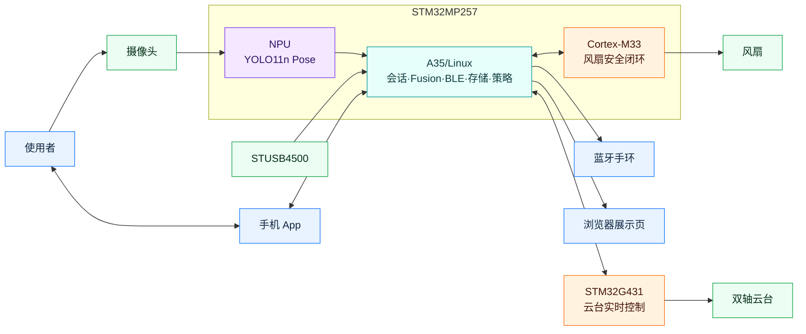
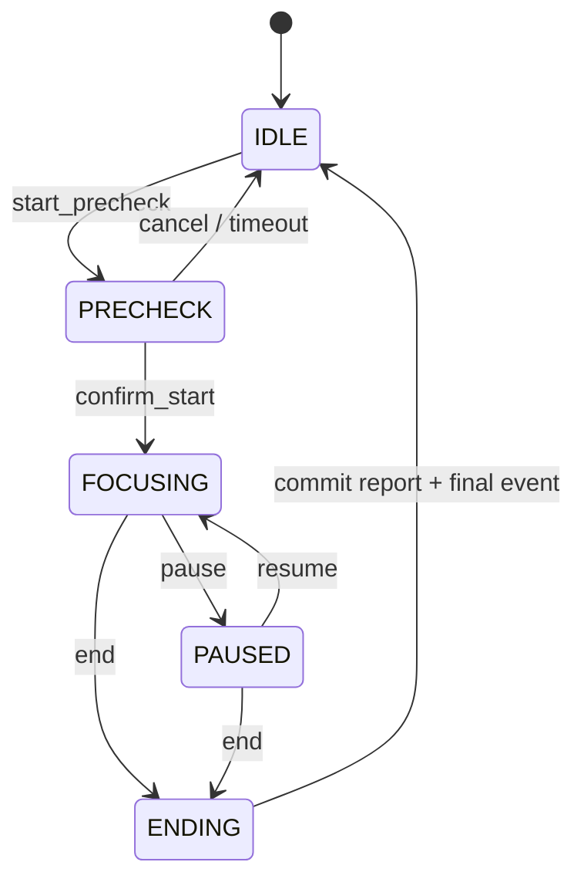

# EdgeFocus 完整系统架构母文档

- 版本：2026-07-16
- 定位：产品、软件、AI、异构硬件、交互、演示与部署的统一事实源
- 图谱入口：[A 核心图](poster-diagrams/A-core-diagrams.md) · [B 工程图](poster-diagrams/B-engineering-diagrams.md) · [C 完整图谱](poster-diagrams/C-complete-diagram-atlas.md) · [海报短文案](poster-diagrams/poster-copy-reference.md)

## 1. 系统定位

EdgeFocus 是运行在 STM32MP257 边缘主机上的专注会话系统。它不尝试从单帧画面直接猜测抽象的“走神”，而是把问题拆成可验证事实：视觉提供“人在/不在/未知”和“趴下概率”，手机 App 提供“未使用/学习/娱乐/其他”原始状态；A35/Linux 在正式会话内做时序、持续性和多源融合，输出 Level 0 正常与 Level 1–3 三级分神、原因和 episode。

系统同时覆盖：

- NPU 端侧姿态推理与 C++ 视觉数据面；
- 主机权威会话、预检、提醒、证据与持久化；
- App 唯一主要交互渠道与手环低打扰提醒；
- PRECHECK 自动云台构图和会话内视觉跟踪；
- M33 独立风扇安全闭环；
- 外部供电驱动的 Home/Go 性能策略；
- 正式现场链、预录 NPU 链和纯前端 pre-log 保底链；
- 可回滚的 ARM 发布与独立演示素材同步。

STM32MP257 是赛道指定型号之一，因此不把芯片算力作为项目亮点。技术参数附注可记录其 NPU 范围为 `1.2–1.35 TOPS`，正式海报重点展示模型、时序融合、异构闭环和故障隔离。

## 2. 设计约束

1. 正式会话状态只由主机 `SessionOrchestrator` 决定。
2. PRECHECK 不属于正式会话：不计时、不入库、不进入 Phone/Fusion/episode/提醒。
3. 视觉不输出“使用手机”；手机类别只来自 App 上报。
4. Level 0 是正常/专注，Level 1–3 才是三级分神。
5. `NOT_PRESENT` 和 `UNKNOWN` 不产生分神提醒，也不沿用过期证据。
6. App 是主要交互面；板载屏幕与声音提醒已移除。
7. 风扇和云台的实时安全动作不依赖业务主循环持续健康。
8. Demo 与正式会话互斥，不污染正式记录、提醒或设备状态。
9. 故障必须局部降级；不得把单一外设异常扩大为全系统停机。
10. 软件 release 和 MP4/pre-log 素材使用独立发布泳道。

## 3. 完整系统边界



| 外部实体 | 输入到主机 | 主机输出 |
|---|---|---|
| 摄像头 | 视频帧 | 相机配置/资源生命周期 |
| App | 会话意图、PhoneFact、ACK、设置 | 权威状态、提醒、报告、设备状态 |
| 手环 | 连接/执行状态 | 有 TTL 的三级振动命令 |
| 展示页 | 无正式业务输入；仅 Demo 开关 | 视频、关键点、证据、近 30 秒时间线 |
| STUSB4500 | 外部供电 PRESENT/ABSENT/UNKNOWN | I2C 只读查询 |
| G431 | UART 状态、PD6 Fault | UART 目标、PD7 Enable |
| M33 | RPMsg 风扇状态/遥测 | 1 Hz 温度与策略事实 |

## 4. 异构计算职责

| 计算域 | 主要职责 | 不承担 |
|---|---|---|
| A35/Linux | 会话、视觉编排、Fusion、BLE、SQLite、供电策略、设备安全编排、Demo | 电机 FOC；风扇硬实时闭环 |
| NPU | YOLO11n Pose 推理 | 会话、提醒、手机类别判断 |
| Cortex-M33 | 100 ms 风扇控制、tach 监测、失联安全高转 | 云台、供电策略、产品会话 |
| STM32G431 | 云台对齐、HOLD、FOC、编码器、电机 PWM、本地 Fault 停机 | 分神判断、会话与 App 协议 |

通信方向冻结：

- A35 → NPU：帧和推理请求；NPU → A35：Pose 输出。
- A35 ↔ M33：RPMsg 双向，A35 约 1 Hz 上报温度/策略，M33 回传控制状态。
- A35 ↔ G431：UART4 115200 双向命令/状态。
- A35 → G431：PD7 Enable。
- G431 → A35：PD6 Fault，低有效。
- PD4 是 BOOT0 控制，不是 G431 复位。

## 5. 主程序运行域

### 5.1 进程常驻域

常驻域持有跨会话资源：`AppContext`、BLE、SQLite、外部供电、云台硬件服务、M33 bridge、HTTP 展示端和资源租约管理。它不直接拥有某一场会话的 episode 或提醒累计。

### 5.2 SessionRuntime

正式运行域由 `SessionOrchestrator` 创建和销毁，承载：

- `DistractionPipelineFeature`：视觉、PhoneFact 和 Fusion；
- `GimbalSessionFeature`：PRECHECK 搜索、人工租约、会话跟踪；
- `ReminderPolicy`：等级、冷却、App/手环事件；
- `SessionSnapshotPublisher`：面向 App、展示和存储的统一快照；
- 会话计时、episode、报告和 SQLite 事务。

### 5.3 DemoRuntime

`BoardDemoRuntime` 只在无正式会话时存在，拥有独立的播放器、frame queue、PhoneFact、snapshot 与 Web 输出。它没有正式提醒、正式会话 ID 或正式 SQLite 写权限。

## 6. 正式会话状态机



| 主机 phase | App phase | 核心语义 |
|---|---|---|
| IDLE | IDLE | 无主机会话，可进入 Demo |
| PRECHECK | PRECHECK | 视觉和云台准备；无正式计时/记录/提醒 |
| FOCUSING | RUNNING | 正式 Fusion、计时、记录和提醒 |
| PAUSED | PAUSED | 保留上下文，暂停累计和提醒 |
| ENDING | ENDING | 主机提交报告、排队最终事件 |
| IDLE + final report | FINISHED | App 展示结果，不新增主机 phase |

转移在 `SessionOrchestrator` 内串行化。重复命令使用 `command_id` 幂等；开始、暂停、恢复和结束都以主机返回状态为准。

## 7. PRECHECK 与云台准备

PRECHECK 的目的不是提前记录用户行为，而是确认相机、NPU、构图、蓝牙和设备状态能够支持正式会话。

流程：

1. 主机取得 Camera/NPU 正式资源租约。
2. 视觉模型寻找有效人物，但不进入 Fusion 与 episode。
3. 云台在机械限位内执行上下左右受限搜索。
4. 一旦目标进入合适构图即停止；搜索结束仍无目标则回默认/中间位置。
5. 用户可通过 App 取得短时人工控制租约进行微调。
6. 用户确认后，主机清空 PRECHECK 连续性并原子创建正式会话。

如果云台健康门失败，PRECHECK 退化为固定相机，不影响用户确认开始；运行中云台异常同样只关闭跟踪。

## 8. Edge AI 视觉数据面

正式视觉链：

```text
CameraFrame
  → frame quality / freshness
  → YOLO11n Pose（17 keypoints）
  → subject selection / continuity
  → normalized 58-d features
  → 2 s / 16-step temporal Prone MLP
  → Presence + Prone observation
  → FusionCore + episode
  → DistractionAssessment
```

关键点归一化和时序模型减少单帧抖动、拍摄距离和人体尺度变化的影响。主体选择必须处理多人、部分出框和短时遮挡；证据过期后输出 `UNKNOWN`，不能无限持有上一帧结论。

### 8.1 视觉字段

| 字段 | 含义 |
|---|---|
| `presence` | `PRESENT / NOT_PRESENT / UNKNOWN` |
| `presence_confidence` | 在场证据置信度/质量 |
| `prone_state` | `PRONE / NOT_PRONE / UNKNOWN` |
| `prone_probability` | 时序模型趴下概率 |
| `subject_id/continuity` | 主体连续性与切换信息 |
| `quality/reasons` | 遮挡、关键点缺失、帧过期等解释 |
| `observed_at` | 证据时间戳，用于 TTL 与对齐 |

不保留困倦、闭眼疲劳、左右转头或视觉手机使用作为正式业务字段。左右转头如未来重新引入，应作为独立研究能力经过新数据和模型验证，不进入当前等级逻辑。

## 9. PhoneFact 与 Fusion

App 上报四种原始手机事实：`OFF / LEARNING / ENTERTAINMENT / OTHER`。正式会话内约每 2 秒发送一次，主机按 5 秒 TTL 判断新鲜度。

融合原则：

- `LEARNING` 只弱化手机分支，不能覆盖趴下等独立视觉证据。
- `ENTERTAINMENT` 与 `OTHER` 都属于无关手机使用；两者互切不清空持续时间。
- 切到 `LEARNING` 或 `OFF` 后，手机分支按策略清零或逐步下降。
- 长时间或严重证据的等级高于短时、弱证据。
- 多源一致可提高等级，但单一可靠的严重证据也可以独立升级。
- `NOT_PRESENT` 与 `UNKNOWN` 的 `applicability` 不适用，不产生分神提醒。

### 9.1 输出契约

```text
DistractionAssessment
  applicability: ACTIVE | NOT_PRESENT | UNKNOWN
  level: 0 | 1 | 2 | 3 | null
  reasons: [presence, prone, phone, duration, quality...]
  episode_id / episode_duration
  observed_at / freshness
```

`level=0` 是正常/专注；Level 1–3 才是三级分神。近 30 秒时间线是展示窗口，不是模型窗口。

## 10. App 交互架构

App 是当前产品唯一主要交互渠道，承担：

- 设备连接、协议协商、状态恢复；
- 专注页和横屏控制面板；
- PRECHECK 状态、自动构图结果与云台人工微调；
- 正式会话开始、暂停、恢复、结束意图；
- 手机应用类别事实心跳；
- 弹窗、屏幕闪烁和前台提醒呈现；
- 手环搜索/重连入口与状态展示；
- 会话报告、历史与未连接主机时的本地模式。

手环搜索、主动重连和连接状态同时出现在普通设置页，以及横屏控制面板内的设置入口；两处调用同一个主机设备代理，不各自维护连接状态。

屏幕策略：App 位于前台时阻止系统自动锁屏；可配置屏幕保护开关和自动黑屏时间。黑屏是 App 自己的屏保层，不代表设备休眠；提醒到达时可恢复可见呈现。

本地模式用于无法使用主机时：App 本地生成会话结果并缓存；以后连接主机时幂等上传。连接主机后仍可选择本地模式或主机模式，但所有记录最终以主机作为权威存储，App 保留缓存以保证传输安全。

## 11. App 与手环可靠协议

角色：

- 板端对 App：板端是 BLE GATT Server，App 是 Client。
- 板端对手环：板端是 GATT Client，手环是 Server。

关键机制：

- `hello/get_state`：连接或重连后恢复主机权威状态；
- `command_id`：会话命令幂等；
- `event_id`：提醒与结束事件去重；
- `push_alert/push_session_end`：关键事件进入 outbox；
- 三阶段 ACK：`RECEIVED / PRESENTED / HANDLED`；
- 手环命令 10 秒 TTL、重连重试、高等级覆盖低等级；
- PhoneFact 2 秒心跳、5 秒 TTL。

通信暂时中断不会停止主机会话。App 重连后先同步 phase/snapshot，再补发缺失事件，不能用本地旧页面直接覆盖主机。

## 12. 云台控制架构

A35 只产生高层构图目标和有限速率的跟踪偏差，G431 负责确定性的运动执行。

正常启动：

```text
Enable=0 → 等待稳定 → PING/OK,G431
→ Enable 上升沿 → BOOT_ALIGN,START/OK
→ HOLD 1 → READY
```

正常结束优先使用：`STOP → OK,STOP → Enable=0`。Fault 路径不同：G431 本地先停驱动；A35 检测 PD6 低或 UART 连续失败后立即撤销 PD7、停止发送目标，并进入低频健康检查。恢复后必须重新对齐，不能直接恢复旧跟踪目标。

会话内跟踪与 PRECHECK 共用唯一 CameraSource，避免第二相机链争抢设备或产生不同主体结论。所有目标经过机械限位、死区、速率限制和人工租约仲裁。

## 13. M33 风扇安全闭环

Linux 从 `cpu-thermal` 读取温度，以约 1 Hz 通过 RPMsg 发送给 M33。M33 以 100 ms 周期完成：

1. 温度策略与 PWM 计算；
2. PB10 PWM 输出；
3. PB11 tach 采样；
4. 堵转、异常转速和 A35 失联检测；
5. 状态遥测。

策略包含常温低噪、高温追升和滞回恢复：超过设定温度后逐步升速，直到温度开始下降并保持当前转速；低于阈值约 5–10°C 后回到正常曲线。约 6000 RPM 作为安全高转档参考。

若超过 3 秒未收到 A35 更新，M33 进入安全高转。Linux fallback 与 M33 模式互斥：M33 在线时 Linux PWM/timer 必须解绑；fallback 接管前必须让 remoteproc offline。禁止双控制者同时写 PB10/PB11。

## 14. 外部供电与 Home/Go

STUSB4500QTR 通过 I2C4（PD10 SDA、PD11 SCL）只提供外部供电事实。状态机使用 3 个一致样本、每次间隔 250 ms 的去抖，输出：

- `PRESENT`：自动 Home；
- `ABSENT`：自动 Go；
- `UNKNOWN`：无手动覆盖时采用安全保守的 Go。

App 可以手动选择 Home/Go，覆盖保持到下一次确认的供电插拔 epoch。Home 视觉业务节拍约 4 FPS，Go 约 3 FPS；这是负载策略而不是硬实时保证，也不是展示页视频帧率。BLE、Fault、M33 风扇闭环和 G431 内部控制不随 Go 降频。

硬件没有电池电量读取能力，因此产品只显示外部供电状态和当前工作档位，不显示虚假电量百分比。

## 15. 正式展示与 Demo 隔离

| 模式 | 启动条件 | 视频来源 | PhoneFact | NPU | 正式记录/提醒 |
|---|---|---|---|---:|---:|
| `LIVE_CAMERA` | 按正常流程启动正式会话 | 现场摄像头 | 只能由 App 同步，页面不可点击 | 是 | 是 |
| `RECORDED_NPU` | IDLE 时页面手动开启 | 可选分段预录视频 | 页面可手动选择 | 是 | 否 |
| `FRONTEND_REPLAY` | IDLE 时手动开启，或预录 NPU 失败自动回退 | 预录视频 | 使用同步保存轨迹，不手动输入 | 否 | 否 |

预录模式不在后台运行：进入时才启动播放器/NPU，退出立即停止并释放；再次进入时从用户选择的片段重新构建播放器状态。`FRONTEND_REPLAY` 的关键点和视觉时间线来自正常 NPU 跑过后保存的 pre-log，不手写伪造视觉结果。

展示页保留两类证据：

- 视觉输入上的主体框、关键点、姿态与置信度叠加；
- 近 30 秒 `PRES / PRONE / PHONE / LEVEL` 四轨证据时间线。

## 16. 持久化与证据

主机 SQLite 是连接主机场景的权威存储，保存：会话元数据、phase 转移、关键 assessment/episode、提醒事件、ACK 状态和最终报告。写入使用事务，事件使用稳定 ID，App 缓存使用幂等上传。

实时推理不应因单次数据库延迟而阻塞。SQLite 失败时保留内存快照并向 App 报告“记录保存异常”，但不得伪报已经持久化；恢复后限次重试。

证据对齐使用单调时钟处理本机持续时间，使用可序列化时间戳用于 App/报告；PhoneFact、视觉帧和 pre-log 都保留 `observed_at` 与 freshness。

## 17. 并发、队列与资源所有权

- `SessionOrchestrator` 的 phase 转移由互斥锁串行化。
- Camera/NPU 由单一 `ResourceLease` 所有；Formal Session 优先于 Demo。
- 帧队列倾向保留最新帧并丢弃过期帧，避免延迟无限累积。
- PhoneFactBuffer 按时间戳和 TTL 提供最新事实，不从 UI 当前选中状态直接读取。
- EventOutbox 与 BLE 发送线程解耦，断线不会阻塞 Fusion。
- 云台人工控制通过短时 lease 覆盖自动跟踪，超时自动归还。
- M33/Linux 风扇控制权和正式/Demo 视觉资源均采用互斥所有权。

## 18. 故障隔离原则

完整矩阵见 [C11 故障降级矩阵](poster-diagrams/C-complete-diagram-atlas.md#c11-故障降级矩阵)。核心规则：

1. 摄像头/NPU 异常使视觉为 UNKNOWN，不使用旧帧冒充新证据。
2. PhoneFact stale 只关闭手机分支，不关闭独立视觉判断。
3. App 断连不停止主机会话，关键事件进入 outbox。
4. 手环异常不影响 App 提醒或正式记录。
5. G431 Fault 立即局部停机，固定相机视觉继续。
6. M33/RPMsg 异常优先保证风扇安全高转或互斥 fallback。
7. STUSB UNKNOWN 无覆盖时采用 Go，安全环保持原频率。
8. Demo 资源冲突永远让位于正式会话。
9. 新 release health check 失败则不切换或自动回滚。

## 19. 构建、部署与回滚

软件链：

```text
Windows workspace
  → tests/config validation
  → A35 cross compiler
  → immutable ARM release
  → board staging
  → hash/dependency/API health
  → atomic current switch
  → systemd restart + smoke test
  → failure: atomic rollback
```

演示素材链：

```text
Windows MP4/pre-log
  → SHA-256 incremental manifest
  → board assets/demo directory
```

MP4 不进入源码包或 ARM release；软件和素材可独立更新、校验与恢复。正式发布保留上一 release，避免现场更新失败后失去可运行版本。

## 20. 代码导航

| 能力 | 主要目录/模块 |
|---|---|
| 应用组装与常驻上下文 | `app/`, `main.cpp` |
| 正式会话与生命周期 | `session/SessionOrchestrator.*`, `session/SessionRuntime.*` |
| 视觉与时序模型 | `vision/`, `models/`, `camera/` |
| Fusion 与行为策略 | `core/`, `behavior/`, `policy/` |
| App/手环网络与事件 | `network/` |
| 云台与设备插件 | `platform/gimbal/`, `device/` |
| 供电与工作负载策略 | `platform/power/`, `vision/VisionCadencePolicy.h` |
| M33 固件与 bridge | `firmware/`, `platform/` 中对应 bridge/service |
| SQLite 与报告 | `storage/` |
| 板端演示模式 | `demo/`, `ui/`, `assets/demo/` |
| 配置 | `config/` |
| 构建与部署 | `scripts/`, `tools/`, `_workspace/` |
| 回归与纯逻辑测试 | `tests/` |

## 21. 海报量化口径

| 指标 | 准确含义 |
|---|---|
| `4 个计算域` | A35、NPU、M33、G431 的异构职责分工 |
| `17 keypoints` | YOLO11n Pose 输出 |
| `58-d × 16 steps` | 约 2 秒趴下时序特征窗口 |
| `2 s / 5 s` | PhoneFact 心跳 / 主机 TTL |
| `100 ms` | M33 风扇控制周期 |
| `1 Hz / 3 s` | A35→M33 温度上报 / 失联 TTL |
| `3 × 250 ms` | 外部供电去抖采样 |
| `Home ≈ 4 FPS / Go ≈ 3 FPS` | 视觉业务节拍档位 |
| `30 s` | 展示页证据时间线窗口 |

芯片算力不作为海报指标。如评委追问硬件参数，可说明 NPU 规格范围约为 `1.2–1.35 TOPS`；不要把规格值写成实测端到端吞吐。

## 22. 术语与废弃能力

统一术语：`Presence`、`Prone`、`PhoneFact`、`Temporal Fusion`、`Distraction Level 0–3`、`Formal Session`、`PRECHECK`、`SessionRuntime`、`DemoRuntime`、`External Power`、`Home/Go`、`Heterogeneous Safety Island`。

当前正式产品不使用：困倦、闭眼疲劳、视觉手机识别、未经重做的左右转头、电量百分比、板载屏幕、板载声音提醒。源码中如仍存在历史兼容实现，不代表产品入口启用，也不得重新成为核心数据依赖。

## 23. 架构变更准入

任何新能力在进入主程序前必须回答：

1. 属于常驻域、SessionRuntime 还是 DemoRuntime？
2. 输入输出是否为稳定类型化数据？
3. 谁拥有相机、NPU、GPIO、串口或 BLE 资源？
4. PRECHECK、FOCUSING、PAUSED、ENDING 各阶段是否运行？
5. 故障时保留什么能力，用户看到什么，谁负责恢复？
6. 是否改变 App/手环协议、SQLite schema 或发布链？
7. 是否有纯逻辑、主机、ARM 和板端分级验收？

未回答这些问题的新模型、外设或页面功能不得直接接入正式会话主链。
