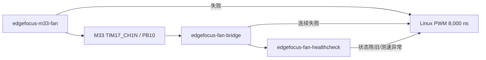

# M33 风扇服务启用与回滚

当前板端：`root@192.168.10.174`。风扇不属于 `focus_app` 会话；它由 M33 loader、A35 bridge、启动健康门和 Linux fallback 四个 unit 独立管理。

## 当前状态

- 新固件和四个 unit 已安装；M33 loader、bridge 和健康门均为 enabled。
- `st-m33firmware-load.service` 已 disabled，但厂商 echo ELF 和 unit 保留用于回滚。
- 两次完整 systemd reboot 和一次用户执行的物理断电重上电均自动进入 `CONTROLLED`，健康门成功。
- 物理断电暴露 RTC 后备不保持：RTC 回到 2000-01-01，Linux 回到 2024-02-28；本轮已从主机校时并执行 `hwclock -w`，但再次断电仍可能丢时钟。
- 2026-07-15 用户在转速单调性、额定转速、Linux fallback 和硬件默认自转均通过后，明确豁免外部波形截图；文件保留 `waveform_verified=false`，另以 `waveform_verification_waived=true` 如实记录。
- 手动验证可使用不带 `--require-calibration` 的 transition `start`；生产 unit 不允许绕过门禁。

## 所有权链



`/usr/local/sbin/edgefocus-fan-transition` 用 `/run/edgefocus/fan-transition.lock` 串行化所有切换。M33 模式下 Linux timer/PWM 必须 unbound；fallback 模式下 remoteproc 必须 offline。

## 当前启用配置

默认流程仍应在风扇接口端确认 25 kHz、8,000 ns 满速命令和供电电压。当前板由用户明确接受剩余风险并豁免该截图，不能在报告中称为“波形已测”。未来更换风扇、电源板、底板、TIM 极性或驱动电路后，豁免自动失效，必须重新测量。

```sh
systemctl disable --now st-m33firmware-load.service
systemctl enable edgefocus-m33-fan.service
systemctl enable edgefocus-fan-bridge.service
systemctl enable edgefocus-fan-healthcheck.service
systemctl daemon-reload
reboot
```

启动后检查：

```sh
systemctl --no-pager --full status \
  edgefocus-m33-fan.service \
  edgefocus-fan-bridge.service \
  edgefocus-fan-healthcheck.service
cat /run/edgefocus/m33-fan-start.json
cat /run/edgefocus/fan-status.json
cat /sys/class/remoteproc/remoteproc0/{state,firmware}
```

通过条件：remoteproc running、固件名正确、Linux timer/PWM unbound、bridge 三个 ready 均为 true、`CONTROLLED`、`current_faults=0`、RPM 300～7500；常温 band 0 允许 600～1500 RPM。

## 人工验证与安全回退

手动启动 M33（仅工程验证）：

```sh
/usr/local/sbin/edgefocus-fan-transition start --stop-bridge
```

立即切到 Linux 安全输出并验证 PB11：

```sh
/usr/local/sbin/edgefocus-fan-transition fallback
cat /run/edgefocus/fan-fallback.json
```

fallback 成功必须同时满足：remoteproc offline、40,000/8,000/normal/enable=1 读回一致、3 秒 PB11 计数换算大于 300 RPM。脚本可重复执行；重复执行不得把 already-bound/exported 当作失败。

## 完整回滚到厂商 echo

```sh
systemctl disable --now edgefocus-fan-healthcheck.service
systemctl disable --now edgefocus-fan-bridge.service
systemctl disable --now edgefocus-m33-fan.service
systemctl stop edgefocus-fan-fallback.service
/usr/local/sbin/edgefocus-fan-transition fallback
systemctl enable st-m33firmware-load.service
systemctl daemon-reload
reboot
```

重启后确认厂商 echo、`/dev/ttyRPMSG0` 和 Linux timer/PWM 正常，且三个 EdgeFocus 开机 unit 都是 disabled。不要删除厂商 loader 或 echo ELF，它们是最终恢复路径。
