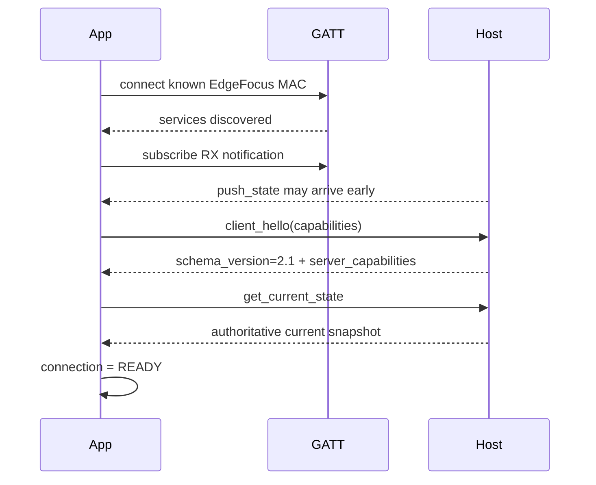
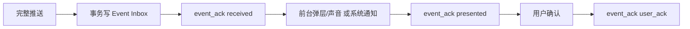

# EdgeFocus App ↔ 当前主机配套设计（App 改造第 3 版）

- 状态：设计与联调基线，待用户审核
- 日期：2026-07-16
- 说明：标题中的“第 3 版”是 App 改造文档版本，不代表主机 wire schema。当前主机仍报告 `schema_version=2.1`。
- App 目标架构：[app-target-architecture.md](../architecture/app-target-architecture.md)
- 当前协议参考：[app-band-protocol-v2.1.md](app-band-protocol-v2.1.md)

## 1. 配套基线

负责 App 实施的 Agent 必须以当前主机源码为准，不能只按旧 App 模型或理想协议开发。

- 主机工作区：`C:\Users\Aze\Desktop\self_developed\code\focus_app`
- 分支：`main`
- 当前 HEAD：`62b5fad64320c43b1b063997f05c1a3c23754cd0`
- 重要事实：主机工作树含尚未提交的会话、手机事实、可靠事件、供电、云台和手环修改；HEAD 只能用于定位，当前工作树才是联调基线。
- 命令入口：`network/AppCommandService.cpp::handleCommand`
- GATT 传输：`network/BleGattServer.*`
- 正式会话：`session/SessionOrchestrator.*`、`session/SessionRuntime.*`
- 手环代理：`device/BleBandController.*`、`device/DeviceManager.*`

实施前必须重新读取上述文件和本文件；不得从旧 App 的 `BoardJsonParser` 反推主机协议。

## 2. 必须新增的 App 功能

以下不是可选优化，是本轮产品收束后的 App 交付范围：

1. 进程级唯一会话协调器，统一 LOCAL/EDGEFOCUS 和竖横屏；
2. 主机连接自动恢复：订阅、`client_hello`、状态重建、退避重连；
3. 主机关键事件持久化去重与 `received/presented/user_ack` ACK；
4. EDGEFOCUS 正式会话每 2 秒手机原始事实心跳；
5. LOCAL 会话离线结果 Outbox，连接后幂等上传并标记同步；
6. 竖屏和横屏都能显示/操作 PRECHECK；
7. PRECHECK 显示真实低带宽预览图，退出后立即停拉；
8. App 前台全局提醒弹层/闪烁/声音，后台使用系统通知和振动；
9. App 前台禁止系统自动锁屏；可配置纯黑屏保与等待时长；
10. 设置页和横屏设置页均显示手环代理状态，并允许请求主机搜索/重连；
11. 外部供电 + Home/Go 显示及当前供电 epoch 内手动切换；
12. 统一历史、同步状态和三档反馈；
13. 删除电量、困倦、板端屏幕/声音和手机端最终分神等级。

## 3. 当前主机能力对照矩阵

| 能力 | 当前主机 | App 本轮动作 | 主机是否还需改 |
|---|---|---|---|
| `client_hello` | 已实现，schema 2.1 | notification 订阅后必发 | 否 |
| `event_ack` | 已实现 | 持久化去重后分阶段 ACK | 否 |
| `push_alert` | 已实现可靠 outbox | App 执行 SCREEN/SOUND | 否 |
| `push_session_end` | 已实现 | App 保存/更新结果并 ACK | 需联调整个自动结束路径 |
| `phone_sync` 原始事实 | 正式 runtime 已实现 sequence/freshness | 改成 2 秒心跳，不发等级 | 否 |
| PRECHECK | 正式 Orchestrator 已实现 | 两套页面共用 UI | 否 |
| 相机预览 | `get_camera_preview_image` 已实现 | 解码并绘制，低优先级轮询 | 否 |
| 云台 PRECHECK | capability gate 已实现 | 只在能力存在时显示 | 否 |
| LOCAL 上传 | `upload_local_session` 已幂等 | Outbox 自动补传 | 否 |
| 历史/最后报告 | 已实现 | 移出 Dashboard 生命周期 | 否 |
| 外部供电/Home-Go | 已实现 | 删除电量，接新字段 | 否 |
| 手环连接状态 | 现有快照有 `bracelet_connected` 与诊断字段 | 先实现只读状态 | 否 |
| 手环主动搜索/重连 | 当前无 App 命令 | capability gate 后显示按钮 | **是，见第 10 节** |
| 状态 `boot_id/revision` | 当前无 | schema 2.1 用连接 epoch + 重连全量读取 | 可选增强，不阻塞配套 |

任何“主机仍需改”的能力必须有 capability gate。App 不得显示一个点击后只在本地变成“已连接”的假按钮。

## 4. 通用 JSON 规则

当前主机请求：

```json
{"cmd":"get_current_state","id":101,"data":{}}
```

成功响应：

```json
{"status":"success","id":101,"data":{}}
```

失败响应：

```json
{"status":"error","id":101,"error":"reason"}
```

推送：

```json
{"cmd":"push_state","data":{}}
```

App 规则：

- `id` 在当前连接内唯一；
- `status=success` 不等于业务动作成功，仍需读取 `data.success` 或 `data.accepted`；
- 未知字段忽略，缺少必需字段进入显式 UNKNOWN，不填 67、电量或旧状态；
- 所有命令有超时，但超时只表示结果未知，不能据此在 App 本地完成主机会话；
- 大响应/推送完整重组后才解析与 ACK；
- 同一 GATT 连接内请求单写入，但调度必须有优先级和可取消预览。

建议优先级：

```text
P0 event_ack / session_control
P1 phone_sync heartbeat
P2 client_hello / get_current_state / band_control
P3 preferences / history
P4 camera preview
```

## 5. 连接时序（严格配套当前主机）



`client_hello`：

```json
{
  "cmd":"client_hello",
  "id":1,
  "data":{
    "capabilities":[
      "event_ack_v1",
      "event_dedupe_v1",
      "phone_heartbeat_v1"
    ]
  }
}
```

当前主机响应能力至少包含：

```text
event_ack_v1
event_dedupe_v1
phone_heartbeat_v1
external_power_v1
power_profile_override_v1
```

国赛协议 3 主机会在云台控制器存在时声明 `gimbal_session_control_v3`、`gimbal_manual_lease_v1` 和 `gimbal_async_result_v1`。App 必须按异步契约处理，不能再把命令入队响应当作电机已执行。

当前主机可能在 `client_hello` 前推一次 `push_state`。App 可临时缓存，但必须以 hello 后的 `get_current_state` 覆盖，随后才进入 READY。

## 6. 正式会话

开始：

```json
{
  "cmd":"session_control",
  "id":10,
  "data":{
    "action":"start",
    "target_duration_min":25,
    "source_mode":"live_camera"
  }
}
```

当前主机只允许 `source_mode=live_camera`。App 不得把主机展示页的预录 NPU/纯前端演示模式带入正式会话协议。

状态来源优先级：

1. `data.runtime_snapshot`；
2. 当前响应/`push_state` 的 session 字段；
3. 仅作显示插值的 App 本地倒计时。

App 插值不得改变 EDGEFOCUS phase。PRECHECK 不计入正式会话时长、统计、手机事实或分神记录。

控制动作：

```text
start
skip_precheck
pause
resume
end
```

`skip_calibration` 是当前主机兼容别名，新 App 只发送 `skip_precheck`。如果快照中的 precheck control 不允许 App 跳过，按钮隐藏或禁用。

断线或超时：

- start 未知：重连后查状态，不重复盲发 start；
- pause/resume/end 未知：保留“正在确认”，重连后查状态；
- 本地剩余时间到零：只显示“等待主机结束确认”；
- 只有 `push_session_end`、end 成功报告或权威 FINISHED/IDLE + 对应报告才能保存主机会话结果。

## 7. 手机原始事实

新 App 只发送：

```json
{
  "cmd":"phone_sync",
  "id":20,
  "data":{
    "session_id":"session_...",
    "sequence":42,
    "timestamp_ms":1784000000000,
    "is_in_use":true,
    "usage_state":"playing"
  }
}
```

当前主机识别的 `usage_state`：

- `learning` → 学习；
- `playing` → 娱乐；
- `using` → 其他/未知使用；
- `is_in_use=false` → 未使用。

禁止发送/消费为最终判定：

```text
distraction_level
phone_distraction_level
App 自算 risk/focus_state
```

当前主机即使收到旧 `distraction_level`，正式 PhoneFact 路径也会标记 ignored；新 App 应彻底不发送。

时序：

- PRECHECK：不发送；
- 正式 RUNNING 首帧：立即发送；
- RUNNING/PAUSED：每 2 秒发送新 sequence；当前主机 PAUSED 是否接受不作为分神记录依据，App 仍可继续提供事实以便恢复，但主机不得计入暂停统计；
- 断线：停止发送；
- 重连并确认同一正式会话：sequence 继续严格递增并立即补当前事实；
- 新 session：sequence 从 1 开始。

App 必须检查 `accepted` 与 `last_accepted_sequence`，不能只看 BLE 写成功。

## 8. 关键事件与 App 提醒

可靠事件：

```text
push_alert
push_session_end
```

App 处理顺序：



ACK：

```json
{
  "cmd":"event_ack",
  "id":30,
  "data":{
    "event_id":"evt_...",
    "session_id":"session_...",
    "stage":"presented"
  }
}
```

`accepted` 和 `duplicate` 视为该阶段成功；`session_mismatch/unknown_event/expired` 记录诊断，不伪装成功。

App 新增功能：

- 任意前台页面上的全局提醒层；
- SCREEN 动作的卡片/闪烁；
- SOUND 动作的一次性播放；
- 后台/系统锁屏的高优先级通知和振动；
- 事件持久化去重，重放不重复执行；
- 提醒队列，不用单个 `lastAlert` 覆盖。

旧 `reminder_ack` 仅为兼容命令，新 App 正式链路不调用。

## 9. LOCAL 会话与权威存储

LOCAL 模式无需主机即可开始。App 生成稳定 UUID、运行计时和手机侧提醒，结束时在一个 Room 事务中：

1. 写完整 Session；
2. 写 `upload_local_session` Outbox；
3. 标记 `synced=false`。

上传：

```json
{
  "cmd":"upload_local_session",
  "id":60,
  "data":{
    "session_id":"app_local_uuid",
    "start_time_ms":1000,
    "end_time_ms":61000,
    "total_duration":60,
    "focus_duration":55,
    "distraction_count":2,
    "reminder_count":1,
    "phone_distraction_count":2,
    "source":"app_local"
  }
}
```

当前主机已按 `session_id` 幂等，返回：

```json
{"stored":true,"already_exists":false,"session_id":"app_local_uuid"}
```

`already_exists=true` 同样视为同步成功。App 在同一事务中标记 `synced=true`。上传重试不依赖用户打开数据页，也不只发生在结束瞬间。

连接主机时用户仍可选择 LOCAL。当前 LOCAL 会话不向主机发送 `session_control` 或 `phone_sync`，结束后只上传结果。

## 10. 手环代理：当前兼容与所需主机小扩展

### 10.1 当前主机可直接读取

`get_device_status` 已返回：

```text
bracelet_connected
output_capability.band_available
```

`get_console_data.device` 另有：

```text
band_last_alert_level
band_last_alert_pattern
band_write_attempt_count
band_last_write_status
```

新 App 第一阶段可用这些字段显示只读状态。不得直接连接手环或模拟“已搜索”。

### 10.2 为主动搜索/重连新增主机能力

主机新增 capability：

```text
band_proxy_control_v1
```

新增查询：

```json
{"cmd":"get_band_status","id":70,"data":{}}
```

建议响应：

```json
{
  "available":true,
  "connection_state":"disconnected",
  "device_name":"EdgefocusBand",
  "last_seen_age_ms":12000,
  "auto_reconnect":true,
  "operation":"idle",
  "last_error":"not_found",
  "next_retry_in_ms":3000
}
```

新增控制：

```json
{
  "cmd":"band_control",
  "id":71,
  "data":{"action":"scan_connect"}
}
```

动作只需要：

```text
scan_connect
reconnect
```

响应表示任务是否接受，不承诺已经连上：

```json
{"accepted":true,"operation":"scanning"}
```

建议 best-effort 推送：

```json
{
  "cmd":"push_band_state",
  "data":{
    "connection_state":"connected",
    "device_name":"EdgefocusBand",
    "operation":"idle",
    "last_error":null
  }
}
```

如果当前主机没有 `band_proxy_control_v1`：

- App 仍显示 `bracelet_connected`；
- 搜索按钮禁用并显示“当前主机仅支持自动重连”；
- 不把 capability 缺失当 BLE 连接故障。

## 11. 外部供电与 Home/Go

App 使用当前主机字段：

```text
external_power_state: PRESENT | ABSENT | UNKNOWN
external_power_present: true | false | null
external_power_sample_age_ms
power_profile: home | go
power_profile_source
manual_override_active
```

App 必须忽略当前源码仍可能返回的旧输出能力字段，不恢复板端屏幕/声音设置。

手动切换：

```json
{"cmd":"set_power_profile","id":80,"data":{"power_profile":"go"}}
```

只在当前供电 epoch 有效，不保存为 App 长期偏好。删除全部 `battery_*`、`power_source` 和默认 67%。

## 12. PRECHECK、预览与云台

相机预览使用当前 `get_camera_preview_image`，支持现有分片协议。App 新增：

- base64 解码与像素/JPEG 转换；
- 实际图片绘制；
- 时间戳、序号、质量和陈旧提示；
- PRECHECK 期间 1–2 FPS 的可取消低优先级刷新；
- 页面退出、断线或进入 RUNNING 时立即停拉。

云台只在 hello 同时返回 `gimbal_session_control_v3`、`gimbal_manual_lease_v1` 和 `gimbal_async_result_v1` 时出现。国赛版命令为：

```text
gimbal_manual_takeover
gimbal_lease_keepalive
gimbal_nudge
gimbal_center
gimbal_stop
gimbal_release
gimbal_force_release
gimbal_recover
precheck_skip_auto_adjust
precheck_confirm_position
```

每条命令带当前 `session_id` 和严格递增 `sequence`。接管成功结果提供 `lease_token`；除接管、恢复和跳过自动调整外，人工命令还必须携带稳定的 `owner_id` 与当前 token。App 每 5 秒发送 keepalive，租约过期后停止运动输入并重新接管。

命令立即响应只表示 `queued=true`。最终结果以可靠事件 `push_gimbal_command_result` 为准，并按普通可靠事件发送 `event_ack`。只有事件中的 `firmware_accepted=true` 才表示 G431 已接受目标；`settled=true` 才表示同一 generation 已物理到位。STOP 和 force-release 在主机队列中优先，旧的低 sequence 运动会被拒绝，不能在 STOP 后补执行。

App 只发方向，不发步长、角度、UART、BOOT0、维护或 NVM 命令。维护能力只存在于板端 CLI 与隐藏网页，不属于 App 产品协议。完整字段见 [gimbal-app-protocol-v3.md](gimbal-app-protocol-v3.md)。

## 13. App 屏保与系统生命周期

这些功能不需要主机改动：

- MainActivity 与 ControlPanelActivity 前台统一防自动锁屏；
- 设置页新增屏保开关与黑屏等待时间；
- 屏保是 App 内纯黑覆盖，不停止 BLE/会话；
- 首次触摸只唤醒页面；
- 主机 SCREEN 提醒能唤醒 App 视觉层；
- App 后台/系统锁屏时使用系统通知；
- `PhoneFactMonitor` 必须识别 App 屏保和非交互状态，不能上报 `using/level 3`。

## 14. 当前主机仍返回但新 App 不应使用的字段

当前工作树中仍可能存在兼容或展示字段：

```text
system_mode
notification_mode
board_screen_available
board_sound_available
screen_output_route
sound_output_route
phone_distraction_level
旧 focus_state 数字
旧 distraction_level 输入
```

新 App 处理原则：

- 可以解析以避免崩溃；
- 不用于新 UI，不作为新状态机输入，不写回 preferences；
- App 提醒配置保存在 App；手环策略由主机代理；
- 最终分神原因以主机稳定 assessment/reasons 或提醒事件为准，不显示旧数值枚举。

## 15. 实施 Agent 的完成定义

负责 App 的 Agent 交付前必须同时满足：

1. 对当前主机 `schema_version=2.1` 完成真机 hello、状态读取和会话控制；
2. 不要求当前主机先有 `boot_id/revision` 才能 READY；
3. `push_alert/push_session_end` 完成持久化去重和三阶段 ACK；
4. phone_sync 抓包中没有 `distraction_level`，并稳定 2 秒心跳；
5. PRECHECK 抓到并显示当前主机真实预览，不是元数据占位；
6. LOCAL 离线会话重启 App 后仍能向当前主机幂等补传；
7. 竖屏和横屏看到同一 session_id/phase，不重复落库；
8. 手环按钮严格受 `band_proxy_control_v1` 控制；扩展未部署时只读兼容，部署后可主动请求搜索/重连；
9. 主机返回遗留字段时 App 不显示电量、困倦、板端屏幕/声音或手机端等级；
10. App 前台不会自动锁屏，黑屏屏保不触发手机分心；
11. 主机在 PRECHECK/RUNNING/PAUSED 任意阶段断连后，App 重连能恢复且不会本地误完成；
12. JVM 测试之外补充至少一组 coordinator 集成测试、一组断连恢复测试和一组 Event Inbox/Outbox 重启测试。

## 16. 联调顺序

1. 当前主机 + 新 App：连接/hello/get_current_state；
2. EDGEFOCUS：start → PRECHECK → preview → RUNNING → pause/resume/end；
3. phone_sync：未使用/学习/娱乐/其他与 2 秒心跳；
4. push_alert：前台、黑屏屏保、后台、重放和用户确认；
5. push_session_end：自动结束、手动结束、断连恢复；
6. LOCAL：离线结束、重启、连接、重复上传；
7. power：PRESENT/ABSENT/UNKNOWN、手动 Home-Go、插拔清除覆盖；
8. gimbal：capability 无/有、故障、恢复；
9. band：先验证当前只读状态，再部署 `band_proxy_control_v1` 扩展验证主动搜索。

任一步失败都应记录请求 ID、session ID、event ID、连接 epoch、主机响应和 App 本地状态；禁止用 UI 本地改色代替协议成功。
