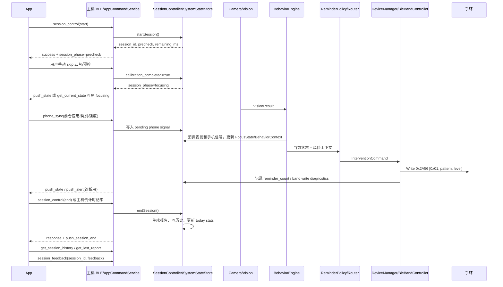

# EdgeFocus 最终工作流程与信息交互时机

> 日期：2026-06-30  
> 性质：主链路联调时序文档。本文回答“什么时候由谁发起交互、主机什么时候更新状态、App 什么时候刷新 UI、手环什么时候被写入”。字段细节以最终 API 契约为准。

---

## 1. 总原则

- 主机是唯一会话权威端，`session_id`、会话阶段、统计、报告、历史均以主机为准。
- App 是操作端、展示端、手机使用状态采集端，不直连手环，不决定最终提醒等级。
- 手环是提醒终端，只接收主机写入的 Alert，不上报 ACK/Notify/电量/状态。
- `phone_sync` 是输入信号，不是提醒命令。
- `PHONE_IN_USE` / `PHONE_IN_PLAYING` 只参与行为层判断，不固定对应 LEVEL_2/LEVEL_3。
- `normal` / `silent` 只筛选提醒渠道，不改变行为判断和提醒严重程度。

---

## 2. 端到端主流程时序



---

## 3. 会话启动阶段

### 3.1 App 发起 start

时机：用户在 App 点击开始。

App -> 主机：

```json
{"cmd":"session_control","id":1,"data":{"action":"start","target_duration_min":25}}
```

主机必须做：

1. 如果没有活动会话，创建新的 `session_id`。
2. 初始化倒计时、统计、报告缓存、会话阶段。
3. 进入 `precheck`，因为云台/预检页保留。
4. 返回 `session_phase=precheck`、`calibration_completed=false`。

主机不应做：

- 不应直接自动进入 `focusing`，除非用户已经明确 skip。
- 不应让 App 自己生成权威 `session_id`。

App 收到响应后：

- 进入会话 UI。
- 如果 `session_phase=precheck`，显示云台/预检页。
- 不根据本地缓存覆盖主机返回的时长和 `session_id`。

### 3.2 主机本机发起 start

时机：用户在主机屏幕点击开始。

主机本机路径也必须走同一个会话控制逻辑，最终仍由 `SessionController` 创建 `session_id`。App 后续通过 `get_current_state` 或 push 同步状态。

---

## 4. 云台/预检阶段

时机：start 成功后，正式专注前。

当前产品口径：

1. 页面保留。
2. 用户手动点击 skip。
3. 主机设置 `calibration_completed=true`。
4. 会话进入 `focusing`。

该阶段交互规则：

| 输入 | 主机处理 |
|---|---|
| App `get_current_state` | 返回 `session_phase=precheck` |
| App `phone_sync` | 可 ACK，但不应计入分心，不应触发提醒 |
| 视觉帧 | 可诊断采集，但不应作为正式专注统计 |
| pause | 进入 paused |
| end | 结束会话并生成报告，报告可为短会话 |

自动跳过云台/预检不是目标设计。如果出现，应作为流程 bug 排查。

---

## 5. 正式专注阶段

时机：用户手动 skip 后，`session_phase=focusing`。

主机循环处理：

```text
摄像头/图片样本 -> VisionResult
App phone_sync -> pending phone signal
BehaviorEngine 消费两路输入
FocusStateMachine 输出 FocusState
ReminderPolicy 结合 cooldown 和 BehaviorContext 决定是否提醒
NotificationRouter 按 normal/silent 选择渠道
DeviceManager 执行本机提醒或手环提醒
SystemStateStore 更新状态、计数、诊断
BleGattServer 向 App push 状态
```

App 在该阶段应做：

- 周期或事件驱动上报 `phone_sync`。
- 以 `push_state` 和 `get_current_state` 刷新 UI。
- 不把 `phone_sync` 响应中的 `focus_state` 当作最终 UI 状态。

主机在该阶段应做：

- 只在 focusing 中把手机/视觉信号计入走神。
- 对学习类 App 进入 `PHONE_IN_LEARNING`，默认不提醒。
- 对娱乐/高风险 App 只作为行为输入，最终等级由策略层决定。
- 发生提醒时更新 `reminder_count`，并记录手环写入诊断。

---

## 6. phone_sync 交互时机

App 发送时机：

| 场景 | 是否发送 | 说明 |
|---|---|---|
| App 前台应用变化 | 是 | 立即发送一次 |
| 前台应用持续使用 | 是 | 可周期发送，避免主机信号过期 |
| 回到学习/白名单应用 | 是 | 发送 `is_in_use=false` 或学习类状态，帮助主机恢复 |
| 会话未开始 | 可不发 | 发了主机也不应计入走神 |
| precheck | 可发 | 主机 ACK，但不计入正式走神 |
| paused | 可发 | 主机不应计入走神 |
| focusing | 是 | 这是正式行为输入 |

主机处理时机：

1. `AppCommandService` 收到 `phone_sync` 后只写入 pending phone signal。
2. `BehaviorEngine` 在 run loop 中消费该信号。
3. `FocusStateMachine` 和 `RiskScorer` 计算状态与风险。
4. `ReminderPolicy` 再决定是否提醒。

结论：`phone_sync` 不是“App 要求提醒”，也不是“App 指定等级”。

---

## 7. 提醒与手环写入时机

提醒触发链路：

```text
FocusState / BehaviorContext
  -> ReminderPolicy 通过 cooldown 和风险规则
  -> InterventionCommand(level, channel/action)
  -> NotificationRouter 根据 normal/silent 筛渠道
  -> DeviceManager issueCommand
  -> BleBandController sendAlert(level)
  -> BlueZ WriteValue 0x2A56 [0x01, pattern, level]
```

手环写入只发生在：

- 主机策略层已经决定需要 BAND 渠道提醒。
- 手环连接状态可用。
- 当前命令没有被 cooldown 或渠道设置过滤掉。

手环写入不发生在：

- App 发送 `phone_sync` 的瞬间。
- App 发送 `reminder_ack` 的瞬间。
- precheck / paused 阶段的手机上报。
- 用户选择 silent 但未启用手环/震动渠道时。

`normal` / `silent` 时机说明：

- 行为层先判断是否走神。
- 策略层先得到严重程度。
- 然后才根据 `system_mode` 和用户启用项筛选提醒方式。
- silent 不降低 level，只选择无声方式。

---

## 8. pause / resume 时机

### pause

App -> 主机：

```json
{"cmd":"session_control","id":2,"data":{"action":"pause"}}
```

主机必须：

- 保持 `session_id` 不变。
- 设置 `paused=true`。
- 停止正式计入视觉和手机分心。
- push `push_state`。

App 必须：

- 显示暂停态。
- 不把 pause 当作 end。
- 不进入结束页，除非收到 `push_session_end` 或 end 响应。

### resume

主机必须：

- 设置 `paused=false`。
- 保持原 `session_id`。
- 继续倒计时和统计。
- push `push_state`。

---

## 9. 会话结束、报告、历史、反馈时机

结束入口：

| 来源 | 触发 |
|---|---|
| App | `session_control(end)` |
| 主机 UI | 本机 END 按钮 |
| 倒计时结束 | BehaviorEngine 检测 remaining <= 0 |
| 离座超时 | BehaviorEngine 检测 away timeout |
| 异常恢复 | recoverInterruptedSessions 关闭旧 open session |

结束后主机必须按顺序完成：

1. `SessionController::endSession()` 收敛会话。
2. 计算 `total_duration/focus_duration/distraction_count/reminder_count/phone_distraction_count`。
3. 写 SQLite completed session。
4. 更新 today stats。
5. 更新 `last_report`。
6. 向 App 返回 end response。
7. 向 App push `push_session_end`。

App 结束后应做：

1. 使用 end response 或 `push_session_end` 拿到 `session_id`。
2. 调 `get_last_report` 或 `get_session_history` 展示统计。
3. 用户反馈时调用 `session_feedback(session_id, feedback)`。

关键一致性要求：

- start/end/report/history/feedback 必须是同一个 `session_id`。
- App 本地历史不能覆盖主机历史。
- 反馈只绑定已存在的 session。

---

## 10. 联调观察点

| 阶段 | 必看日志/状态 | 通过条件 |
|---|---|---|
| start | session_id、session_phase | start 后进入 precheck |
| skip | calibration_completed、session_phase | 手动 skip 后进入 focusing |
| camera | frame_quality、VisionResult | 能获得真实帧或图片样本结果 |
| phone_sync | pending phone signal、BehaviorContext | focusing 中被行为层消费 |
| behavior | FocusState、risk_score | 手机和视觉综合进入状态机 |
| policy | command level、cooldown | 等级由策略决定，不由 phone_sync 固定 |
| router | system_mode、enabled channels | normal/silent 只筛渠道 |
| band | band_write_attempt_count、band_last_write_status | 需要提醒时写 0x2A56 |
| end | last_report、SQLite completed session | 报告和历史存在同一 session_id |
| feedback | SQLite feedback | 反馈绑定该 session_id |

---

## 11. 当前不作为主链路要求

- 不要求 App 消费 `push_alert` 后做完整提醒 UI。
- 不要求手环 ACK、Notify、电量上报、状态读取。
- 不要求云台真实驱动闭环。
- 不要求校准协议变化。
- 不要求 Dashboard 重构。
- 不要求视觉算法完美，只要求输入链路和粗状态可观测。
