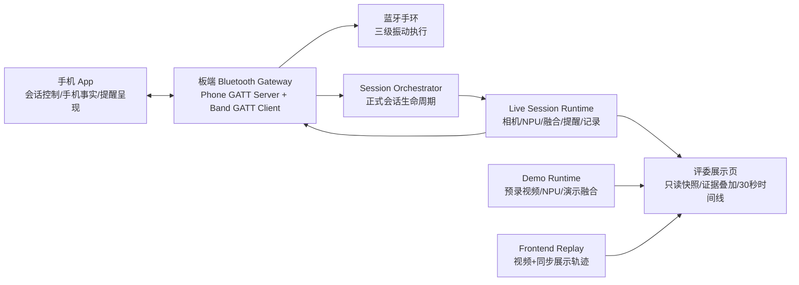

# EdgeFocus 板端展示、正式会话与蓝牙可靠性规格

日期：2026-07-14
状态：待用户最终复核
适用范围：板端主程序与展示页；其中正式会话蓝牙章节作为 App、手环后续改造依据

文档使用规则：预录 NPU 与前端保底回放属于主机内部展示实现，不进入 App/手环交接协议，也不通过 GATT 暴露演示模式或演示状态。

## 1. 目标

本规格冻结以下边界，供板端先实施，并作为后续 App、手环源码审查与改造的共同依据：

1. 现场摄像头展示必须是正式会话的只读展示切面。
2. 预录视频是独立演示运行域，优先使用板端 NPU 实时推理。
3. NPU 回退是明确标识的纯前端同步动画，不冒充实时推理。
4. 恢复视频视觉证据叠加与近 30 秒证据时间线。
5. 当前版本禁用全部云台功能，板载屏幕与声音输出继续保持移除。
6. 修正 App 与手环通信中的丢消息、假送达、状态闪断和 ACK 无法关联问题。
7. 板端完成后，再分别审查 App 与手环源码，补齐遗漏功能并删除多余功能。

## 2. 总体架构



系统分为两个互斥运行域：

- `SessionRuntime`：真实产品会话，产生正式记录并允许向 App、手环发出提醒。
- `DemoRuntime`：无会话时的展示能力，不写正式记录，不向 App、手环发出提醒。

真实会话拥有最高优先级。App 发起真实会话时，如果预录演示正在运行，必须先停止演示，再进入正常预检流程。

预录演示只接受板端展示页本地控制。App 的 `session_control` 始终创建 `LIVE_CAMERA` 正式会话；通过 GATT 请求 `recorded_input` 或其他演示源时必须拒绝。

### 2.1 运行域权限矩阵

| 写操作 | IDLE | DemoRuntime | SessionRuntime |
|---|---|---|---|
| App 启动正式会话 | 允许 | 先原子停止 Demo，成功后允许 | 幂等返回当前会话 |
| App 暂停/恢复/结束 | 无会话时拒绝 | 拒绝 | 允许 |
| 展示页切换输入/启动演示 | 允许 | 允许控制当前演示 | 拒绝 |
| 展示页手动演示手机事实 | 拒绝 | 仅 `RECORDED_NPU` 允许 | 拒绝 |
| 旧 Demo `force_*`/提醒/计数写接口 | 拒绝 | 拒绝 | 拒绝 |
| 正式数据库、提醒 outbox、App/手环输出 | 不写 | 禁止 | 仅正式流程允许 |

App 启动正式会话时，停止 Demo、释放视频/NPU所有权并清空演示状态必须作为一个受控切换完成；释放失败则拒绝启动正式会话，两个运行域不得并存。

## 3. 功能归属

| 功能 | 板端 | App | 手环 | 展示页 |
|---|---|---|---|---|
| 正式会话创建、阶段切换和持久化 | 主责 | 发起/控制 | 无 | 只读 |
| 相机采集、NPU 推理、视觉时序判定 | 主责 | 无 | 无 | 展示结果 |
| 手机使用分类 | 接收原始事实 | 主责 | 无 | 现场只读，演示可手动 |
| 分神等级融合 | 主责 | 无 | 无 | 展示结果 |
| 提醒决策与事件生成 | 主责 | 无 | 无 | 展示状态 |
| 提醒文字与声音呈现 | 发送事件 | 主责 | 无 | 仅展示 |
| 振动提醒 | 调度、重试 | 无 | 执行 | 展示投递状态 |
| 预录 NPU 演示 | 主责 | 无 | 无 | 控制与展示 |
| NPU 保底回放 | 提供静态素材 | 无 | 无 | 主责 |
| 云台 | 当前禁用 | 不显示控制 | 无 | 不显示控制 |

## 4. 展示模式与状态机

### 4.1 模式

无真实会话时允许选择：

- `LIVE_CAMERA`：等待或展示真实会话。
- `RECORDED_NPU`：预录视频进入板端真实视觉推理链。
- `FRONTEND_REPLAY`：纯前端保底回放。

页面只提供两个一级入口：`现场摄像头`、`预录演示`。进入预录演示后，再提供：

- `NPU 优先`：默认；模型初始化失败或有效推理连续中断时进入保底回放。
- `强制保底回放`：现场主动验证保底展示。

真实会话处于 `PRECHECK/FOCUSING/PAUSED/ENDING` 时，所有模式切换控件锁定。

### 4.2 现场摄像头

- 按既有正式流程由 App 启动会话：`PRECHECK -> FOCUSING -> PAUSED/ENDING -> IDLE`。
- 展示页不得自行建立正式会话或覆盖正式判定。
- 手机类别控件显示但不可点击；HTTP 接口也必须拒绝手动覆盖。
- 手机类别仅来自当前会话的 App 蓝牙事实。
- NPU 故障时显示真实的降级/不可用状态，现场模式不得切换为伪造前端结果。
- 会话提醒可真实投递到 App 和手环。

### 4.3 预录 NPU 演示

- 不创建正式会话记录，不计入用户统计。
- 不向 App 或手环发送提醒；只显示“此时将触发提醒”。
- P01 素材合成为约 30～35 秒循环视频：正常在座、趴下、恢复并使用手机、人离开。
- 人在、趴下、人体框、关键点和置信度由 NPU 实时生成。
- 页面允许手动选择 `未使用/学习/娱乐/其他`，用于演示外部手机事实参与融合。
- 页面必须明确标注 `预录输入 · 实时 NPU`。

### 4.4 纯前端保底回放

- 播放与预录 NPU 模式相同的视频。
- 根据视频播放位置同步播放预先生成的完整展示轨迹：视觉覆盖层、人在、趴下、手机状态、综合等级、近 30 秒时间线。
- 手机状态由轨迹脚本自动变化，页面手动手机控件禁用。
- 不调用 NPU、融合层、正式会话、蓝牙提醒或统计模块。
- 页面必须明确标注 `演示回放 · NPU 保底模式`。
- 自动回退条件固定为：模型初始化失败，或视频帧持续有效但连续 2 秒没有新的有效 NPU 结果。
- 进入回退时统一从视频 0 点重启并清空时间线，不尝试跨 NPU/浏览器时钟无缝续播。
- 自动进入回退后保持回退，避免 NPU 状态抖动造成页面来回切换；用户可在无会话时重新启动 NPU 演示。

## 5. 展示证据

### 5.1 视频证据叠加

现场摄像头和预录 NPU 模式恢复以下覆盖内容：

- 主体人体框与主体标识。
- 可用姿态关键点和骨架。
- `presence`、`prone` 及置信度。
- 推理来源、帧编号、推理 FPS、推理延迟和证据年龄。

保留 `显示证据叠加` 开关，展示环境默认开启。手机类别必须标记为外部证据，不能绘制成视觉模型识别结果。

后端向页面发布原子证据快照，至少包含：

```text
run_id, sequence, media_timestamp_ms, frame_sequence,
preview_frame, boxes, keypoints, presence, prone,
phone_fact, assessment_level, inference_health
```

同一个 `sequence` 的图像、覆盖层和判定必须来自同一证据时刻，禁止把上一帧判定绘制到下一帧图像上。页面可以平滑显示相机预览，但覆盖层必须显示证据年龄。

### 5.2 近 30 秒证据时间线

固定恢复四条轨道：

- `PRES`：人在证据。
- `PRONE`：趴下证据。
- `PHONE`：外部手机事实。
- `LEVEL`：融合等级。

要求：

- 以时间而不是帧数量采样，推理 FPS 变化不能改变横轴语义。
- 历史轨迹最高按 4 Hz 采样，30 秒最多保存 120 个原子快照。
- 视频、证据叠加和时间线共享同一播放/单调时钟。
- 预录视频开始新一轮循环时清空上一轮轨迹，不跨循环串数据。
- 数据过期或不可用时显示断点或灰色区域，不无限延长最后状态。
- 前端回放使用同一渲染数据结构，确保页面布局不突变。

预录视频与回放轨迹必须由 manifest 锁定：视频 SHA-256、轨迹 SHA-256、时长、FPS、循环边界、片段媒体时间、模型版本和配置哈希。seek 后按目标媒体时间重新定位轨迹；pause 时视频与轨迹同时暂停；loop 时两者同时归零。

## 6. 蓝牙消息契约

### 6.1 GATT 兼容边界

当前 Phone GATT 服务 UUID 和收发特征保持兼容：

- Service：`0000ff00-0000-1000-8000-00805f9b34fb`
- App -> Board：`0000ff01-0000-1000-8000-00805f9b34fb`
- Board -> App：`0000ff02-0000-1000-8000-00805f9b34fb`

继续支持现有 JSON 请求、响应和大消息分片。新增字段可被旧 App 忽略，但可靠重发必须经过能力协商后才能启用。

新 App 连接后发送：

```json
{
  "cmd": "client_hello",
  "id": 1,
  "data": {
    "app_version": "...",
    "capabilities": ["event_ack_v1", "event_dedupe_v1", "phone_heartbeat_v1"]
  }
}
```

只有同一连接同时声明 `event_ack_v1` 和 `event_dedupe_v1` 时，板端才启用提醒重发。未协商能力的旧 App 维持单次推送，避免重复展示。

订阅和能力协商允许任意先后顺序。每次连接分别跟踪 `notifications_subscribed` 与 `reliable_push_negotiated`；两者第一次同时为 true 时触发一次可靠补发。只有订阅、没有 hello 的旧 App 只接收当前快照和后续单次事件，不执行历史补发。

### 6.2 通用事件信封

关键板端事件采用：

```json
{
  "cmd": "push_alert",
  "data": {
    "schema_version": "2.1",
    "event_id": "evt-...",
    "session_id": "session-...",
    "episode_id": "episode-...",
    "created_at_ms": 0,
    "ttl_ms": 10000,
    "remaining_ttl_ms": 10000,
    "level": 2,
    "reasons": ["PHONE_ENTERTAINMENT"],
    "message": "...",
    "targets": ["APP", "BAND"]
  }
}
```

`event_id` 在一次提醒生命周期内稳定，重发不得生成新 ID。

所有过期判断以板端 `steady_clock` 为准。`created_at_ms` 仅供板端诊断；App 不比较板端与手机的绝对时间，只使用每次发送时更新的 `remaining_ttl_ms`。每个事件分别保存 `delivery_deadline` 和 `ack_deadline`：前者控制是否继续补发，后者控制是否仍接受后续 ACK。

### 6.3 App ACK

新增统一命令：

```json
{
  "cmd": "event_ack",
  "id": 123,
  "data": {
    "event_id": "evt-...",
    "session_id": "session-...",
    "stage": "received"
  }
}
```

`stage` 取值：

- `received`：App 已收到并完成解析。
- `presented`：App 已显示通知或开始播放提醒声音。
- `user_ack`：用户主动确认。

只有与当前或仍在待确认队列中的事件匹配的 `user_ack` 才能调整提醒冷却。旧 `reminder_ack` 暂时兼容，但不得影响无法关联的提醒。

ACK 阶段只能单调前进并且幂等：`received -> presented -> user_ack`。允许直接向前跳级；接受任意更高阶段时隐含完成全部前序阶段，并原子地从 outbox 移除。迟到的低阶段 ACK 不得使状态降级。ACK 使用 registry 内保存的 `session_id` 校验，不依赖当前会话。传输补发期限结束后，只要仍在 `ack_deadline` 内，`presented/user_ack` 仍可接受。响应必须明确返回以下之一：`accepted`、`duplicate`、`expired`、`session_mismatch`、`unknown_event`。

### 6.4 手机事实同步

App 上报原始事实，不上报最终分神等级：

```json
{
  "cmd": "phone_sync",
  "id": 124,
  "data": {
    "session_id": "session-...",
    "sequence": 18,
    "timestamp_ms": 0,
    "is_in_use": true,
    "app_category": "entertainment",
    "fresh_for_ms": 5000
  }
}
```

规则：

- 状态变化时立即发送。
- 状态不变时每 2 秒发送心跳。
- 板端默认有效期 5 秒；旧 App 未提供时，由板端使用 5 秒而不是 1 秒。
- 超时输出 `STALE/UNKNOWN`，不得自动解释为未使用。
- `sequence` 以 `session_id` 为作用域，从 1 开始递增；重连快照返回板端最后接受值，App 从下一值继续。
- 相同 sequence 且内容相同视为幂等重试并返回接受；相同 sequence 但内容不同返回冲突；更旧 sequence 返回过期。
- 只有更大的 sequence 才更新事实与板端 `received_at`；相同 sequence 的幂等重试不刷新 5 秒新鲜度。
- 新鲜度只按板端接收时的 `steady_clock` 计算，不使用 App `timestamp_ms` 判断过期。
- App 提供的 `fresh_for_ms` 仅作兼容输入，板端固定/钳制为 5 秒，不能由 App 任意延长。
- `is_in_use=false` 时类别必须为空；`is_in_use=true` 时类别必须是 `learning/entertainment/other` 之一。
- 板端校验当前 `session_id`、sequence 和分类合法性，并在响应中返回最后接受 sequence。
- `learning` 只弱化手机路径，不得降低独立的趴下视觉证据。

### 6.5 重连与补发

App 完成通知订阅后：

1. 板端发送当前完整会话快照。
2. 板端补发尚未过期且未收到 `received` ACK 的关键事件。
3. App 恢复手机事实心跳。

只为 `push_alert`、`push_session_end` 保存有界待发队列。普通状态推送允许由完整快照恢复，不逐条补发。

固定规则：

- App outbox 容量为 8，ACK registry 容量为 32。
- `push_alert` 传输 TTL 为 10 秒，`push_session_end` 传输 TTL 为 60 秒。
- 重发节奏为创建后 0、500、1500、3000 ms；之后仅在 App 重新订阅时补发一次。
- 收到 `received` 后从 outbox 移除，但 ACK registry 固定保留至创建后 120 秒；`push_session_end` 同样保留 120 秒，不因当前会话已经结束而立即清除。
- outbox 和 registry 是同一事件记录的两个索引。溢出淘汰必须原子移除所有索引并停止重发；未到期的容量淘汰记为 `dropped_overflow`，不得混用 `expired`。
- 溢出时先清除过期项和已确认项，再淘汰最旧的低等级提醒；`push_session_end` 优先级高于普通提醒，不得被普通提醒挤出。
- 同一逻辑消息的分片必须连续发送，不能与另一消息的分片交错；App 完成重组和 JSON 解析后才能发送 `received`。

重连完整快照至少包含：当前 `session_id/phase`、板端最后接受的 phone sequence、当前手机事实及年龄、活动提醒 `event_id`，以及 App/手环各自的投递状态。

## 7. 手环投递

现阶段保留既有三级提醒帧，板端负责可靠调度：

```text
[0x01, pattern, level]
```

固定映射：`LEVEL_1 -> pattern 0x01`、`LEVEL_2 -> 0x02`、`LEVEL_3 -> 0x03`，手环提醒 TTL 统一为 10 秒。

队列容量固定为 `1 条 in-flight + 1 条 pending`。两者至少保存：`event_id/level/pattern/deadline/attempt/status`。真值规则：

| 当前状态 | 新事件/连接变化 | 处理 |
|---|---|---|
| 空槽 | 任意新事件 | 写入待发槽 |
| 有待发 | 更高等级新事件 | 新事件覆盖，旧事件记 `superseded` |
| 有待发 | 同等级更新事件 | 新事件覆盖，旧事件记 `superseded` |
| 有待发 | 更低等级新事件 | 保留当前事件，新事件记 `suppressed_by_higher` |
| 正在写入且 pending 为空 | 更高等级新事件 | 不取消 DBus 调用；新事件进入 pending |
| 正在写入且 pending 为空 | 同级或更低等级新事件 | 不重复排队；新事件记 `suppressed_by_inflight` |
| 正在写入且已有 pending | 任意新事件 | 只与 pending 比较，按更高/同级覆盖、低级抑制规则处理 |
| 断连 | 有待发事件 | 保留且不消耗写入重试次数 |
| 重连 | 待发未过期 | 立即尝试写入 |
| 任意 | 已过期 | 记 `expired` 并清空 |

规则：

- 断连或写失败时，仅缓存最新且未过期的提醒。
- 新的更高等级提醒可以覆盖未发送的低等级提醒。
- 重连后只发送未过期提醒，不补震陈旧提醒。
- 写入计划固定为首次 0 ms、消耗瞬态失败预算后 500 ms、再次失败后 1500 ms；每个事件最多消耗 3 次瞬态失败预算。
- 每次 DBus 调用都增加诊断 attempt；`NotConnected/ServicesUnavailable` 归类为断连，转回 pending 且不消耗三次瞬态失败预算，因此 TTL 内因多次重连产生的实际调用数可以超过 3；其他瞬态错误消耗失败预算。
- 如果低等级 in-flight 写失败且已有更高等级 pending，低等级记 `superseded`，优先发送高等级，不再重试低等级。
- DBus 单次写入超时目标不超过 1 秒，不能保留现有最长 5 秒阻塞语义。
- 每次写前检查过期；写返回后再次检查，成功但已过期时仍记录传输结果，同时不得再重试。
- 写入必须在独立工作线程完成，不得以最长 5 秒同步调用阻塞其他设备动作。
- BlueZ 写成功只能标记 `sent/written`，不能标记用户已感知。

App 与手环按目标分别保存投递状态。手环不存在 `received/presented/acknowledged` 阶段，只能到 `sent`。

板端完成后必须再审查手环固件，核对振动模式、命令解析、电源状态、无用命令和是否存在反向状态能力。本规格不预判固件一定无需修改。

## 8. 投递状态与统计

统一状态语义：

- `pending`：已生成，尚未成功写入目标。
- `sent`：已写入传输层或手环特征。
- `received`：App 明确确认收到。
- `presented`：App 明确确认已呈现。
- `acknowledged`：用户主动确认。
- `expired`：超出有效期，不再补发。
- `failed`：在有效期内发生不可恢复错误。

`attempted`、`sent`、`acknowledged` 必须分别记录，不能再在发送前把 App 通道写成已送达。正式会话的提醒次数按策略生成事件次数统计，另行记录各目标投递结果。

## 9. 云台、板载屏幕与声音

- 当前版本不注册 `GimbalMonitor` 常驻模块。
- 不向 `SessionRuntime` 添加 `GimbalSessionFeature`。
- 启动时忽略数据库中历史 `gimbal_enabled=true`；配置强制为 false，偏好更新也不得重新启用。
- BLE、HTTP 和 Demo 的所有云台控制入口统一返回明确的 `disabled`。
- 当前板端展示页隐藏云台控制和云台预检步骤；App 内对应 UI 的删除属于后续 App 源码阶段。
- 板载屏幕和板载声音继续保持禁用；文字与声音提醒由 App 呈现。
- 云台代码可以保留，待硬件稳定后作为可选会话特性重新启用。

## 10. App 与手环后续源码审查

板端实现并验证后，分别在 App 和手环工作区执行源码审查，不把其他项目源码复制到本仓库。

给 App/手环工作区的交接文档只抽取本规格的正式会话、手机事实、提醒事件和投递章节；不得包含预录 NPU、前端回放、演示手机输入或展示页模式控制。

### 10.1 App 审查清单

- 会话启动、预检、暂停、恢复、结束是否与板端阶段一致。
- 手机前台分类是否完整覆盖 `未使用/学习/娱乐/其他`。
- 是否实现状态变化即时上报和 2 秒心跳。
- 是否处理 `received/presented/user_ack`，并按 `event_id` 去重。
- 断线重连后是否重新订阅、请求快照并恢复心跳。
- 板载屏幕/声音迁移后，App 是否完整承担提醒 UI 和声音。
- 是否存在板端已经接管、应从 App 删除的重复决策逻辑。
- 是否存在旧困倦、旧视觉状态、旧云台或旧本地分神等级逻辑。

### 10.2 手环固件审查清单

- 三级命令和振动模式是否与产品语义一致。
- 是否存在板端不再调用的多余命令或历史模式。
- 命令处理是否幂等，重复写入是否造成异常叠加。
- 振动执行期间的新高等级命令如何抢占。
- 低电量、断连、休眠和重连行为是否合理。
- 是否值得增加轻量状态/ACK；若增加，另行升级协议版本，不阻塞当前板端实现。

审查产物应为“保留、删除、新增、修改、暂缓”五类功能差异表，再决定实际修改范围。

## 11. 验收标准

### 板端与展示页

- 无会话时可选择现场或预录；真实会话期间不能切换。
- 现场模式手机控件前后端均只读。
- App GATT 无法选择预录输入，展示页也无法创建正式会话。
- 正式会话期间，旧 `force_*`、HTTP session-control、触发提醒和修改计数等 Demo 写入口均不能改变正式状态。
- 预录 NPU 模式可手动切换手机类别并真实更新演示融合结果。
- 强制/自动前端回放时手机控件禁用，轨迹与视频同步。
- 两种 NPU 模式均显示视觉证据叠加和近 30 秒四轨时间线。
- 现场 NPU 故障显示真实降级，不出现伪造推理结果。
- 云台线程、串口动作、预检和页面控件均未启用。
- 历史 `gimbal_enabled=true` 与 BLE/HTTP/Demo 控制命令均不能重新启用云台。

### App 通信

- 手机心跳短暂抖动不导致 1 秒闪断；5 秒超时后明确显示过期。
- App 断连期间生成的未过期提醒可在重连后补发。
- 同一 `event_id` 重发不会重复显示或重复用户统计。
- 迟到 ACK 不影响其他会话或其他提醒。
- 投递状态不再提前显示成功。

### 手环通信

- 断连时不阻塞会话线程。
- 短暂断连后可发送仍有效的最新提醒。
- 过期提醒不会在重连后突然补震。
- 失败、重试、成功和过期状态均可在诊断快照中观察。

### 分阶段验收门

五天内的板端门使用确定性 GATT 测试客户端和手环 test double 验证新协议、断连、重发、ACK 与过期；不得把测试客户端通过表述为真实 App 已完成支持。

真实跨设备门在板端稳定后执行：审查并修改 App/手环源码，再使用真实 App 和真实手环完成端到端验收。

App 云台 UI 与云台预检入口的删除也在真实跨设备门完成，不计入当前板端门。

## 12. 实施顺序

1. 板端模式状态机、输入源和展示只读权限。
2. P01 合成视频、预录 NPU 链路、前端同步回放轨迹。
3. 恢复视觉证据叠加和 30 秒时间线。
4. 禁用云台注册与控制面。
5. App 事件 outbox、ACK、手机事实心跳与投递状态。
6. 手环异步队列、重试、过期和诊断状态。
7. 单元测试、浏览器视觉 QA、板端部署和断连场景验证。
8. 转入 App、手环源码工作区进行对照审查和后续修改。

## 13. 非目标

- 本轮不重新设计或训练趴下模型。
- 本轮不恢复左右转头识别。
- 本轮不启用云台。
- 本轮不修改手环固件或 App 源码；只冻结契约并完成板端。
- 前端回放不作为真实 NPU 性能或识别准确率证据。
