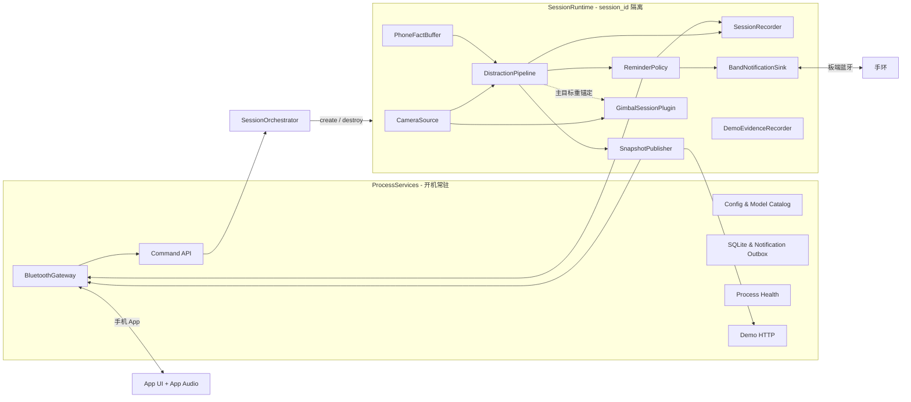
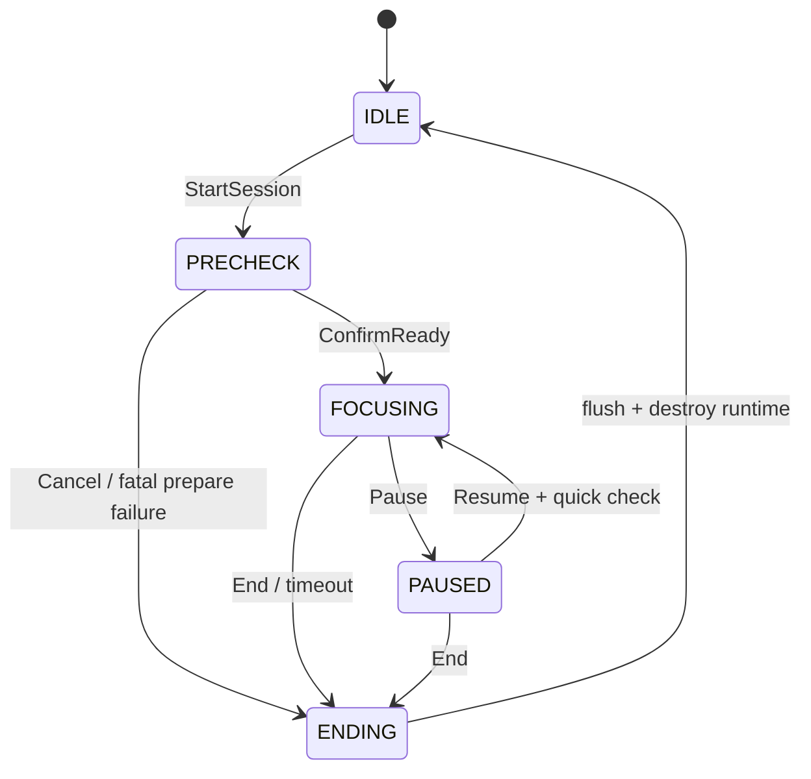

# EdgeFocus 主程序会话中心架构规格

日期：2026-07-14  
状态：用户已批准  
适用仓库：`code/focus_app`  
判定核心来源：`code/distraction_core/cpp`

## 1. 背景与结论

独立 C++ `distraction_core` 已在 STM32MP257 板端使用真实摄像头和 NPU 验证通过，当前可靠能力收束为：人在/不在、是否趴下、App 原始手机类别融合、三级分神等级、原因与 episode。

主程序现状以进程级常驻线程组织 Camera、Vision、Behavior、Reminder、Device 和 Gimbal，并通过大型共享 `SystemStateStore` 判断会话状态。该结构会造成空闲时仍运行、跨会话状态泄漏、整对象并发覆盖、旧状态语义渗透和演示路径绕过生产链。

目标架构采用：

1. `ProcessServices`：开机常驻，只负责接入、配置、持久化与健康。
2. `SessionOrchestrator`：唯一会话生命周期所有者。
3. `SessionRuntime`：每次会话创建的隔离运行域。
4. 新 `DistractionCore`：视觉、手机事实融合和分神等级的唯一决策者。
5. App 与手环：均通过板端蓝牙；App 承担显示和声音，手环由板端直连执行提醒。
6. 云台：会话级辅助插件，失败只降级为固定机位，不影响判定主链。

## 2. 产品范围

### 2.1 保留

- 会话开始、预检、正式专注、暂停、恢复、结束与报告
- 真实摄像头和 NPU 推理
- Presence / Prone 视觉证据
- App 上报 `未使用 / 学习 / 娱乐 / 其他`
- 动态三级分神等级、原因、episode
- 提醒冷却、升级、用户确认
- App 蓝牙命令、状态、提醒与声音
- 板端蓝牙手环提醒
- 云台预检自动找人、App 手动调整、正式会话 OpenCV 跟踪
- SQLite 会话记录与报告
- 浏览器演示页、预录视频真实推理、NPU 故障证据回放

### 2.2 删除

- 困倦、闭眼疲劳、建议休息
- `LOOKING_AWAY`、旧左右转头业务状态
- 视觉手机识别占位字段
- 固定风险常数与手机倍率污染视觉风险
- 旧 `FocusStateMachine/EventDetector/RiskScorer` 生产决策路径
- 板载 ScreenController、FrameBuffer UI、SoundController 及板端屏幕/声音路由
- 演示页通过 override 伪造生产状态的路径

### 2.3 暂不纳入

- 直接识别沉思、发呆等内部认知状态
- 新增脸部、眼神或左右转头专家
- 云台故障影响分神等级
- Evidence Replay 产生真实提醒或写入正式会话统计

## 3. 顶层架构



## 4. 生命周期

### 4.1 进程级常驻服务

以下服务在进程启动后常驻，但不得在 IDLE 阶段运行分神推理：

- `BluetoothGateway`
  - Phone GATT Server：接收 App 命令/手机事实，发送状态/提醒。
  - Band GATT Client 协调器：管理同一 BlueZ 适配器上的手环连接。
- `Command API`：解析类型化命令，调用 `SessionOrchestrator`。
- `ConfigService / ModelCatalog`：绝对路径、版本、checksum、能力配置。
- `SQLiteStore / NotificationOutbox`：持久化、提醒重试、崩溃恢复。
- `ProcessHealthService`：进程、蓝牙、存储和资源健康。
- `DemoHttpServer`：只读快照和显式会话命令，不拥有业务状态。

### 4.2 SessionRuntime

一次会话必须有唯一 `session_id`、唯一 `SessionContext` 和唯一 `SessionRuntime`。Runtime 销毁时必须释放所有窗口、episode、提醒冷却、相机、tracker、串口任务和会话队列；下一次会话不得复用上次的时序状态。

会话核心服务：

- `CameraSource`
- `DistractionPipeline`
- `PhoneFactBuffer`
- `ReminderPolicy`
- `SessionRecorder`
- `SnapshotPublisher`

会话扩展：

- `GimbalSessionPlugin`
- `BandNotificationSink`
- `DemoEvidenceRecorder`

扩展统一实现：

```cpp
class ISessionFeature {
public:
    virtual PrepareResult prepare(const SessionContext&) = 0;
    virtual void enterPhase(SessionPhase) = 0;
    virtual void stop(StopReason) noexcept = 0;
    virtual FeatureHealth health() const = 0;
    virtual ~ISessionFeature() = default;
};
```

扩展不得直接改写会话 phase，只能向 Orchestrator 返回准备结果或健康事件。

## 5. 会话状态机



### 5.1 IDLE

- 手机 App 蓝牙、命令、配置、存储、健康和演示 HTTP 常驻。
- 不打开相机，不运行 NPU，不产生提醒。
- 手环可保持低成本待机状态，但不发送提醒。

### 5.2 PRECHECK

严格启动顺序：

1. 创建 session row 与 `SessionRuntime`。
2. 打开唯一 `CameraSource`。
3. 加载/检查 NPU 模型与时序模型。
4. 发布预览和健康状态。
5. 启动 Gimbal PRECHECK：安全搜索或 App 手动调整。
6. 连接/确认手环。
7. 用户或策略确认 ready 后进入 FOCUSING。

PRECHECK 不累计分神、不触发提醒。

### 5.3 FOCUSING

- 进入时原子重置 Fusion、episode、提醒冷却和正式计时起点。
- Camera → Perception → Fusion 为唯一判定链。
- 手机上报只作为原始事实进入 Fusion，不接受 App 给出的分神等级。
- 云台切换为 TRACKING。
- ReminderPolicy 输出 App 与 BAND 两种目标。
- SessionRecorder 记录 assessment、episode、提醒和送达结果。

### 5.4 PAUSED（批准策略 A：低功耗保持）

- 暂停正式计时、Fusion 连续性和提醒。
- 云台发送 STOP 并保持当前角度。
- 相机保留降帧预览。
- NPU 低频运行，只用于 presence/快速恢复检查；结果不计入正式 episode。
- App 和手环连接保持。
- Resume 时执行快速 presence/health check，通过后重置 Fusion 连续性并回到 FOCUSING。

### 5.5 ENDING

严格停止顺序：

1. 禁止产生新提醒。
2. 停止 Gimbal 自动控制并发送安全 STOP。
3. 停止视觉任务和相机输入。
4. 闭合所有 episode。
5. 刷写事件、提醒送达与报告。
6. 发布终态快照。
7. 销毁 SessionRuntime，返回 IDLE。

所有 stop 必须幂等，异常退出的开放会话由下次启动标记为 `interrupted`。

## 6. 新判定链融合

`distraction_core/cpp` 的下列实现迁入主程序内部库 `edgefocus_distraction_core`：

- YOLO Pose decode / NMS / seat subject selection
- 58 维 keypoint feature extraction
- Portable MLP 加载与 OnlineProneClassifier
- FusionCoreCpp 及 episode
- STAI Pose Runtime

生产数据流：

```text
CameraFrame
  -> FrameQualityGate
  -> StaiPoseRuntime
  -> decode_yolo_pose
  -> select_seat_subject
  -> extract_keypoint_features58
  -> OnlineProneClassifier
  -> VisualEvidence(presence, prone, subject_box)
  + PhoneObservation
  -> FusionCore
  -> DistractionAssessment
```

旧 `VisionResult` 和 `FocusState` 不能作为新生产契约的中间层。兼容字段仅可在 App/API 边界临时派生，并必须标注 deprecated。

## 7. 稳定数据契约

### 7.1 PhoneFact

```text
session_id
sequence
received_monotonic_ms
source_timestamp_ms
active
category = LEARNING | ENTERTAINMENT | GENERAL_OR_UNKNOWN | null
fresh_for_ms
```

同一 session 内 sequence 必须递增；重复/乱序丢弃。断连产生显式 stale，不伪造 OFF。

### 7.2 DistractionAssessment

```text
timestamp_ms
applicability = ACTIVE | NOT_PRESENT | UNKNOWN
level = 0 | 1 | 2 | 3 | null
reasons[]
distraction_episode
presence_episode
prone_episode
would_remind
```

NOT_PRESENT 与 UNKNOWN 不属于分神等级。

### 7.3 SessionSnapshot

Snapshot 是 UI/App/演示唯一读取面：

```text
schema_version, boot_id, sequence, snapshot_ms
session{id, phase, mode, elapsed_ms, remaining_ms}
source{mode, id, label, status}
health{camera, npu, model, bluetooth, frame_age_ms, latency_ms, fps}
visual{presence, prone, subject_box, evidence_timestamp_ms}
phone{active, category, freshness}
assessment{applicability, level, reasons, episodes}
reminder{episode_id, level, state, delivered_to[], acknowledged}
gimbal{phase, health, angle, tracking, manual_lease}
frame{frame_id, preview_sequence, overlay_sequence}
```

SnapshotPublisher 是唯一写者。各模块发布领域事件/局部状态，不再对整份快照 read-modify-write。

## 8. 蓝牙与提醒

`BluetoothGateway` 是对 BlueZ 的统一进程级入口，但保留两种明确角色：

- Phone endpoint：板端 GATT Server。
- Band endpoint：板端 GATT Client。

`NotificationRouter` 只允许：

- `APP`
- `BAND`

删除 `SCREEN`、`SOUND`、`LIGHT` 生产路由。App 收到 ReminderEvent 后展示并播放声音；板端不播放声音。

ReminderEvent 必须包含：

```text
event_id, session_id, episode_id, level, reasons,
created_at_ms, delivery_targets, attempt, requires_ack
```

App 通道通过 Outbox 持久化、重试和 event_id 去重；手环通道记录写入尝试和送达结果。App 用户确认通过 `event_id/episode_id` 回传，不再只修改一个全局冷却值。

## 9. 云台会话插件

### 9.1 单一所有权

- CameraSource 是相机唯一所有者。
- Gimbal 插件只消费共享帧与 `TrackingObservation`。
- GimbalController 是串口唯一所有者。
- App 手动命令与自动控制必须通过同一 CommandArbiter。

### 9.2 PRECHECK

- 在配置的安全角度范围内分步扫动。
- 每一步等待画面稳定后检查主用户。
- 找到用户后停止搜索并等待确认。
- App 手动命令获得短时 manual lease；lease 有效期内自动搜索/跟踪暂停。

### 9.3 FOCUSING

- NPU 主目标框周期性初始化/校正 OpenCV tracker。
- OpenCV tracker 在 NPU 帧间提供较高频中心误差。
- 串口控制应用 deadband、命令频率限制、最大单步角度和软限位。
- 短时丢失保持；持续丢失后才安全重搜索。

### 9.4 故障

串口离线、超时、越界、tracker 异常或相机目标不足时：

1. 发送 STOP（若串口可用）。
2. 状态进入 `DEGRADED_FIXED_CAMERA`。
3. 禁止继续自动命令。
4. 主会话、NPU、Fusion 与提醒继续运行。

## 10. 演示与备用路径

### 10.1 LIVE_CAMERA

真实相机与 NPU。预览帧可按相机帧率刷新；pose/assessment overlay 只按推理帧刷新并显示新鲜度。

### 10.2 RECORDED_INPUT

预录视频作为 CameraSource 的替代输入，逐帧进入同一 NPU、时序和 Fusion。页面显著标记 `RECORDED INPUT / REAL INFERENCE`。

### 10.3 EVIDENCE_REPLAY

只在 NPU 无法运行时播放事先保存的帧、模型输出和 assessment。页面显著标记 `EVIDENCE REPLAY / NOT LIVE INFERENCE`。

- 不进入正式 ReminderPolicy。
- 不写入正式会话统计。
- 不允许把 override 值冒充推理结果。

## 11. 并发与容错

- 所有时间判断使用 monotonic clock；持久化另存 wall clock。
- 帧、PhoneFact、Assessment 均带 session_id、sequence 和 timestamp。
- 队列有明确丢弃策略和真实 dropped 计数。
- 相邻证据超过 maximum_gap 关闭连续性。
- run loop 异常被模块边界捕获并上报 health，不触发 `std::terminate`。
- SessionOrchestrator 的 phase transition 串行化；重复命令幂等。
- shutdown 采用 stop token + 有界等待；超时记录为 degraded，不无限阻塞。

## 12. 验收标准

### 架构

- IDLE 时相机/NPU/视觉/提醒/云台线程不运行。
- 每次 Start 创建新 session_id 和新 Fusion/episode 状态。
- SessionRuntime 销毁后无残留线程或设备句柄。
- UI/App/Demo 只读 SessionSnapshot。

### 判定

- 主程序与已验证独立 C++ 子程序对同一输入产生等价 Presence/Prone/Fusion 结果。
- 旧困倦、转头、视觉手机和固定风险路径不可达。
- App 切换娱乐→其他保持风险 episode；切学习/未使用按新核心规则下降或关闭。

### 蓝牙与提醒

- App 与手环可共用板端适配器工作。
- App 提醒支持 ACK、重试、去重。
- 手环三级指令与送达状态可观测。
- 板端不调用屏幕与声音控制器。

### 云台

- PRECHECK 自动搜索与手动控制不会并发发串口命令。
- FOCUSING 使用共享相机帧，不创建第二个 VideoCapture。
- 插件失败后主推理和提醒继续运行。

### 演示

- LIVE、RECORDED_INPUT、EVIDENCE_REPLAY 来源标签不可混淆。
- Recorded input 走真实推理链。
- Evidence replay 不触发生产提醒或写正式统计。

