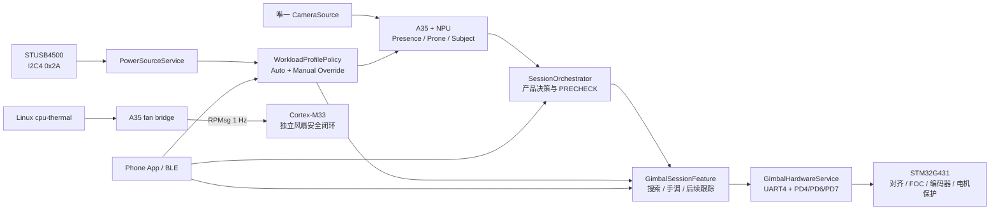
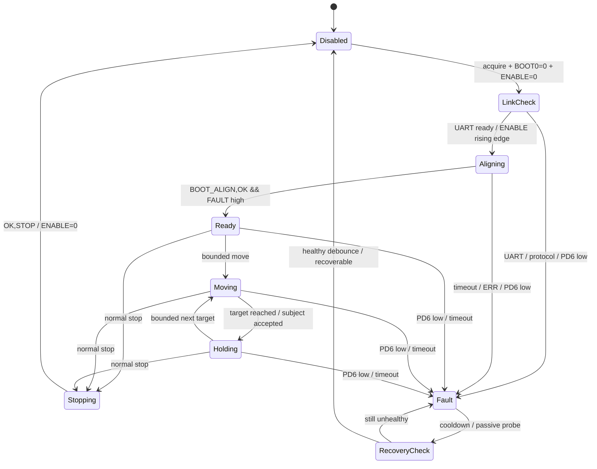

# EdgeFocus 云台、外部供电与异构控制设计

状态：规格已批准，待实施

日期：2026-07-15

适用平台：STM32MP257 自研板（A35-TD / OpenSTLinux）、STM32MP257 Cortex-M33、STM32G431 云台控制板、STUSB4500QTR

## 1. 决策摘要

本设计采用“进程级硬件服务 + 会话级云台插件”方案：

- A35/Linux 独占云台 UART4、PD4/PD6/PD7 和 STUSB4500 所在 I2C4；
- G431 独占云台电机对齐、FOC、编码器、PWM、保持与驱动故障处理；
- M33 功能冻结在已经上板的风扇安全闭环，不接云台或充电；
- 正式会话的 PRECHECK 使用有界自动搜索，找不到人物则回中心并允许用户手调；
- STUSB4500 只提供“外部供电存在/不存在/未知”事实，不恢复已经取消的电量显示；
- 外接电源默认 Home，无外接电源默认 Go；手动覆盖保持到下一次确认的电源插拔；
- Go 首版只降低应用任务频率，不修改 Linux CPU governor，也不降低安全与通信频率。

直接修补旧 `GimbalMonitor/DeviceManager` 被否决，因为同步 UART 轮询无法可靠处理异步 `BOOT_ALIGN`，且旧供电归一化会覆盖用户手动模式。Linux 内核驱动路线保留为进入国赛后的升级计划，不进入本轮展示交付。

## 2. 目标

1. 在不依赖 M33 的情况下安全调通 MP257 → UART4 → G431 → 云台电机链。
2. 先用独立 bring-up 程序完成无运动、对齐、Fault、STOP 和小角度运动验证，再复用同一硬件核心接入主程序。
3. 把云台作为可降级的会话功能：故障时退化为固定摄像头，不让会话主链失效。
4. 在 PRECHECK 中完成一次受限人物搜索，并明确自动与手动控制权交接。
5. 从 STUSB4500 可靠获得外部供电事实，驱动 Home/Go 自动策略和用户临时覆盖。
6. 删除产品界面和协议中的虚假电量语义；本轮板端与新版 App 同步升级，不保留旧 App 兼容层。
7. 固化 A35/NPU、M33、G431 的异构职责图、故障隔离和评委讲解口径。

## 3. 非目标

本轮不做：

- 不把云台、STUSB4500、充电芯片或 Home/Go 策略迁入 M33；
- 不修改已经部署的 M33 风扇固件、RPMsg 协议、PB10/PB11 或开机服务链；
- 不让 A35 直接生成云台电机 PWM、FOC 或编码器控制；
- 不在首轮 bring-up 直接加入持续人脸跟踪；
- 不打开第二个摄像头，不照搬示例程序的独立 `VideoCapture`；
- 不用 PD4 冒充 G431 复位脚，也不提供无法兑现的软件重启功能；
- 不写 STUSB4500 NVM，不改 PD 协商 PDO，不控制 MP2762 充电参数；
- 不在首版修改 Linux CPU/NPU governor；
- 不把未经实机验证的机械角度写成产品硬限位；
- 不为 Demo 回放伪造云台、电源或电量状态。

## 4. 已验证硬件事实

事实来源：

- 最新自研板网表：`hardware_bringup/20260715_new_tel/Netlist_Schematic1_2026-07-15.tel`；
- G431 资料：`_workspace/gimbal_develop_example/g431_board_control_signals.md`；
- 人脸跟踪示例：`_workspace/gimbal_develop_example/GimbalFaceTracking`；
- 运行板：`root@192.168.10.174` 的 device tree、pinctrl、GPIO、UART 与 I2C 只读检查；
- ST 官方 STUSB4500 数据手册 DS12499 与软件编程手册 UM2650。

### 4.1 云台连接

| MP257 资源 | 网络 | 方向 | 事实 |
|---|---|---|---|
| `/dev/ttySTM1` | UART4 → G431 UART | 双向 | Linux 节点对应 `serial@40330000`，115200 8N1，当前无人占用 |
| PD4 | `BOOT0_CTRL_G431` | 输出 | 只在 G431 复位时选择 ROM Bootloader；单独改变不会重启 |
| PD6 | `G431_FAULT_OUT` | 输入 | 开漏、低有效；网表连接 U1.B78 与 G431 U17.54，并由 R75 10 kΩ 上拉到 `MCU_3.3V` |
| PD7 | `G431_ENABLE_IN` | 输出 | 高有效；低→高触发两轴自动电角度对齐 |

G431 的 NRST 没有接到 MP257 可控 GPIO。普通运行不需要 NRST；固件升级进入/退出 Bootloader 需要人工 Reset 或重新给 G431 上电。

G431 板对 Enable 有硬件下拉。A35 释放 GPIO、进程崩溃或尚未接管时，预期默认禁止电机；该行为仍需在 bring-up 中实测并记录。

PD6 的外部上拉虽然已由网表确认，首次使能前仍必须实测“健康时稳定高、G431 Fault 时拉低、故障释放后恢复高”。任一项不成立都禁止拉高 PD7，不能用软件内部 pull-up 掩盖板级问题。

### 4.2 外部供电检测

| 资源 | 映射 | 已验证事实 |
|---|---|---|
| PD10 | I2C4 SDA / AF6 | Linux `i2c@40150000` |
| PD11 | I2C4 SCL / AF6 | Linux `/dev/i2c-1` |
| STUSB4500 | 7 位地址 `0x2A` | Device ID 寄存器 `0x2F` 读回 `0x25` |
| 当前未插电状态 | `0x0E=0x00`, `0x10=0x04` | Unattached 且 VBUS 处于 vSafe0V，与实物一致 |

I2C4 同时连接 MP2762。实现只能访问已知 STUSB4500 地址，禁止在生产程序中扫描整条总线或写未知设备。

STUSB4500 状态依据：

- `TYPEC_MONITORING_STATUS_1(0x10).VBUS_READY[3]`：VBUS 已处于 vSafe5V 或协商电压；
- `PORT_STATUS_1(0x0E).ATTACH[0]`：Type-C 端口已连接；
- `0x0D/0x0F` 含 read-clear 事件位，不作为普通轮询主状态，避免诊断读取清掉事件。

首版只按以下静态寄存器真值表生成供电事实：

| `ATTACH` | `VBUS_READY` | 原始事实 | 说明 |
|---:|---:|---|---|
| 0 | 0 | ABSENT | 已确认未连接且 VBUS 不可用 |
| 1 | 1 | PRESENT | 已连接且 VBUS 达到可用电平 |
| 1 | 0 | UNKNOWN | 可能处于插入/协商瞬态或异常，不提前宣告外部供电 |
| 0 | 1 | UNKNOWN | 寄存器组合不一致，保守等待稳定 |

原始 PRESENT/ABSENT 必须连续 3 次一致、采样间隔 250 ms 后才成为确认事实。单个原始 UNKNOWN 不直接覆盖最后确认事实；原始 UNKNOWN 连续达到 2 秒、连续 3 次读失败，或距最后成功样本超过 2 秒时，对外状态转为 UNKNOWN。转 UNKNOWN 仍保留最后确认事实及年龄用于诊断，不产生 power epoch，也不清除手动覆盖。

## 5. 异构系统边界



### 5.1 A35/NPU：感知与编排平面

- 唯一相机所有者和视觉/NPU 推理；
- 会话、PRECHECK、手机事实、提醒、App/手环和演示状态；
- 向 G431 发送经过限位和控制权仲裁的高层角度目标；
- 读取 STUSB4500 并决定应用工作档位；
- 不拥有电机底层控制或风扇失联安全闭环。

### 5.2 M33：散热安全实时岛

- 继续独占 TIM17/PB10 PWM、PB11 tach、温度 TTL 和断链安全高转速；
- 生命周期独立于 `focus_app`、正式会话和 Demo；
- 本轮不修改固件、协议或服务；
- 文档明确标记“功能冻结”，不再预留云台/充电的本轮实施项。

### 5.3 G431：电机确定性执行平面

- 两轴电角度对齐、FOC、电流环、编码器、PWM、保持和本地看门狗；
- 自己先处理失锁、编码器、驱动和 Enable 掉线故障；
- 只接收 A35 的高层目标，不理解人物、会话、走神或 Home/Go。

这种拆分的展示重点不是“用了多个核”，而是按时间确定性和故障范围把感知、系统安全和电机执行分到不同计算域。

## 6. 代码所有权与组件

### 6.1 `GimbalHardwareService`

进程级、单实例，建议位于 `platform/gimbal/`，由 `AppContext` 管理。职责：

- 独占打开 `/dev/ttySTM1`，配置 115200 8N1；
- 独占申请 PD4、PD6、PD7，启动时先输出 BOOT0=0、Enable=0；
- 单一 UART reader 持续解析同步响应和异步事件；
- command queue 串行发送业务命令并按响应类型完成 promise；
- 把 `BOOT_WAIT_ENABLE`、`BOOT_ALIGN,START/OK`、`ERR`、`STAT`、`FAULT` 等解析成类型化事件；
- 监听 PD6 下降沿；故障时立即撤销 PD7，并发布锁存原因；
- 暴露受限的 `enableAndAlign()`、`stopAndDisable()`、`moveTo()`、`hold()`、`status()`；
- 不暴露原始 UART 透传给 App、网页或会话代码。

旧 `GimbalController/GimbalMonitor` 不继续扩展。迁移期间可以保留兼容编译，但生产入口只能存在一个 UART/GPIO 所有者。

### 6.2 `GimbalSessionFeature`

会话级 `ISessionFeature`，由 `SessionRuntime` 创建。职责：

- PRECHECK 中请求 `GimbalHardwareService` 控制租约；
- 执行有界搜索、人物提前停止、回中和手动调整仲裁；
- FOCUSING 首版保持 PRECHECK 选定角度；
- PAUSED 保持当前位置，不重新对齐；
- ENDING/异常退出执行 `STOP → OK → Enable=0`；
- 硬件不可用时报告 degraded，并让正式会话以固定相机继续。

未来人脸跟踪继续使用该 feature，但输入必须来自唯一 CameraSource 发布的帧/人物观测，禁止另开摄像头。

### 6.3 `PowerSourceService`

进程级、单实例，建议位于 `platform/power/`。职责：

- 只打开 `/dev/i2c-1` 并访问 `0x2A`；
- 读取 `0x10` 和 `0x0E` 静态状态，发布 `PRESENT/ABSENT/UNKNOWN`；
- 使用冻结的 250 ms 采样间隔和连续 3 次一致样本做 PRESENT/ABSENT 去抖；实机测试只能收紧发布参数，不能放宽或改成无限等待；
- 短暂读取失败或原始 UNKNOWN 保留上次已确认状态及年龄；连续原始 UNKNOWN 2 秒、连续 3 次读失败或 2 秒无成功样本时转 `UNKNOWN`；
- 不写 STUSB4500、MP2762 或任意 NVM；
- 不把 I2C 瞬态错误伪装成一次拔插。

### 6.4 `WorkloadProfilePolicy`

它是有效 Home/Go 档位的唯一写者，输入为：

- `PowerSourceService` 的外部供电事实；
- App 的手动 Home/Go 命令；
- 当前供电 epoch。

状态至少包含：

```text
external_power_state = PRESENT | ABSENT | UNKNOWN
effective_profile = HOME | GO
profile_source = AUTO_EXTERNAL | AUTO_NO_EXTERNAL | AUTO_FAILSAFE | MANUAL
manual_override_active = bool
power_epoch = monotonic counter
```

规则：

1. 确认 PRESENT：若无手动覆盖，HOME；
2. 确认 ABSENT：若无手动覆盖，GO；
3. App 手动选择：当前 power epoch 内覆盖自动值；
4. 下一次确认的 PRESENT↔ABSENT 转换：递增 epoch、清除覆盖、重新自动选择；
5. `UNKNOWN` 不算插拔，不清除手动覆盖；
6. 启动时 UNKNOWN 且无手动覆盖：GO；
7. 持续 I2C 故障从已知转 UNKNOWN：没有手动覆盖时使用 GO，但保留最后已知事实和年龄用于诊断；
8. 手动覆盖不写 SQLite，不跨重启延续。

`power_epoch` 只在“新的确认 PRESENT/ABSENT 与上一次确认事实相反”时递增。中间出现 UNKNOWN 不产生 epoch：`PRESENT -> UNKNOWN -> PRESENT` 不清覆盖，`PRESENT -> UNKNOWN -> ABSENT` 在 ABSENT 完成确认时只递增一次并清覆盖。进程启动后的第一次确认事实只建立基线，不视为一次插拔，因此不会清除用户可能在启动 UNKNOWN 阶段设置的手动覆盖。

## 7. 云台安全状态机



### 7.1 启动和对齐

1. 申请 GPIO 时使用无毛刺初值：PD4=0、PD7=0；PD6 只读。
2. 打开 UART，启动 reader，清空旧的半行缓存，但保留可识别启动事件。
3. 保持 BOOT0=0、Enable=0，等待云台电源和 UART 稳定 500 ms，再发送 `PING`；`OK,G431`、`PONG` 或 `OK,PING` 均视为链路成功。
4. 单次 PING 应答超时 500 ms；最多连续尝试 3 次。三次均无返回立即保持 Enable=0 并进入 Fault，禁止用 Enable 高沿替代启动前链路门槛。
5. PING 成功后确保 Enable 已低至少 100 ms，再拉高 PD7。该低→高边沿会触发 G431 自动电角度对齐，必须经过机械净空授权。
6. 等待异步 `BOOT_ALIGN,START` 和 `BOOT_ALIGN,OK`；只以 OK 且 PD6 仍高作为 Ready 依据，对齐超时为 10 秒。
7. Ready 后再执行 `FAULT/STAT/ANGLE` 诊断，确认故障状态和当前角度；诊断不得发送运动目标。
8. 10 秒仍无 OK、收到 `ERR,BOOT_ALIGN`、PD6 低或后置健康诊断失败：立即 Enable=0 并进入 Fault。

独立 bring-up 与正式服务必须共用上述门槛，不保留绕过启动前 PING 的 `enabled-probe`。

同步命令响应和异步事件必须由同一个 reader 分类，不能沿用“写一条、下一行必是该命令响应”的假设。

### 7.2 Fault 和停止

- G431 本地故障已经会关闭驱动；A35 看到 PD6 低后再次撤销 Enable，形成双层闭锁；
- 正常停止必须发送 `STOP` 并等待 `OK,STOP`，随后才拉低 Enable；
- 命令超时先撤销 Enable，不依赖旧实现的未确认单字节 `!` 紧急命令；
- 不自动操作 BOOT0，不自动重启 G431；
- Fault 状态不得成为永久盲区：Enable 保持为低时，服务按可配置低频周期（初始建议 5 秒）进入 `RecoveryCheck`，只读取 PD6 并执行无运动的 UART `PING/FAULT/STAT` 健康探测；
- 恢复探测不得拉高 PD7、切换 PD4、发送运动命令或触发对齐；PD6 为高且 `PING/FAULT/STAT` 连续 3 个探测周期全部健康后，清除 `fault_active`、保留 `fault_latched_reason`，发布 `recoverable=true` 并回到 Disabled；
- `recoverable=true` 只表示被动健康检查通过，不授权任何自动运动；重新对齐必须由用户在 App/工程工具中显式触发，且一次命令只允许一次完整对齐尝试；
- 恢复必须重新走完整 `LinkCheck -> Aligning`，不能从 RecoveryCheck 直接进入 Ready；
- focus_app 退出、服务停止或会话异常结束都要执行 best-effort STOP，并最终保证 PD7 释放为硬件默认禁能。

## 8. PRECHECK 自动搜索与手动接管

### 8.1 前置条件

PRECHECK 搜索只有同时满足以下条件才开始：

- 正式会话持有相机/NPU；
- GimbalHardwareService 已 Ready；
- PD6 为高，最近 UART 健康；
- 已获得唯一会话控制租约；
- 机械安全范围已经由 bring-up 实测并写入板级配置。

任一条件不满足，PRECHECK 以固定相机继续，并在 App 中说明云台降级原因。

### 8.2 搜索流程

1. **当前位置预观察**：先用当前角度观察；人物已经满足可用条件时不移动。
2. **默认中心**：若当前角度未知或超出软件安全范围，移动到经实测配置的默认中心。
3. **有界十字搜索**：冻结顺序为中心→上→中心→右→中心→下→中心→左→中心；每个 waypoint 均由默认中心加相对偏移得到，并经过软件夹取。最后一个中心同时是“无人时回中”，不在序列外追加第十个目标。
4. **到点观察**：移动完成/稳定后观察有限时间；运动途中若视觉证据已经连续满足条件，也允许提前停止。
5. **人物提前停止**：立即请求 STOP/HOLD，记录当前角度为本次会话自动位置。
6. **未找到**：完整覆盖后返回默认中心并保持。
7. **手动阶段**：自动搜索结束或用户主动跳过后，App 获得有界 nudge 权限；自动搜索不得再抢回控制权。
8. **确认进入 FOCUSING**：保持最终角度；首版不持续跟踪。

搜索不是电机“绕一整圈”。“上下左右转一圈”在产品内定义为覆盖四个方向的受限搜索，不允许跨越机械限位或用 0~360°环绕假设驱动实体支架。

自动搜索必须同时受 waypoint 数量、单步和总截止时间约束，首版冻结为：

- 自动目标最多 9 个，即 `中心、上、中心、右、中心、下、中心、左、中心`；已经位于中心时允许省略重复目标，禁止动态追加巡航点或在最后中心之后再补发回中命令；
- 每个移动命令从发送到到达/失败最多 2 秒，超时立即进入 Fault 并禁能；
- 每个到点后的稳定与视觉观察合计最多 1 秒；可用人物至少连续 2 个 fresh 观测且覆盖不少于 400 ms；
- 从取得自动控制租约起，搜索目标最迟在第 27 秒停止排队，并必须把序列内的最终中心作为最后命令；整个自动阶段（含最终中心到达/STOP）在第 30 秒硬截止。硬截止时尚未安全回中则立即禁能并降级固定相机，不在截止后追加动作；
- 上述时间参数可以在完成板级验证后收紧，但发布配置不得放宽，也不得缺省为无限等待。

用户执行 `precheck_skip_auto_adjust()` 时必须按以下顺序取消：停止接受新的自动目标；递增 search generation 并清空旧 generation 的排队命令；请求 STOP/HOLD；在成功或超时禁能后才释放自动租约并授予手动租约。任何迟到的到达、ACK 或视觉事件携带旧 generation 时一律丢弃，不能在手动接管后继续驱动云台。

### 8.3 可用人物证据

复用生产 Pose/Presence 链的主目标，不新建脸部摄像头或第二模型进程。首版可用条件包括：

- 主体存在且置信度达到生产阈值；
- 主体框不是严重边缘裁切，头肩关键点足以支持后续 Presence/Prone；
- 证据连续满足配置的稳定时间/帧数；
- 证据 freshness 在允许范围内。

中央目标区域、边缘容忍、稳定时间和 waypoint 观察时间都必须进入板级配置并在实机上标定；规格不把未经验证的百分比写成永久业务常数。

### 8.4 手动控制协议

App 只允许：

```text
gimbal_nudge(direction = UP | DOWN | LEFT | RIGHT, step = SMALL)
gimbal_center()
gimbal_stop()
gimbal_realign()
precheck_skip_auto_adjust()
precheck_confirm_position()
```

- 仅 PRECHECK 手动阶段接受 nudge；
- `gimbal_realign()` 仅在当前会话仍处于 PRECHECK、硬件为 `Disabled + recoverable=true` 且用户持有有效会话/控制租约时接受；一次调用只执行一次 `LinkCheck -> Aligning`，失败即返回 Fault，不自动重试；
- `gimbal_realign()` 成功后直接进入 PRECHECK 手动阶段，不重新启动自动搜索；用户可再使用 center/nudge 选择位置并确认；
- 每次命令经过会话 id、控制租约、角度边界、速率限制和去重；
- 禁止 App 传原始角度、任意 UART 文本或 Bootloader 命令；
- 页面现场展示保持只读，控制来自 App；工程 bring-up 工具可以有明确标记的诊断命令。

## 9. Home/Go 应用频率

Home/Go 调整的是应用采样/刷新频率，不调整硬件安全环：

| 链路 | Home 初始目标 | Go 初始目标 | 约束 |
|---|---:|---:|---|
| Pose/Prone NPU | 板端可持续约 4 FPS | 约 3 FPS | 必须按实测吞吐校准 |
| PRECHECK 人物搜索 | 约 4 FPS | 临时提升到约 4 FPS | 搜索短时、优先快速完成 |
| 后续云台目标刷新 | 8 Hz | 4 Hz | G431 FOC 频率不变 |
| 非关键状态/UI | 正常 | 降低 | 正式证据仍用单调时钟 |
| PD6 Fault | 事件驱动 | 事件驱动 | 不降频 |
| STUSB 状态 | 相同 | 相同 | 不降频 |
| BLE 心跳/ACK | 相同 | 相同 | 不降频 |
| M33 风扇闭环 | 相同 | 相同 | 完全独立 |

Prone MLP 使用 2000 ms 真实时间窗口并插值到 16 steps，能容忍适度采样变化；但模型 `maximum_gap_ms=500`，相邻有效特征超过 500 ms 会清空连续性。因此 Go 不采用 2 FPS 临界值，初始用约 3 FPS 留出调度抖动余量，并必须通过现有视频回归比较 Home/Go 输出稳定性。

CameraSource 和浏览器预览不因 Go 直接降帧。视觉 worker 按 profile 丢弃过早帧，继续优先处理最新帧，避免队列积压。

发布前冻结 `tests/data/home_go_regression_manifest.json`，记录所用现有认可视频的相对路径、SHA-256 和场景覆盖；至少覆盖稳定在座、趴下、人离开及一段不少于 30 秒的连续输入。相同视频和确定性手机事实分别跑 Home/Go，并以 250 ms 时间桶对齐，必须同时满足：

- Presence、Prone 和综合等级逐桶一致率分别不低于 95%；
- 每段每类状态转换次数差不超过 1 次；Go 的首个稳定状态相对 Home 额外延迟不超过 750 ms；
- 预录输入中由调度造成的 `maximum_gap_ms` 连续性清空次数为 0，推理间隔 p99 小于 450 ms、最大值小于 500 ms；
- Go 的板端持续推理频率不低于 2.8 FPS，且队列年龄不持续增长；Home 保持当前约 4 FPS 基线。

任一指标不满足时先调整 Go 采样频率，不修改 2000 ms 窗口、模型阈值或用更宽松数据集掩盖回归。

## 10. 状态与 App 契约

### 10.1 删除电量显示

硬件已经取消电量读取，因此：

- App、板端 UI、浏览器状态页删除电量百分比、电池电压和“正在充电”显示；
- 新领域状态不再包含虚假默认 67%；
- 删除旧通用 `power_source` 字段和 `battery_charging` 推断，不提供供电字段别名；新版只使用下一节的 `external_power_*` 契约。

新协议直接删除 `battery_available`、`battery_percent`、`battery_voltage_mv` 和 `battery_charging`。板端不按客户端版本返回旧结构，不提供虚假数值或兼容哨兵；板端与新版 App 必须作为同一次协议升级发布，旧 App 明确不在本轮支持范围内。

### 10.2 新供电状态

```json
{
  "external_power_state": "PRESENT | ABSENT | UNKNOWN",
  "external_power_present": true,
  "power_profile": "home | go",
  "power_profile_source": "auto_external | auto_no_external | auto_failsafe | manual",
  "manual_override_active": false,
  "external_power_sample_age_ms": 120
}
```

`external_power_present` 在 UNKNOWN 时必须为 `null`，不能用 false 混淆“确认未插电”和“I2C 不可用”。

### 10.3 云台状态

对外状态改为与新状态机一致：

```text
capability = AVAILABLE | DEGRADED | DISABLED
state = DISABLED | LINK_CHECK | ALIGNING | READY | MOVING | HOLDING | FAULT | RECOVERY_CHECK
fault_active
fault_latched_reason
recoverable
last_recovery_probe_age_ms
angle_yaw / angle_pitch
control_owner = NONE | PRECHECK_AUTO | PRECHECK_MANUAL | FOCUS_TRACKING | ENGINEERING
auto_search_result = NOT_RUN | FOUND | NOT_FOUND | SKIPPED | FAILED
```

旧 `xhome/yhome/cal/boost/motor/ix/iy` 只作为底层诊断兼容，不继续扩展为产品状态。

协议字段变化必须同步更新 `docs/integration/app-band-protocol-v2.1.md`，并给 App 工作区提供迁移说明。Demo 模式不需要模拟 STUSB、云台或手动模式。

## 11. 故障降级

| 故障 | 本地动作 | 产品行为 |
|---|---|---|
| PD6 低 / G431 Fault | G431 本地停驱动，A35 拉低 PD7；低频被动复查 | 固定相机继续会话；恢复后提示可重新对齐，不在后台自行运动 |
| 对齐超时/ERR | PD7 拉低，锁存原因 | 跳过自动搜索，允许无云台预检 |
| UART 断链 | 停止命令并禁能 | 不自动循环复位；人工恢复后重对齐 |
| 自动搜索无人物 | 回默认中心 | 开放用户手动调整 |
| NPU 不可用 | 不执行自动搜索 | 固定当前/默认位置，手动调整仍可用 |
| STUSB 短暂读错 | 保持最近确认事实 | 不清手动覆盖，不抖动档位 |
| STUSB 持续读错 | 进入 UNKNOWN | 无手动覆盖时 Go；App 显示供电检测不可用 |
| M33 风扇故障 | 由既有平台服务处理 | 不由云台/供电模块接管或掩盖 |

## 12. 实施阶段

### 阶段 A：独立 bring-up

创建与主程序使用同一 `platform/gimbal` 核心的工程诊断程序：

1. 只申请 GPIO、打开 UART、读取状态，不使能；
2. 验证 PD4=0、PD6 电平、PD7 默认低和 UART 启动消息；
3. 执行一次 Enable 对齐并记录完整 `BOOT_ALIGN`；
4. 验证 STOP、禁能、重复对齐和异常回收；
5. 以保守小角度、低速度验证 pitch/yaw 方向；
6. 实测机械安全范围、默认中心、方向符号和最大安全速度；
7. 验证进程退出、串口拔断/超时和 PD6 Fault 后 PD7 最终状态。

未完成阶段 A 前不得启用 focus_app 生产云台入口。

### 阶段 B：供电检测与档位

1. 主机测试 STUSB 状态解析和策略状态机；
2. 板端验证未插电、插电、反复插拔和 I2C 错误；
3. 验证手动覆盖到下一次插拔；
4. 删除板端与新版 App 的电量字段和显示，验证协议中不存在任何 `battery_*` 投影；
5. 比较 Home/Go NPU FPS、延迟、Prone 稳定性与功耗。

### 阶段 C：主程序 PRECHECK

1. 注册进程级硬件服务，但保持生产 gimbal feature flag 默认关闭；
2. 把 GimbalSessionFeature 注入 SessionRuntime；
3. 接入 PRECHECK 自动搜索与 App 手动控制租约；
4. 固定相机降级、异常结束和正式会话回归；
5. 验证后才移除 `EDGEFOCUS_DISABLE_GIMBAL=1`。

### 阶段 D：后续人脸跟踪

在基础链稳定后，评估：

- Pose 主体框/鼻肩关键点作为轻量目标；
- 低频 YuNet/轻量脸部模型做重捕获与确认；
- OpenCV tracker 在 NPU/脸部帧间插值。

无论选择哪种，都必须复用唯一 CameraSource，且 Go/Home 只改变目标刷新，不改变 G431 内部实时控制。

## 13. 验证计划

### 13.1 主机测试

- Gimbal 状态机所有合法/非法转移；
- 异步 `BOOT_ALIGN` 插入同步响应前后的 UART 路由；
- 对齐超时、PD6 Fault、UART timeout、STOP success/failure；
- Fault 期间探测保持 PD7 低、不发运动命令；持续异常保持 Fault，连续健康后只进入 recoverable/Disabled；
- PRECHECK 恢复后只发布 recoverable；没有用户显式命令不得重新对齐，单次命令失败也不得形成自动重试循环；
- 角度夹取、速度限制、控制租约和手动命令 phase 限制；
- PRECHECK 已有人不移动、途中发现提前停止、无人物回中、用户跳过；
- PRECHECK 单步移动在 2 秒超时后 Fault/禁能；最多 9 个目标且第 9 个为最终中心，第 27 秒后不再排队目标，第 30 秒硬截止后无任何运动；
- skip 后旧 generation 的 ACK、到达和视觉事件全部丢弃；STOP/HOLD 成功或超时禁能之前不能授予手动租约；
- `gimbal_realign()` 只在 PRECHECK 的 recoverable 状态接受，成功后进入手动阶段且不重启自动搜索；
- STUSB 四种 `ATTACH/VBUS_READY` 组合、3 样本去抖、2 秒读错阈值、短错/长错和 power epoch；
- 持续成功读到原始 UNKNOWN 满 2 秒后对外转 UNKNOWN，但保留最后确认事实、不递增 epoch、不清手动覆盖；
- 手动覆盖在同一 epoch 保持，确认插拔后清除，UNKNOWN 不清除；
- 新供电字段类型稳定，响应中不存在任何 `battery_*` 字段；
- Home/Go 调度不改变 2000 ms Prone 窗口，间隔不越过 500 ms；
- Release 测试不得把有副作用调用放进 `assert(...)`。

### 13.2 板端无运动验证

- GPIO 所有权、默认电平和进程退出后的 PD7；首次使能前实测 PD6 外部上拉、Fault 拉低和释放恢复；
- ttySTM1 单一所有者、115200 8N1、CRLF/LF 兼容；
- G431 VER/PING/STAT/FAULT/ANGLE 的真实返回格式；
- Enable 上升沿后的完整异步启动序列；
- focus_app 仍禁用云台时与 bring-up 程序互斥。

### 13.3 板端受限运动验证

- 使用限流供电和机械净空；
- 单轴小角度确认方向，再做双轴；
- STOP 后保持/释放行为；
- 软件范围、G431 固件保护和实体限位不冲突；
- PD6 Fault 后没有继续运动命令；低频健康探测不会改变 PD4/PD7，恢复后必须重新完整对齐；
- PRECHECK 四方向搜索不越界、能提前停止、无人物回中；skip 后在途动作停止后才开放手动控制。

### 13.4 供电与模式验证

- STUSB `0x2A` 在有/无外部供电时状态正确，并覆盖四项静态真值表；
- 插拔去抖不会导致 Home/Go 连续跳变；
- Home 手动切 Go、Go 手动切 Home均能保持到下次插拔；
- 重启不恢复旧手动覆盖；
- 持续 I2C 故障进入 UNKNOWN/Go；
- App 和网页无电量 67% 或虚假充电状态；
- Home/Go 在冻结回归集上满足第 9 章的逐桶一致率、转换次数差、延迟、连续性和最低 FPS 指标。

## 14. 发布、回滚与运行约束

- 本轮复用 `deploy_to_board.py` 的原子 release、健康检查和失败回滚；
- 机械配置单独版本化，未验证配置不得成为默认生产值；
- bring-up 工具和 focus_app 不能同时打开 ttySTM1 或申请 PD4/PD6/PD7；
- 首次集成保持 `EDGEFOCUS_DISABLE_GIMBAL=1`，以单独 feature flag 灰度；
- 供电检测失败不得阻止 focus_app 启动；
- rollback 恢复旧 binary 后必须继续保持云台禁用，避免旧 GimbalMonitor 驱动新硬件；
- 当前 M33 风扇服务、设备树和 resource ownership 不因本轮部署改变。

## 15. 国赛后升级路线（方案 3）

若进入国赛，再评估：

1. 为 STUSB4500 增加 Linux `power_supply`/regmap 驱动或扩展现有上游驱动，使用 ALERT IRQ；
2. 用 serdev + GPIO descriptor/IRQ 把 G431 链路迁到内核/专用守护进程；
3. 设备树正式描述 STUSB4500、G431 GPIO、UART 和唤醒策略；
4. 为电源热插拔、system suspend/resume 和驱动故障增加内核级回归；
5. 保持本规格定义的用户态 `PowerSourceSnapshot`、`GimbalStatus` 和会话控制租约不变，避免上层重写。

该升级不改变异构边界：M33 仍只负责风扇，G431 仍负责电机实时环，A35 仍负责感知和会话编排。
