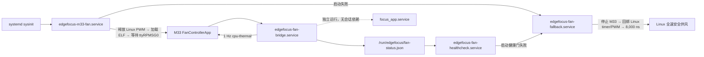

# M33 风扇极性校准、测速与开机接管设计

- 日期：2026-07-15
- 目标板：STM32MP257 自研底板，`192.168.10.174`
- 状态：用户已批准方案 A；等待规格复核后实施

## 1. 目标

在不耦合 `focus_app` 会话生命周期的前提下，完成以下闭环：

1. 修正 M33 `TIM17_CH1N/PB10` 与 Linux PWM 原型不一致的极性语义。
2. 在 M33 启用已经由 Linux bring-up 验证过的 PB11 tach。
3. 以常温 1000～1200 RPM、物理满速约 6000 RPM 校准温控档位。
4. 将 M33 风扇固件和 A35 温度 bridge 配置为可回滚的开机自启链。
5. 任一温度、RPMsg 或 bridge 故障均进入高风量安全态，不允许静默停转。

## 2. 已知事实与问题

- Linux 原型使用 40,000 ns 周期（25 kHz），对外逻辑为“较小 `duty_cycle` 更快”。
- Linux bring-up 已确认 PB11 有规则上/下降沿；历史样本为 `36,000 ns → 约 540 RPM`。
- 风扇说明给出物理满速约 6000 RPM，但未给出 tach 每转脉冲数。
- 当前 M33 固件在约 36°C 选择低温档 `36,000 ns`，但用户观察到明显高转速。
- 当前 M33 直接把逻辑 duty 写入 CH1 compare；CH1N 是互补输出，因此它没有等价复现 Linux sysfs 的有效极性。
- 当前板级适配把 `safe_duty_ns` 临时覆盖为 36,000 ns，且 `kEnableTach=false`。这两项只是分阶段 bring-up 设置，不是最终温控配置。
- 厂商 `st-m33firmware-load.service` 开机加载 echo 示例；当前风扇固件和 bridge 仅手动运行。

## 3. 采用方案

采用“极性修正后的开环温度曲线 + tach 校准/监测”，暂不引入闭环 PI 转速控制。

理由：

- 保留已经通过主机测试的温度曲线、迟滞、TTL 和自适应增压状态机。
- tach 可证明实际转速、校准档位并检测堵转，但不会因瞬时测速噪声持续调制 PWM。
- 相比闭环 RPM 控制，实施和板上参数更少，适合当前硬件收束阶段。

## 4. PWM 语义与校准

### 4.1 稳定接口

`FanControlCore` 继续输出与 Linux 原型一致的逻辑 `duty_ns`：

- 数值较小表示更快。
- 8,000 ns 是故障安全高风量端。
- 36,000 ns 附近是低速端。

只有 ATK 板级适配负责把逻辑 duty 转成 TIM17_CH1N compare。初始修正公式为：

```text
TIM17 counter frequency = 1,000,000 Hz
timer tick = 1,000 ns
period_ticks = 40
logical_ticks = duty_ns / 1000
compare_ticks = period_ticks - logical_ticks
```

板级配置必须把 TIM17 prescaler 固定为 1 MHz counter、ARR 固定为 39；换算实现不得依赖未经检查的整数常量。该映射必须通过 PB11 RPM 实测确认；如果 RPM 随逻辑 duty 的方向仍不符合“数值越小越快”，不得进入自启动阶段。

### 4.2 安全值

- `safe_duty_ns` 恢复为 8,000 ns。
- M33 启动但尚未取得有效温度、温度超过 TTL、RPMsg 断开或控制故障时均使用该安全值。
- 收到连续两帧有效温度后才允许从安全态降速。

### 4.3 校准流程

1. 启用 PB11 tach，但先保持自启动禁用。
2. 依次测试若干逻辑 duty，记录 RPM，并确认 RPM 单调变化。
3. tach 初始按 2 pulses/rev 计算。
4. PPR 校准必须在板端正常风扇供电、逻辑 8,000 ns、极性方向已经由两点测速确认、稳定至少 10 秒后进行。还必须用示波器或逻辑分析仪在风扇接口端独立确认控制波形已经达到该风扇说明定义的满速命令，并记录供电电压；只看 TIM17 寄存器或 PB10 SoC 引脚不算独立证明。
5. 只有上述接口端满速命令成立，才分别按 1/2/4 pulses/rev 换算满速窗口。只有一个候选落在额定 6000 RPM 的 ±25%（4500～7500 RPM），且相邻候选均落在该范围外时，才固化该 PPR；否则标记 `ppr_unresolved`，阻止自启动，不得选择“看起来最近”的倍率。如果无法取得接口端测量工具，本轮只能启用 raw pulse/stall 诊断，RPM 数值与自启动保持禁用。
6. 调整低温档，使稳定 RPM 落在 1000～1200。
7. 其余温度档保持单调递增；至少记录每档实际 RPM，不要求本轮实现闭环精确跟踪。

验收时不得只看寄存器或 duty，必须同时保存 `temperature / logical duty / hardware compare / pulse count / computed RPM`。

## 5. PB11 tach

- M33 申请 GPIOB pin 11 资源，配置输入、上拉和 EXTI2 line 11 rising edge。
- 每 1 秒原子取出脉冲计数并换算 RPM。
- HELLO capability 宣告 tachometer，状态文件的 `rpm` 必须来自本窗口而不是占位值。
- 连续三个有效窗口在需要转动的 duty 下均为 0，才判定堵转并进入高风量安全态；沿用现有便携核心策略。
- 首个窗口未完成时使用 `TachUnavailable`，但不阻止 M33 保持安全风量。
- 若 PB11 资源申请或中断配置失败，M33 风扇服务启动失败并触发开机回退，不得以“无 tach 的正常模式”继续自启动。

## 6. 开机服务拓扑



### 6.1 M33 loader

- 禁用但不删除厂商 `st-m33firmware-load.service`，以便回滚到 echo。
- 新增 `edgefocus-m33-fan.service`，`WantedBy=sysinit.target`，早于 bridge。
- loader 必须幂等执行：停止旧 bridge/M33、停止旧 Python 风扇服务、unexport PWM、按子到父顺序 unbind Linux PWM/timer、原子安装/选择 ELF、启动 remoteproc、等待 `/dev/ttyRPMSG0`。
- 当前 staged firmware 仍需要 `EFAN_PROBE`；loader 必须发送 probe 并确认 stage 9 成功后才返回成功。
- `ExecStop` 和 loader 启动失败都调用同一个仓库内 `edgefocus-fan-transition fallback` 幂等路径；该路径完成停止 remoteproc、资源回绑、Linux 安全 PWM 输出和测速验证。
- loader 启动失败时通过 `OnFailure=edgefocus-fan-fallback.service` 进入同一 fallback 路径，不把“驱动已回绑”当成回退成功。

### 6.2 A35 bridge

- 为 `edgefocus-fan-bridge.service` 增加 `[Install] WantedBy=multi-user.target`。
- `Requires=`、`After=` 指向 `edgefocus-m33-fan.service` 和 `dev-ttyRPMSG0.device`。
- 保持 `Restart=on-failure`，设置有限的 `StartLimitIntervalSec/StartLimitBurst`，并明确配置 `OnFailure=edgefocus-fan-fallback.service`。单次退出进入 auto-restart，不触发 fallback；只有启动失败或连续失败耗尽 start-limit、unit 进入 failed，`OnFailure` 才执行 fallback。
- bridge 与 `focus_app.service` 没有 Requires/After 关系，二者独立故障、独立升级。

### 6.3 启动健康门

新增 `edgefocus-fan-healthcheck.service` 作为唯一启动健康门所有者：

- `Type=oneshot`，`Requires=` M33 loader 与 bridge，`After=` 两者。
- `WantedBy=multi-user.target`，最多等待 10 秒轮询状态文件。
- 失败时通过 `OnFailure=edgefocus-fan-fallback.service` 停止 bridge/M33 并执行 Linux 安全输出。
- bridge 的运行期瞬时重启不直接触发 fallback；由 M33 TTL 保持高风量。bridge unit 自身的 `OnFailure` 负责在达到 systemd start-limit 后切换到 Linux fallback；启动阶段则由 healthcheck 的 `OnFailure` 负责。

健康检查必须同时满足：

- `remoteproc0/state=running` 且固件名正确。
- bridge `transport_connected=true`、`protocol_ready=true`、`thermal_ready=true`。
- M33 在两帧温度后为 `CONTROLLED`。
- PB11 已产生有效 tach 窗口；常温低温档应为 1000～1200 RPM，启动健康门容许 700～1500 RPM；任何状态下 RPM 必须大于 300 且不超过 7500。
- Linux `stm32-timers` 与 `stm32-pwm` 不再绑定 TIM17。
- 状态文件的单调时间与 `m33_boot_id` 必须属于本次 loader 启动；旧文件或超时样本不能通过健康门。

健康门失败时，服务返回失败并执行 fallback；不得留下 M33 与 Linux 同时写 PB10 的状态。

### 6.4 Linux fallback actuator

`edgefocus-fan-transition fallback` 是唯一资源恢复实现；loader `ExecStop`、loader `OnFailure`、bridge `OnFailure`、healthcheck `OnFailure` 和人工停止最终都调用它。重复调用必须成功处理 remoteproc 已停止、driver 已绑定、PWM 已 export 的状态，不把 `EBUSY`/already-bound 当成致命错误。固定顺序为：

脚本必须使用 `/run/edgefocus/fan-transition.lock` 文件锁串行化 start/fallback，避免多个 `OnFailure` 并发修改 remoteproc、driver binding 或 PWM sysfs。

1. 停止 bridge，停止 remoteproc，确认 M33 不再运行。
2. 按父到子顺序 bind `stm32-timers/40270000.timer` 与 `stm32-pwm/40270000.timer:pwm`。
3. export `pwm0`，等待 sysfs 节点出现。
4. 写 `enable=0`、`period=40000`、`polarity=normal`、`duty_cycle=8000`，最后写 `enable=1`。
5. 回读 period、polarity、duty 和 enable；随后用 PB11 采样最多 3 秒，要求 RPM 大于 300。

只有回读与非零转速都通过，fallback unit 才成功。启用自启动前必须另做一次无软件控制验证：停止 M33、unbind Linux timer/PWM、保持至少 30 秒，目视确认风扇由硬件默认路径持续自转并记录结果；不通过则禁止启用自启动。若 sysfs 或 tach 回退验证失败，服务必须保持 failed、写入 critical journal，进入“软件回退失败、仅剩已验证硬件默认自转”的终端故障，要求人工介入；软件不得把该状态报告为成功回退。

### 6.5 人工回滚顺序

1. 停止并禁用 `edgefocus-fan-healthcheck.service`，防止它通过依赖重新拉起其他 unit。
2. 停止并禁用 `edgefocus-fan-bridge.service`。
3. 停止并禁用 `edgefocus-m33-fan.service`；其 `ExecStop` 必须完成幂等 Linux 安全输出。
4. 停止并禁用 `edgefocus-fan-fallback.service`；该 unit 本身不设常规 `WantedBy`，只由 `OnFailure` 拉起。
5. 重新启用 `st-m33firmware-load.service`，执行 daemon-reload 并重启板端。
6. 验证厂商 echo 固件、`/dev/ttyRPMSG0`、Linux timer/PWM 资源状态，确认四个 EdgeFocus fan unit 均未启用。

## 7. 故障与回滚

| 故障 | 预期行为 |
|---|---|
| 温度未收到/过期 | M33 使用 8,000 ns 逻辑安全值 |
| bridge 退出 | M33 在 TTL 后进入安全态；systemd 重启 bridge |
| bridge 重启 | HELLO 重建协议，两帧温度后恢复 CONTROLLED |
| tach 连续三窗为 0 | 记录堵转故障并保持高风量指令 |
| PB11/RIF/EXTI 初始化失败 | M33 service 启动失败并回绑 Linux 资源 |
| M33 ELF/remoteproc/RPMsg 启动失败 | 停止 M33，按固定顺序恢复 Linux 8,000 ns 安全输出并验证 RPM |
| 人工回滚 | 按 6.5 的完整顺序禁用四个新 unit，恢复厂商 loader，重启并验证 echo |

## 8. 测试与验收

### 8.1 主机

- 更新 PWM 映射纯函数测试：边界、反向换算和越界拒绝。
- 保留温控、协议和 M33 app 全部测试。
- 增加 tach PPR 倍率、RPM 换算和三窗堵转测试。
- 静态检查 systemd 依赖没有循环，loader start/stop 幂等。

### 8.2 板端手动校准

- 自启动保持关闭，手动部署 tach 版固件。
- 记录低温档、至少三个中间 duty 和安全高风量档的 RPM。
- 确认常温档 1000～1200 RPM、最高档接近 6000 RPM，并固化最终 PPR。
- 重做 bridge stop 6 秒/start 恢复测试。

### 8.3 冷启动

- 启用服务后执行至少两次完整断电冷启动。
- 每次检查服务、remoteproc、RPM、温度、资源所有权和 `focus_app.service`。
- 注入一次 bridge 启动失败，验证 M33 安全态与自动恢复。
- 注入一次 M33 loader 失败，验证 Linux 资源回绑且无双写。

## 9. 非目标

- 本轮不实现闭环 PI/RPM 控制。
- 不把风扇放入正式会话、Demo、App 或手环协议。
- 不同时恢复被 PB11 占用的 `can@402d0000`。
- 不启用尚未验证的独立 M33 WWDG。
- 不修改视觉、行为、提醒或展示链。
