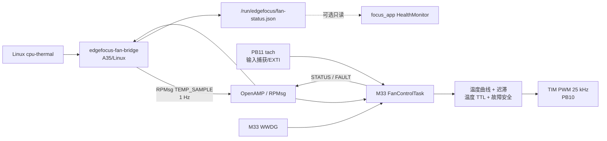

# EdgeFocus M33 风扇控制设计

状态：已批准（含 70°C → 62°C 自适应增压策略）

日期：2026-07-15

适用平台：STM32MP257，自研板，A35-TD / OpenSTLinux + Cortex-M33 协处理器

## 1. 目标

把已由 Linux/Python 原型验证过的温控风扇迁移为独立、故障安全的板级服务：

- Cortex-M33 独占风扇 PWM 和转速反馈，持续执行确定性的风扇控制；
- Cortex-A35/Linux 读取现有 `cpu-thermal` 温度，通过 RPMsg 周期上报；
- Linux、视觉 NPU、正式会话或展示链路卡顿时，M33仍能让风扇进入安全高转速；
- 风扇不属于会话功能，不因 `SessionOrchestrator`、Demo 或主程序启停而停止；
- 为后续云台和电源板保留版本化消息框架，但首版不实现对应控制。

本设计采用此前批准的混合方案 B。选择它是因为当前没有证据证明 M33可在现有板级 RIF 配置中直接读取结温 DTS，而 PWM、转速反馈和故障安全又适合由 M33独立承担。

## 2. 非目标

首版不做以下事项：

- 不切换到 M33-TD 启动方式，继续保持 A35-TD / OpenSTLinux 主系统；
- 不把相机、NPU、蓝牙、会话、提醒策略或展示逻辑迁移到 M33；
- 不接管云台串口、电源板或其他 GPIO；
- 不让 M33自动复位 A35；
- 不把风扇做成 `ISessionFeature`，也不让主程序直接写 PWM；
- 不假设 `pwmchip0/pwm0` 能反推出 M33侧的 TIM 实例和通道；
- 不在未确认 PB11/CAN 冲突前启用测速输入。

## 3. 已知硬件事实与实施门槛

Linux 原型 `_workspace/fan_develop/fan_temp_control.py` 给出以下已验证映射：

- PB10：25 kHz PWM，Linux 当前表现为 `/sys/class/pwm/pwmchip0/pwm0`；
- PB11：风扇 tach 输入，当前注释要求禁用 `can@402d0000` 后才能使用；
- 外部驱动反相：较小的 Linux `duty_cycle` 数值代表更高的实际风扇速度；
- 当前温区表使用 40,000 ns 周期和 36,000/30,000/22,000/14,000/8,000 ns 五档；
- 原型以 8,000 ns 作为读取或控制失败时的安全高转速。

开始写板级 HAL 和设备树前，必须从运行板或自研板 CubeMX/BSP 工程确认：

1. PB10 实际复用到哪个 TIM、哪个通道和哪个 AF；
2. PB11 使用 GPIO EXTI 还是 TIM 输入捕获，以及 GPIO bank/中断归属；
3. `can@402d0000` 是否仍启用、是否有其他产品功能依赖它；
4. 当前系统是何种 A35-TD device tree、RIF 配置和 OpenSTLinux 版本；
5. `/sys/class/remoteproc` 中 M33实例、状态、firmware 名称和 `st-m33firmware-load.service` 行为；
6. M33可用 RETRAM/SRAM、资源表和 OpenAMP 示例版本；
7. PWM 控制线在 M33未启动、复位或 pinctrl 切换期间的电气默认状态。

任一项未知时不得生成“猜测可用”的生产设备树，也不得同时启动 Linux PWM 服务和 M33 PWM。

## 4. 系统架构



### 4.1 M33 固件

M33固件是 PWM、tach、控制状态和自身看门狗的唯一所有者，包含：

- `FanControlCore`：与 HAL 无关的温区、迟滞、TTL 和故障状态机；
- `FanPwmDriver`：把抽象档位映射为已校准的反相 `duty_cycle`；
- `FanTachometer`：按脉冲计数计算 RPM，支持“不可用”和“疑似堵转”；
- `FanRpmsgEndpoint`：版本协商、温度输入、状态和故障输出；
- `FanSafetySupervisor`：启动安全态、温度超时、非法输入和控制循环健康；
- `M33Watchdog`：只有控制循环、PWM 更新和协议任务均健康时才喂 WWDG。

固件不理解会话、分神等级、手机状态或展示模式。

### 4.2 Linux bridge

`edgefocus-fan-bridge` 是独立 systemd 服务，不链接主程序业务核心：

- 定位指定的 thermal zone，默认优先 `cpu-thermal`；
- 每 1 秒发送一次带序号和单调时钟的温度样本；
- 完成协议版本握手，拒绝不兼容固件；
- 接收 M33状态，原子更新 `/run/edgefocus/fan-status.json`；
- 将温度、档位、原始 PWM、RPM、样本年龄和 fault flags 写入 journal；
- bridge 停止、崩溃或 RPMsg 断开时不尝试接管 Linux PWM，由 M33超时进入安全态。

找不到指定 thermal zone 时不得静默选取“第一个温区”；bridge 应报告错误并停止发送温度，让 M33保持安全态。

主程序未来可让 `HealthMonitor` 只读状态文件，但风扇健康不得成为正式会话启动条件。

## 5. 控制规则

### 5.1 初始曲线

首版保留 Linux 原型已验证的 25 kHz 和五档原始占空时间，避免在迁核的同时改变热策略：

| 上升阈值 | PB10 `duty_cycle` | 语义 |
|---:|---:|---|
| `< 45°C` | 36,000 ns | 低速 |
| `45°C` | 30,000 ns | 较低 |
| `55°C` | 22,000 ns | 中速 |
| `65°C` | 14,000 ns | 较高 |
| `75°C` | 8,000 ns | 安全高转速 |

降档使用 2°C 迟滞。例如从 `>=65°C` 档降回中速，温度必须低于 63°C。升档不附加迟滞，避免温度上升时响应变慢。

所有对外状态同时给出抽象 `fan_level` 和硬件 `duty_ns`。业务和协议不得根据“数值越小速度越快”自行推导，反相只封装在 `FanPwmDriver`。

### 5.2 自适应增压冷却

普通五档曲线之上增加一个 `ADAPTIVE_BOOST` 覆盖层。它解决持续 NPU 高负载下“温度仍在上升，但固定温区只能保持同一档位”的问题。

默认参数：

- 进入温度：滤波温度连续 3 秒达到或超过 `70°C`；
- 退出温度：滤波温度连续 10 秒低于或等于 `62°C`；
- 升速节奏：每 5 秒提高约 5 个百分点的抽象风扇速度；在当前 40,000 ns 反相 PWM 标定下，对应每步减少约 2,000 ns `duty_cycle`；
- 降温确认：滤波温度相比 10 秒前至少下降 `0.5°C`；
- 再升速确认：保持期间温度趋势连续两个窗口达到 `+0.3°C / 10秒`；
- 临界温度：达到或超过 `80°C` 时不等待爬升，立即使用已校准的最高安全转速。

温度趋势使用最近 10 秒的滤波样本计算，不允许根据单帧下降判断“已经降温”。控制子状态为：

1. `NORMAL`：按五档曲线和 2°C 迟滞运行；
2. `BOOST_RAMP`：达到 70°C 后，每 5 秒逐级加速，直到温度出现确认下降或达到最高安全转速；
3. `BOOST_HOLD`：确认温度下降后锁住当前转速；如果温度重新持续上升，则回到 `BOOST_RAMP`；
4. `BOOST_CRITICAL`：达到 80°C 后保持最高安全转速，直到满足统一的 62°C 退出条件。

降到 62°C 并稳定 10 秒后退出增压覆盖层，重新使用普通曲线。为了避免噪声和转速突变，退出后每 5 秒最多降低约 5 个百分点，直至追上普通曲线目标。

失效安全的优先级始终高于自适应增压。温度过期、协议异常或控制任务超期时直接进入 `FAIL_SAFE`，不等待趋势窗口。

### 5.3 温度输入

- 合法范围暂定 `-40,000..150,000 m°C`；越界样本被拒绝并记录故障；
- 相同或倒退的序号不刷新 TTL；
- 样本使用 M33接收时刻判断新鲜度，不依赖 A35墙上时钟；
- 连续 3 秒没有合法温度样本，进入 `TEMP_STALE` 安全高转速；
- 收到连续 2 个合法新样本后才退出 `TEMP_STALE`，防止链路抖动频繁切换。

### 5.4 转速反馈

- 默认每转 2 个脉冲，最终以实际风扇规格确认；
- 采用固定测量窗口，不在控制任务中阻塞等待边沿；
- tach 未配置时报告 `TACH_UNAVAILABLE`，但不阻止 PWM 控制；
- 高速档连续 3 个完整窗口为 0 RPM 才报告 `FAN_STALL`；
- 首版堵转只上报故障并保持安全高转速，不反复启停风扇。

### 5.5 启动和失效安全

M33一获得 PB10 所有权就先设置 8,000 ns 安全值，再等待 RPMsg。以下情况全部保持或切换到 8,000 ns：

- 尚未收到首个合法温度；
- 温度 TTL 超时；
- 协议版本不兼容；
- 控制状态损坏或出现非法枚举；
- bridge 明确下线；
- M33控制任务发现自身调度超期。

不得在异常路径中关闭 PWM。M33复位期间的最终电气安全取决于板级上拉/下拉和风扇驱动电路，必须实测后才能声明“复位时安全高转速”。

OpenAMP/RPMsg 初始化不得阻塞 PWM 与安全监督任务；即使 Linux永远没有建立 RPMsg endpoint，M33也必须持续输出安全 PWM 并喂养仅属于健康控制循环的 WWDG。

## 6. RPMsg 协议

协议采用小端、固定宽度字段和显式版本，不传 JSON。公共头部包含：

- `magic`；
- `protocol_major`、`protocol_minor`；
- `message_type`；
- `payload_length`；
- `sequence`；
- `sender_monotonic_ms`；
- `payload_crc32`。

首版消息类型只有：

1. `HELLO`：双方版本、能力位和 M33 boot id；
2. `TEMP_SAMPLE`：温度、thermal source id；
3. `STATUS`：当前档位、控制子状态、`duty_ns`、RPM、滤波温度、10 秒趋势和样本年龄；
4. `FAULT`：锁存与当前 fault flags、首次发生时间；
5. `SHUTDOWN_NOTICE`：Linux有序关机提示；它只改变诊断状态，不允许关闭风扇。

预留但首版不实现云台和电源板消息。未知消息必须按长度安全跳过；major 不兼容时进入安全高转速，minor 不同但公共字段兼容时允许通信。

## 7. 状态与故障模型

状态：

- `BOOT_SAFE`：PWM 已是安全值，等待合法温度；
- `CONTROLLED`：按曲线和迟滞运行；
- `FAIL_SAFE`：输入或内部健康异常，保持安全高转速。

`CONTROLLED` 内部必须进一步报告 `NORMAL / BOOST_RAMP / BOOST_HOLD / BOOST_CRITICAL`，便于验证自适应策略当前为何升速或保持。

首版 fault flags：

- `TEMP_NOT_RECEIVED`；
- `TEMP_STALE`；
- `TEMP_RANGE_INVALID`；
- `PROTOCOL_INCOMPATIBLE`；
- `RPMSG_DISCONNECTED`；
- `TACH_UNAVAILABLE`；
- `FAN_STALL`；
- `CONTROL_DEADLINE_MISSED`；
- `PWM_WRITE_FAILED`。

所有故障都能被 Linux读取；真正的当前故障与历史锁存故障分开。清除历史锁存不改变当前安全状态。

## 8. 生命周期和部署边界

风扇服务的生命周期早于且独立于 `focus_app.service`：

1. bootloader / Linux 建立正确的 RIF、pinmux、时钟和 M33内存；
2. remoteproc 加载 M33固件；
3. M33立即进入 `BOOT_SAFE` 并启动 PWM；
4. `edgefocus-fan-bridge.service` 等待 RPMsg endpoint 并开始温度上报；
5. `focus_app.service` 可独立启动或停止。

设备树切换和 firmware 安装必须拥有独立版本号与回滚入口。首次上板分两步：

- 手动验证版本：不设自动启动，只在工程人员在场时加载 M33并做温度、PWM、tach 和超时测试；
- 稳定版本：通过掉电、重启和故障注入后，才启用开机自动加载和 bridge 服务。

Linux Python 原型保留为诊断与回滚工具，但在 M33拥有 PB10/PB11 的设备树上必须保持禁用。回滚必须同时恢复 Linux 外设归属和 Linux fan service，不能只替换一个二进制。

## 9. 代码组织

建议在当前产品仓库内建立独立构建边界：

```text
firmware/m33/fan_controller/      STM32CubeMP2/OpenAMP 工程和 HAL 适配
platform/fan/core/                可在主机运行的纯控制核心与协议定义
platform/fan/bridge/              Linux edgefocus-fan-bridge
platform/fan/tests/               曲线、迟滞、TTL、协议和故障测试
docs/hardware/                    自研板 pinmux、RIF、remoteproc 与回滚记录
```

若 STM32CubeMP2 工程必须由 CubeMX 在外部工作区生成，只把可复现的 `.ioc`、必要源码、补丁和构建说明纳入仓库，不提交 IDE 缓存或生成物。

## 10. 验证计划

### 10.1 主机测试

- 五档阈值和 2°C 降档迟滞；
- 70°C 连续 3 秒进入增压、每 5 秒升速、10 秒降温趋势确认和保持；
- 保持后再次升温恢复爬升、80°C 立即最高安全转速；
- 62°C 连续 10 秒退出增压并限速回落到普通曲线；
- 温度边界、乱序、重复、越界和 TTL；
- bridge 断线与两帧恢复门槛；
- 反相 PWM 映射只存在于硬件适配层；
- tach 脉冲到 RPM 的换算和堵转确认窗口；
- 协议截断、错误长度、CRC、未知类型和版本不兼容；
- M33 boot id 改变后 bridge 清理旧状态。

### 10.2 板端手动验证

- PB10 25 kHz 频率与五档占空时间示波器测量；
- 实际风扇速度方向与反相假设；
- PB11 每转脉冲数和 RPM 误差；
- 禁用/启用 CAN 后 PB11 冲突行为；
- 停止 bridge、杀死 bridge、停止 RPMsg、让温度越界后的 3 秒安全态；
- M33复位、remoteproc 重启和 A35重启期间风扇行为；
- 连续高负载 NPU 下温度曲线和控制周期；
- `focus_app` 与 Demo 启停不改变风扇生命周期。

### 10.3 发布验收

只有同时满足以下条件才能启用开机自动加载：

- 外设唯一所有权得到运行设备树验证；
- 安全态占空时间和复位期间电气行为实测通过；
- 温度上报中断时在 3 秒内进入安全高转速；
- M33固件自身异常能由 WWDG恢复，恢复后先进入 `BOOT_SAFE`；
- rollback 能一次性恢复固件、设备树、服务和 Linux fan 原型；
- 24 小时 NPU 压力运行无 PWM 中断、协议死锁或虚假停转。

## 11. 对主程序架构的影响

当前主程序的会话、视觉、行为、展示和蓝牙架构不需要为首版风扇修改。风扇属于进程外的板级平台服务：

```text
Board Platform Services
├── M33 Fan Controller
├── Linux fan bridge
└── focus_app
    └── HealthMonitor（未来可选只读 fan-status）
```

完成上板验证后，只需在 `docs/architecture/current-architecture.md` 的部署拓扑和进程级服务边界中补充该平台服务。不得把风扇状态加入 `SessionSnapshot` 或分神判定。
