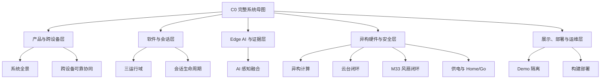

# EdgeFocus 完整架构母文档与展示图谱设计

- 日期：2026-07-16
- 状态：用户已批准 A/B/C 三种信息密度全部交付
- 交付性质：工程架构资料与可编辑图源，不负责最终海报版式或 AI 图片生成

## 1. 目标

建立一份完整、统一、可下钻的 EdgeFocus 架构母文档，并从中导出三套不同信息密度的架构图素材：

- A：4 张核心图，适合快速理解和海报主展示；
- B：9 张工程图，适合解释软件、硬件、通信与安全设计；
- C：完整母文档、1 张系统总图和 12 张专题图，作为所有展示材料的事实源。

三套图不是三种互相冲突的架构。A、B 都从 C 裁剪和组合，必须保持模块名称、方向、颜色、状态和术语一致。

## 2. 展示主张

EdgeFocus 的展示重点不是“摄像头加模型”，而是一套在低于 2 TOPS 的边缘平台上完成感知、时序判定、跨设备交互、会话编排和实时硬件控制的异构系统。

统一叙事：

```text
视觉与手机事实
  → 边缘 AI 时序融合
  → 会话内三级分神判定
  → App / 手环可靠提醒
  → 云台、散热与供电协同
  → 可解释证据、记录与现场展示
```

## 3. 架构事实基线

母文档和全部图按以下完成形态表达：

- STM32MP257 A35/Linux 负责产品会话、视觉数据流、融合、BLE、存储、供电策略和硬件编排；
- STM32MP257 NPU 运行 YOLO11n Pose，平台峰值算力约 1.2 TOPS INT8；
- Pose 关键点经 58 维特征和时序 Prone MLP，与 Presence 和手机原始事实进入 FusionCore；
- 输出为 `ACTIVE / NOT_PRESENT / UNKNOWN`、0–3 分神等级、reasons 和 episode；
- App 是用户主要交互面，负责会话控制、手机事实、PRECHECK、提醒呈现与记录缓存；
- 主机同时作为 App GATT Server 和手环 GATT Client，关键 App 事件有 ACK/outbox，手环有 TTL/重试/等级覆盖队列；
- 正式会话由 `SessionOrchestrator` 管理 PRECHECK、FOCUSING、PAUSED、ENDING；
- PRECHECK 不计时、不入库、不记录分神，只运行视觉与云台准备；
- 云台作为正式完成能力呈现：A35 根据视觉目标执行 PRECHECK 自动调整和会话内跟踪，G431 负责对齐、FOC、编码器、电机 PWM 与 Fault；
- M33 独占风扇 PB10 PWM/PB11 tach，以 100 ms 周期完成散热安全闭环；A35 通过 RPMsg 以 1 Hz 上报 `cpu-thermal`，3 秒失联进入安全高转速；
- STUSB4500 只提供外部供电事实，驱动 Home/Go 性能档位，不显示虚假电量；
- 正式会话与 DemoRuntime 互斥，预录 NPU 和 pre-log 回放不污染正式会话、记录或提醒；
- 部署采用 Windows 工作区、A35 交叉编译机、原子 release、健康检查与失败回滚。

## 4. 图谱层级



## 5. A 套：4 张核心图

### A1 系统全景架构

回答“这是一个什么系统”。

必须包含：用户、App、浏览器展示页、STM32MP257 A35/NPU/M33、摄像头、G431 云台、风扇、STUSB4500 和手环。主数据流从感知到融合再到提醒，硬件控制流与业务数据流使用不同线型。

### A2 Edge AI 多源时序融合

回答“分神如何判定”。

必须包含：CameraFrame、质量门、YOLO11n Pose、主体选择、17 keypoints、58-d features、2 秒/16 step 时序 Prone MLP、Presence、PhoneFact、FusionCore、三级等级、reasons/episode、近 30 秒证据时间线。

明确表达：手机学习类只弱化手机分支，不覆盖独立视觉证据；NOT_PRESENT 和 UNKNOWN 不产生分神提醒。

### A3 异构计算与实时控制

回答“为什么使用多个计算域”。

必须包含：

- A35/Linux：非实时业务、会话、融合、安全编排；
- NPU：Pose 感知；
- M33：100 ms 风扇实时安全岛；
- G431：云台电机确定性执行平面；
- A35↔M33 RPMsg、A35↔G431 UART4/Enable/Fault；
- 任一协处理器故障不拖垮基础会话主链。

### A4 跨设备可靠协同

回答“提醒如何可靠到达用户”。

必须包含：App GATT Server 链、手机 2 秒心跳/5 秒 TTL、`push_alert/push_session_end`、三阶段 ACK、Event Outbox；手环 GATT Client 链、三级振动、10 秒 TTL、重连重试和高等级覆盖。

## 6. B 套：9 张工程图

### B1 主程序三运行域

进程级常驻域、正式 SessionRuntime、无会话 DemoRuntime，以及相机/NPU资源租约。

### B2 正式会话状态机

IDLE → PRECHECK → FOCUSING ↔ PAUSED → ENDING → IDLE。为每个 phase 标注相机、NPU、Fusion、提醒、手机事实和持久化是否活跃。

### B3 软件模块与类型化数据面

`AppContext / SessionOrchestrator / SessionRuntime / ISessionFeature / SessionSnapshotPublisher / SQLiteStore / AppCommandService / DeviceManager` 的依赖与所有权。

### B4 可靠事件与状态同步

App 连接、notification、hello、get state、session control、phone heartbeat、event inbox/outbox、断线恢复和幂等本地会话补传。

### B5 云台视觉控制闭环

唯一 CameraSource → 人物观测 → PRECHECK 自动定位 → 会话内目标跟踪 → `GimbalHardwareService` → G431 FOC/编码器/电机；同时展示 PD6 Fault、PD7 Enable、STOP、低频健康恢复与固定相机降级。

### B6 M33 风扇安全闭环

Linux `cpu-thermal` → A35 bridge → RPMsg → M33 100 ms 控制 → PB10 PWM → 风扇 → PB11 tach；加入 3 秒 TTL、堵转/异常、Linux fallback、loader/healthcheck 开机链。

### B7 供电与 Home/Go 策略

STUSB4500 I2C4 → PRESENT/ABSENT/UNKNOWN 去抖 → WorkloadProfilePolicy → Home 约 4 FPS / Go 约 3 FPS；BLE、Fault、M33 风扇和 G431 内部实时环不降频。

### B8 正式会话与演示隔离

LIVE_CAMERA 正式会话、RECORDED_NPU 预录推理、FRONTEND_REPLAY pre-log 三模式，突出数据面、队列、手机事实、snapshot、记录/提醒相互隔离。

### B9 构建、发布与回滚

Windows 源码 → 交叉编译机 → ARM release → SHA-256 媒体增量同步 → 板端新 release → health check → 原子切换/失败回滚。

## 7. C 套：完整母文档与 12 张专题图

C 套包含 A/B 全部内容，并增加以下专题：

1. C01 系统全景；
2. C02 产品交互与信息流；
3. C03 主程序软件运行域；
4. C04 正式会话生命周期与资源开关；
5. C05 Edge AI 感知、时序与 Fusion；
6. C06 App/手环跨设备可靠链；
7. C07 A35/NPU/M33/G431 异构职责；
8. C08 云台视觉控制与安全状态机；
9. C09 M33 风扇闭环与启动回退；
10. C10 外部供电/Home-Go 性能策略；
11. C11 正式/Demo 资源隔离与证据来源；
12. C12 故障降级矩阵与原子部署。

另附一张“代码导航图”，用于内部工程说明，不计入海报 12 图：从功能需求映射到 `session/vision/core/platform/device/network/demo/storage` 目录。

## 8. 完整母文档目录

母文档建议命名：`docs/architecture/edgefocus-complete-architecture.md`。

目录：

1. 系统定位与设计约束；
2. 产品边界和使用流程；
3. 硬件组成与计算域；
4. 顶层系统架构；
5. 主程序软件架构与运行域；
6. 正式会话状态机；
7. Edge AI 感知与多源融合；
8. App、手环和浏览器交互；
9. 云台视觉控制架构；
10. M33 风扇安全闭环；
11. 外部供电与 Home/Go；
12. 正式会话与 Demo 隔离；
13. 持久化、证据和报告；
14. 并发、队列、时钟与新鲜度；
15. 故障隔离与降级；
16. 构建、部署、健康检查与回滚；
17. 代码模块导航；
18. 可用于海报的量化指标与讲解口径。

## 9. 视觉语法

所有 Mermaid 源图使用统一语法，方便后续重绘：

| 类别 | 建议色系 | 示例 |
|---|---|---|
| 用户与外部终端 | 蓝色 | App、浏览器、手环 |
| A35/Linux 业务 | 深青色 | 会话、BLE、存储、策略 |
| AI/NPU | 紫色 | Pose、Prone、Fusion |
| 实时协处理器 | 橙色 | M33、G431 |
| 传感与执行器 | 绿色 | 摄像头、风扇、云台、电源 |
| 安全/故障 | 红色 | Fault、fallback、degraded |
| Demo-only | 灰色虚线 | 预录 NPU、pre-log |

箭头：

- 实线：正式业务数据流；
- 粗实线：控制或执行链；
- 双向线：协议/状态交互；
- 虚线：诊断、兼容投影或 Demo-only；
- 红色回路：故障与安全回退。

每张图顶部用一句话说明“这张图回答什么”，底部提供 3–5 条可直接放海报的短说明。

## 10. 术语冻结

统一使用：

```text
人在 / Presence
趴下 / Prone
手机原始事实 / PhoneFact
多源时序融合 / Temporal Fusion
分神等级 / Distraction Level 0–3
正式会话 / Formal Session
预检 / PRECHECK
会话运行域 / SessionRuntime
演示运行域 / DemoRuntime
外部供电 / External Power
Home / Go
异构安全岛 / Heterogeneous Safety Island
```

不使用：困倦、闭眼疲劳、视觉识别手机、虚假电量、板载屏幕/声音提醒。

## 11. 图中状态表达

- 云台按完整正式能力绘制，不增加“未通过/刚打通/待接入”标签；
- M33 风扇按已启用的开机闭环绘制；
- App 按已批准的目标架构绘制，在母文档中另设“当前 App 改造边界”说明，海报图不混入旧 App 结构；
- Demo 清楚标注为展示运行域，不能与正式推理混画；
- 历史兼容层只出现在内部软件图，不进入产品总图。

## 12. 交付文件

```text
docs/architecture/edgefocus-complete-architecture.md
docs/architecture/poster-diagrams/
  README.md
  A-core-diagrams.md
  B-engineering-diagrams.md
  C-complete-diagram-atlas.md
  poster-copy-reference.md
```

浏览器预览继续保存在 `.superpowers/brainstorm/`，仅用于选择和校对，不作为正式架构事实源。

## 13. 验收

- A/B/C 图的同名模块和箭头方向一致；
- 每张专题图只承担一个主要问题，缩放到海报小区域仍可理解；
- 完整母文档能解释所有图中的模块、生命周期和故障降级；
- 图中不出现已删除的困倦、电量、板载提醒或视觉手机判断；
- 正式会话、Demo、M33 风扇和 G431 云台的资源所有权不混淆；
- 所有量化数字可追溯到源码、板端实测或正式规格；
- Mermaid 可解析，Markdown 链接有效，`git diff --check` 通过。
