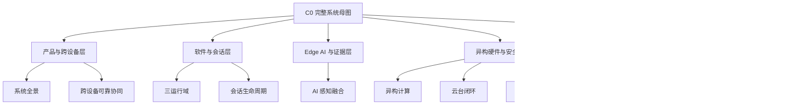
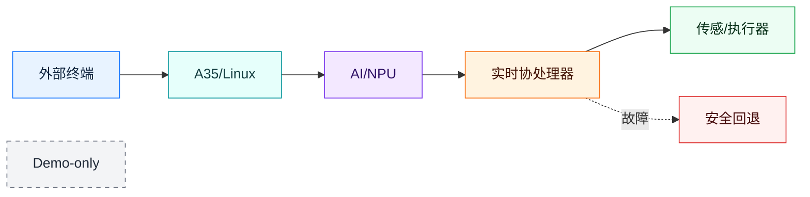

# EdgeFocus 完整架构母文档与展示图谱设计

- 日期：2026-07-16
- 状态：用户已批准 A/B/C 三种信息密度全部交付
- 交付性质：工程架构资料与可编辑图源，不负责最终海报版式或 AI 图片生成

## 1. 目标

建立一份完整、统一、可下钻的 EdgeFocus 架构母文档，并从中导出三套不同信息密度的架构图素材：

- A：4 张核心图，适合快速理解和海报主展示；
- B：9 张工程图，适合解释软件、硬件、通信与安全设计；
- C：完整母文档、1 张系统总图和 12 张专题图，作为所有展示材料的事实源。

三套图不是三种互相冲突的架构。A、B 都从 C 裁剪和组合，必须保持模块名称、方向、颜色、状态和术语一致。

## 2. 展示主张

EdgeFocus 的展示重点不是“摄像头加模型”，而是一套在低于 2 TOPS 的边缘平台上完成感知、时序判定、跨设备交互、会话编排和实时硬件控制的异构系统。

统一叙事：

```text
视觉与手机事实
  → 边缘 AI 时序融合
  → 会话内三级分神判定
  → App / 手环可靠提醒
  → 云台、散热与供电协同
  → 可解释证据、记录与现场展示
```

## 3. 架构事实基线

母文档和全部图按以下完成形态表达：

- STM32MP257 A35/Linux 负责产品会话、视觉数据流、融合、BLE、存储、供电策略和硬件编排；
- STM32MP257 NPU 运行 YOLO11n Pose；800 MHz 标称理论算力为 1.2 TOPS INT8，只有实际启用 900 MHz overdrive 时才使用 1.35 TOPS 理论上限口径；
- Pose 关键点经 58 维特征和时序 Prone MLP，与 Presence 和手机原始事实进入 FusionCore；
- 输出为 `ACTIVE / NOT_PRESENT / UNKNOWN`、0–3 分神等级、reasons 和 episode；
- App 是用户主要交互面，展示 PRECHECK、发送会话意图和手机事实、呈现提醒并缓存记录；正式状态权威始终在主机；
- 板端对手机 App 扮演 BLE GATT Server、手机 App 是 Client；板端对手环扮演 GATT Client、手环是 Server。关键 App 事件有 ACK/outbox，手环有 TTL/重试/等级覆盖队列；
- 正式会话由 `SessionOrchestrator` 管理 PRECHECK、FOCUSING、PAUSED、ENDING；
- PRECHECK 不计时、不入库、不记录分神，只运行视觉与云台准备；
- 云台作为正式完成能力呈现：A35 根据视觉目标执行 PRECHECK 自动调整和会话内跟踪，G431 负责对齐、FOC、编码器、电机 PWM 与 Fault。此处是用户明确批准的最终产品架构基线，优先于旧阶段文档，不添加“未通过、待接入、待集成”标签；
- M33 独占风扇 PB10 PWM/PB11 tach，以 100 ms 周期完成散热安全闭环；A35 通过 RPMsg 以 1 Hz 上报 `cpu-thermal`，3 秒失联进入安全高转速；
- STUSB4500 只提供外部供电事实，驱动 Home/Go 性能档位，不显示虚假电量；
- 正式会话与 DemoRuntime 互斥，预录 NPU 和 pre-log 回放不污染正式会话、记录或提醒；
- 部署采用 Windows 工作区、A35 交叉编译机、原子 release、健康检查与失败回滚。

## 4. 图谱层级



## 5. A 套：4 张核心图

### A1 系统全景架构

回答“这是一个什么系统”。

必须包含：用户、App、浏览器展示页、STM32MP257 A35/NPU/M33、摄像头、G431 云台、风扇、STUSB4500 和手环。主数据流从感知到融合再到提醒，硬件控制流与业务数据流使用不同线型。

### A2 Edge AI 多源时序融合

回答“分神如何判定”。

必须包含：CameraFrame、质量门、YOLO11n Pose、主体选择、17 keypoints、58-d features、2 秒/16 step 时序 Prone MLP、Presence、PhoneFact、FusionCore、Level 0 正常 + Level 1–3 三级分神、reasons/episode、近 30 秒证据时间线。

明确表达：手机学习类只弱化手机分支，不覆盖独立视觉证据；NOT_PRESENT 和 UNKNOWN 不产生分神提醒。

### A3 异构计算与实时控制

回答“为什么使用多个计算域”。

必须包含：

- A35/Linux：非实时业务、会话、融合、安全编排；
- NPU：Pose 感知；
- M33：100 ms 风扇实时安全岛；
- G431：云台电机确定性执行平面；
- A35↔M33 RPMsg；A35↔G431 仅 UART4 双向，PD7 Enable 为 A35→G431，PD6 Fault 为 G431→A35；
- 任一协处理器故障不拖垮基础会话主链。

### A4 跨设备可靠协同

回答“提醒如何可靠到达用户”。

必须包含：板端 GATT Server ↔ 手机 App Client 链、手机 2 秒心跳/5 秒 TTL、`push_alert/push_session_end`、三阶段 ACK、Event Outbox；板端 GATT Client ↔ 手环 Server 链、三级振动、10 秒 TTL、重连重试和高等级覆盖。

## 6. B 套：9 张工程图

### B1 主程序三运行域

进程级常驻域、正式 SessionRuntime、无会话 DemoRuntime，以及相机/NPU资源租约。

### B2 正式会话状态机

IDLE → PRECHECK → FOCUSING ↔ PAUSED → ENDING → IDLE。为每个 phase 标注相机、NPU、Fusion、提醒、手机事实和持久化是否活跃。

### B3 软件模块与类型化数据面

`AppContext / SessionOrchestrator / SessionRuntime / ISessionFeature / DistractionPipelineFeature / PhoneFactBuffer / SessionSnapshotPublisher / ReminderPolicy / BleGattServer / AppEventOutbox / SQLiteStore / AppCommandService / DeviceManager / PowerSourceService / GimbalHardwareService / BoardDemoRuntime` 的依赖与所有权。类型化数据面必须包含 `CameraFrame / PhoneFact / DistractionAssessment / SessionSnapshot`，兼容投影仅用虚线表示。

### B4 可靠事件与状态同步

App 连接、notification、hello、get state、session control、phone heartbeat、event inbox/outbox、断线恢复和幂等本地会话补传。

### B5 云台视觉控制闭环

唯一 CameraSource → 人物观测 → PRECHECK 自动定位/人工微调 → FOCUSING 会话内目标跟踪 → `GimbalHardwareService` → G431 FOC/编码器/电机。UART4 是双向状态与目标通道，PD7 为 A35→G431 Enable，PD6 为 G431→A35 低有效 Fault，PD4 只标 BOOT0、不得画成复位；同时展示 STOP、低频健康恢复与固定相机降级。

### B6 M33 风扇安全闭环

Linux `cpu-thermal` → A35 bridge ↔ RPMsg 握手/温度/状态 → M33 100 ms 控制 → PB10 PWM → 风扇 → PB11 tach；加入 3 秒 TTL、堵转/异常、loader/healthcheck 开机链。M33 模式与 Linux fallback 必须画成互斥所有权切换：M33 在线时 Linux timer/PWM unbound，fallback 时 remoteproc offline，禁止两个控制者并行写 PB10/PB11。

### B7 供电与 Home/Go 策略

STUSB4500 I2C4 → 3 个一致样本去抖 → PRESENT/ABSENT/UNKNOWN → WorkloadProfilePolicy → Home 约 4 FPS / Go 约 3 FPS。UNKNOWN 无手动覆盖时进入 Go；手动覆盖保持到下一次确认的供电插拔。BLE、Fault、M33 风扇和 G431 内部实时环不降频。

### B8 正式会话与演示隔离

LIVE_CAMERA 正式会话、RECORDED_NPU 预录推理、FRONTEND_REPLAY pre-log 三模式，突出数据面、队列、手机事实、snapshot、记录/提醒相互隔离。

### B9 构建、发布与回滚

必须使用双泳道：源码从 Windows → 交叉编译机 → ARM 新 release → 板端 health check → 原子切换/失败回滚；媒体从 Windows 直接经 SHA-256 增量同步到板端媒体目录，MP4 不进入源码包或 ARM release。

## 7. C 套：完整母文档与 12 张专题图

C0 是不计入专题数量的唯一完整系统母图。C 套另含以下 12 张专题图：

1. C01 产品交互与信息流；
2. C02 软件运行域与类型化数据面；
3. C03 正式会话生命周期；
4. C04 Edge AI 感知、时序与 Fusion；
5. C05 App/手环跨设备可靠链；
6. C06 A35/NPU/M33/G431 异构职责；
7. C07 云台视觉控制与安全状态机；
8. C08 M33 风扇闭环与启动回退；
9. C09 外部供电/Home-Go 性能策略；
10. C10 正式/Demo 资源隔离与证据来源；
11. C11 故障降级矩阵；
12. C12 构建部署与回滚。

另附一张“代码导航图”，用于内部工程说明，不计入海报 12 图：从功能需求映射到 `session/vision/core/platform/device/network/demo/storage` 目录。

### 7.1 A/B/C 显式映射

| 摘要/工程图 | 规范源 | 区别 |
|---|---|---|
| A1 系统全景 | C0 + C01 | A1 只保留用户、主机、计算域和主要数据闭环；C0 保留全部边界 |
| A2 Edge AI | C04 | A2 适合快速讲算法；C04 保留质量、新鲜度、episode 和可解释输出 |
| A3 异构计算 | C06 | A3 讲职责分工；C06 讲协议、时钟域和故障范围 |
| A4 跨设备 | C05 | A4 讲两条提醒链；C05 保留协商、心跳、ACK、TTL 和重试 |
| B1 三运行域 | C02 | B1 讲生命周期边界；C02 同时给出软件模块和类型化数据面 |
| B2 会话状态机 | C03 | 同一事实，B2 用 phase×资源表，C03 是规范源 |
| B3 软件模块 | C02 | 从 C02 下钻代码所有权，不重复产品节点 |
| B4 可靠事件与同步 | C05 | 从 C05 下钻连接和恢复时序 |
| B5 云台 | C07 | 同图源，B5 强调控制链，C07 同时包含安全状态机 |
| B6 M33 风扇 | C08 | 同图源，B6 强调闭环，C08 同时包含开机/fallback |
| B7 供电/Home-Go | C09 | 同图源 |
| B8 Demo 隔离 | C10 | 同图源 |
| B9 部署回滚 | C12 | 同图源 |

状态术语统一映射：

| 主机正式 phase | App 页面 phase | 含义 |
|---|---|---|
| IDLE | IDLE | 无主机会话 |
| PRECHECK | PRECHECK | 主机拥有预检状态；App 展示并发送用户意图 |
| FOCUSING | RUNNING | 正式计时、Fusion、记录与提醒运行 |
| PAUSED | PAUSED | 暂停累计与提醒 |
| ENDING | ENDING | 主机收尾、刷新报告 |
| IDLE + 对应 report/event | FINISHED | App 展示最终结果 |

### 7.2 C 图契约

| 图 | 唯一回答的问题 | 必选分组、节点与方向 | 禁止内容 | 方向/规模 | 必选量化标签 |
|---|---|---|---|---|---|
| C0 | 整个系统如何闭环 | 摄像头→A35/NPU；STUSB4500→A35 策略；A35→G431→云台；A35↔M33→风扇；A35↔App；A35→手环；A35→浏览器展示；感知→决策→提醒与控制 | 代码文件、旧兼容字段、Demo 伪装正式链 | LR，≤24 节点 | 1.2 TOPS@800MHz、2s phone heartbeat、100ms fan loop |
| C01 | 用户如何使用产品 | App 会话/PRECHECK/提醒/记录，主机权威会话，手环执行，浏览器只读展示 | 旧板载 UI、App 自算最终等级 | LR，≤14 | 三级分神、30s 展示时间线 |
| C02 | 软件如何分域和传递类型化数据 | 常驻域/SessionRuntime/DemoRuntime；CameraFrame/PhoneFact/Assessment/Snapshot；资源租约 | 把 SystemStateStore 画成新核心 | TB，≤22 | FrameQueue=3、Home/Go cadence |
| C03 | 会话阶段如何控制资源 | IDLE/PRECHECK/FOCUSING/PAUSED/ENDING 与相机/NPU/Fusion/提醒/存储开关 | PRECHECK 计时/入库/手机融合 | LR 状态机+表，≤10 状态 | PRECHECK 250ms、PAUSED 1000ms |
| C04 | 分神如何从证据产生 | Camera→quality→Pose→subject→58d→Prone；Presence/Phone→Fusion→level/reasons/episode | 困倦、视觉手机判断、把 UNKNOWN 当专注 | LR，≤18 | 17 keypoints、58d、2s/16 steps、level 0+1–3 |
| C05 | 手机与手环如何可靠协同 | 板端 Server↔App Client；板端 Client↔Band Server；hello/state/heartbeat/ACK/outbox/TTL/retry | 画反 GATT 角色、把手环接到 App | 双泳道序列/流图，≤20 | 2s/5s、10s TTL、ACK 3 stages |
| C06 | 多计算域为何这样分工 | A35→NPU；A35↔M33 RPMsg；UART4 双向；PD7 Enable 为 A35→G431；PD6 Fault 为 G431→A35；故障隔离 | M33 控云台/供电，A35 生成电机 PWM | TB 四泳道，≤18 | NPU 1.2 TOPS@800MHz、M33 100ms、RPMsg 1Hz |
| C07 | 云台如何从视觉到安全执行 | 唯一 Camera→人物目标→PRECHECK/追踪→HW Service↔G431→电机；PD7/PD6/STOP/Fault/恢复 | PD4 画复位、第二相机、原始 UART 暴露 | LR 闭环+安全支路，≤20 | UART 115200、Fault 低有效 |
| C08 | 风扇如何在异核失联时安全 | cpu-thermal→bridge↔RPMsg→M33→PB10→fan→PB11；loader/health/fallback 互斥接管 | Linux 与 M33 同时控制 PWM | LR 主闭环+下方 fallback，≤18 | 100ms、1Hz、3s TTL、约6000 RPM安全档 |
| C09 | 供电如何改变性能而不影响安全 | STUSB→去抖→P/A/U→profile policy→Home/Go→Vision cadence；manual override/epoch | 电量、电压、UNKNOWN=ABSENT | LR 策略图，≤16 | 3 samples×250ms、Home≈4FPS、Go≈3FPS |
| C10 | Demo 如何不污染正式会话 | Formal lease 与 DemoRuntime 互斥；Live/Recorded NPU/Frontend replay 各自 queue/facts/snapshot | 回放写正式 SQLite/提醒、两个相机 owner | TB 三泳道，≤20 | NPU stale 2s、30s 四轨展示 |
| C11 | 各故障如何局部降级 | Camera/NPU、Phone stale、App BLE、Band、SQLite、G431、M33/RPMsg、STUSB、Demo 冲突、部署失败 | 只写“系统报错”、隐去恢复责任 | 故障矩阵，不用大流图 | 每项含检测/动作/保留能力/用户状态/恢复/责任域 |
| C12 | 软件和素材如何安全发布 | 源码泳道：Windows→CC→release→health→switch/rollback；媒体泳道：Windows→SHA256→media dir | MP4 进入源码包/release | LR 双泳道，≤16 | SHA-256、原子切换、health check |

每张图的海报短文案固定为 3–5 条，每条不超过 24 个汉字；详细解释只进入母文档。A 图从对应 C 图删除工程节点，B 图保留工程时序/所有权，禁止重新定义独立事实。

## 8. 完整母文档目录

母文档建议命名：`docs/architecture/edgefocus-complete-architecture.md`。

目录：

1. 系统定位与设计约束；
2. 产品边界和使用流程；
3. 硬件组成与计算域；
4. 顶层系统架构；
5. 主程序软件架构与运行域；
6. 正式会话状态机；
7. Edge AI 感知与多源融合；
8. App、手环和浏览器交互；
9. 云台视觉控制架构；
10. M33 风扇安全闭环；
11. 外部供电与 Home/Go；
12. 正式会话与 Demo 隔离；
13. 持久化、证据和报告；
14. 并发、队列、时钟与新鲜度；
15. 故障隔离与降级；
16. 构建、部署、健康检查与回滚；
17. 代码模块导航；
18. 可用于海报的量化指标与讲解口径。

## 9. 视觉语法

所有 Mermaid 源图使用统一语法，方便后续重绘：

| 类别 | 填充色 | 描边色 | 示例 |
|---|---|---|---|
| 用户与外部终端 | `#E8F3FF` | `#1677FF` | App、浏览器、手环 |
| A35/Linux 业务 | `#E6FFFB` | `#08979C` | 会话、BLE、存储、策略 |
| AI/NPU | `#F3E8FF` | `#7C3AED` | Pose、Prone、Fusion |
| 实时协处理器 | `#FFF3E0` | `#F97316` | M33、G431 |
| 传感与执行器 | `#ECFDF3` | `#16A34A` | 摄像头、风扇、云台、电源 |
| 安全/故障 | `#FFF1F0` | `#DC2626` | Fault、fallback、degraded |
| Demo-only | `#F3F4F6` | `#6B7280` | 预录 NPU、pre-log |

箭头：

- 实线：正式业务数据流；
- 粗实线：控制或执行链；
- 双向线：协议/状态交互；
- 虚线：诊断、兼容投影或 Demo-only；
- 红色回路：故障与安全回退。

每张图顶部用一句话说明“这张图回答什么”，底部提供 3–5 条可直接放海报的短说明。

Mermaid 图统一声明以下基础类，允许专题图删去未使用的类，不允许自行改变颜色含义：



版式约束：C0、C01、C04、C05、C07、C08、C09、C12 默认从左到右；C02、C06、C10 默认使用上下分层泳道；C03 使用状态机；C11 使用矩阵而非流程图。外部终端置于最左/最上，执行器置于最右/最下，故障回路靠底部，Demo 泳道始终与正式会话分离。海报图不得把 Mermaid 自动布局结果直接当最终版式；重绘时仍遵守上述方向和色义。

## 9.1 量化口径台账

| 数值 | 唯一含义 | 不得误写为 | 主要出现图 |
|---|---|---|---|
| `1.2 TOPS INT8 @ 800 MHz` | STM32MP257 NPU 标称理论算力口径 | 实测端到端吞吐；默认 1.35 TOPS | C0、C04、C06 |
| `1.35 TOPS @ 900 MHz` | 仅启用 overdrive 时的理论上限 | 当前默认工作点 | 母文档注释，不进入核心海报短文案 |
| `2 s / 16 steps` | Prone MLP 的时序观察窗口 | 手机心跳或云台恢复周期 | C04 |
| `2 s heartbeat / 5 s TTL` | App 手机原始事实的上报与新鲜度 | 模型窗口 | C05 |
| `30 s` | 展示页“近 30 秒证据时间线”可视窗口 | 模型只看 30 秒 | C01、C04、C10 |
| `100 ms` | M33 风扇闭环控制周期 | A35 温度上报周期 | C06、C08 |
| `1 Hz` | A35 向 M33 上报温度/状态的频率 | 风扇 PWM 频率 | C08 |
| `3 s TTL` | M33 未收到 A35 更新时进入安全高转速 | 通用系统故障超时 | C08 |
| `3 × 250 ms` | 外部供电状态一致样本去抖 | Home/Go 切换总是固定 750 ms | C09 |
| `Home ≈ 4 FPS / Go ≈ 3 FPS` | 视觉业务节拍档位 | NPU 硬实时保证值；整页预览帧率 | C09 |
| `UART4 115200` | A35 与 G431 的串口速率 | 视觉跟踪刷新率 | C07 |
| `Level 0 + Level 1–3` | 0 为正常/专注，1–3 才是三级分神 | 四级分神 | C01、C04 |

## 9.2 事实来源与图稿追溯

| 事实域 | 规范/源码来源 | 约束的图 |
|---|---|---|
| 当前主程序边界、运行域与模块 | `docs/architecture/current-architecture.md` 与当前 `session/vision/core/platform/device/network/demo/storage` 模块 | C0、C02、C03、C04、C10、C11 |
| App 目标架构、主机状态权威与本地会话补传 | `docs/architecture/app-target-architecture.md`、`docs/integration/app-host-alignment-v3.md` | C01、C03、C05 |
| App/手环 BLE 角色、ACK、TTL 与重试 | `docs/integration/app-band-protocol-v2.1.md` | C05、C11 |
| M33 风扇闭环、服务与回退 | `docs/hardware/stm32mp257-m33-fan-inventory.md`、`docs/hardware/m33-fan-service-operations.md` | C06、C08、C11 |
| 云台协议、GPIO、安全状态机与正式能力 | 用户批准的最终产品基线、`gimbal-power-heterogeneous-control-design.md` 中的接口规格 | C0、C06、C07、C11 |
| 外部供电与 Home/Go | `gimbal-power-heterogeneous-control-design.md` 的供电策略规格 | C09、C11 |
| 构建、部署、媒体同步与回滚 | 当前部署脚本/服务设计与母文档发布章节 | C12 |

当旧阶段文档与本规格冲突时，以用户在 2026-07-16 批准的最终产品基线为准；尤其云台不得回退为“未完成、待集成”状态。

## 10. 术语冻结

统一使用：

```text
人在 / Presence
趴下 / Prone
手机原始事实 / PhoneFact
多源时序融合 / Temporal Fusion
分神等级 / Distraction Level 0–3
正式会话 / Formal Session
预检 / PRECHECK
会话运行域 / SessionRuntime
演示运行域 / DemoRuntime
外部供电 / External Power
Home / Go
异构安全岛 / Heterogeneous Safety Island
```

不使用：困倦、闭眼疲劳、视觉识别手机、虚假电量、板载屏幕/声音提醒。

## 11. 图中状态表达

- 云台按完整正式能力绘制，不增加“未通过/刚打通/待接入”标签；
- M33 风扇按已启用的开机闭环绘制；
- App 按已批准的目标架构绘制，在母文档中另设“当前 App 改造边界”说明，海报图不混入旧 App 结构；
- Demo 清楚标注为展示运行域，不能与正式推理混画；
- 历史兼容层只出现在内部软件图，不进入产品总图。

### 11.1 C11 故障矩阵最低覆盖

C11 固定使用六列：`故障域 / 检测信号 / 立即动作 / 保留能力 / 用户可见状态 / 自动恢复与责任域`。至少覆盖：

| 故障域 | 检测信号 | 立即动作 | 保留能力 | 用户可见状态 | 自动恢复与责任域 |
|---|---|---|---|---|---|
| Camera / NPU | 打开失败、帧超时、推理 stale | 视觉输出置 UNKNOWN；停止使用旧证据 | 会话、手机事实、App/手环链路 | 视觉不可用/降级 | Camera/NPU worker 限频重启，A35 负责 |
| PhoneFact | 超过 5 s TTL | 手机分支置 stale，不沿用旧类别 | 独立视觉判断 | 手机状态未同步 | App 心跳恢复即重新生效，A35 负责 |
| App BLE | 断连、ACK 超时 | 事件进入 outbox，主机会话继续 | 计时、推理、存储、手环 | App 重连中 | 重连后 hello/get-state/幂等补发，A35+App |
| 手环 BLE | 连接失败、10 s TTL 到期 | 队列重试/丢弃过期低优先级提醒 | App 提醒和会话全链路 | 手环未连接 | 周期搜索，等级覆盖队列，A35 负责 |
| SQLite | 事务失败、磁盘错误 | 保留内存 snapshot，禁止伪报已落盘 | 实时判定与提醒 | 记录保存异常 | 限次重试并上报，Storage/A35 负责 |
| G431 / Fault | PD6 低、UART 连续失败、对齐失败 | G431 本地先停驱动；A35 立即撤销 PD7 并停止下发目标 | 固定相机视觉与正式会话 | 云台已降级 | 低频 PING/STAT/FAULT 检查，恢复后重新对齐，A35+G431；仅正常结束或链路仍可通信时采用 STOP→OK→Enable=0 |
| M33 / RPMsg | 3 s TTL、remoteproc/bridge health 失败 | M33 安全高转或互斥切换 Linux fallback | 会话、AI 与硬件温控 | 散热安全模式 | healthcheck 恢复 M33 后再移交，M33/A35 |
| STUSB4500 | I2C 失败、样本不一致 | 状态置 UNKNOWN；无覆盖时采用 Go | 全部安全链路 | 供电状态未知/Go | 周期采样；确认插拔事件清除手动覆盖，Power/A35 |
| Demo 资源冲突 | Camera/NPU lease 获取失败 | Demo 不启动或切换 Frontend replay | 正式会话完全保留 | 演示资源占用/回放 | 正式资源释放后再试，DemoRuntime |
| 新 release | health check 失败 | 不切换或原子回滚 | 上一 release 和媒体素材 | 更新失败/已回滚 | 部署服务记录并保留诊断，Deploy/A35 |

任何故障都不得使用“系统报错”作为唯一处理；矩阵必须明确谁检测、谁降级、谁恢复。安全执行域优先保证散热、云台停止和正式会话数据一致性。

## 12. 交付文件

```text
docs/architecture/edgefocus-complete-architecture.md
docs/architecture/poster-diagrams/
  README.md
  A-core-diagrams.md
  B-engineering-diagrams.md
  C-complete-diagram-atlas.md
  poster-copy-reference.md
```

浏览器预览继续保存在 `.superpowers/brainstorm/`，仅用于选择和校对，不作为正式架构事实源。

## 13. 验收

- A/B/C 图的同名模块和箭头方向一致；
- 每张专题图只承担一个主要问题，缩放到海报小区域仍可理解；
- 完整母文档能解释所有图中的模块、生命周期和故障降级；
- 图中不出现已删除的困倦、电量、板载提醒或视觉手机判断；
- 正式会话、Demo、M33 风扇和 G431 云台的资源所有权不混淆；
- 所有量化数字可追溯到源码、板端实测或正式规格；
- Mermaid 可解析，Markdown 链接有效，`git diff --check` 通过。
