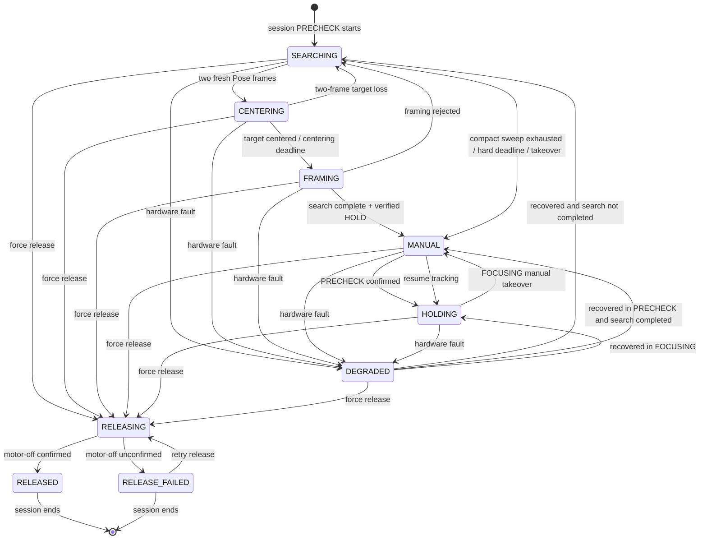

# Compact Gimbal Search and Session-Scoped Release Design

Date: 2026-07-17  
Status: Approved for implementation

## 1. Goal

Reduce onsite PRECHECK motion to a short, visibly understandable demonstration; prevent an already completed search from replaying after fault recovery; and allow an operator to release the gimbal motors from the browser so the camera can be positioned by hand and fixed with tape for the remainder of the current session.

This change belongs to the optional formal-session gimbal feature. It must not affect the camera, NPU, distraction assessment, reminders, App/Band communication, or recorded demonstration modes.

## 2. Compact automatic search

The normal PRECHECK search becomes a compact two-waypoint sweep relative to the alignment reference:

1. Observe the current/center view for 400 ms.
2. Move to yaw `-50°`, pitch `+30°` while continuing to consume fresh Pose evidence.
3. Move to yaw `+50°`, pitch `-30°` while continuing to consume fresh Pose evidence.
4. If no acceptable subject is found, return to the reference center, enable HOLD, and hand control to manual PRECHECK adjustment.

There is no full-pitch recovery scan. The configured automatic search envelope is yaw `[-50°, +50°]` and pitch `[-30°, +30°]`. Manual unbounded nudge behavior remains unchanged.

The default monotonic-time gates are `initial_observe_ms=400`, `stop_queueing_ms=10000`, and `hard_deadline_ms=12000`:

- At the first controller tick at or after 10,000 ms, search completion is atomically latched for `Searching`, `Centering`, and `Framing`, and no new waypoint may be issued. If the controller is still `Searching`, it freezes the current motion and begins the reference-center/HOLD/manual handoff. If it is already validating a candidate, that one candidate may finish: acceptance HOLDs at the centered target; association loss or framing rejection goes directly to reference-center/HOLD/manual handoff rather than `Searching`. A fault in this 10–12 second window also recovers without a rescan because completion is already latched.
- At the first controller tick at or after 12,000 ms, all search and candidate admission closes. Any in-progress centering/framing is cancelled, the current motion is frozen, search is atomically marked complete, and the controller begins the reference-center/HOLD/manual handoff.

A center or HOLD failure may degrade the gimbal, but recovery must not replay the sweep. Fake-clock tests cover ticks immediately below, at, and above both boundaries.

Pose acquisition requires two distinct, strictly increasing fresh frames from the active session and current search generation before freezing motion. Existing `subject_observations=2` becomes an enforced gate rather than an unused configuration value. Search recovery clears the old candidate/frame counter. After two-frame acquisition, the controller freezes at the current angle before any centering command.

## 3. Do not repeat a completed search after recovery

`GimbalPrecheckController` owns a session-local `automatic_search_completed` fact. It is atomically set at the first terminal decision at which no more search waypoint may be visited:

- finishes candidate centering/framing and finally accepts a subject;
- expires the final compact waypoint without an accepted subject;
- reaches the hard deadline; or
- is explicitly skipped by operator takeover.

It resets only when the controller starts or stops a formal session.

The fact is set before reference-center movement, HOLD, or manual handoff is attempted. Therefore a failure after the last waypoint, during reference-center return, or during HOLD cannot cause another sweep. The fact update, search-generation update, and state transition occur under the controller's serialized state lock.

`Centering` and `Framing` remain explicit controller states. They are candidate-validation substates of the unfinished search:

- a fault or two-frame association loss before final framing acceptance discards the candidate; recovery may restart the compact sweep from a fresh generation;
- a failed 2-of-3 framing check resumes the remaining compact sweep and does not mark search complete;
- final framing acceptance first increments the search/candidate motion generation and marks search complete, invalidating every delayed waypoint, Pose, candidate, and timeout callback. It then executes and verifies HOLD at the current centered position. Only a successful HOLD enters `Manual` and grants manual lease; HOLD failure enters `Degraded` with search completion still latched;
- forced release from either state immediately closes all search and candidate admission.

If a fault occurs before search completion, passive recovery may restart the compact search because no valid handoff was reached. If a fault occurs after completion:

- PRECHECK recovery performs link/alignment recovery and HOLD only;
- it returns to manual PRECHECK control without replaying search waypoints;
- FOCUSING recovery retains the existing HOLD/tracking recovery behavior.

No stale pre-fault target coordinates are reused after alignment establishes a new reference.

## 4. Session-scoped forced release

Add `RELEASING`, `RELEASED`, and `RELEASE_FAILED` to the PRECHECK controller state machine and a typed synchronous `forceRelease()` command. The command is valid only for the active formal session during PRECHECK or FOCUSING and must pass the existing `session_id` and monotonically increasing command-sequence gate.

On success it:

1. under the controller lock, latches release intent, increments the control generation, enters `RELEASING`, clears manual lease/candidate state, and closes search/tracking/manual-motion admission;
2. calls the hardware service's serialized `stopAndDisable()` path (`STOP`, response validation, and motor/enable-off attempt);
3. enters `RELEASED` with detail `session_forced_release` only if motor-off/disable is confirmed;
4. otherwise enters `RELEASE_FAILED` with detail `session_force_release_unconfirmed` and preserves the release-intent latch;
5. suppresses automatic search, visual tracking, HOLD calls, realignment, and passive session recovery for the remainder of the current session in both terminal release states.

The command is synchronous and controller/session stop use the same serialization boundary. Session rollover cannot occur between the command's state validation and completion; stop waits for the command, clears the session state, and the next session cannot start until the old runtime is destroyed. Hardware commands are independently serialized by `GimbalHardwareService`. A tracking command already admitted before `RELEASING` may finish first, but no command can be admitted after the release gate, and STOP/disable runs after any such serialized in-flight command.

`RELEASED` is an intentional operator state, not a gimbal fault. Feature health reports it as unavailable but not degraded. `RELEASE_FAILED` is unavailable and degraded/unsafe: tracking remains disabled and the page must explicitly warn the operator not to touch the mechanism. Vision and the rest of the formal session continue normally.

The latch is not process-global and is not persisted. Session stop clears it. Starting the next formal session runs the normal enable/alignment and compact PRECHECK search.

## 5. Browser controls

Keep the existing `停止` action as "stop current motion and HOLD". Add a separate red `强制释放云台` action with a confirmation prompt explaining that the motor will be disabled and automatic tracking will stop for the current session.

The backend exposes a `force_release_enabled` control only when:

- a formal LIVE_CAMERA session is active;
- phase is PRECHECK or FOCUSING;
- the gimbal controller belongs to the active session; and
- the state is not `RELEASING`, `RELEASED`, or `RELEASE_FAILED`.

`RELEASING` disables and rejects every release request. `RELEASED` also rejects every release request. `RELEASE_FAILED` exposes a distinct `force_release_retry_enabled` control; only a new monotonically increasing sequence may retry and re-enter `RELEASING`. A stale/repeated sequence is always rejected.

After confirmed motor-off, the page shows `云台已释放，可手动调整` and disables all gimbal motion, takeover, release-to-tracking, and realign controls. It does not offer re-enable within the same session. If motor-off cannot be confirmed, it shows `释放未确认，请勿手动触碰` and may expose only `重试强制释放`; a retry uses the next command sequence but never clears the release-intent latch or enables the gimbal.

The browser continues to call only `GimbalPrecheckController`; it never sends raw UART, GPIO, angle, or HOLD commands.

## 6. State transitions

## 7. Safety and error behavior

- `stopAndDisable()` always attempts the available disable/motor-off mechanism even when writing STOP, waiting for `OK,STOP`, or reading status fails. It records STOP and disable/verification failures separately. Only confirmed `MOTOR=0` and `HOLD=0` (UART-only mode), or confirmed Enable-off (GPIO-interlocked mode), produces `RELEASED`.
- Once release intent is latched, partial success or any failure cannot fall back to normal `DEGRADED` auto-recovery. `maintain()` treats `RELEASING`, `RELEASED`, and `RELEASE_FAILED` as recovery-suppressed for the current session. The process-level hardware service may keep passive diagnostics, but the session feature issues no enable/alignment/motion command.
- The FOCUSING worker sends tracking commands only while controller state is `HOLDING`; searching, centering, framing, manual, degraded, releasing, released, and release-failed states cannot race the tracker.
- Final subject acceptance invalidates the search/candidate motion generation before HOLD. After acceptance, delayed visual frames, old waypoint timers, centering updates, framing callbacks, and cutoff ticks are ignored. The last successful hardware control action before entering `Manual` is verified HOLD at the centered position.
- Session ending remains idempotent. A released, already-disabled gimbal is not centered and receives at most the existing safe idempotent disable path.
- Recorded NPU and frontend replay never expose or invoke this control.
- Automatic search uses the bounded `moveTo()` path. `MotionLimits` relative to the alignment reference include yaw `[-50°, +50°]` and pitch `[-30°, +30°]`, inclusive. Manual unbounded nudge remains on its separate verified manual path. Automatic targets outside either boundary fail with `target_out_of_bounds`.

## 8. Existing subject-acquisition path review

The current controller already has the intended successful path: a Pose candidate triggers `freezeAtCurrent()`, enters `Centering`, uses `GimbalVisualTracker` to move the face target toward the configured frame point, freezes again, collects three framing samples, and on a 2-of-3 pass calls `finishSearchLocked(true)` followed by HOLD/manual handoff. A finally accepted subject therefore does not intentionally return to a search waypoint.

Two qualifications are intentional and must be visible in tests and logs:

- before final acceptance, two missing associated frames or a failed 2-of-3 framing check means the candidate was not validated, so the controller may resume the unfinished sweep;
- the current implementation's quick trigger uses one frame even though `subject_observations=2` exists. This change must enforce two distinct fresh frames before the first freeze, reducing false candidate excursions.

The new search-completion latch guarantees that after final framing acceptance no cooldown, timeout, recovery, or stale active waypoint can move the gimbal away from the accepted target. Logs should distinguish `candidate_rejected_resume_search` from `subject_accepted_search_complete`.

## 9. Verification

Host tests must cover:

- board configuration produces exactly two compact search waypoints, no recovery waypoints, and stays within the requested envelope;
- the automatic soft-limit endpoints are accepted through bounded `moveTo()`, while any target outside either axis is rejected;
- two distinct fresh Pose frames are required before the scan freezes and enters centering;
- accepted subject flow is `Searching -> Centering -> Framing -> verified HOLD -> Manual`; command logs end in HOLD and no late Pose, waypoint, tracker, framing, or cutoff callback can issue any subsequent movement;
- candidate loss or failed framing resumes only the unfinished compact sweep;
- a completed search followed by a recoverable fault returns to manual/HOLD without increasing waypoint progress or replaying a waypoint;
- final-waypoint exhaustion followed by center/HOLD failure remains search-complete and does not rescan after recovery;
- a fault before completion may restart the compact search;
- fake-clock checks immediately below/at/above 10 seconds prove completion latches and waypoint admission closes while one active candidate may finish; candidate rejection/loss and a recoverable fault within the 10–12 second window go to handoff/recovery without rescan. Equivalent checks at 12 seconds prove all candidate/search work is cancelled, motion freezes, and completion remains latched;
- faults in Centering and Framing discard unaccepted candidates and start a fresh search generation;
- forced release closes command admission before hardware stop, serializes against tracking/manual/maintain, enters `RELEASED` on confirmation, blocks recovery/tracking, and resets on the next session;
- STOP failure followed by successful disable is represented accurately; unconfirmed disable enters `RELEASE_FAILED`, remains recovery-suppressed, and cannot claim hand-adjustment safety;
- release concurrent with session stop cannot act on the next session;
- stale sequence, wrong session, wrong phase, and release requests in `RELEASING`/`RELEASED` are rejected; a fresh-sequence `RELEASE_FAILED` retry is accepted and stale retry is rejected;
- Demo HTTP state/control JSON exposes the new action only in valid formal-session phases.

Build validation includes `test_gimbal_precheck`, `test_gimbal_tracking`, `test_demo_http`, the main executable, JavaScript syntax extraction/check, and `git diff --check`.

Board validation must avoid uncommanded broad motion: verify the two-waypoint search in a clear area, force release from the page, confirm the head is freely hand-adjustable, confirm no recovery or tracking command re-enables it during that session, then end the session and verify the next session can align normally.
