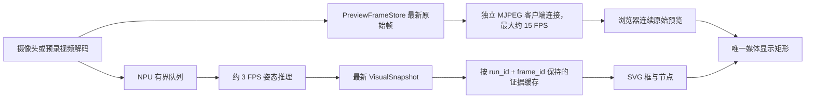

# EdgeFocus 流畅预览与脸部中心追踪设计

日期：2026-07-17

## 目标

在不提高 NPU 推理频率的前提下，使现场展示页保持约 15 FPS 的连续原始视频预览，并将最近一次有效 NPU 人体框和姿态关键点稳定叠加在当前视频上。修复浏览器容器比例变化造成的拉伸、裁切或证据坐标错位。同时将会话云台追踪点从双肩中心改为脸部中心，使脸部稳定保持在画面水平中心、垂直上方三分之一处，并修复俯仰方向的正反馈问题。

## 当前问题

1. 页面每 100 ms 建立一次连接请求 JPEG，板端每次都重新编码；HTTP 服务单线程处理，请求、编码和状态轮询彼此阻塞。
2. 桌面布局同时使用视频区 `min-height: 300px`、底部固定 `232px` 和 `body { overflow: hidden }`。在较矮的浏览器视口中，按源比例展开的视频下半部分超出页面并被裁掉；缩小浏览器后可用 CSS 高度增加，原本被裁掉的手臂和上半身才重新出现。
3. 视频使用 `object-fit: contain`，SVG 却覆盖整个容器。出现黑边时，两者使用不同的显示矩形。
4. 视频帧和视觉证据分别轮询，没有明确的“最近一次 NPU 证据”保持与跨运行清理规则。
5. 云台目标点优先使用双肩中心，不能表达“脸位于上三分之一”的构图目标。
6. 画面纵坐标向下递增，但当前俯仰控制方向与已验证的人工上下控制映射不一致，可能形成越追越偏的正反馈。

## 方案选择

采用持续 MJPEG 流，而不是继续轮询单帧 JPEG，也不在现场引入 WebRTC/H.264 服务。

- 相比单帧轮询，MJPEG 复用一条连接，降低握手和请求调度开销，并让浏览器直接连续解码。
- 相比 WebRTC/H.264，MJPEG 不需要新的媒体服务器、协商协议或板端硬件编码集成，适合当前现场部署窗口。
- 流上限约 15 FPS。NPU 继续按现有功耗策略运行，预计约 3 FPS；预览帧率不得反向驱动或提高 NPU 调度频率。

## 预览数据流



### PreviewFrameStore

`PreviewFrameStore` 以 `shared_ptr<const CameraFrame>` 保存不可变最新帧，同时提供轻量元数据读取：代次、序号、时间戳、源宽高和发布帧率。帧指针和全部元数据在同一把锁内原子替换；消费者取得引用计数快照后，生产者覆盖最新槽位也不会造成悬空引用或撕裂。状态 API 只能读取元数据，不得为了获取序号而复制整帧。等待新帧使用可被 `clear()` 和停机显式唤醒的条件变量。

预览发布与 NPU 队列完全解耦：预览槽位覆盖永不等待 NPU；NPU 队列保持现有有界 `latest-wins` 行为，队满时丢弃旧帧而不是阻塞采集。流编码器按序号读取新帧；没有新帧时等待，不重复编码同一帧，最多约 15 FPS。正式会话未启动且没有进入预录 NPU 模式时，不打开或后台消费摄像头视频源。

### HTTP 并发

普通 JSON/控制请求继续由短连接路径处理；识别到 MJPEG 请求后立即移交给受限的流客户端线程，监听线程继续服务控制请求。MJPEG 长连接不得阻塞以下请求：

- `/api/demo/state`
- 会话控制
- 云台控制
- 手机状态控制

服务内只有一个共享 JPEG 编码线程：每个源帧最多编码一次，编码结果以不可变引用计数快照发布给所有客户端，不允许按客户端重复编码。最多同时接受 2 个 MJPEG 客户端；超出返回 503。每个客户端只保留最新编码帧，慢客户端跳过中间帧；写超时为 1 秒，`EPIPE`、`ECONNRESET` 或超时立即断开。进程忽略 `SIGPIPE` 或使用无信号发送。服务关闭时主动 `shutdown/close` 所有流 socket，唤醒编码/客户端条件变量，并确定性 join 编码线程和全部客户端线程。

流接口与现有展示页、单帧接口使用相同监听地址和现场网络访问策略，不新增公网监听或独立暴露端口。

### MJPEG 输出

新增 `/api/demo/stream.mjpg`，响应 `multipart/x-mixed-replace`。每个 part 含 JPEG、内容长度、运行代次、帧序号和时间戳头。JPEG 质量初始为 78。

旧 `/api/demo/frame.jpg` 暂时保留作为诊断回退，但展示页不再轮询它。

## 浏览器媒体与证据坐标

页面根据当前权威运行的 `preview.width`、`preview.height` 和视频容器实际尺寸计算 contain 后的媒体矩形：

```text
scale = min(containerWidth / sourceWidth,
            containerHeight / sourceHeight)
displayWidth  = sourceWidth  * scale
displayHeight = sourceHeight * scale
left = (containerWidth  - displayWidth)  / 2
top  = (containerHeight - displayHeight) / 2
```

MJPEG `` 与 SVG 使用完全相同的 `left/top/width/height`。视频保持原始比例，永不 cover、裁剪或非等比拉伸；容器多余区域显示黑边。窗口缩放、全屏和源视频尺寸变化时重新计算。

视频舞台必须受网格单元边界约束：桌面端 `.stage` 和 `.video` 允许 `min-height: 0`，媒体元素使用绝对定位填充舞台后再执行 `contain`，不能依靠媒体固有尺寸撑开网格。较矮视口优先压缩底部时间线与控制区；仍不足时允许页面纵向滚动，禁止通过 `body { overflow: hidden }` 裁掉视频下半部。

视觉框和关键点继续使用 0～1 的源图像归一化坐标。SVG 使用当前源像素尺寸作为 `viewBox="0 0 sourceWidth sourceHeight"`，归一化坐标乘以相应源宽高。由于 SVG 外框与源画面同一宽高比，缩放为等比；线条使用 non-scaling stroke。`ResizeObserver`、源分辨率变化和权威运行代次变化都会重新计算媒体矩形。

## NPU 证据保持规则

会话/演示状态持有唯一权威 `source.run_id`（运行代次）。模式切换时先递增代次、停止旧生产者并清空旧预览/证据；页面通过单调的状态请求序号忽略晚到响应，只接受与当前权威 `run_id` 相等的预览和视觉快照。前端缓存键为 `source.run_id + visual.frame_id`：

1. 新 `run_id`、模式切换或会话结束：立即清空证据。
2. 同一运行中收到更大的非零 `frame_id`：用整个新 `visual` 快照原子替换缓存。
3. 两次 NPU 结果之间：在连续视频上复用缓存框和关键点。
4. 新 NPU 结果明确无主体：替换为无框/无点状态，不继续保留旧人。
5. 纯前端回放继续按媒体时间使用预录轨迹，不套用实时保持规则。
6. 旧代次、乱序或重复视觉快照不能重新成为当前证据。

证据年龄仍显示真实 NPU 时间，不得把 15 FPS 预览标成 15 FPS 推理。

证据保持仅属于 UI：云台控制器仍直接消费不可变 `VisualSnapshot`，每个 `(run_id, frame_id)` 最多驱动一次命令，并按单调采集时间执行现有新鲜度检查。重复、乱序、跨代或超出 `visual_fresh_ms` 的证据不驱动控制。1.5 秒丢失计时从最后一份可靠新证据计算；进入丢失保持、换代或重新捕获目标时重置平滑历史，避免恢复后沿用旧误差。

## 脸部中心追踪

### 追踪点优先级

COCO Pose 关键点：鼻子 0、双眼 1/2、双耳 3/4。

有效脸部点必须坐标有限、位于 `[0,1]`，置信度不低于 `0.35`。确定公式如下：

1. 鼻子和双眼有效：`face = 0.50 * nose + 0.25 * leftEye + 0.25 * rightEye`。
2. 双眼有效但鼻子无效：使用双眼中点。
3. 鼻子和恰好一个眼睛有效：使用两点中点。
4. 上述组合不成立但鼻子/眼睛/耳朵中至少两个有效：使用所有有效脸部点的算术平均。
5. 脸部点不足但人体框有效且主体置信度不低于 `0.50`：框的 `x1/y1/x2/y2` 必须全部有限且 `x2 > x1`、`y2 > y1`；先与 `[0,1] × [0,1]` 画面求交并裁剪，裁剪后宽高仍须为正，完全在画面外的框拒绝。使用裁剪后框计算 `x = box center`、`y = box top + 0.25 * box height`，最终点再次检查有限并裁剪到 `[0,1]`。
6. 无可靠人体框：不产生新命令；保持最后位置。持续丢失约 1.5 秒后状态变为 `target_lost_holding`。

双肩不再作为首选追踪点。

### 目标与控制方向

- 画面目标：`target_x = 0.5`，`target_y = 1 / 3`。
- 保留现有平滑、死区、最小命令周期和单步限制。
- 统一使用未镜像的源图像坐标，`error_y = face_y - 1/3`。已经验证的人工控制映射为 `UP => +pitch`、`DOWN => -pitch`，因此自动命令明确使用 `pitch_delta = clamp(-error_y * pitch_gain, ±maximum_step)`，即 `pitch_direction = -1`。脸偏低产生负 pitch（DOWN），脸偏高产生正 pitch（UP）。
- 水平追踪方向不因本次改动而改变。

正式会话追踪仍受硬件 FAULT、UART、对齐状态和自动运动安全窗口约束。人工无软限位路径不复用于自动追踪。

## 异常与降级

- MJPEG 断流：JS `onerror` 以 0.5、1、2 秒退避并用 cache-busting URL 重建 `src`。状态中的预览序号持续 2 秒不前进时触发停滞 watchdog；状态和控制面板始终保持可用。
- 暂无帧：显示等待状态，不拉伸最后帧到未知比例。
- NPU 暂停或低帧率：继续显示原始流和最后证据年龄；不伪造新 frame_id。
- 模式切换：先推进运行代次，再停止/回收旧源，清空旧原始帧、共享 JPEG 和证据，最后启动新源。正式摄像头只在 PRECHECK、FOCUSING、PAUSED 等正式会话有效阶段打开；会话结束即关闭。预录 NPU 只在对应模式打开；纯前端回放使用 MP4，不启动 MJPEG 编码。
- 目标丢失：云台保持，不盲目累计角度。

## 验证

### 单元/组件测试

- PreviewFrameStore 元数据不复制帧，并正确报告序号、宽高和发布帧率。
- 并发覆盖时不可变快照无撕裂/悬空；新帧读取不重复返回相同序号；停机可唤醒等待者。
- NPU 队满不会阻塞预览，且 15 FPS 预览不会提高 NPU 调度频率。
- 两个共享流客户端只触发一次编码；第三个返回 503；慢客户端丢帧到最新，断连和停机均回收线程/socket。
- multipart 边界、Content-Length、代次/序号头及中途断连正确。
- 媒体矩形在 4:3、16:9、超宽及低高度容器中保持比例且居中，不撑开父网格。
- 证据缓存只在新 frame_id 更新，并在 run/mode 变化时清空。
- 旧代次晚到、重复/乱序帧、明确无主体和 NPU 停顿超过 1.5 秒均按规则处理。
- 脸部公式得到精确期望坐标；脸部不足时使用人体框顶部 25%。
- NaN/Inf、负尺寸、零尺寸、部分越界和完全越界人体框分别按规定裁剪或拒绝，绝不向控制器输出非有限点。
- 人脸位于目标下方时最终命令为负 pitch，位于上方时为正 pitch。
- 目标丢失后不继续累计命令。

### 板端验证

1. 正式会话预览连续，页面显示约 15 FPS，NPU 指标保持真实约 3 FPS。
2. 在不同浏览器窗口比例与缩放级别下，人、手臂和画面边缘不被页面裁掉或横向拉伸；矮窗口允许下方面板压缩/滚动。
3. 框和关键点随缩放仍贴合人物；推理间隔内保持而不闪烁。
4. 抬手、转身和移动时原始视频继续流畅，证据按 NPU 节拍更新。
5. 人脸上下移动时云台能双向追回，并稳定在水平中心和画面上三分之一。
6. 先在相同 640×480 输入下关闭预览流运行 60 秒取得 NPU FPS、`focus_app` CPU 和 RSS 基线；随后分别用 1、2 个页面持续 60 秒。舍弃前 15 秒预热后必须同时满足：预览 FPS 中位数不低于 12、稳定网络下无超过 1 秒的帧间断；1 页面 NPU FPS 不低于基线 90%，2 页面不低于基线 85%；控制 API 延迟 p95 不高于 250 ms、最大不高于 1 s；`focus_app` 平均 CPU 相对基线增加不超过 60 个百分点；15～60 秒 RSS 增长不超过 12 MiB 且无单调持续增长。任一指标失败则降预览上限/质量，不允许提高 NPU 间隔来换取预览性能。
