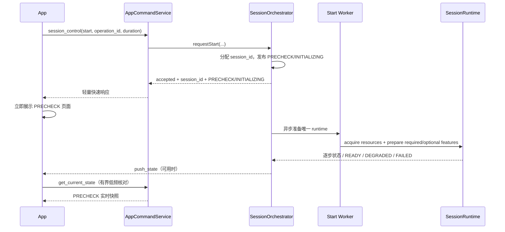

# EdgeFocus PRECHECK 快速确认、实时状态与崩溃防护设计

- 日期：2026-07-17
- 范围：`EdgeFocusApp` 与 `self_developed/code/focus_app`
- 状态：已由用户批准方案 A，并要求主机提前确认 PRECHECK

## 1. 问题与目标

实机当前存在同一启动链上的三类故障：

1. App 点击开始后只短暂显示“正在等待 EdgeFocus 确认会话”，随后回到首页，未进入 PRECHECK 页面。
2. 第二次点击可能直接进入正式会话，说明第一次请求已经在主机端生效，但 App 因响应或超时策略没有接收该事实。
3. 自动重连或点击开始一段时间后 App 可能闪退；PRECHECK 相机预览的请求、解析和 Bitmap 解码是当前高风险链路。

本次目标：

- 主机收到合法 `start` 后，先建立唯一会话身份并立即发布 `PRECHECK/INITIALIZING`，不等待摄像头、模型或云台全部准备完成。
- App 收到快速确认后立即打开现有 PRECHECK 页面，并实时显示初始化、画质、相机和可选云台状态。
- App 始终以主机 phase 为权威，不从 `success`、剩余时间或本地倒计时推断 `FOCUSING`。
- 响应丢失或超时时通过有界状态核对恢复，不自动重发 `start`。
- PRECHECK 预览链在损坏包、超大包、断连、重连和页面退出时不闪退、不无限占用内存。
- 保持首页和 PRECHECK 页面原有 UI 风格及布局，只修正状态和错误展示。

## 2. 已确认根因

### 2.1 启动响应过晚

主机 `SessionOrchestrator::start()` 当前同步执行 runtime factory、required feature prepare 和 PRECHECK phase 切换，`AppCommandService` 只能在这些步骤全部完成后回复。

App 的所有 BLE 请求共用 5 秒 `WRITE_TIMEOUT_MS`。主机准备超过 5 秒时，App 把请求视为失败并恢复 IDLE，但主机仍可能稍后进入 PRECHECK。因此第一次点击已经生效，第二次点击收到幂等的活动会话后才进入会话。

### 2.2 App 错误推断正式运行

`TimerStateHolder.startEdgeFocusSession()` 在 `start` 成功响应未解析出 phase 时，会依据剩余时间或本地时间直接设置 `RUNNING`。这绕过了主机 PRECHECK，也违反主机模式的权威边界。

### 2.3 PRECHECK 预览缺少资源边界

- App 每 750 ms 请求一帧，快于主机声明的 1200 ms 建议间隔。
- JSON 解析处于长生命周期 `launch` 中，异常没有在预览边界内统一收口。
- Base64 与 JPEG Bitmap 在 Compose 渲染线程解码，持续产生大对象。
- BLE chunk assembler 没有 chunk 数量、单消息字节数和并发消息数量上限，组装使用重复数组拼接。
- 离开 PRECHECK 时只取消排队预览；必须保证在途结果不能写回已经退出的 phase。

## 3. 选定方案

采用“主机快速 PRECHECK ACK + 异步准备 + App 有界核对 + 安全预览”方案。

不采用：

- 仅把通用 5 秒超时调大：仍会把启动正确性绑定到具体机型和初始化耗时。
- App 本地伪造 PRECHECK：会产生第二套状态机，无法正确处理主机准备失败、已有会话和断连恢复。
- App 超时后自动重发 start：请求结果不明确时重发可能造成重复会话或覆盖当前会话。

## 4. 主机启动状态机

### 4.1 对外 phase 与内部准备状态

对 App 继续使用稳定 phase：

- `IDLE`
- `PRECHECK`
- `FOCUSING`
- `PAUSED`

PRECHECK 增加准备状态，不新增 App 页面：

- `INITIALIZING`：会话身份已建立，required runtime 正在准备。
- `READY`：required runtime 已准备并进入可交互 PRECHECK。
- `DEGRADED`：required runtime 可用，但一个或多个 optional feature 降级。
- `FAILED`：required prepare 失败，随后安全回收并回到 IDLE；错误原因保留供状态核对读取。

`session_phase=PRECHECK` 与 `precheck.preparation_state` 必须同时返回。App 可在 `INITIALIZING` 阶段立即打开 PRECHECK 页面，但“跳过预检/开始正式会话”操作在 `READY` 或 `DEGRADED` 前不可用。

### 4.2 快速确认时序

快速响应不得携带 Base64 图片，只返回轻量状态和预览元数据。图片仍由专用 `get_camera_preview_image` 按需读取。

### 4.3 所有权与并发边界

- `SessionOrchestrator` 仍是正式会话身份、phase 和 runtime 的唯一所有者。
- 异步 start worker 归 `SessionOrchestrator` 所有；不得把 pending start 放进 `AppCommandService` 形成第二个状态机。
- `requestStart` 在锁内只完成校验、分配 context、发布 `PRECHECK/INITIALIZING` 和启动唯一 worker，然后立即返回。
- 耗时的资源获取和 `runtime->prepare()` 不持有 orchestrator 主互斥锁。
- worker 完成后重新持锁，并校验 session generation/session_id；过期 worker 不得覆盖新会话。
- 重复 start 在 `INITIALIZING/READY/DEGRADED/FOCUSING/PAUSED` 中幂等返回当前 session_id 和状态，不创建第二个 worker。
- `confirmReady` 在 `INITIALIZING` 时返回明确的 `precheck_not_ready`，不结束 PRECHECK。
- `end` 或进程退出发生在 `INITIALIZING` 时，先标记取消；worker 到达安全点后按逆序停止已经取得的资源，且不能再发布 READY。
- required prepare 失败发布可读取的失败原因，安全回收 runtime 后回到 IDLE；optional feature 失败只发布 DEGRADED。

## 5. App 启动事务与超时策略

### 5.1 单一 pending start

App 为一次点击建立单一启动事务：

- 保存本地 `operation_id`、目标时长和整体 deadline。
- 发送一次 `start`；pending 期间禁止重复点击。
- 收到 `PRECHECK`：立即应用主机快照并显示 PRECHECK。
- 收到 `FOCUSING`：恢复已有正式会话；只有主机明确返回该 phase 才进入 RUNNING。
- 收到显式拒绝：结束 pending 并展示错误。
- 收到格式正确但 phase 缺失/IDLE：不推断 RUNNING，进入状态核对。
- BLE 响应超时属于“结果未知”，不等同于主机拒绝；进入状态核对且不重发 start。

### 5.2 有界状态核对

- 快速 ACK 目标：2 秒内；BLE 单请求仍保留有限超时，不用无限等待。
- start 首次结果未知后，每 1 秒请求一次 `get_current_state`，请求串行且一次只允许一个在途。
- 整体核对窗口为 30 秒；收到 `PRECHECK/FOCUSING/PAUSED` 立即结束 pending。
- 期间断连时保留事务 deadline；重连后先完成协议协商，再立即核对一次当前状态。
- 30 秒内主机始终明确为 IDLE，或 deadline 到达仍无权威活动 phase：结束 pending、保持首页并显示可重试错误。
- deadline 后到达的旧响应只能走普通状态恢复，且必须通过当前 session_id/generation 门控，不能覆盖新操作。

### 5.3 状态展示

现有 PRECHECK 页面复用，不新增跳转栈：

- `INITIALIZING`：显示“EdgeFocus 正在准备”，各检查项展示当前事实；操作按钮禁用。
- `READY`：允许用户按原设计继续/跳过。
- `DEGRADED`：展示具体可选能力不可用，但 required 检查通过时仍允许继续。
- 主机实时快照更新相机、画质、构图、云台和错误项。
- 不增加“主机权威·状态已同步”一类冗余标签。

## 6. PRECHECK 实时状态和预览安全

### 6.1 状态轮询

- PRECHECK 的轻量状态核对沿用统一 board sync，约 1 秒一次；请求调度优先级高于图片预览。
- push_state 用于降低延迟，但轮询是丢包和重连后的收敛保障。
- 同一快照 reducer 处理 start ACK、push 和 get_current_state，避免多条解析分支产生不同结果。

### 6.2 图片预览

- 按主机协议建议，最短请求间隔 1200 ms。
- 同时最多一个预览请求；离开 PRECHECK、断连或 session_id 改变时取消循环并丢弃在途结果。
- 解析、Base64 解码和 Bitmap 采样放在 IO/Default dispatcher，不在 Compose 渲染阶段重复解码。
- 只把已验证且适合显示的预览对象交给 UI；UI 不保存整段历史 Base64。
- 对编码长度、解码后尺寸和像素数设置上限；越界或损坏数据只记录一次受控错误并等待下一帧，不结束进程。
- 相同 sequence 不重复解码；新帧替换旧帧后允许旧 Bitmap 被回收。

### 6.3 BLE chunk 防护

- 限制单消息最大 chunk 数、单消息累计字节数和同时 pending 消息数。
- 拒绝不一致的 `total/kind/response_id`、非法 Base64 和越界 sequence。
- 使用预计算总长度的一次性拷贝组装，删除 O(n²) 的逐块数组拼接。
- 超时、断连和会话切换清除残留组装状态。

## 7. 错误处理与可观测性

App 事件日志至少记录：

- operation_id（不得当作主机 session_id）
- start send/ack/timeout/reconcile
- 主机 session_id、phase、preparation_state
- 核对次数、deadline 原因
- preview sequence、payload 大小、解析/解码拒绝原因
- 重连后恢复到的 session_id/phase

主机日志至少记录：

- session_id 与 start generation
- 快速 ACK 时间
- worker 的 resource acquire、required/optional prepare 和 phase 发布
- 取消、失败和逆序清理结果

错误消息不得泄露原始 Base64 或完整大响应。

## 8. 测试与验收

### 8.1 主机测试

- `requestStart` 在慢 prepare 尚未完成时立即返回 PRECHECK/INITIALIZING。
- 同时两次 start 只创建一个 worker，并返回同一 session_id。
- INITIALIZING 中 confirm 被拒绝且会话保留。
- prepare 成功转 READY；optional 失败转 DEGRADED；required 失败清理并回 IDLE。
- INITIALIZING 中 end/析构不会死锁、泄漏 worker 或晚到发布 READY。
- start/get_current_state 响应不包含 Base64 图片。

### 8.2 App 单元测试

- start ACK 为 PRECHECK 时立即进入 PRECHECK 页面状态。
- start 响应超时后核对到 PRECHECK，不重发 start。
- 缺 phase 但有时间字段时不进入 RUNNING。
- 30 秒内持续 IDLE 才结束 pending 并报告超时。
- 重连后核对已有 PRECHECK，恢复同一会话。
- 晚到旧响应不能覆盖新 session/generation。
- 损坏 JSON、非法 Base64、超限 chunk/图片不会抛出未捕获异常。
- PRECHECK 退出后在途预览不写回；1200 ms 内不发第二个预览请求。

### 8.3 实机验收

1. 冷启动 APP 自动连接主机，时间选择保持用户值且轮盘可拖动。
2. 第一次点击开始后直接进入 PRECHECK 页面，不需要第二次点击。
3. 页面先显示初始化，再实时更新相机/画质/云台状态。
4. 主机准备超过旧 5 秒阈值时仍能正常收敛。
5. PRECHECK 中断开并恢复蓝牙，APP 恢复同一 PRECHECK，不创建新会话。
6. 连续停留 PRECHECK 至少 10 分钟、反复前后台和重连，无闪退且内存无持续增长。
7. 主机 required prepare 故障时 APP 返回可重试状态并显示原因，不误入正式会话。
8. 只有主机明确进入 FOCUSING 后，APP 才启动会话中屏保和正式计时展示。

## 9. 实施顺序

1. 主机增加 owned async start transaction、PRECHECK/INITIALIZING 快速发布及测试。
2. 主机状态协议补充 preparation_state/error，并保证控制响应无图片负载。
3. App 收束 start ACK/状态核对/reconnect 为单一启动事务和 reducer。
4. App 加固 preview loop、后台解码和 chunk assembler 上限。
5. 更新双端协议/架构文档，运行双端测试和构建。
6. 生成新 APK；若设备可通过 ADB 连接，抓取旧版或新版实机日志并执行覆盖安装回归。
