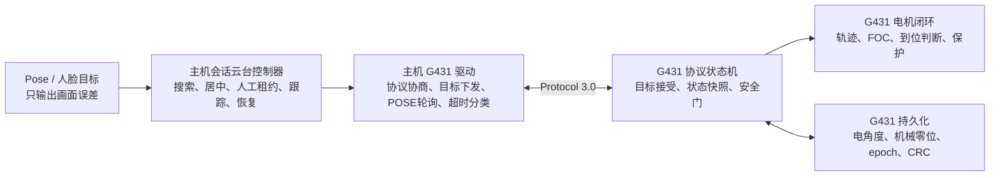
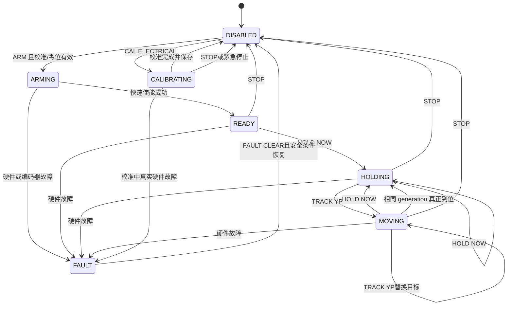
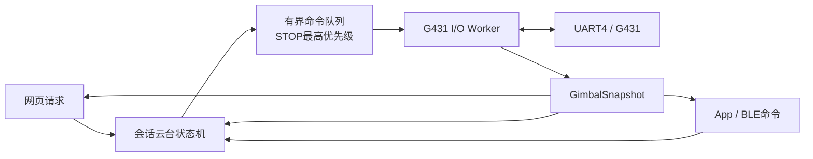
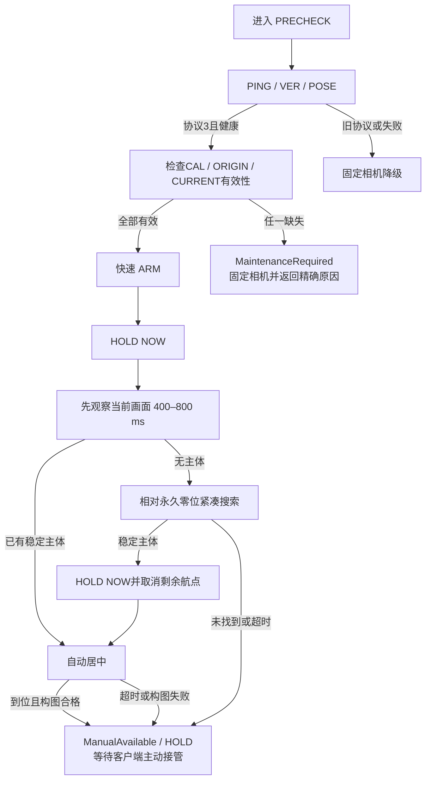

# EdgeFocus 国赛版云台协议 3.0 与主机链路重构设计

- 日期：2026-07-20
- 状态：用户已批准设计内容，待规格审查与书面复核
- 主程序基线：现场稳定运行源码，不使用当前未提交候选工作树作为实现起点
- G431 基线：`code/G431`，已核对与现场研究包及硬件参考工程核心源码一致
- 现场源码归档：`_workspace/exports/EdgeFocus_Onsite_Gimbal_Research_20260719/01_onsite_runtime/edgefocus-live-build-source.tar.gz`
- 现场源码归档 SHA-256：`e4200f542cd5eb4b970afef5ecaddb372527744f9a285c0778a30de724a9c6b0`
- 现场 ARM 二进制 SHA-256：`a2c044e5042dd6f185bc7f91fca64b89ee38244f8f784bd07ae169cd33433367`
- 依据：
  - `doc/EdgeFocus主机_云台状态机搜索与跨端协议修复实施文档.md`
  - `doc/G431云台固件_位置参考系与控制修复实施文档.md`

## 1. 目标

本次重构同时修改完整 STM32MP257 主程序和 STM32G431 云台固件，解决以下根因：

1. 电角度校准、永久机械正前方和运行目标共用同一 `home` 语义。
2. `ARM`、会话切换或故障恢复会重新做电角度校准并重新定义逻辑零位。
3. 主机把命令 ACK 当作物理运动完成，搜索、居中和人工控制时序不可靠。
4. 串口运动等待可能阻塞会话、HTTP 或 BLE 路径。
5. 搜索业务失败、通信瞬态错误和真实硬件故障没有可靠分类。
6. 人工连续微调基于滞后实测角度，可能丢失或抵消用户的净位移。
7. 固件 5 ms 控制路径含阻塞式 I2C/ADC访问、不可中断校准和不完整保护。

完成后，云台仍是正式会话的可降级外挂能力。云台故障不得阻断 Presence、Prone、Phone Fusion、BLE、展示网页或正式会话的基础能力。

## 2. 非目标

- 不恢复困倦、闭眼疲劳、旧左右转头或视觉手机识别。
- 不重写与本次复审无关的视觉、Fusion、存储和提醒业务。
- 不新增第二个相机或 NPU 所有者。
- 不在第一轮完全推倒现有可工作的 FOC 内核。
- 不允许协议 2.0 固件执行自动搜索、跟踪或人工运动。
- 不把 PRECHECK 视觉证据写入正式分心累计、报告或提醒。

## 3. 工程与版本策略

### 3.1 开发工作区

- `code/focus_app_national`：完整主程序源码，从现场稳定运行源码导入并建立独立国赛分支。
- `code/G431_national`：完整 G431 工程，从已确认的 `code/G431` 基线建立独立国赛分支。
- 当前 `code/focus_app` 的未提交候选改动完整保留，不作为国赛实现基线。
- 当前 `code/G431` 保留为可回退固件基线。

验证完成后，`focus_app_national` 收束为正式 `code/focus_app` 主线，不作为长期独立子项目。

### 3.2 成对版本

主机协议 3.0 驱动与 G431 协议 3.0 固件视为一个发布单元。部署和回退均成对进行，不能只切换一侧。

## 4. 总体职责边界



- 主机决定为什么运动、何时运动和目标位置。
- G431 决定怎样安全到达目标，并提供是否真正到位的权威事实。
- 视觉层不得直接发送 UART 命令。
- `precheck_confirm_position` 仅保存本会话构图位置，不更新永久机械零位。
- 只有维护流程可执行电校准、永久零位捕获或持久数据清除。

## 5. G431 参考系和持久化

### 5.1 三层参考系

G431 必须分别保存：

1. **电角度参数**：换相方向、极对数、电角度 offset；只由 `CAL ELECTRICAL` 更新。
2. **永久机械零位**：人工将产品摆正后捕获的两轴编码器 raw；只由 `ORIGIN CAPTURE` 更新。
3. **运行目标**：搜索、居中、跟踪或人工运动目标；不持久化。

协议角度使用 `0..3599` 的 0.1°环形坐标，`0` 永远表示永久机械零位。主机使用最短路径换算有符号偏移。

### 5.2 安全窗口

- 默认 yaw：永久零位 ±70°。
- 默认 pitch：永久零位 ±70°。
- 两轴分别配置，可在实机验收后缩小。
- 搜索航点范围和产品安全窗口是两套配置；搜索不默认扫满安全窗口。
- 自动搜索、自动居中、人工微调、会话跟踪和恢复目标必须经过同一安全窗口校验。

### 5.3 Flash A/B 槽

目标 MCU 为 STM32G431RB，128 KB Flash。当前固件二进制约54 KB。链接脚本将应用区从126 KB缩到124 KB，保留最后两个独立2 KB页作为 A/B 持久化槽。

记录至少包含：

```c
struct GimbalNvRecordV3 {
    uint32_t magic;
    uint16_t schema_version;
    uint16_t record_length;
    uint32_t generation;
    AxisElectricalCalibration axis[2];
    uint16_t origin_raw[2];
    uint32_t calibration_epoch;
    uint32_t origin_epoch;
    CurrentProtectionConfig current_protection;
    int16_t safe_min_tenths[2];
    int16_t safe_max_tenths[2];
    uint32_t valid_flags;
    uint32_t crc32;
};
```

写入规则：

1. 启动时读取两页，检查 magic、版本、长度和 CRC。
2. 选择最高 generation 的有效记录。
3. 更新时擦除非活动页、写入新 generation、读回校验。
4. 新记录验证成功后才成为活动记录。
5. 写入失败保留旧页；不能先擦除唯一有效副本。
6. `STOP`、`ARM`、会话结束和普通故障恢复不清除记录。
7. generation 使用32位模序比较；未知 schema、非法长度和CRC错误记录均忽略。
8. 旧 schema 不做隐式迁移；设备进入 `MAINTENANCE_REQUIRED`，由维护工具显式重新校准。
9. `CAL ELECTRICAL` 成功只原子更新电参数和 `calibration_epoch`，保留已有 origin raw、valid和epoch；中止、失败或掉电不提交新记录。
10. `NVM CLEAR ORIGIN` 写入新的tombstone记录，只清除 origin valid并递增 `origin_epoch`；`NVM CLEAR ALL` 同样写入新记录，清除电校准、机械零位和电流保护有效位并递增相应epoch，随后拒绝普通ARM。两者都不通过同时擦除A/B页表达“清空”。
11. 固件对所有运动目标执行持久化安全窗二次校验；主机配置只能等于或小于固件窗口。

## 6. G431 状态机



### 6.1 命令语义

- `ARM`：要求电校准、机械零位和电流保护均有效，加载持久参数并快速使能；不扫动、不执行电校准、不重新定义机械零位。
- `ARM MAINTENANCE`：仅维护向导可用；要求电校准和机械零位有效，进入普通 `READY` 状态并设置正交标志 `arm_profile=MAINTENANCE`。此profile下只允许低PWM、低速度和永久零位±10°的小角度测试。
- `HOLD NOW`：原子捕获两轴当前位置，同时重置目标、轨迹、积分和速度估计，生成新的 motion generation。
- `TRACK YP`：接受异步目标并返回 generation；ACK不代表到位。
- `POSE`：提供当前角度、目标、generation、settled、epoch、校准有效性、故障和样本年龄。
- `STOP`：停止轨迹、关闭驱动和 Boost；确认输出关闭后返回，不修改 NVM。
- `!`：紧急停止字节，任何状态下50 ms内生效。
- `CAL ELECTRICAL`：显式、异步、可中断的维护流程。
- `ORIGIN CAPTURE`：允许在 `DISABLED`、`READY` 或 `HOLDING` 执行；要求电校准有效、两轴编码器有效且低速稳定，原子保存两轴永久零位并递增 origin epoch。首次初始化在电机关闭的 `DISABLED` 状态下人工摆正后捕获，不依赖ARM。
- `FAULT CLEAR`：只允许输出已关闭时执行；仅在驱动Fault输入释放、编码器/采样恢复且不存在失控条件时清除锁存故障并回到 `DISABLED`。

### 6.2 命令—状态矩阵

| 命令 | 允许状态 | 关键结果 |
|---|---|---|
| `ARM` | DISABLED | READY；缺少任一生产校准则拒绝 |
| `ARM MAINTENANCE` | DISABLED | READY，`arm_profile=MAINTENANCE`；仅允许±10°低功率测试 |
| `HOLD NOW` | READY/HOLDING/MOVING | HOLDING，新generation |
| `TRACK YP` | HOLDING/MOVING | MOVING，替换目标并递增generation |
| `ORIGIN CAPTURE` | DISABLED/READY/HOLDING | 保存两轴永久零位 |
| `CAL ELECTRICAL` | DISABLED | CALIBRATING；异步可中断 |
| `PROTECT CURRENT SET` | DISABLED | 保存电流保护参数 |
| `STOP` | ARMING/READY/HOLDING/MOVING/CALIBRATING/FAULT | 无故障时DISABLED；已有FAULT时保持FAULT但确保输出关闭；清除arm_profile |
| `FAULT CLEAR` | FAULT且输出关闭 | 安全条件恢复后进入DISABLED |
| `!` | 所有状态 | 立即关PWM/Boost，运动或维护事务中止 |

FAULT采用锁存语义。`STOP`只保证输出安全，不伪造故障已消失；必须在物理条件恢复后显式 `FAULT CLEAR`。

### 6.2 settled 条件

`SETTLED=1` 必须同时满足：

- 当前运动 generation 与目标 generation 一致。
- 目标斜坡已到终点。
- 两轴位置误差均在进入阈值内。
- 两轴估计速度均在低速阈值内。
- 编码器样本有效且未过期。
- 上述条件连续维持约250 ms。

目标改变、generation改变、误差越过退出阈值、样本过期或故障时立即清除 settled。

## 7. UART协议 3.0

### 7.0 传输和语法

- UART4，115200 baud，8N1，无流控。
- 普通命令和响应以 `\r\n` 结尾；最大行长256字节（包含结尾）。
- 关键字和枚举使用大写ASCII；数值使用十进制，不接受符号外的空白变体。
- `yaw10` 参数始终在前，`pitch10` 始终在后。
- 逻辑角只接受 `0..3599`；明确拒绝3600并由调用方规范化。
- 主机同一时刻最多保持一个普通请求等待响应；motion generation只关联运动目标，不充当通用request id。
- 协议不发送会与普通响应交错的异步事件行。长操作通过立即 `ACCEPTED` 和后续 `POSE` 轮询表达。
- `POSE` 在一个临界区内复制完整快照后再格式化，禁止跨控制周期拼字段。
- 永久零位无效时仍返回 `P_RAW/Y_RAW` 和raw有效位，逻辑 `YAW10/PITCH10/TYAW10/TPITCH10` 返回 `NA`。
- 固件复位、主机重新打开UART链路或解析器因 `!` 主动重同步后，必须重新执行 `HELLO HOST PROTO=3.0` 才接受可改变状态的协议3命令；未协商的旧运动命令返回 `NEGOTIATION_REQUIRED`。普通 `STOP` 不清除HELLO协商状态。

### 7.1 能力协商

```text
PING
OK,G431

VER
VER,PROTO=3.0,FW=G431-GIMBAL,CAPS=ASYNC_MOTION|POSE|ORIGIN|FAULT_CLASS|HOLD_NOW|NVM_V3|MAINT_ASSIST_DIAG|NEGOTIATION_REQUIRED,MAX_SPEED10=NA,MAX_ACCEL10=NA,SETTLE_MS=250

HELLO HOST PROTO=3.0
OK,HELLO,PROTO=3.0
```

主机首版只在 `PROTO=3.0` 且必需能力完整时开放运动。未来3.x版本必须显式加入兼容表，不能仅因主版本相同自动接受。协议2.0只允许只读诊断并固定相机降级。

### 7.2 命令集合

```text
PING
VER
HELLO HOST PROTO=3.0
ARM
ARM MAINTENANCE
STOP
HOLD NOW
TRACK YP <yaw10> <pitch10>
POSE
FAULT
FAULT CLEAR
CAL ELECTRICAL P|Y|ALL
ORIGIN CAPTURE
NVM STATUS
NVM CLEAR ORIGIN|ALL
CURRENT
CURRENT RESET
MAINTASSIST?
PROTECT CURRENT SET P_PEAK=<raw> P_AVG=<raw> Y_PEAK=<raw> Y_AVG=<raw> STALL_MS=<ms>
PROTECT CURRENT CLEAR
!
```

### 7.3 典型响应

```text
OK,ARM,STATE=READY,CAL_EPOCH=3,ORIGIN_EPOCH=1
OK,HOLD_NOW,GEN=41,YAW10=0,PITCH10=0
TRACK,ACCEPTED,GEN=42,YAW10=3500,PITCH10=120
POSE,STATE=MOVING,ARM_PROFILE=PRODUCTION,P_RAW=1024,Y_RAW=2080,P_RAW_VALID=1,Y_RAW_VALID=1,YAW10=3570,PITCH10=80,TYAW10=3500,TPITCH10=120,CURRENT_VALID=1,TARGET_VALID=1,GEN=42,SETTLED=0,CAL_EPOCH=3,ORIGIN_EPOCH=1,CAL_VALID=1,ORIGIN_VALID=1,CURRENT_PROTECTION=CONFIGURED,SAMPLE_AGE_MS=2,FAULT=NONE,OP=NONE,OP_GEN=0,OP_PROGRESS=0,LAST_OP_STATUS=OK
CAL,ACCEPTED,OP_GEN=7,AXIS=ALL
POSE,STATE=CALIBRATING,P_RAW=1024,Y_RAW=2080,P_RAW_VALID=1,Y_RAW_VALID=1,YAW10=0,PITCH10=0,TYAW10=NA,TPITCH10=NA,CURRENT_VALID=1,TARGET_VALID=0,GEN=42,SETTLED=0,CAL_EPOCH=3,ORIGIN_EPOCH=1,CAL_VALID=1,ORIGIN_VALID=1,CURRENT_PROTECTION=CONFIGURED,SAMPLE_AGE_MS=2,FAULT=NONE,OP=CAL_ELECTRICAL,OP_GEN=7,OP_PROGRESS=45,LAST_OP_STATUS=RUNNING
OK,STOP,STATE=DISABLED,BOOST=0,MOTOR=0,HOLD=0
CURRENT,P_RAW=620,P_AVG=580,P_PEAK=910,Y_RAW=600,Y_AVG=565,Y_PEAK=870,WINDOW_MS=1000,SAMPLES=200,VALID=1,SATURATED=0
MAINTASSIST,GEN=43,ATTEMPTED=1,EXHAUSTED=0,ACTIVE_MS=85,PEAK_FLOOR=132
```

### 7.4 错误分类

- `ERR,CLASS=COMMAND,CODE=<stable_code>`：格式、范围或状态不允许；不触发硬件降级。
- `ERR,CLASS=TRANSIENT,CODE=<stable_code>`：忙、样本暂时无效或通信瞬态；允许有限重试。
- `ERR,CLASS=FAULT,CODE=<stable_code>`：驱动器、编码器、电流、堵转、失控或安全条件失败；立即停机。

首版稳定错误码至少包括：`UNKNOWN_CMD`、`BAD_FORMAT`、`BAD_RANGE`、`INVALID_STATE`、`NEGOTIATION_REQUIRED`、`CAL_REQUIRED`、`ORIGIN_REQUIRED`、`CURRENT_CONFIG_REQUIRED`、`BUSY`、`SAMPLE_STALE`、`UART_TRANSIENT`、`DRIVER_FAULT`、`ENCODER_FAULT`、`OVERCURRENT`、`STALL`、`CONTROL_LOST`。

`CAL ELECTRICAL` 完整语义：命令先返回 `CAL,ACCEPTED,OP_GEN=n`；主机轮询 `POSE.OP/OP_GEN/OP_PROGRESS/LAST_OP_STATUS`。成功时状态回到DISABLED、`CAL_EPOCH`递增且 `LAST_OP_STATUS=OK`；STOP或 `!` 时为 `ABORTED`；失败时为 `FAILED` 并附稳定错误码。不存在独立异步完成行。

`CURRENT` 返回ADC raw单位的两轴瞬时值、最近1000 ms滚动平均值，以及自 `CURRENT RESET` 后的峰值、样本数、有效位和ADC饱和位。少于一个完整窗口、任一采样过期或ADC饱和时 `VALID=0`，维护端不得据此生成阈值。`CURRENT RESET` 允许在READY/HOLDING中执行，用于标定运动开始前清空峰值统计。

`MAINTASSIST?` 是只读维护诊断，要求先完成 `HELLO`，但在固件 BUSY 时仍允许读取。它只观察维护模式 yaw 的一次性自适应脱粘辅助；`GEN` 必须与本次运动 generation 一致，`ACTIVE_MS` 不得超过 300，`PEAK_FLOOR` 不得超过维护上限 180。该能力不改变生产模式或 pitch 的 PWM 边界。

响应必须包含稳定机器码；展示文字由主机/App映射，不依赖固件英文字符串。

## 8. G431 实时控制修改

保留已能驱动电机的 FOC主体，但修改外围控制和安全门：

1. 电角度校准改为可中断的分步状态机，删除多秒阻塞 `HAL_Delay` 路径。
2. 5 ms控制循环不得执行20 ms I2C等待或循环重试。
3. 硬件 I2C、软件 I2C和ADC使用异步或严格有界采样器；控制循环只消费最新值及样本年龄。
4. 轨迹斜坡按真实 `dt` 更新。
5. 目标反向时清理或反算错误方向积分；重力前馈与误差积分分离。
6. 增加峰值电流、滑动平均电流、堵转、编码器连续错误和样本过期保护。
7. 不使用猜测电流阈值。维护向导采集零电流和受控运动数据，确认前报告 `CURRENT_PROTECTION=UNCONFIGURED`；编码器、堵转和超时保护仍启用。
8. ISR只搬运字节、完成标志或紧急停止标志，不执行Flash、复杂I2C、格式化输出或状态机长步骤。
9. 电流保护未配置时，普通 `ARM`、搜索、跟踪和普通人工运动全部拒绝 `CURRENT_CONFIG_REQUIRED`；只有 `ARM MAINTENANCE` 可在硬件DAC电流上限、低PWM和低速度约束下执行永久零位±10°的标定运动。维护profile复用READY/HOLDING/MOVING状态，所有目标入口都额外检查profile限制。
10. `PROTECT CURRENT SET` 只允许DISABLED维护状态，校验峰值大于平均值、范围和stall时间后原子写入A/B槽；`CLEAR` 清有效位并使普通ARM重新受限。

## 9. 主机驱动与并发模型

### 9.1 唯一I/O所有者

`GimbalHardwareService` 独占 `/dev/ttySTM3`，内部运行一个 I/O worker。所有会话、HTTP和BLE调用只提交类型化意图。



- HTTP/BLE线程不得持锁等待运动到位。
- 命令入口先返回 `queued=true`；只有G431 ACK后，快照/可靠事件才发布 `accepted=true`、generation和 `acked_through_sequence`。不得在固件ACK前虚构generation。
- HTTP若需要同步用户反馈，可在不持有会话/网络全局锁的前提下最多等待固件ACK 500 ms；BLE回调不得等待，通过可靠事件返回结果。
- STOP具有最高普通队列优先级并取消尚未下发的运动目标。
- 紧急停止不进入普通队列：使用独立原子 emergency slot，I/O worker每次poll优先检查并立即发送单字节 `!`。
- 同方向、同租约的连续人工目标可合并，但必须保留净位移。

### 9.2 Linux串口可靠性

串口实现必须处理：

- `EINTR`、`EAGAIN`、短写。
- 部分行、CR/LF差异、粘包、未知异步行。
- 每条请求独立截止时间。
- request、ACK和motion generation匹配。
- 连续超时、恢复和退避。
- 历史累计 `UARTERR` 非零不直接等价于当前故障。
- UART始终非阻塞或使用短周期poll，任何不可取消的单次等待不得超过10 ms。
- `!` 不带换行，允许打断行命令、普通运动、校准等待和Flash维护流程。
- 产品默认使用 `UART_ONLY` 控制；若配置并验证了 `UART+ENABLE+FAULT`，紧急停止同时拉低Enable。PD6 Fault可作为额外安全输入，但不能替代协议状态。
- G431校准和Flash状态机每个小步骤都检查急停标志；擦写期间保持电机输出关闭。

### 9.3 状态模型

- `LinkHealth`：Healthy / Degraded / Offline。
- `ControlMode`：Idle / MaintenanceRequired / AutoSearch / AutoCentering / ManualAvailable / Manual / Tracking / Recovering / Maintenance / Released。
- `CommandError`：格式、范围、阶段、session、sequence或租约错误。
- `HardwareFault`：驱动、编码器、电流、堵转、失控等真实故障。
- `GimbalPoseState`：当前/目标角、generation、settled、epoch、时间戳和样本年龄。

搜索未找到人、居中超时和构图失败是业务结果，不能写成 HardwareFault。

## 10. PRECHECK 搜索与构图



规则：

1. 进入PRECHECK后先观察当前画面，不立即扫动。
2. 协议协商后先检查 `CAL_VALID`、`ORIGIN_VALID` 和 `CURRENT_PROTECTION`；任一缺失时进入 `MaintenanceRequired` 固定相机降级，返回精确缺失项并禁止自动搜索。
3. 搜索航点单独配置，默认产品紧凑序列为 `(-35°,0°) → (+35°,0°) → (0°,-25°) → (0°,+25°)`；每个点均相对永久零位。现场快速演示配置可以保留已验证的两点序列，但必须显式标注profile。
4. 每个航点等待相同 generation 的 `SETTLED=1`，再等待150–300 ms机械稳定缓冲，之后才观察视觉帧。
5. 运动期限根据实际角差、G431 `VER` 报告的实测速度/加速度和settle时间计算；数值未标定时使用固件版本绑定的保守配置并明确报告来源，不得回退到猜测40°/s。
6. 整次默认紧凑搜索使用计算期限并设置24秒绝对安全上限；上限只防止异常悬挂，不替代逐航点动态deadline。达到上限转人工，不标记硬件FAULT。
7. 候选要求2–3个不同且新鲜的Pose帧、同一主体和约300–400 ms连续性；使用相机唯一 `frame_id` 和采集单调时间去重，页面重复帧不得累计。
8. 找到候选后立即清空剩余航点并 `HOLD NOW`。
9. 自动居中使用脸部中心，使其位于画面水平中心、垂直约1/3处。
10. 居中或构图结束后进入 `ManualAvailable` 并保持HOLD，不凭空绑定App或网页owner；只有客户端显式 `manual_takeover(owner_id)` 且HOLD NOW成功后才签发lease。
11. 居中或构图失败是业务结果，不进入FAULT。
12. `search_completed` 按会话锁存；完成后的故障恢复不重新搜索。
13. PRECHECK可过视觉模型，但不进入正式分心累计、记录、报告或提醒。

## 11. 人工控制

- 默认单步5°，配置范围1–10°，删除30°硬编码。
- 新目标从权威目标角累加，不从滞后的当前测量重新计算。
- 接管先取消搜索/居中，再执行 `HOLD NOW`；成功后才签发 manual lease。
- lease固定结构为 `{session_id, owner_id, lease_epoch, token, expires_at}`，每个会话同时最多一个所有者。
- App和网页使用各自稳定 `owner_id`；新所有者只能在旧lease显式释放或过期后接管，不允许隐式抢占。
- lease默认30秒TTL；App连接心跳或网页5秒keepalive续租。新会话、会话结束、phase不允许、owner断连超时、真实故障和强制释放都会撤销lease。PRECHECK租约过期后保持HOLD并回到可人工接管状态；FOCUSING租约过期后HOLD、清空旧视觉连续性并从新帧恢复自动跟踪。
- sequence按 `{session_id, owner_id}` 严格单调。重复sequence返回缓存结果且不再次累计位移；更小sequence返回稳定 `STALE_SEQUENCE`。
- 合并窗口内的输入先更新权威目标并返回 `queued=true`。一个G431目标ACK可覆盖多个请求，结果事件返回 `acked_through_sequence`、最终权威目标和同一generation；不得给尚未下发的请求伪造generation。
- 队列替换旧绝对目标时保留累计净位移；`STOP`、`HOLD NOW`、lease撤销和phase切换清空未发送增量。
- `gimbal_stop` 冻结当前位置并保留lease。
- “强制释放云台”执行真正 `STOP`，本会话进入 `RELEASED` 后禁止搜索、HOLD、恢复和跟踪。
- PRECHECK人工构图位置只属于当前会话，不调用 `ORIGIN CAPTURE`。
- FOCUSING人工租约期间暂停自动跟踪；释放后从新视觉帧恢复。

## 12. 会话跟踪和恢复

### 12.1 跟踪

- 使用脸部中心，目标为画面 `(0.5, 1/3)`。
- 图像误差经过死区、平滑、最大步幅和下发频率限制。
- 所有目标通过统一±70°安全窗。
- NPU低帧率时，G431继续完成已接受轨迹；主机不重复使用旧视觉误差。

### 12.2 恢复

1. 链路异常或真实Fault时停止目标下发；`UART_ONLY` 发送独立急停/STOP，已验证硬件线模式还需撤销Enable。
2. 按退避周期低频探测恢复。
3. 探测物理故障已释放，确认输出关闭后执行 `FAULT CLEAR`。
4. 若此前发送过 `!`，丢弃半行和未完成响应，重新执行 `PING → VER → HELLO HOST PROTO=3.0 → POSE` 同步；确认固件处于DISABLED。
5. 执行快速 `ARM`，再验证 calibration/origin epoch 未发生意外变化。
6. 执行 `HOLD NOW`，再恢复人工目标、跟踪或固定位置。
7. 搜索已完成时不重新扫描。
8. `gimbal_realign` 迁移为 `gimbal_recover`，恢复流程不得调用电校准。

`!` 后若没有锁存硬件故障，固件进入DISABLED；如果停止原因同时触发硬件故障，则保持FAULT并等待上述清除流程。

### 12.3 会话结束

- 默认策略为回永久零位 `(0°,0°)`，等待匹配generation的settled和动态deadline，然后执行STOP。
- 回零失败只记录 `RETURN_TO_ORIGIN_FAILED` 业务结果并继续安全STOP；不改变origin、不触发电校准，也不把业务超时升级为硬件FAULT。
- 配置可选择 `HOLD_THEN_STOP`，但不得在会话结束时捕获新origin。
- 当前会话已进入 `Released` 时跳过任何回零/HOLD，保持输出关闭。
- `force_released_latch` 只在当前session有效，新会话创建时清除。

## 13. App与网页契约

统一云台快照至少包含：

```text
protocol_version
capabilities[]
available
degraded_reason
link_health
control_mode
current_yaw10 / current_pitch10
target_yaw10 / target_pitch10
motion_generation
settled
manual_lease
lease_owner_id / lease_epoch / lease_expires_at
search_state
search_completed
calibration_valid / calibration_epoch
origin_valid / origin_epoch
fault_class / fault_code
last_pose_age_ms
last_queued_sequence / acked_through_sequence
current_protection_state
```

普通命令入口先表示已进入主机队列，不表示G431已接受，更不表示电机到位：

```json
{
  "queued": true,
  "request_sequence": 18,
  "target_yaw10": 100,
  "target_pitch10": 3550
}
```

G431确认后由可靠事件或新快照发布：

```json
{
  "accepted": true,
  "acked_through_sequence": 18,
  "motion_generation": 42,
  "target_yaw10": 100,
  "target_pitch10": 3550,
  "settled": false
}
```

网页与App只能调用会话控制器，不得直发UART、GPIO或原始角度。

## 14. 维护入口

CLI和网页均提供维护能力。

网页维护面板要求：

- 仅在IDLE、无正式会话且无Demo资源占用时进入。
- 先STOP并确认输出关闭。
- 使用一次性确认短语解锁60秒。
- 与普通展示控制分离。
- 每一步等待新的状态、generation或epoch，不能只依赖按钮请求成功。
- 清除NVM需要第二次独立确认。

维护向导：

1. 检查协议、NVM、编码器和故障。
2. `CAL ELECTRICAL ALL`，显示进度并允许紧急停止。
3. 提示人工将云台摆到产品正前方。
4. 确认编码器稳定后执行 `ORIGIN CAPTURE`。
5. 执行 `ARM MAINTENANCE` 和 `HOLD NOW`，按绝对目标0°、+10°、0°、-10°低功率验收。每段要求同generation、位置有效、无Fault、目标未越界，并在误差≤2°内连续稳定3个80 ms样本；`SETTLED=1` 是更强成功条件但非维护验收唯一门槛，生产settled定义不变。
6. `maintenance-move` 到达目标后才执行 `CURRENT RESET`，固定目标不再运动，再取得完整1000 ms保持电流窗口；完整 `current-sample` 仍按其既定流程在运动前RESET。`VALID=0` 或 `SATURATED=1` 时禁止生成阈值并要求重采。
7. 完成采样后执行STOP并确认DISABLED，再生成建议峰值/平均值/stall参数；人工确认后用 `PROTECT CURRENT SET` 原子保存。
8. 执行普通ARM，确认生产安全门已开放，再做配置范围内的验证。
9. 导出校准和测试日志。

## 15. 可观测性

关键日志包含：

- monotonic timestamp、session_id、控制模式。
- request sequence、motion generation。
- 当前/目标角、settled、POSE年龄。
- UART命令耗时和连续超时次数。
- link health、错误分类和故障码。
- calibration/origin epoch。

高速跟踪日志必须限频，只在状态变化和采样窗口记录，避免日志反过来影响主进程。

## 16. 测试

### 16.1 G431

- 环形角度、最短路径和±70°安全窗。
- A/B槽、CRC、generation、旧版本和模拟掉电。
- 协议分包、粘包、坏参数、状态限制和紧急停止。
- 状态机全部合法/非法转移。
- settled、目标反向积分、采样过期和故障停机。
- 普通运动、等待响应、CAL步骤和Flash维护中的独立急停slot。
- 单次I2C错误只丢弃样本，达到连续错误门限后才进入FAULT。
- Debug/Release构建、链接区和Flash占用检查。

### 16.2 主机

- 使用协议3.0假传输层测试状态机。
- ACK已收到但尚未到位。
- 延迟的旧generation POSE不得完成新目标。
- 短写、部分串口行、`EAGAIN`和超时。
- 搜索找到人后取消剩余航点。
- 居中失败转人工而非FAULT。
- 人工连续点击不丢净位移。
- lease所有权、30秒TTL、keepalive、重复sequence幂等和多客户端竞争。
- 串口卡顿期间网页和BLE仍可响应。
- 故障恢复不重扫。
- PRECHECK不产生正式分心记录。
- 协议2.0只读降级。

### 16.3 实机

1. 连续完整重启20次，零位、calibration epoch和origin epoch保持。
2. 连续ARM/STOP二十次，每次ARM导致的机械位移每轴≤1°，永久零位不变。
3. 物理断电后同一正前方逻辑角误差每轴≤±1°。
4. 会话切换和故障恢复不做电校准。
5. 两轴±70°边界低速验证；越界目标由主机和固件分别拒绝。
6. 10°正反向维护运动方向正确，最终误差不超过2°，因此单次同向净位移不少于约8°，且全程无Fault。
7. 运动中 `HOLD NOW` 后200 ms内停止明显运动，最终误差≤1°。
8. 普通运动和 `CAL ELECTRICAL` 中发送 `!`，均在50 ms内关PWM/Boost。
9. 到位条件连续维持约250 ms后才报告settled。
10. 单次I2C错误不进入FAULT，达到配置连续错误门限才停机。
11. 搜索、居中、人工微调和跟踪完整闭环。
12. 串口中断、编码器错误、急停和恢复。
13. 云台异常时网页、BLE和视觉主链继续工作。
14. 分别验证 `UART_ONLY`；若启用硬件线模式，再单独验证 `UART+ENABLE+FAULT`，未验证模式不得写入生产配置。

## 17. 发布与回退

1. 保存现场主机二进制、配置和旧G431固件，并核对本规格记录的归档SHA-256。
2. 停止并临时禁用旧 `focus_app.service`，确认无正式会话、UART写入或云台运动；在固件和新主机均完成前不得自动重启旧服务。
3. 刷入G431协议3固件；协议3固件对未执行 `HELLO HOST PROTO=3.0` 的改变状态命令默认拒绝。
4. 通过CLI完成首次电校准、永久零位捕获、维护限幅运动、电流阈值采集与保存。
5. 部署完整 `focus_app_national`。
6. 依次验证固定相机降级、人工微调、PRECHECK、跟踪和恢复。
7. 验收后将国赛工作区收束回正式主线。

回退时同样保持主机服务停止，依次恢复旧G431固件、旧主机二进制和现场紧凑配置，核对版本后再重新启用服务。

## 18. 完成标准

- 普通启动、ARM、STOP、会话切换和故障恢复均不会改变永久零位。
- 协议明确区分目标接受与物理到位。
- HTTP/BLE不因G431运动或超时失去响应。
- 自动搜索找到主体后不会执行剩余航点。
- 人工连续操作不丢失净位移。
- 故障恢复不重复已完成搜索。
- PRECHECK不污染正式分心数据。
- G431 NVM、协议、状态机和安全保护测试通过。
- 主机相关本机测试、ARM全目标构建和板端验收通过。
- 现场稳定版仍可执行成对回退。
