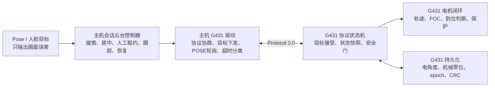
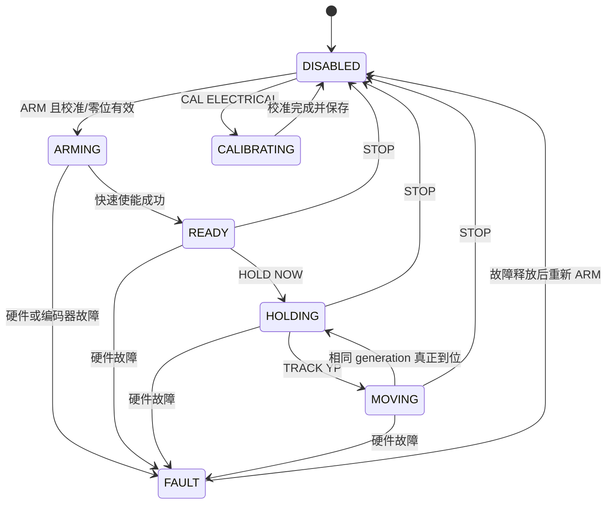
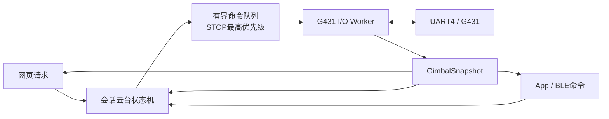
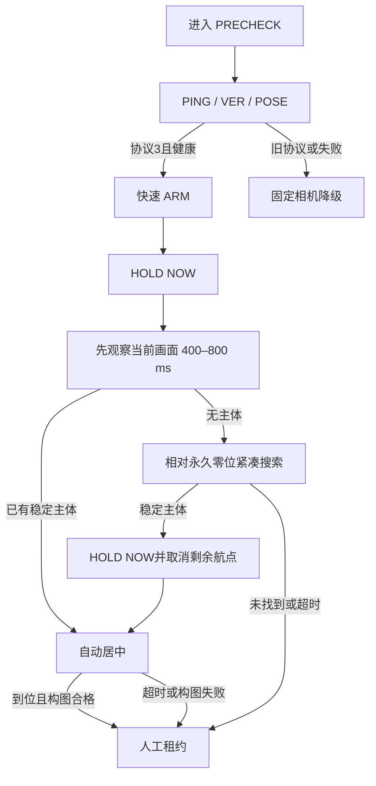

# EdgeFocus 国赛版云台协议 3.0 与主机链路重构设计

- 日期：2026-07-20
- 状态：用户已批准设计内容，待规格审查与书面复核
- 主程序基线：现场稳定运行源码，不使用当前未提交候选工作树作为实现起点
- G431 基线：`code/G431`，已核对与现场研究包及硬件参考工程核心源码一致
- 依据：
  - `doc/EdgeFocus主机_云台状态机搜索与跨端协议修复实施文档.md`
  - `doc/G431云台固件_位置参考系与控制修复实施文档.md`

## 1. 目标

本次重构同时修改完整 STM32MP257 主程序和 STM32G431 云台固件，解决以下根因：

1. 电角度校准、永久机械正前方和运行目标共用同一 `home` 语义。
2. `ARM`、会话切换或故障恢复会重新做电角度校准并重新定义逻辑零位。
3. 主机把命令 ACK 当作物理运动完成，搜索、居中和人工控制时序不可靠。
4. 串口运动等待可能阻塞会话、HTTP 或 BLE 路径。
5. 搜索业务失败、通信瞬态错误和真实硬件故障没有可靠分类。
6. 人工连续微调基于滞后实测角度，可能丢失或抵消用户的净位移。
7. 固件 5 ms 控制路径含阻塞式 I2C/ADC访问、不可中断校准和不完整保护。

完成后，云台仍是正式会话的可降级外挂能力。云台故障不得阻断 Presence、Prone、Phone Fusion、BLE、展示网页或正式会话的基础能力。

## 2. 非目标

- 不恢复困倦、闭眼疲劳、旧左右转头或视觉手机识别。
- 不重写与本次复审无关的视觉、Fusion、存储和提醒业务。
- 不新增第二个相机或 NPU 所有者。
- 不在第一轮完全推倒现有可工作的 FOC 内核。
- 不允许协议 2.0 固件执行自动搜索、跟踪或人工运动。
- 不把 PRECHECK 视觉证据写入正式分心累计、报告或提醒。

## 3. 工程与版本策略

### 3.1 开发工作区

- `code/focus_app_national`：完整主程序源码，从现场稳定运行源码导入并建立独立国赛分支。
- `code/G431_national`：完整 G431 工程，从已确认的 `code/G431` 基线建立独立国赛分支。
- 当前 `code/focus_app` 的未提交候选改动完整保留，不作为国赛实现基线。
- 当前 `code/G431` 保留为可回退固件基线。

验证完成后，`focus_app_national` 收束为正式 `code/focus_app` 主线，不作为长期独立子项目。

### 3.2 成对版本

主机协议 3.0 驱动与 G431 协议 3.0 固件视为一个发布单元。部署和回退均成对进行，不能只切换一侧。

## 4. 总体职责边界



- 主机决定为什么运动、何时运动和目标位置。
- G431 决定怎样安全到达目标，并提供是否真正到位的权威事实。
- 视觉层不得直接发送 UART 命令。
- `precheck_confirm_position` 仅保存本会话构图位置，不更新永久机械零位。
- 只有维护流程可执行电校准、永久零位捕获或持久数据清除。

## 5. G431 参考系和持久化

### 5.1 三层参考系

G431 必须分别保存：

1. **电角度参数**：换相方向、极对数、电角度 offset；只由 `CAL ELECTRICAL` 更新。
2. **永久机械零位**：人工将产品摆正后捕获的两轴编码器 raw；只由 `ORIGIN CAPTURE` 更新。
3. **运行目标**：搜索、居中、跟踪或人工运动目标；不持久化。

协议角度使用 `0..3599` 的 0.1°环形坐标，`0` 永远表示永久机械零位。主机使用最短路径换算有符号偏移。

### 5.2 安全窗口

- 默认 yaw：永久零位 ±70°。
- 默认 pitch：永久零位 ±70°。
- 两轴分别配置，可在实机验收后缩小。
- 搜索航点范围和产品安全窗口是两套配置；搜索不默认扫满安全窗口。
- 自动搜索、自动居中、人工微调、会话跟踪和恢复目标必须经过同一安全窗口校验。

### 5.3 Flash A/B 槽

目标 MCU 为 STM32G431RB，128 KB Flash。当前固件二进制约54 KB。链接脚本将应用区从126 KB缩到124 KB，保留最后两个独立2 KB页作为 A/B 持久化槽。

记录至少包含：

```c
struct GimbalNvRecordV3 {
    uint32_t magic;
    uint16_t schema_version;
    uint16_t record_length;
    uint32_t generation;
    AxisElectricalCalibration axis[2];
    uint16_t origin_raw[2];
    uint32_t calibration_epoch;
    uint32_t origin_epoch;
    CurrentProtectionConfig current_protection;
    uint32_t valid_flags;
    uint32_t crc32;
};
```

写入规则：

1. 启动时读取两页，检查 magic、版本、长度和 CRC。
2. 选择最高 generation 的有效记录。
3. 更新时擦除非活动页、写入新 generation、读回校验。
4. 新记录验证成功后才成为活动记录。
5. 写入失败保留旧页；不能先擦除唯一有效副本。
6. `STOP`、`ARM`、会话结束和普通故障恢复不清除记录。

## 6. G431 状态机



### 6.1 命令语义

- `ARM`：加载持久参数并快速使能，不扫动、不执行电校准、不重新定义机械零位。
- `HOLD NOW`：原子捕获两轴当前位置，同时重置目标、轨迹、积分和速度估计，生成新的 motion generation。
- `TRACK YP`：接受异步目标并返回 generation；ACK不代表到位。
- `POSE`：提供当前角度、目标、generation、settled、epoch、校准有效性、故障和样本年龄。
- `STOP`：停止轨迹、关闭驱动和 Boost；确认输出关闭后返回，不修改 NVM。
- `!`：紧急停止字节，任何状态下50 ms内生效。
- `CAL ELECTRICAL`：显式、异步、可中断的维护流程。
- `ORIGIN CAPTURE`：要求电校准有效、两轴编码器有效且稳定，原子保存两轴永久零位并递增 origin epoch。

### 6.2 settled 条件

`SETTLED=1` 必须同时满足：

- 当前运动 generation 与目标 generation 一致。
- 目标斜坡已到终点。
- 两轴位置误差均在进入阈值内。
- 两轴估计速度均在低速阈值内。
- 编码器样本有效且未过期。
- 上述条件连续维持约250 ms。

目标改变、generation改变、误差越过退出阈值、样本过期或故障时立即清除 settled。

## 7. UART协议 3.0

### 7.1 能力协商

```text
PING
OK,G431

VER
VER,PROTO=3.0,FW=G431-GIMBAL,CAPS=ASYNC_MOTION|POSE|ORIGIN|FAULT_CLASS|HOLD_NOW|NVM_V3
```

主机只有在 `PROTO=3.x` 且必需能力完整时开放运动。协议2.0只允许只读诊断并固定相机降级。

### 7.2 命令集合

```text
PING
VER
ARM
STOP
HOLD NOW
TRACK YP <yaw10> <pitch10>
POSE
FAULT
CAL ELECTRICAL P|Y|ALL
ORIGIN CAPTURE
NVM STATUS
NVM CLEAR ORIGIN|ALL
!
```

### 7.3 典型响应

```text
OK,ARM,STATE=READY,CAL_EPOCH=3,ORIGIN_EPOCH=1
OK,HOLD_NOW,GEN=41,YAW10=0,PITCH10=0
TRACK,ACCEPTED,GEN=42,YAW10=3500,PITCH10=120
POSE,STATE=MOVING,YAW10=3570,PITCH10=80,TYAW10=3500,TPITCH10=120,GEN=42,SETTLED=0,CAL_EPOCH=3,ORIGIN_EPOCH=1,CAL_VALID=1,ORIGIN_VALID=1,SAMPLE_AGE_MS=2,FAULT=NONE
OK,STOP,STATE=DISABLED,BOOST=0,MOTOR=0,HOLD=0
```

### 7.4 错误分类

- `ERR,CLASS=COMMAND,...`：格式、范围或状态不允许；不触发硬件降级。
- `ERR,CLASS=TRANSIENT,...`：忙、样本暂时无效或通信瞬态；允许有限重试。
- `ERR,CLASS=FAULT,...`：驱动器、编码器、电流、堵转、失控或安全条件失败；立即停机。

响应必须包含稳定机器码；展示文字由主机/App映射，不依赖固件英文字符串。

## 8. G431 实时控制修改

保留已能驱动电机的 FOC主体，但修改外围控制和安全门：

1. 电角度校准改为可中断的分步状态机，删除多秒阻塞 `HAL_Delay` 路径。
2. 5 ms控制循环不得执行20 ms I2C等待或循环重试。
3. 硬件 I2C、软件 I2C和ADC使用异步或严格有界采样器；控制循环只消费最新值及样本年龄。
4. 轨迹斜坡按真实 `dt` 更新。
5. 目标反向时清理或反算错误方向积分；重力前馈与误差积分分离。
6. 增加峰值电流、滑动平均电流、堵转、编码器连续错误和样本过期保护。
7. 不使用猜测电流阈值。维护向导采集零电流和受控运动数据，确认前报告 `CURRENT_PROTECTION=UNCONFIGURED`；编码器、堵转和超时保护仍启用。
8. ISR只搬运字节、完成标志或紧急停止标志，不执行Flash、复杂I2C、格式化输出或状态机长步骤。

## 9. 主机驱动与并发模型

### 9.1 唯一I/O所有者

`GimbalHardwareService` 独占 `/dev/ttySTM3`，内部运行一个 I/O worker。所有会话、HTTP和BLE调用只提交类型化意图。



- HTTP/BLE线程不得持锁等待运动到位。
- 普通请求在500 ms内返回已接受或拒绝；运动完成通过后续快照推送。
- STOP/紧急停止具有最高队列优先级并可取消尚未下发的运动目标。
- 同方向、同租约的连续人工目标可合并，但必须保留净位移。

### 9.2 Linux串口可靠性

串口实现必须处理：

- `EINTR`、`EAGAIN`、短写。
- 部分行、CR/LF差异、粘包、未知异步行。
- 每条请求独立截止时间。
- request、ACK和motion generation匹配。
- 连续超时、恢复和退避。
- 历史累计 `UARTERR` 非零不直接等价于当前故障。

### 9.3 状态模型

- `LinkHealth`：Healthy / Degraded / Offline。
- `ControlMode`：Idle / AutoSearch / AutoCentering / Manual / Tracking / Recovering / Maintenance。
- `CommandError`：格式、范围、阶段、session、sequence或租约错误。
- `HardwareFault`：驱动、编码器、电流、堵转、失控等真实故障。
- `GimbalPoseState`：当前/目标角、generation、settled、epoch、时间戳和样本年龄。

搜索未找到人、居中超时和构图失败是业务结果，不能写成 HardwareFault。

## 10. PRECHECK 搜索与构图



规则：

1. 进入PRECHECK后先观察当前画面，不立即扫动。
2. 搜索航点单独配置，默认紧凑搜索不扫满±70°安全窗口。
3. 每个航点等待相同 generation 的 `SETTLED=1`，再等待150–300 ms机械稳定缓冲，之后才观察视觉帧。
4. 运动期限根据实际角差、实测速度和加速度计算，不假定40°/s。
5. 候选要求2–3个不同且新鲜的Pose帧、同一主体和约300–400 ms连续性。
6. 找到候选后立即清空剩余航点并 `HOLD NOW`。
7. 自动居中使用脸部中心，使其位于画面水平中心、垂直约1/3处。
8. 居中或构图失败转人工租约，不进入FAULT。
9. `search_completed` 按会话锁存；完成后的故障恢复不重新搜索。
10. PRECHECK可过视觉模型，但不进入正式分心累计、记录、报告或提醒。

## 11. 人工控制

- 默认单步5°，配置范围1–10°，删除30°硬编码。
- 新目标从权威目标角累加，不从滞后的当前测量重新计算。
- 接管先取消搜索/居中，再执行 `HOLD NOW`；成功后才签发 manual lease。
- 命令必须绑定当前 session、严格递增 sequence和有效lease。
- `gimbal_stop` 冻结当前位置并保留lease。
- “强制释放云台”执行真正 `STOP`，本会话进入 `RELEASED` 后禁止搜索、HOLD、恢复和跟踪。
- PRECHECK人工构图位置只属于当前会话，不调用 `ORIGIN CAPTURE`。
- FOCUSING人工租约期间暂停自动跟踪；释放后从新视觉帧恢复。

## 12. 会话跟踪和恢复

### 12.1 跟踪

- 使用脸部中心，目标为画面 `(0.5, 1/3)`。
- 图像误差经过死区、平滑、最大步幅和下发频率限制。
- 所有目标通过统一±70°安全窗。
- NPU低帧率时，G431继续完成已接受轨迹；主机不重复使用旧视觉误差。

### 12.2 恢复

1. 链路异常或真实Fault时停止目标下发并撤销Enable。
2. 按退避周期低频探测恢复。
3. 确认故障释放后执行快速 `ARM`。
4. 验证 calibration/origin epoch 未发生意外变化。
5. 执行 `HOLD NOW`，再恢复人工目标、跟踪或固定位置。
6. 搜索已完成时不重新扫描。
7. `gimbal_realign` 迁移为 `gimbal_recover`，恢复流程不得调用电校准。

## 13. App与网页契约

统一云台快照至少包含：

```text
protocol_version
capabilities[]
available
degraded_reason
link_health
control_mode
current_yaw10 / current_pitch10
target_yaw10 / target_pitch10
motion_generation
settled
manual_lease
search_state
search_completed
calibration_valid / calibration_epoch
origin_valid / origin_epoch
fault_class / fault_code
last_pose_age_ms
```

普通命令响应表示主机是否接受，而不是电机是否到位：

```json
{
  "accepted": true,
  "request_sequence": 18,
  "motion_generation": 42,
  "target_yaw10": 100,
  "target_pitch10": 3550
}
```

网页与App只能调用会话控制器，不得直发UART、GPIO或原始角度。

## 14. 维护入口

CLI和网页均提供维护能力。

网页维护面板要求：

- 仅在IDLE、无正式会话且无Demo资源占用时进入。
- 先STOP并确认输出关闭。
- 使用一次性确认短语解锁60秒。
- 与普通展示控制分离。
- 每一步等待新的状态、generation或epoch，不能只依赖按钮请求成功。
- 清除NVM需要第二次独立确认。

维护向导：

1. 检查协议、NVM、编码器和故障。
2. `CAL ELECTRICAL ALL`，显示进度并允许紧急停止。
3. 提示人工将云台摆到产品正前方。
4. 确认编码器稳定后执行 `ORIGIN CAPTURE`。
5. 小角度四向运动并回0°，验证方向、零位和settled。
6. 采集空载及受控运动电流，生成并确认保护阈值。
7. 导出校准和测试日志。

## 15. 可观测性

关键日志包含：

- monotonic timestamp、session_id、控制模式。
- request sequence、motion generation。
- 当前/目标角、settled、POSE年龄。
- UART命令耗时和连续超时次数。
- link health、错误分类和故障码。
- calibration/origin epoch。

高速跟踪日志必须限频，只在状态变化和采样窗口记录，避免日志反过来影响主进程。

## 16. 测试

### 16.1 G431

- 环形角度、最短路径和±70°安全窗。
- A/B槽、CRC、generation、旧版本和模拟掉电。
- 协议分包、粘包、坏参数、状态限制和紧急停止。
- 状态机全部合法/非法转移。
- settled、目标反向积分、采样过期和故障停机。
- Debug/Release构建、链接区和Flash占用检查。

### 16.2 主机

- 使用协议3.0假传输层测试状态机。
- ACK已收到但尚未到位。
- 延迟的旧generation POSE不得完成新目标。
- 短写、部分串口行、`EAGAIN`和超时。
- 搜索找到人后取消剩余航点。
- 居中失败转人工而非FAULT。
- 人工连续点击不丢净位移。
- 串口卡顿期间网页和BLE仍可响应。
- 故障恢复不重扫。
- PRECHECK不产生正式分心记录。
- 协议2.0只读降级。

### 16.3 实机

1. 上电后零位和epoch保持。
2. 连续ARM/STOP十次不改变零位。
3. 会话切换和故障恢复不做电校准。
4. 两轴±70°边界低速验证。
5. 搜索、居中、人工微调和跟踪完整闭环。
6. 串口中断、编码器错误、急停和恢复。
7. 云台异常时网页、BLE和视觉主链继续工作。
8. 物理断电后恢复持久化数据。

## 17. 发布与回退

1. 保存现场主机二进制、配置和旧G431固件。
2. 停止主机云台运动和正式会话。
3. 刷入G431协议3固件。
4. 通过CLI完成首次电校准和永久零位捕获。
5. 部署完整 `focus_app_national`。
6. 依次验证固定相机降级、人工微调、PRECHECK、跟踪和恢复。
7. 验收后将国赛工作区收束回正式主线。

回退必须同时恢复旧G431固件、旧主机二进制和现场紧凑配置。

## 18. 完成标准

- 普通启动、ARM、STOP、会话切换和故障恢复均不会改变永久零位。
- 协议明确区分目标接受与物理到位。
- HTTP/BLE不因G431运动或超时失去响应。
- 自动搜索找到主体后不会执行剩余航点。
- 人工连续操作不丢失净位移。
- 故障恢复不重复已完成搜索。
- PRECHECK不污染正式分心数据。
- G431 NVM、协议、状态机和安全保护测试通过。
- 主机相关本机测试、ARM全目标构建和板端验收通过。
- 现场稳定版仍可执行成对回退。
