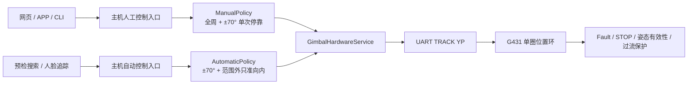

# 云台全周人工控制与受限自动控制设计

日期：2026-07-22
状态：已由产品负责人批准，待规格审查

## 1. 背景与目标

云台两轴机械结构均无硬限位、无碰撞物，允许单圈全周位置控制。此前 G431 固件与主机共同使用原点 ±70° 作为统一目标范围，导致人工微调、维护回中和设备停在范围外时均可能被拒绝。

本设计将机械/电气安全与产品业务范围拆开：

- G431 负责单圈位置控制和底层安全，不承载 ±70° 业务规则。
- 主机自动搜索、预检自动调整和人脸追踪限制在原点 ±70°。
- 主机人工控制允许单圈全周调整；从自动范围内向外跨界时只在 ±70° 停靠一次。
- 从 ±70° 外向内返回不停车；AUTO 也可通过已有小步闭环逐步返回范围内。
- 网页、APP 和诊断入口复用同一套主机策略，避免行为分叉。

这里的“全周”是 AS5600 单圈绝对角度域 `0～359.9°`，不表示累计多圈计数。`0°` 与 `360°` 是同一物理位置。

## 2. 分层架构



### 2.1 G431 固件职责

G431 不区分 AUTO 与 MANUAL，也不解析业务来源。现有 `TRACK YP yaw10 pitch10` 协议保持不变。

Production 模式：

- 接受 `yaw10`、`pitch10` 的完整合法域 `0～3599`。
- HOLD 可在单圈任意有效姿态启用。
- 不再使用 NVM 中旧的 ±70°字段拒绝 Production TRACK/HOLD。
- 始终保留 Fault、STOP、编码器有效性、控制丢失和过流保护。

Maintenance 模式：

- 继续使用原点 ±10° 的独立诊断目标范围。
- 不继承 Production 的全周权限。
- 当前未提交的“±70° 外额外 10°维护恢复带”不进入最终实现。

NVM V3 的版本号、结构大小、字段偏移和 CRC 覆盖范围保持不变。安全窗口字段继续原样保存，以维持既有校准、原点、过流和回滚兼容；新固件仅在 Production 决策中忽略旧窗口，不迁移、不清零，也不因启动或首次 TRACK 自动回写。

升级测试必须使用包含非默认原点、校准、过流和窗口值的 golden V3 镜像，验证升级启动、掉电重启、Production TRACK 后字节保持，旧固件可直接读取同一镜像。

`VER` 只追加旧解析器可忽略的能力 token `FULL_RANGE_POSITION`，既有字段顺序和含义不变。

### 2.2 主机策略职责

新增纯逻辑组件 `GimbalMotionPolicy`，只进行角度归一化和目标裁决，不访问串口、GPIO、摄像头或线程。

它提供两类规划：

- `planAutomatic(current, requested)`：受限自动控制。
- `planManualNudge(authoritative_target, observed_pose, direction, fine_tune, gate)`：人工步进与边界停靠。

普通步进和微调步进均由主机配置，初始值分别为 30°和 10°。网页与 APP 只在每一条 nudge 指令中发送方向及可选布尔字段 `fine_tune`；字段缺失或为 `false` 使用普通步进，`true` 使用微调步进。该字段不是持久模式，普通与微调按钮可任意交替，且同方向操作共享边界停靠许可。前端不发送具体角度，因此两端始终与主机配置同步。

所有裁决结果显式包含请求目标、实际目标、每轴处置状态和是否发生边界停靠，调用者不得自行复制判断逻辑。

## 3. AUTO 目标裁决

每个轴独立执行以下规则。策略内部统一使用十分之一度整数：绝对角域 `[0,3599]`，相对原点偏角 `[-1800,1799]`，自动边界为 `±700`。

基础函数定义为：

- `wrap3600(x) = ((x % 3600) + 3600) % 3600`。
- `signedOffset(abs, origin)` 先计算 `wrap3600(abs-origin)`；结果大于等于 1800 时减 3600，得到 `[-1800,1799]`。
- `shortestDelta(from,to)` 使用同样归一化；恰好 1800 的等距情形由调用模式裁决。

AUTO 的 180°等距情形选择朝 0°的方向。MANUAL 的主机普通/微调步进配置必须为 `1..1799` 个十分之一度，避免方向歧义；更大的人工移动必须拆成有向小步。边界跨越按按钮方向的有向圆弧判断，不只比较归一化后的端点。

任一轴编码器、原点无效或存在全局 Fault 时，旧 `TRACK YP` 无法安全省略单轴，因此整条双轴命令拒绝；只有两轴安全前提都有效时才进行逐轴业务裁决。

### 3.1 当前位于自动范围内

- 请求目标也在范围内：直接通过。
- 请求目标越过 `+70°`：实际目标截断为 `+70°`。
- 请求目标越过 `-70°`：实际目标截断为 `-70°`。

### 3.2 当前位于自动范围外

- 当前偏角大于 `+700`：仅允许 `shortestDelta` 初始方向为负的目标。
- 当前偏角小于 `-700`：仅允许 `shortestDelta` 初始方向为正的目标。
- 合法向内路径可以进入 `[-700,+700]`；若请求落到对侧范围外，则截断到对侧边界，避免穿过整个自动区后再次落到范围外。
- 继续向外的请求使用当前有效实测姿态作为该轴安全保持目标，不能沿用仍比实测姿态更向外的旧权威目标。
- 另一轴仍执行合法分量；最终以包含两个实际目标的单条 `TRACK YP` 原子发送。

AUTO 接管前先建立运动屏障：使在途 MANUAL 事务失效，执行 HOLD/STOP 流程并取得两轴新鲜有效实测姿态，再建立不会继续向外的双轴权威目标。旧 MANUAL 目标不得直接成为 AUTO hold。

本规则不插入强制回中，不改变现有自动控制的小步闭环节拍。自动搜索或追踪按原节拍逐步走回 ±70°内。

若当前姿态、原点或任一编码器无效，则不进行推算并拒绝整条自动运动。

## 4. MANUAL 边界停靠

人工控制允许单圈全周位置。±70°是从内部向外跨越时的一次停靠点，不是软限位。

### 4.1 状态

- `NORMAL`：无待使用的边界通行记录。
- `BOUNDARY_PENDING(axis, side, generation)`：边界目标已被固件接受，但尚未证明物理停靠。
- `BOUNDARY_ARMED(axis, side, expires_at)`：实测已在边界稳定停靠，允许下一次同轴同方向越界。

`BOUNDARY_PENDING` 期间同方向后续命令返回 busy 并保持边界目标。只有实测进入现有验收容差、速度/稳定条件满足且未发生 STOP、Fault、超时，才进入 `BOUNDARY_ARMED`。

`BOUNDARY_ARMED` 默认有效 10 秒；普通和微调按钮的同方向操作均可消费该许可。

### 4.2 规则

1. 当前稳定实测姿态在 `(-700,+700)` 内，人工请求沿按钮方向向外跨界：本次目标截断到对应边界；固件 ACK 后进入 `BOUNDARY_PENDING`。
2. `BOUNDARY_PENDING` 验收成功后进入 `BOUNDARY_ARMED`；运动失败、堵转、姿态失效、STOP、Fault 或超时则清除许可并将权威状态标记为待重同步。
3. `BOUNDARY_ARMED` 有效期内再次进行同轴、同方向操作：从边界继续完整步进，随后清除记录。
4. 当前本来就在边界且实测稳定时，同方向点击直接运动，不要求先做一次无位移确认；尚未到达的权威目标不算“本来就在边界”。
5. 初始化实测处于边界验收容差内且稳定，可按已经在边界处理；容差不得扩大到明显吞掉正常范围。
6. 当前已经在 ±70°外：向外和向内人工步进都直接执行。
7. 从范围外返回范围内不在 ±70°停靠。
8. 向内操作、方向改变、控制权释放、AUTO 接管、STOP、Fault 或许可超时会清除记录。
9. YAW/PITCH 分别维护状态；单轴按钮不得消费另一轴许可，未选轴目标来自同一串行事务的双轴快照。
10. 普通和微调只是当前命令的步进选择，不是持久模式；切换步进类型不会清除同方向边界许可。

人工目标以已验收权威目标为主，实测姿态用于初始化、安全校验和运动验收。`+50° → 普通 +30°` 先稳定停到 `+70°`，随后同方向微调 +10°可到 `+80°`，或普通 +30°可到 `+100°`。

## 5. 组件改动范围

### 5.1 G431_national

- `Core/Src/app_gimbal.c`：Production TRACK/HOLD 改为完整单圈合法域；Maintenance ±10°保持独立。
- `Core/Src/gimbal_angle.c`：删除未提交的临时恢复带语义，保留纯角度和 Maintenance 范围校验。
- `Core/Src/uart_protocol_v3.c`：能力/诊断输出说明 Production 全周位置策略；不改变 `TRACK YP` 格式。
- `tests/test_gimbal_core.c`：覆盖 Production 全周、Maintenance ±10°和非法 `3600`。

### 5.2 focus_app_national

- 新增 `platform/gimbal/GimbalMotionPolicy.{h,cpp}`：AUTO 与 MANUAL 的纯策略实现。
- `GimbalHardwareService`：以单一串行执行器事务化双轴快照、策略、TRACK ACK、权威目标和边界状态提交。
- `GimbalPrecheckController`：保存每轴 `PENDING/ARMED` 状态，并让预检与会话内人工微调复用相同行为。
- `GimbalVisualTracker`、预检搜索/居中：继续走自动入口，不直接调用无界移动。
- `GimbalBoardConfig`：增加普通/微调两档主机步进配置，默认 30°/10°，并校验在 `(0°,180°)`。
- `AppCommandService` 与演示网页：只转发方向及单条命令的 `fine_tune`，不发送具体度数、不自行计算越界。
- `tools/gimbal_bringup.cpp`：维护诊断继续 ±10°；若增加 Production 人工测试，必须使用明确的危险确认参数。
- 删除本轮尚未提交的 `containsWithMargin` 临时维护恢复实现及其测试。

## 6. API 与 APP 后续字段说明

人工请求增加单条命令属性：

```json
{
  "direction": "RIGHT",
  "fine_tune": true
}
```

`fine_tune` 不是模式开关：每次点击独立携带。缺失或 `false` 使用主机普通步进，`true` 使用主机微调步进；APP 和网页均不发送具体角度。

人工命令结果增加可选字段：

```json
{
  "accepted": true,
  "fine_tune": false,
  "resolved_step_deg": 30.0,
  "motion_status": "pending",
  "boundary_stop_planned": true,
  "boundary_paused": false,
  "axes": {
    "yaw": {
      "requested_target_deg": 80.0,
      "applied_target_deg": 70.0,
      "decision": "clamped_to_boundary",
      "boundary_state": "pending",
      "boundary_side": "positive"
    },
    "pitch": {"decision": "held_unselected"}
  }
}
```

`axes.yaw` 与 `axes.pitch` 分别表达请求、实际目标和业务裁决；整包 `accepted`/`motion_status` 表达 UART 双轴命令状态。

`boundary_stop_planned=true` 只表示已规划边界停靠；只有物理稳定验收后状态快照才返回 `boundary_paused=true`。APP 此时可显示“已到自动范围边界，再次点击可继续”。

所有新增字段均向后兼容。旧 APP 不发送 `fine_tune`、忽略新增返回字段时，仍按普通步进工作。

代码完成且最终字段名稳定后，另行交付简短文档：

`docs/integration/gimbal-manual-boundary-app-fields.md`

该文档至少说明字段类型、出现时机、示例、UI 建议、旧客户端兼容和 STOP/Fault 时的清理语义，供 APP 工作区实施 agent 使用。

## 7. 错误处理与并发

- STOP、Fault 和硬件急停命令保持最高队列优先级。
- 每台云台使用单一串行执行器；sequence 占位、双轴快照、策略计算、`TRACK YP` 发送、ACK、权威目标和边界状态提交构成一个事务。
- 并发不同 sequence 排队；重复且仍执行的 sequence 等待同一结果，已完成重复请求返回同一结果，不重复消费边界许可。
- 单轴 nudge 的未选轴目标来自事务内同一双轴快照；`TRACK YP` ACK 视为整包原子接受，不假定单轴部分成功。
- 明确拒绝或发送前失败保持原状态；UART 超时若命令可能已送达，则标记 `OUTCOME_UNKNOWN`，不得自动重发。
- `OUTCOME_UNKNOWN` 清除边界许可、阻止新运动，通过 STOP 和只读姿态重同步后重建双轴权威目标；若串口自身不可用，先使用独立急停手段。
- STOP/Fault 使用控制代次优先使在途事务失效，失效事务后续到达的 ACK 不得提交状态。
- 边界截断 ACK 后只记录 `BOUNDARY_PENDING`；稳定验收成功后才提交 `BOUNDARY_ARMED`。
- AUTO 接管时清除人工边界记录。
- Manual takeover 时暂停自动控制，release 后才允许 AUTO 恢复，避免两个来源竞争目标。
- 任一轴姿态/原点失效或全局 Fault 时整条人工和自动目标均拒绝，不能根据旧缓存跨边界。

## 8. 测试与验收

### 8.1 纯逻辑测试

MANUAL：

- `+50° 普通 +30° → +70°`，ACK 时返回 `boundary_stop_planned=true`、`boundary_state=pending`。
- 实测稳定验收后才返回 `boundary_paused=true`；PENDING 期间再次点击不会越界。
- 上一步稳定后，同方向微调 +10°可到 +80°，普通 +30°可到 +100°，两种按钮可交替消费许可。
- 初始位于 `+70°`，第一次 `+30° → +100°`。
- `+100° -30° → +70°`，返回途中不停车。
- `+70° -30° → +40°`。
- 正负边界、两轴独立、方向改变、10 秒超时与 STOP/Fault 清状态。
- `fine_tune` 缺失/false/true 分别解析为主机普通/普通/微调配置，不接受前端具体角度。
- 覆盖 `359.9°↔0°`、原点不为 0、±180°等距和有向跨界。

AUTO：

- `+50° 请求 +80° → +70°`。
- `+100° 请求 +95° → +95°`。
- `+100° 请求 +105° → 保持 +100°`。
- 当前实测 +100°、旧 MANUAL 权威目标 +120°时，AUTO 向外请求必须安全保持实测 +100°，不能继续追 +120°。
- `+100° 请求 -80°` 的向内路径截断到对侧 -70°，不能再次落到范围外。
- MANUAL release 后立即 AUTO 接管时，必须先完成运动屏障和双轴重同步。
- YAW 向外被保持时，PITCH 合法分量仍执行。
- `-100°` 的对称用例。
- 环形坐标下只允许范围外向内的最短路径初始方向。

G431：

- Production 接受 `0、700、1000、1799、1800、3599`。
- Maintenance 接受 ±10°边界并拒绝越界目标。
- `3600`、无效姿态、Fault 和未 HOLD 状态仍拒绝。
- 覆盖 G431 `3599→0`、`0→3599` 和 180°等距时的环形误差方向。
- 使用 golden NVM V3 镜像验证升级、掉电、TRACK 后字节保持及旧固件回滚读取。

### 8.2 主机集成测试

- 网页与 APP 命令进入同一个 `GimbalPrecheckController::nudge` 路径。
- sequence 重放不重复消费停靠记录。
- lease 释放、会话切换和 AUTO 接管清除记录。
- 自动搜索、居中和追踪无法从 ±70°内产生越界实际目标。
- 当前位于范围外时，追踪的向内小步可正常发送。

- 普通/微调按钮及旧客户端缺省字段进入同一 nudge 路径并解析为主机配置步进。
- PENDING/ARMED 转换依赖实测稳定，不依赖目标 ACK；快速第二次点击不能提前越界。
- sequence 执行中重放等待同一结果，并发 yaw/pitch 不发生双轴目标覆盖。
- UART `OUTCOME_UNKNOWN`、延迟 ACK、STOP/Fault 控制代次和重同步均有集成测试。
- 一轴业务受限时另一轴可执行；任一轴安全前提无效时整包拒绝。
### 8.3 板端验收顺序

1. 禁用并屏蔽主程序自动重启，准备独立于 UART 的断电/硬急停手段。
2. 检查作业区、线缆和两轴全周行程无干涉；另一轴在单轴测试时保持。
3. 刷写后只读 probe，核对固件版本、`FULL_RANGE_POSITION`、原点、校准、NVM 和姿态有效性。
4. 越过 ±70°前先用小角度、受控速度/电流验证两轴方向、软件 STOP 和独立急停。
5. 逐轴按预先规定的最大步长/速度越过边界，记录请求、ACK、实测、稳定状态和 Fault。
6. 部署主机 CLI，先用模拟策略测试确认 AUTO/MANUAL 裁决。
7. 验证 `+50 → PENDING → +70稳定 → +100/+80 → +70 → +40` 人工序列及两档按钮交替。
8. 将云台放在范围外，验证 AUTO 只向内小步、不会继续向外。
9. Fault 使用安全注入或既有测试机制，不通过人为堵转制造；UART 超时先独立急停并重同步。
10. 验证网页与 APP 字段后再恢复主程序服务。


## 9. 回滚与交付

- G431 与主机分别提交，保留当前可运行版本的 ELF、CLI 和板端二进制备份。
- G431 回滚不依赖清除 NVM；校准和原点数据不得因角度策略调整丢失。
- 主机策略可通过回滚二进制恢复原行为。
