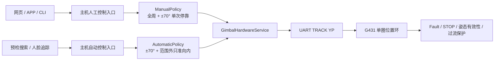

# 云台全周人工控制与受限自动控制设计

日期：2026-07-22
状态：已由产品负责人批准，待规格审查

## 1. 背景与目标

云台两轴机械结构均无硬限位、无碰撞物，允许单圈全周位置控制。此前 G431 固件与主机共同使用原点 ±70° 作为统一目标范围，导致人工微调、维护回中和设备停在范围外时均可能被拒绝。

本设计将机械/电气安全与产品业务范围拆开：

- G431 负责单圈位置控制和底层安全，不承载 ±70° 业务规则。
- 主机自动搜索、预检自动调整和人脸追踪限制在原点 ±70°。
- 主机人工控制允许单圈全周调整；从自动范围内向外跨界时只在 ±70° 停靠一次。
- 从 ±70° 外向内返回不停车；AUTO 也可通过已有小步闭环逐步返回范围内。
- 网页、APP 和诊断入口复用同一套主机策略，避免行为分叉。

这里的“全周”是 AS5600 单圈绝对角度域 `0～359.9°`，不表示累计多圈计数。`0°` 与 `360°` 是同一物理位置。

## 2. 分层架构



### 2.1 G431 固件职责

G431 不区分 AUTO 与 MANUAL，也不解析业务来源。现有 `TRACK YP yaw10 pitch10` 协议保持不变。

Production 模式：

- 接受 `yaw10`、`pitch10` 的完整合法域 `0～3599`。
- HOLD 可在单圈任意有效姿态启用。
- 不再使用 NVM 中旧的 ±70°字段拒绝 Production TRACK/HOLD。
- 始终保留 Fault、STOP、编码器有效性、控制丢失和过流保护。

Maintenance 模式：

- 继续使用原点 ±10° 的独立诊断目标范围。
- 不继承 Production 的全周权限。
- 当前未提交的“±70° 外额外 10°维护恢复带”不进入最终实现。

NVM V3 中的安全窗口字段暂时保留，以维持存储布局与既有校准、原点、过流数据兼容；它们在 Production 中变为旧版诊断字段，不触发自动迁移或清空。`VER`/诊断输出应增加明确的全周位置能力标识，避免误以为旧 ±70°字段仍是 Production 限位。

### 2.2 主机策略职责

新增纯逻辑组件 `GimbalMotionPolicy`，只进行角度归一化和目标裁决，不访问串口、GPIO、摄像头或线程。

它提供两类规划：

- `planAutomatic(current, requested)`：受限自动控制。
- `planManualNudge(authoritative_target, observed_pose, direction, step, gate)`：人工步进与边界停靠。

所有裁决结果显式包含请求目标、实际目标、每轴处置状态和是否发生边界停靠，调用者不得自行复制判断逻辑。

## 3. AUTO 目标裁决

每个轴独立执行以下规则。角度先转换为相对原点的有符号偏角 `[-180°, 180°)`；自动范围为 `[-70°, +70°]`。

### 3.1 当前位于自动范围内

- 请求目标也在范围内：直接通过。
- 请求目标越过 `+70°`：实际目标截断为 `+70°`。
- 请求目标越过 `-70°`：实际目标截断为 `-70°`。

### 3.2 当前位于自动范围外

- 当前偏角大于 `+70°`：仅允许最短路径初始方向为负的目标，即让云台向 0°方向运动。
- 当前偏角小于 `-70°`：仅允许最短路径初始方向为正的目标。
- 继续向外或保持扩大偏角的请求：该轴实际目标保持当前权威目标。
- 另一轴仍可执行自己的合法分量，不因单轴受限而丢弃整条命令。

本规则不插入强制回中，不改变现有自动控制的小步闭环节拍。自动搜索或追踪会按原节拍逐步走回 ±70°内。

若当前姿态、原点或编码器无效，则不进行推算并拒绝自动运动。

## 4. MANUAL 边界停靠

人工控制允许单圈全周位置。±70°是从内部向外跨越时的一次停靠点，不是软限位。

### 4.1 状态

- `NORMAL`：无待使用的边界通行记录。
- `BOUNDARY_ARMED(axis, side, expires_at)`：上一条同轴人工命令因向外跨界被截断在指定边界。

`BOUNDARY_ARMED` 默认有效 10 秒，仅用于解决电机摩擦造成的实测角度未精确落在 70°以及下一次点击应当越界的问题。

### 4.2 规则

1. 当前权威目标在 `(-70°, +70°)` 内，人工请求从内部向外跨界：本次目标截断到对应 ±70°，并进入 `BOUNDARY_ARMED`。
2. `BOUNDARY_ARMED` 有效期内再次进行同轴、同方向操作：从边界继续完整步进，随后清除记录。
3. 当前本来就在边界时，同方向点击直接运动，不要求先做一次无位移确认。
4. 初始化时实测姿态处于边界容差带内，可按“已经在边界”处理；容差使用现有位置验收容差，不能用宽到明显吞掉正常范围的阈值。
5. 当前已经在 ±70°外：向外和向内人工步进都直接执行。
6. 从范围外返回范围内不在 ±70°停靠。
7. 向内操作、方向改变、控制权释放、模式切换、STOP、Fault 或超时会清除待使用记录。
8. YAW/PITCH 分别维护停靠状态；单轴人工按钮不得误消费另一轴的记录。

人工目标以控制器维护的权威目标为主，实测姿态用于初始化、有效性校验和运动验收。这样 `+50° → +30°` 被截断到 `+70°` 后，即使编码器因静摩擦只读到 `+69.x°`，下一次同方向点击仍能到达 `+100°`。

## 5. 组件改动范围

### 5.1 G431_national

- `Core/Src/app_gimbal.c`：Production TRACK/HOLD 改为完整单圈合法域；Maintenance ±10°保持独立。
- `Core/Src/gimbal_angle.c`：删除未提交的临时恢复带语义，保留纯角度和 Maintenance 范围校验。
- `Core/Src/uart_protocol_v3.c`：能力/诊断输出说明 Production 全周位置策略；不改变 `TRACK YP` 格式。
- `tests/test_gimbal_core.c`：覆盖 Production 全周、Maintenance ±10°和非法 `3600`。

### 5.2 focus_app_national

- 新增 `platform/gimbal/GimbalMotionPolicy.{h,cpp}`：AUTO 与 MANUAL 的纯策略实现。
- `GimbalHardwareService`：自动移动统一调用 AUTO 策略；人工移动提供明确入口，发送策略裁决后的实际目标。
- `GimbalPrecheckController`：保存每轴人工停靠状态，并让预检与会话内人工微调复用相同行为。
- `GimbalVisualTracker`、预检搜索/居中：继续走自动入口，不直接调用无界移动。
- `AppCommandService` 与演示网页：只转发人工方向/步长并展示返回字段，不自行计算越界。
- `tools/gimbal_bringup.cpp`：维护诊断继续 ±10°；若增加 Production 人工测试，必须使用明确的危险确认参数。
- 删除本轮尚未提交的 `containsWithMargin` 临时维护恢复实现及其测试。

## 6. API 与 APP 后续字段说明

人工命令结果增加可选字段：

```json
{
  "requested_target_deg": 80.0,
  "applied_target_deg": 70.0,
  "boundary_paused": true,
  "boundary_axis": "yaw",
  "boundary_side": "positive",
  "axis_decision": "clamped_to_boundary"
}
```

字段必须是向后兼容的可选字段。旧 APP 忽略时不影响命令成功；新版 APP 可显示“已到自动范围边界，再次点击可继续”。

代码完成且最终字段名稳定后，另行交付简短文档：

`docs/integration/gimbal-manual-boundary-app-fields.md`

该文档至少说明字段类型、出现时机、示例、UI 建议、旧客户端兼容和 STOP/Fault 时的清理语义，供 APP 工作区实施 agent 使用。

## 7. 错误处理与并发

- STOP、Fault 和硬件急停命令保持最高队列优先级。
- Manual lease、owner、sequence 和幂等检查先于策略执行；重复 sequence 返回同一结果，不重复消费边界通行记录。
- 只有固件接受目标后才更新权威目标；发送失败不得改变边界状态。
- 若边界截断命令已接受，则记录 `BOUNDARY_ARMED`；若失败，则保持 `NORMAL`。
- AUTO 接管时清除人工边界记录。
- Manual takeover 时暂停自动控制，release 后才允许 AUTO 恢复，避免两个来源竞争目标。
- 姿态失效或原点失效时人工和自动目标都拒绝，不能根据旧缓存跨边界。

## 8. 测试与验收

### 8.1 纯逻辑测试

MANUAL：

- `+50° +30° → +70°`，返回 `boundary_paused=true`。
- 上一步成功后再次 `+30° → +100°`。
- 初始位于 `+70°`，第一次 `+30° → +100°`。
- `+100° -30° → +70°`，返回途中不停车。
- `+70° -30° → +40°`。
- 正负边界、两轴独立、方向改变、10 秒超时与 STOP/Fault 清状态。
- `359.9° ↔ 0°` 小步不被误判成大角度越界。

AUTO：

- `+50° 请求 +80° → +70°`。
- `+100° 请求 +95° → +95°`。
- `+100° 请求 +105° → 保持 +100°`。
- YAW 向外被保持时，PITCH 合法分量仍执行。
- `-100°` 的对称用例。
- 环形坐标下只允许范围外向内的最短路径初始方向。

G431：

- Production 接受 `0、700、1000、1799、1800、3599`。
- Maintenance 接受 ±10°边界并拒绝越界目标。
- `3600`、无效姿态、Fault 和未 HOLD 状态仍拒绝。

### 8.2 主机集成测试

- 网页与 APP 命令进入同一个 `GimbalPrecheckController::nudge` 路径。
- sequence 重放不重复消费停靠记录。
- lease 释放、会话切换和 AUTO 接管清除记录。
- 自动搜索、居中和追踪无法从 ±70°内产生越界实际目标。
- 当前位于范围外时，追踪的向内小步可正常发送。

### 8.3 板端验收顺序

1. 保持主程序服务停用，刷写 G431 后执行只读 probe。
2. 验证 Production 可在低风险步长下越过 ±70°，并验证 STOP/Fault。
3. 部署主机 CLI，使用模拟策略测试确认 AUTO/MANUAL 裁决。
4. 验证 `+50 → +70 → +100 → +70 → +40` 人工序列。
5. 将云台放在范围外，验证 AUTO 只向内小步、不会继续向外。
6. 验证网页与 APP 字段后再恢复主程序服务。

任一步出现姿态无效、发散、Fault、串口超时或方向错误，立即 STOP 并停止后续运动测试。

## 9. 回滚与交付

- G431 与主机分别提交，保留当前可运行版本的 ELF、CLI 和板端二进制备份。
- G431 回滚不依赖清除 NVM；校准和原点数据不得因角度策略调整丢失。
- 主机策略可通过回滚二进制恢复原行为。
