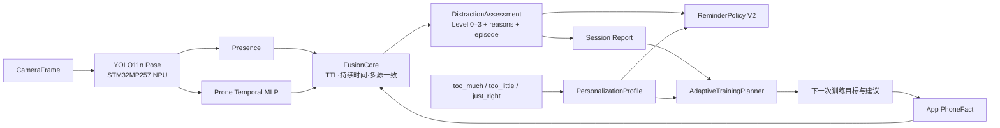

# EdgeFocus 国赛版本功能补全规划

- 作品名称：**基于 STM32MP257 的端侧 AI 专注监督和训练与自适应学习系统**
- 文档状态：方案基线，待产品评审后拆分实施任务
- 日期：2026-08-07
- 适用仓库：`focus_app_national`、`G431_national`、`EdgeFocusApp`

## 1. 结论先行

国赛版不再扩展新的视觉判别状态。正式视觉与行为输入冻结为：

- `Presence`：人在 / 人不在 / 未知；
- `Prone`：趴下 / 未趴下 / 未知；
- `PhoneFact`：由 App 权威上报未使用 / 学习 / 娱乐 / 其他。

这三类输入已经具备可验证、可解释、可在 STM32MP257 长时间稳定运行的基础。国赛下一阶段应优先补齐作品名称中尚未形成闭环的两部分：

1. **专注训练**：从单次计时和统计升级为有阶段、有目标、有复盘、有下一次建议的训练系统。
2. **自适应学习**：让会话历史和用户反馈真正改变后续提醒节奏与训练计划，同时保持检测事实和安全边界不被随意修改。

同时先解决 App 蓝牙预览刷新空白、反馈枚举不一致等确定性体验问题。

## 2. 作品名称能力核对

| 名称承诺 | 当前状态 | 国赛版缺口 | 建议补齐 |
|---|---|---|---|
| 基于 STM32MP257 | 已完成 | 无核心缺口 | 保留 A35/NPU/M33/G431 异构系统展示 |
| 端侧 AI | 已完成 Pose/Prone 端侧推理 | 无需为了数量增加不稳定状态 | 强调端侧隐私、离线运行、证据时序与故障降级 |
| 专注监督 | 已有正式会话、Fusion、三级提醒 | 提醒仍经过旧兼容映射，解释和报告可继续收束 | ReminderPolicy 直接消费 Assessment，保留原因与 episode |
| 专注训练 | 目前主要是计时和会话统计 | 缺少阶段目标、渐进训练与复盘建议 | AdaptiveTrainingPlanner |
| 自适应学习 | 已能保存三值反馈 | 反馈仅存档，未参与后续策略 | PersonalizationProfile + 有界策略更新 |

“训练”指训练用户的专注习惯；“自适应学习”指系统学习用户的提醒接受度、会话表现和合适训练节奏。国赛第一版不在板端在线训练或修改深度模型权重。

## 3. 冻结后的正式判断链



边界保持不变：

- PRECHECK 可以运行 Pose 和云台构图，但不进入正式 Fusion、episode、提醒或记录；
- 正式会话只有 `SessionOrchestrator` 可以创建；
- `NOT_PRESENT` 与 `UNKNOWN` 的 level 为 null；
- App 学习类手机只弱化手机分支，不能覆盖独立 Prone 证据；
- 辅助硬件或 App 断连不能让主机伪造新事实。

## 4. ReminderPolicy V2

当前提醒链存在 `DistractionAssessment.level -> risk_score -> level` 的兼容往返。国赛版应让提醒策略直接消费 `DistractionAssessment`，避免个性化参数作用于两套阈值。

### 4.1 输入

- `applicability`；
- `level`；
- `reasons[]`；
- 当前 distraction episode 及持续时间；
- 最近一次提醒及 ACK 状态；
- `PersonalizationProfile` 中允许调整的提醒参数；
- 当前会话 phase 与提醒通道可用性。

### 4.2 输出

```text
ReminderDecision
├─ should_issue
├─ level
├─ reason_summary
├─ episode_id
├─ cooldown_remaining_ms
├─ selected_channels
└─ policy_version / profile_version
```

### 4.3 不可被个性化改变的内容

- Presence/Prone/PhoneFact 原始事实；
- 证据 freshness、session_id 和 sequence 校验；
- `NOT_PRESENT / UNKNOWN` 不提醒；
- Level 3 的安全上限和最大延迟；
- PRECHECK、PAUSED、ENDING 不累计正式提醒。

个性化只调整“何时再次提醒、弱风险需要持续多久才提示、App/手环采用何种呈现强度”，不修改摄像头和模型看到的事实。

## 5. PersonalizationProfile

主机作为权威存储，为当前本地用户维护版本化画像：

```text
PersonalizationProfile
├─ reminder_cooldown_multiplier
├─ preferred_alert_channels
├─ preferred_session_duration_min
├─ recent_completion_rate
├─ recent_level2_level3_ratio
├─ recent_phone_episode_ratio
├─ recent_prone_episode_ratio
├─ feedback_counts
├─ profile_version
└─ updated_at / reset_reason
```

### 5.1 三值反馈统一

App、主机、SQLite 和报告统一使用：

- `too_much`：提醒偏多；
- `too_little`：提醒偏少；
- `just_right`：提醒节奏合适。

当前 App 仍残留另一套 `too_many/not_enough/perfect/well_detected/missed/other` 反馈 UI，而 ViewModel 与主机只接受上述三值。实施自适应前必须删除旧枚举，避免反馈在上传前被丢弃。

### 5.2 有界更新规则

- 单场反馈先写入主机并保留原始值；
- 达到最小样本数后再调整，单次最多改变一个小步长；
- `too_much` 只小幅延长重复提醒冷却；
- `too_little` 只小幅缩短重复提醒冷却；
- `just_right` 保持当前策略并增加其可信度；
- 所有参数有硬上下界、版本号、更新原因和恢复默认入口；
- 单次异常反馈不能大幅改变系统；
- 检测 episode 和历史报告不因后续参数变化被重写。

第一版使用可解释的窗口重算与有界控制器，而不是不可审计的在线黑盒学习。首次提醒、等级升级和 Fusion 判定阈值不参与个性化。

## 6. AdaptiveTrainingPlanner

这是作品名称中“专注训练”的核心产品模块。

### 6.1 输入

- 最近若干场会话完成情况；
- 实际专注时长与中断次数；
- Level 2/3 episode 数量和累计时长；
- Prone 与 PhoneFact 主要干扰来源；
- 用户三值反馈；
- 用户主动选择的训练时长与是否采用上次建议。

### 6.2 输出

```text
TrainingPlan
├─ stage: BASELINE | STABILIZE | EXTEND | MAINTAIN
├─ recommended_duration_min
├─ recommended_break_min
├─ primary_goal
├─ reason_summary
├─ generated_from_sessions[]
├─ planner_version
└─ user_override
```

### 6.3 训练阶段

| 阶段 | 进入条件 | 系统目标 | 建议行为 |
|---|---|---|---|
| BASELINE | 历史样本不足 | 建立个人会话基线 | 使用较短会话，不做激进调整 |
| STABILIZE | 完成率或高等级事件波动较大 | 先稳定完成 | 保持或小幅缩短时长，强调主要干扰来源 |
| EXTEND | 连续多场稳定完成 | 延长持续专注能力 | 每次只增加小幅时长 |
| MAINTAIN | 已达到用户目标且表现稳定 | 保持习惯 | 保持时长，关注长期趋势 |

### 6.4 会话报告升级

报告不只显示“专注了多久”，还应回答：

- 本场完成率与有效专注时长；
- 主要干扰来自 Prone 还是 PhoneFact；
- Level 2/3 发生次数、累计时长和恢复速度；
- 与最近基线相比改善或下降；
- 下一场建议时长、休息时长和一个清晰目标；
- 建议为何发生，用户是否采用。

产品闭环因此变为：

```text
会话目标
  -> 端侧监督
  -> 分级提醒
  -> 会话报告
  -> 用户反馈
  -> 个性化提醒参数与下一次训练计划
  -> 下一场验证调整是否有效
```

## 7. App 与展示端修改

### 7.1 P0：蓝牙预览 last-good-frame

目标行为：

```text
旧 Bitmap 保持显示
  -> 请求新图 / 接收 BLE 分片
  -> 完整 JSON 与 Base64 校验
  -> 后台解码成功
  -> 主线程原子替换 Bitmap
```

- 请求中、分片中、解析失败、解码失败都不得清空旧 Bitmap；
- 只有退出 PRECHECK、会话 ID 改变或用户主动关闭预览时才清空；
- UI 显示“刷新中、最后成功时间、画面已陈旧或刷新失败”，但保留上一张成功画面；
- BLE 图像保持低优先级，不能阻塞云台命令、状态同步、事件 ACK 和 PhoneFact；
- 补充“解码失败保留上一 Bitmap”和“跨会话必须清空”的测试。

### 7.2 自适应训练页面

- 专注页在开始前显示本次建议时长和训练目标；
- 用户可以采用、调整或忽略建议，系统记录选择；
- 会话结束页展示主要干扰、趋势和下一次建议；
- 数据页显示训练阶段、近期开启率、完成率和高等级 episode 趋势；
- 设置页提供个性化开关、提醒偏好和恢复默认；
- 页面只展示主机返回的权威 profile/plan，不自行复制一套计算逻辑。

完整的新用户引导、会前建议、会中提醒、会后反馈、数据看板、设置、横屏控制面板、LOCAL 离线与预览修复规格见：[自适应训练与App交互详细设计.md](./自适应训练与App交互详细设计.md)。

## 8. 存储与协议

### 8.1 主机存储

当前数据库仅含测试数据，本次不迁移旧测试库；国赛版部署时删除旧 DB，由新 schema 全量创建。

建议新增：

```text
personalization_profiles
training_plans
profile_update_events
```

每个会话报告保留生成时的 `policy_version`、`profile_version` 和 `planner_version`，便于解释历史结果。

### 8.2 App 协议

- 保留现有 `session_feedback(session_id, feedback)` 命令，冻结三值枚举；
- 状态/报告新增只读 `personalization_summary` 与 `next_training_plan`；
- App 采用建议时发送用户意图，主机确认后成为本场目标；
- 所有更新携带 version，重连后以主机为准；
- LOCAL 会话仍由 App 生成结果并缓存，连接主机后幂等上传，再由主机纳入统一训练历史。

## 9. 实施优先级

### P0：确定性体验与契约

1. App 预览改为 last-good-frame。
2. 统一反馈枚举为 `too_much/too_little/just_right`。
3. 冻结 PersonalizationProfile、TrainingPlan 与版本字段。
4. 补齐 App/主机协议文档与新库创建测试。

### P1：提醒策略收束

1. ReminderPolicy 直接消费 `DistractionAssessment`。
2. 移除 `level -> risk_score -> level` 兼容往返。
3. 保留当前等级语义与提醒输出，先证明行为无回归。
4. 增加 policy version 和完整决策日志。

### P2：自适应画像

1. 新增画像存储、反馈累计和有界更新器。
2. 先在历史数据/模拟会话上回放验证。
3. App 增加调整原因、版本和恢复默认入口。
4. 验证断连、重复反馈、乱序和恢复默认。

### P3：专注训练计划

1. 实现 BASELINE/STABILIZE/EXTEND/MAINTAIN 状态机。
2. 生成下一场建议与升级后的会话报告。
3. App 完成建议、覆盖、结果和趋势页面。
4. 验证本地模式记录补传后不会重复计入训练历史。

### P4：国赛全链验收

1. Presence、Prone、四类 PhoneFact 和长短时组合回归。
2. 三种反馈对后续提醒和计划的可解释变化演示。
3. App 预览、断连恢复、历史同步与跨页面状态一致性测试。
4. 冻结数据库 schema、协议、App、主机发布和回滚包。

## 10. 验收门槛

### 10.1 判断与提醒不回归

- 视觉字段仍只有 Presence、Prone、主体框/关键点和质量数据；
- PhoneFact 仍只有未使用、学习、娱乐、其他；
- `NOT_PRESENT/UNKNOWN` 不产生等级和提醒；
- 学习类手机不会清除独立 Prone 证据；
- 长时间或严重分神等级高于短时弱分神；
- ReminderPolicy V2 与当前已验证样例结果一致，除非有明确的版本化策略变更。

### 10.2 自适应可信度

- 每次参数变化都有旧值、新值、依据、范围和 profile version；
- 未达到最小样本数不调整；
- 单场反馈不能造成大幅变化；
- 用户可关闭个性化并恢复默认；
- 历史会话不因新画像被重算；
- 现场能解释并演示反馈如何影响下一场提醒节奏或训练建议。

### 10.3 App 稳定性

- 新预览解码成功前持续显示旧图；
- 新图失败时只显示错误/陈旧状态，不出现空白闪烁；
- 退出 PRECHECK 和切换会话后不会显示上一会话画面；
- 预览请求不阻塞云台、会话、提醒 ACK 和 PhoneFact；
- App/主机三值反馈完全一致并可在断连后补传。

## 11. 明确不做

- 不新增视觉行为状态或新的视觉模型；
- 不修改已验证的 Presence/Prone/PhoneFact 产品语义；
- 不把用户反馈用于改写历史记录；
- 不让个性化绕过证据 TTL、会话 phase 或安全等级上限；
- 不在板端在线训练神经网络；
- 不把 App 本地建议当作主机已确认的权威训练计划。

## 12. 下一步建议

建议直接按以下顺序进入实施：

1. 修复 App 蓝牙预览空白；
2. 删除 App 旧反馈枚举并完成三值协议回归；
3. 收束 ReminderPolicy 直接消费 Assessment；
4. 冻结画像和训练计划 schema；
5. 实现有界反馈更新器；
6. 实现 AdaptiveTrainingPlanner 和 App 训练闭环。
