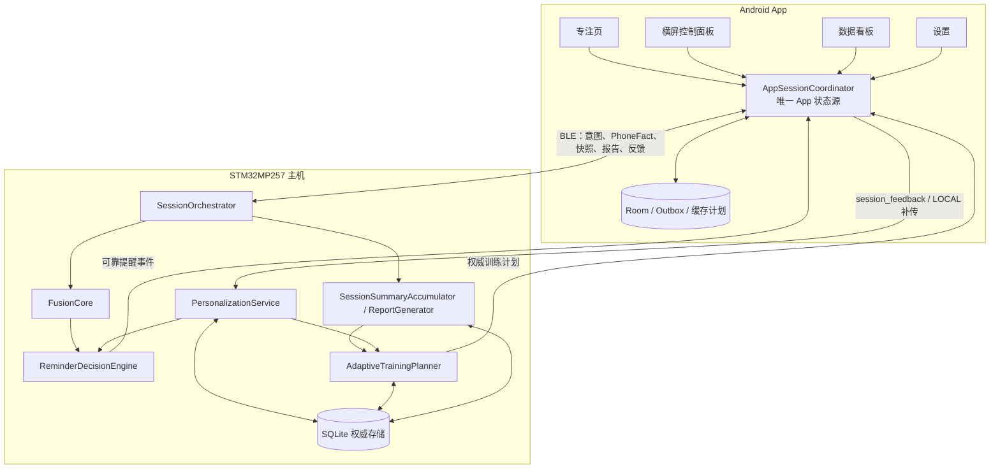

# EdgeFocus 自适应训练与 App 交互详细设计

- 日期：2026-08-07
- 状态：国赛版实施规格
- 适用仓库：`focus_app_national`、`EdgeFocusApp`
- 配套总览：[国赛版本功能补全规划.md](./国赛版本功能补全规划.md)

## 1. 本版交付边界

本版不新增视觉状态或视觉模型。正式判断输入继续冻结为：

- `Presence`：人在 / 人不在 / 未知；
- `Prone`：趴下 / 未趴下 / 未知；
- `PhoneFact`：未使用 / 学习 / 娱乐 / 其他，由 App 权威上报。

新增能力集中在三个确定性模块：

1. `ReminderDecisionEngine`：直接消费 `DistractionAssessment`，统一提醒去重、升级、冷却和解释；
2. `PersonalizationService`：依据三值反馈形成有界、可回滚的提醒节奏画像；
3. `AdaptiveTrainingPlanner`：依据完成情况生成下一场训练时长、阶段和目标。

“自适应学习”在本版中指可解释的规则学习，不指板端在线训练神经网络。用户反馈不能修改视觉事实、Fusion 等级、历史报告或 Level 3 的安全边界。

## 2. 权威边界与组件关系



权威规则：

- EDGEFOCUS 会话状态、Assessment、提醒决策、报告、画像和训练计划均以主机为准；
- LOCAL 会话在离线期间由 App 运行并缓存，重新连接后幂等上传，主机接纳后再更新画像和计划；
- App 离线时只显示最后一次主机确认的缓存计划，并明确标记“离线建议”；App 不复制主机计划算法；
- 画像和计划属于跨会话服务，不属于单个 `SessionRuntime`；正式会话开始时冻结本场使用的版本，过程中不热切换。

## 3. 主机模块设计

### 3.1 推荐目录

```text
policy/
├─ ReminderDecisionEngine.h/.cpp     # 纯决策，不负责 BLE/SQLite
└─ ReminderPolicy.h/.cpp             # 调用决策、投递、记录

personalization/
├─ PersonalizationProfile.h
├─ PersonalizationEngine.h/.cpp      # 纯函数重算
└─ PersonalizationService.h/.cpp     # 存储与版本协调

training/
├─ TrainingPlan.h
├─ AdaptiveTrainingPlanner.h/.cpp    # 纯函数
└─ TrainingPlanService.h/.cpp        # 触发、持久化、查询

session/
└─ SessionSummaryAccumulator.h/.cpp  # 仅在正式 FOCUSING 累积
```

`network/AppCommandService` 只做 JSON 校验和命令路由；不得在协议层复制画像或计划算法。

### 3.2 会话版本冻结

进入 `FOCUSING` 时保存：

```text
SessionPolicySnapshot
├─ policy_version
├─ profile_version
├─ training_plan_id
├─ planner_version
├─ selected_duration_min
└─ plan_adoption: ADOPTED | ADJUSTED | NOT_AVAILABLE
```

会话结束后的反馈只影响下一场。当前场内的“已收到提醒” ACK 可以延长当前 episode 的下一次重复提醒，但不直接改写长期画像。

## 4. ReminderDecisionEngine V2

### 4.1 输入与输出

```text
ReminderInput
├─ phase
├─ DistractionAssessment
├─ previous reminder ledger
├─ frozen PersonalizationProfile
├─ available channels
└─ monotonic_now_ms

ReminderDecision
├─ should_issue
├─ level
├─ reason_summary
├─ episode_id
├─ decision_kind: FIRST | ESCALATION | REPEAT | SUPPRESSED
├─ cooldown_remaining_ms
├─ selected_channels
├─ policy_version
└─ profile_version
```

### 4.2 固定决策顺序

1. `phase != FOCUSING`：不提醒；
2. `applicability != APPLICABLE` 或 `level` 为空：不提醒；
3. episode、证据 freshness 或 session_id 无效：不提醒；
4. 新 episode 第一次达到可提醒等级：生成 `FIRST`；
5. 同一 episode 等级升高：不受旧等级冷却影响，生成一次 `ESCALATION`；
6. 等级未变化：达到该等级重复冷却后才生成 `REPEAT`；
7. 同一 `episode_id + level + decision_kind` 通过 ledger 去重；
8. 结果带原始 `reasons[]` 和版本号写入日志，不再经过 `risk_score` 反向映射等级。

建议初始重复冷却配置：

| 等级 | 默认重复冷却 | 说明 |
|---|---:|---|
| Level 1 | 90 s | 弱风险不应频繁打断 |
| Level 2 | 45 s | 明确分心，适度重复 |
| Level 3 | 20 s | 长时间或严重分心，保持更高优先级 |

首次提醒和等级升级不乘个性化倍率。只有 `REPEAT` 冷却乘 `cooldown_multiplier`；结果再限制到 `0.75–1.50`。用户 ACK 后，当前 episode 的下一次重复冷却额外乘 `3`，但 Level 3 升级仍可立即提示。

这些秒数必须放入配置并通过回放调整，不写死在协议或 App。

## 5. PersonalizationProfile V1

### 5.1 数据结构

```text
PersonalizationProfile
├─ profile_id: "default"
├─ enabled
├─ profile_version
├─ cooldown_multiplier
├─ preferred_alert_channels
├─ preferred_session_duration_min
├─ feedback_sample_count
├─ feedback_balance
├─ confidence
├─ source_digest
├─ updated_at_ms
└─ update_reason
```

当前产品无账号体系，V1 只使用稳定的 `profile_id="default"`，不要伪造多用户账号。未来引入账号时再迁移为实际 user id。

### 5.2 反馈与重算规则

反馈枚举唯一合法值：

- `too_much = +1`；
- `just_right = 0`；
- `too_little = -1`。

画像不按“收到一次请求就累加一次”的方式更新，而是每次从最近有效反馈重算，避免断线重传和用户修改反馈造成重复学习。

```text
候选集合 = 最近 8 场有效会话的最新反馈
最小样本 = 3
balance = sum(feedback_value) / sample_count
target_multiplier = clamp(1.0 + 0.5 * balance, 0.75, 1.50)
new_multiplier = move_towards(old_multiplier, target_multiplier, max_step=0.10)
confidence = min(sample_count / 8.0, 1.0)
```

有效会话要求：

- 已进入过正式 `FOCUSING`；
- 非 `prepare_failed`、非预检取消；
- 正式运行时间至少 5 分钟；
- 同一 session 只采用最新反馈。

若 `source_digest` 未变化，不创建新 profile version。用户关闭个性化后继续保存原始反馈，但提醒采用倍率 `1.0`；“恢复默认”创建新的 profile version，并记录 `USER_RESET`，不删除历史会话。

### 5.3 不允许学习的内容

- Presence/Prone/PhoneFact 取值和置信度；
- Fusion 的 TTL、Level 阈值和严重度顺序；
- 首次 Level 3 提醒；
- PRECHECK、PAUSED、ENDING 的计时边界；
- 历史 session、episode 和报告。

## 6. AdaptiveTrainingPlanner V1

### 6.1 必需会话汇总

每场正式会话结束时生成：

```text
SessionTrainingSummary
├─ session_id
├─ target_duration_ms
├─ focusing_duration_ms
├─ effective_focus_ms
├─ level1_ms / level2_ms / level3_ms
├─ prone_ms
├─ phone_learning_ms
├─ phone_entertainment_ms
├─ phone_other_ms
├─ early_end
├─ end_reason
├─ reminder_count
├─ reminder_ack_count
├─ training_plan_id
├─ plan_adoption
├─ policy_version / profile_version / planner_version
└─ completed_at_ms
```

只在 `FOCUSING` 累积。PRECHECK 视觉输出、云台搜索时间和暂停时间不得进入这些字段。

### 6.2 派生指标

```text
completion_rate = clamp(focusing_duration / target_duration, 0, 1)
focus_efficiency = clamp(effective_focus / focusing_duration, 0, 1)
high_risk_ratio = clamp((level2_ms + level3_ms) / focusing_duration, 0, 1)
```

主要干扰来源按累计时长比较：`PRONE`、`PHONE_ENTERTAINMENT`、`PHONE_OTHER`。学习类手机可以进入统计，但不能被标为主要分心原因，除非同时存在独立 Prone 证据。

### 6.3 阶段判定

计划器使用最近 5 场有效会话，最少 3 场后才离开 `BASELINE`：

| 阶段 | 确定性条件 | 下一场动作 |
|---|---|---|
| BASELINE | 有效会话少于 3 场 | 沿用用户默认时长，建议范围 15–30 分钟 |
| STABILIZE | 最近 3 场完成率中位数 `<0.80`，或高风险占比中位数 `>0.15`，或至少 2 场提前结束 | 保持或减少 5 分钟，最低建议 10 分钟 |
| EXTEND | 最近 3 场完成率均 `>=0.90`、专注效率中位数 `>=0.80`、高风险占比中位数 `<=0.08`，且未达到用户目标 | 增加 5 分钟 |
| MAINTAIN | 已达到用户目标，或表现稳定但未满足连续延长条件 | 保持当前建议 |

其他约束：

- 推荐时长只按 5 分钟步进；
- V1 推荐范围 `10–60` 分钟，用户仍可在现有 `5–120` 分钟范围手动覆盖；
- 每完成一场最多变化 5 分钟；
- 少于 45 分钟建议休息 5 分钟，45 分钟及以上建议休息 10 分钟；
- 用户手动时长不会被禁止，只记录 `ADJUSTED`；
- 反馈变化、EDGEFOCUS 会话结束、LOCAL 会话补传成功时重算；同一输入摘要只生成一次计划。

### 6.4 计划输出

```text
TrainingPlan
├─ plan_id
├─ stage: BASELINE | STABILIZE | EXTEND | MAINTAIN
├─ recommended_duration_min
├─ recommended_break_min
├─ primary_goal
├─ reason_code
├─ reason_summary
├─ based_on_session_ids[]
├─ profile_version
├─ planner_version
├─ generated_at_ms
└─ valid_until_ms
```

`reason_code` 使用稳定枚举，例如：`INSUFFICIENT_BASELINE`、`LOW_COMPLETION_RATE`、`HIGH_RISK_UNSTABLE`、`READY_TO_EXTEND`、`GOAL_REACHED_MAINTAIN`、`DOMINANT_PRONE`、`DOMINANT_PHONE_ENTERTAINMENT`、`DOMINANT_PHONE_OTHER`。

App 显示主机返回的 `reason_summary`，同时保留 `reason_code` 供测试和多语言使用。

## 7. 新用户与完整 App 交互

### 7.1 首次使用

不新增强制注册或复杂账号流程。首次进入专注页时显示一次轻量引导卡：

1. 说明“系统根据会话结果和你的反馈调整提醒节奏与下一场时长”；
2. 选择训练目标时长，默认沿用现有番茄钟设置；
3. 个性化训练默认开启，允许当场关闭；
4. EDGEFOCUS 模式未连接主机时保留现有“开始按钮禁用 + 连接设备提示”；LOCAL 模式仍可离线开始。

引导完成状态存在 App 设置；真正的画像和计划仍存在主机。

### 7.2 竖屏专注页

#### IDLE / FINISHED

在现有时长选择环上方加入“本次训练建议卡”：

```text
稳定阶段 · 建议 25 分钟
原因：最近三场完成稳定，可以小幅延长
目标：减少娱乐类手机打断
[采用 25 分钟]  [按自己的时长]
```

- 点击“采用”后更新选择环并记录 `ADOPTED`；
- 用户旋转时长环后记录 `ADJUSTED`，但不阻止开始；
- 无足够历史时显示 `BASELINE`，不伪造提升/下降结论；
- 离线 LOCAL 使用缓存计划时显示“离线建议，连接主机后更新”；
- 主机不支持新协议时隐藏建议卡，保留现有开始流程。

#### PRECHECK

- 保持现有摄像头预览、云台搜索/微调和确认流程；
- 顶部仅显示紧凑目标“本次 25 分钟 · 稳定完成”，不得在预检阶段累计训练数据；
- 预检取消不计入画像或计划样本。

#### FOCUSING / PAUSED

- 显示本场训练目标、剩余时间和本场主机权威状态；
- 提醒弹窗显示等级、原因与“知道了”，不显示难以解释的原始概率；
- “知道了”只执行可靠事件 ACK 和本场 snooze；
- PAUSED 不累计训练指标，也不触发提醒。

### 7.3 会话结束交互

正式报告到达后弹出结果页或底部面板，不要直接无提示回到普通 IDLE：

1. 完成率、有效专注时长；
2. Level 2/3 次数与累计时长；
3. 主要干扰来源；
4. 与最近基线相比的确定性结论；
5. 三值反馈：`提醒过多 / 适中 / 提醒过少`；
6. 主机确认反馈后显示“下次提醒将更疏 / 保持 / 更密”和下一场计划。

反馈可以稍后在 Dashboard 修改。修改后 App 必须使用相同 `session_feedback` 覆盖提交，主机从最新反馈集合重算，不能重复累计。

离线 LOCAL 结束时先显示本地报告和缓存建议，并提示“反馈已保存，连接主机后生成最新计划”。

### 7.4 数据看板

保留当前“今日、本周、最近会话”，新增：

- 当前训练阶段及解释；
- 最近 5 场完成率趋势；
- Level 2/3 高风险占比趋势；
- 主要干扰来源趋势；
- 建议采纳情况；
- 会话详情中的版本、计划、反馈与下一步建议。

不得把“总时长增长”单独当作训练有效；至少同时呈现完成率或高风险占比。

### 7.5 设置页

在现有设置中新增“个性化训练”：

- 开启/关闭个性化提醒节奏；
- 训练目标时长（10–60 分钟）；
- 提醒通道偏好；
- 当前画像版本与最后更新时间；
- “恢复默认”二次确认。

关闭个性化不删除会话和反馈；主机只停用倍率并采用默认策略。恢复默认不删除历史，只重置画像参数。

### 7.6 横屏控制面板

横屏页不是另一套产品逻辑：

- IDLE 展示同一计划卡和时长选择；
- PRECHECK 展示同一预检状态；
- FOCUSING 展示同一训练目标、状态和提醒；
- 会话结束展示同一报告和三值反馈；
- 所有操作通过同一个 `AppSessionCoordinator`，不得由 `ControlPanelViewModel` 自行生成计划或保存第二份结果。

## 8. App 蓝牙预览 last-good-frame

### 8.1 当前问题

当前 `rememberCameraPreviewBitmap()` 的每组新 key 都以 `null` 初始化，页面又同时要求 `preview.available && bitmap != null`。因此请求到新帧但尚未完成解码时，旧画面会先消失。

### 8.2 目标状态

```text
PreviewUiState
├─ last_good_bitmap
├─ last_good_sequence
├─ last_success_at_ms
├─ request_in_flight
├─ stale
├─ error_message
└─ source_session_id
```

处理规则：

1. 收到新 payload 后在后台解析和解码；
2. 只有解码成功且 session id/sequence 仍有效时，原子替换 last-good；
3. 请求、分片、解析、解码失败只更新状态文字，不清空旧图；
4. 退出 PRECHECK、session id 改变或用户主动关闭时清空；
5. 迟到的旧请求结果不得覆盖新 session；
6. BLE 预览继续使用最低优先级，不因训练页增加额外轮询。

实现时可保留 Bitmap 在 UI 层，但必须以 `sessionId` 为 `remember` 清理键；更稳妥的做法是在共享预览协调器维护最后成功帧，再由竖屏和横屏共同消费。

## 9. App/主机协议 V1 增量

建议主机新增一个明确能力：`adaptive_training_v1`。未声明时 App 隐藏自适应 UI，不阻止现有会话。

### 9.1 `get_current_state` 增量

```json
{
  "adaptive": {
    "enabled": true,
    "profile_version": 4,
    "training_plan": {
      "plan_id": "plan_...",
      "stage": "EXTEND",
      "recommended_duration_min": 30,
      "recommended_break_min": 5,
      "primary_goal": "减少娱乐类手机打断",
      "reason_code": "READY_TO_EXTEND",
      "reason_summary": "最近三场完成稳定，可以小幅延长",
      "planner_version": "1.0",
      "generated_at_ms": 1786000000000
    }
  }
}
```

### 9.2 `session_control(start)` 增量

```json
{
  "cmd": "session_control",
  "data": {
    "action": "start",
    "target_duration_min": 30,
    "source_mode": "live_camera",
    "training_plan_id": "plan_...",
    "plan_adoption": "ADOPTED"
  }
}
```

主机校验 plan 是否仍存在，但用户选择的时长始终优先；计划过期只记录 `ADJUSTED/STALE_PLAN`，不拒绝会话。

### 9.3 `session_feedback` 响应增量

请求继续使用现有三值字段。成功响应原子返回最新画像摘要和下一计划：

```json
{
  "success": true,
  "data": {
    "session_id": "...",
    "feedback": "too_much",
    "profile_update": {
      "changed": true,
      "profile_version": 5,
      "cooldown_multiplier": 1.1,
      "effect_summary": "后续重复提醒将略微变疏"
    },
    "next_training_plan": {}
  }
}
```

### 9.4 设置与重置

- `update_preferences` 新增 `personalization_enabled`、`training_goal_duration_min`、`preferred_alert_channels`；
- 新增 `reset_personalization`，要求 `data.confirm=true`；
- `get_preferences` 返回主机实际保存值；
- 所有命令继续携带现有 request id 并按现有调度器排序。

### 9.5 LOCAL 会话补传

`upload_local_session` 增加：

- `target_duration`；
- `end_reason`、`early_end`；
- `level1_ms/level2_ms/level3_ms`（LOCAL 无该能力时为 0，并声明 `evidence_scope="PHONE_ONLY"`）；
- 各 PhoneFact 时长；
- `feedback`；
- `training_plan_id` 与 `plan_adoption`。

主机继续以 `session_id` 幂等。相同 session 内容未变化时不重算；内容版本变化时覆盖汇总后重算一次。

## 10. 数据库存储

当前数据库仅含测试数据，本次不做旧库迁移。国赛版部署时删除旧 DB，让新版 schema 全量创建。

建议新增：

```text
session_training_summary(session_id PK, ...汇总字段...)
personalization_profile(profile_id PK, enabled, version, cooldown_multiplier,
                        preferred_session_duration_min, feedback_sample_count,
                        feedback_balance, confidence, source_digest,
                        updated_at_ms, update_reason)
training_plan(plan_id PK, stage, recommended_duration_min, recommended_break_min,
              primary_goal, reason_code, reason_summary, based_on_sessions_json,
              profile_version, planner_version, generated_at_ms, valid_until_ms,
              active)
profile_update_event(id PK, old_version, new_version, old_value, new_value,
                     source_digest, reason, created_at_ms)
```

写入事务边界：

```text
保存/覆盖 feedback
  -> 重算并保存 profile（输入变化时）
  -> 重算并保存 active training plan
  -> 提交事务
```

若事务失败，三者全部回滚，App 收到失败后保留 Outbox 重试。

## 11. 失败与降级

| 场景 | 行为 |
|---|---|
| 主机无 `adaptive_training_v1` | 隐藏训练建议与个性化设置，现有会话照常 |
| 画像读取失败 | 使用默认倍率 1.0，记录降级，不阻止提醒 |
| 计划生成失败 | 保留上一有效计划并标记 stale；无计划时允许手动开始 |
| 反馈发送超时 | App 保留 Outbox，本地显示“待同步” |
| 重复/修改反馈 | 主机按 session 最新值重算，不重复累计 |
| LOCAL 离线 | 使用缓存计划；连接主机后上传并以主机新计划覆盖 |
| 新预览失败 | 保留 last-good-frame，显示陈旧/失败，不影响会话命令 |
| App 重连 | `get_current_state` 覆盖画像/计划缓存，不能靠页面猜测 |

## 12. 实施拆分

### H1：主机数据基础

- 新建全量 schema；
- 实现 `SessionSummaryAccumulator`；
- 扩充 `SessionReport`、历史和 LOCAL 上传；
- 增加事务与幂等测试。

### H2：提醒策略

- 新建纯 `ReminderDecisionEngine`；
- `ReminderPolicy` 改为投递和日志外壳；
- 删除 `level -> risk_score -> level`；
- 先做旧样例回归，再启用新的等级冷却配置。

### H3：画像与计划

- 实现纯 `PersonalizationEngine` 和 `AdaptiveTrainingPlanner`；
- 实现存储服务、版本、source digest、重算触发；
- 接入 session end、feedback 和 LOCAL upload。

### H4：协议

- 扩充 `AppCommandService` 与协议文档；
- 新增 `adaptive_training_v1`；
- 返回 profile/plan/report 增量字段；
- 保持旧 App 基础会话可用。

### A1：App 确定性修复

- 完成 last-good-frame；
- 删除旧反馈枚举，只保留三值；
- 增加预览和反馈 Outbox 测试。

### A2：App 训练交互

- 新增共享 `AdaptiveTrainingUiState`；
- 首页建议卡、结果反馈面板、Dashboard 趋势、Settings 个性化设置；
- 横竖屏复用同一协调器；
- LOCAL 缓存计划和同步状态。

## 13. 测试矩阵

### 主机单元测试

- 新 episode、同级重复、升级、ACK、阶段切换和 monotonic clock；
- 3/8 个反馈样本边界、三值组合、重复请求、修改反馈、reset；
- 四阶段所有条件、5 分钟步进、10–60 边界、用户覆盖；
- 学习类手机不成为独立分心主因；
- PRECHECK 和 PAUSED 汇总始终为 0。

### App 单元/UI 测试

- 新帧未完成、解析失败、解码失败时旧 Bitmap 不消失；
- session id 改变后旧 Bitmap 必须清空；
- 竖屏和横屏看到相同 plan/profile version；
- EDGEFOCUS 未连接仍禁用开始，LOCAL 可开始；
- 反馈离线排队、重连上传、主机响应覆盖缓存；
- 主机未声明能力时无崩溃且不显示伪计划。

### 联调验收

1. 完成 3 场模拟会话，从 BASELINE 进入确定阶段；
2. 连续提交“提醒过多”，展示 multiplier 每次最多变化 0.10；
3. 修改同一场反馈，确认不会重复累计；
4. 稳定完成 3 场，下一建议只增加 5 分钟；
5. 断开主机完成 LOCAL 会话，重连后只入库一次并更新计划；
6. 蓝牙预览连续刷新与故意损坏一帧，画面不空白，关键命令延迟不恶化。

## 14. 完成定义

- 三个新主机模块均有纯算法单测和确定性输出；
- App 从首次引导、会前建议、会中提醒、会后反馈到历史趋势形成闭环；
- 同一画像和计划在首页、横屏控制面板、Dashboard、设置中版本一致；
- 断连、重传、重复反馈和 LOCAL 补传不会重复学习；
- 不新增视觉状态，不改变 Presence/Prone/PhoneFact 和 PRECHECK 边界；
- 新数据库可在空目录一次启动成功，测试库无需迁移；
- 现场可以明确演示“反馈如何改变下一场提醒节奏、稳定表现如何改变下一场训练时长”。
