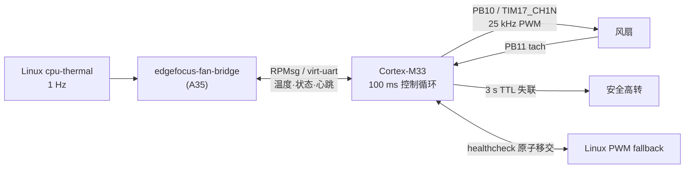

# STM32MP257 副核（M33）风扇安全闭环

STM32MP257 的 Cortex-M33 独立承担散热安全控制：A35/Linux 只上报温度事实，M33 独占风扇 PWM 与转速采样，即使 Linux 业务侧异常也能保持安全散热。

## 拓扑



## 设计约束

- **单一控制者**：M33 在线时 Linux 的 PWM/timer 必须解绑；切回 fallback 前先让 remoteproc offline。禁止双写 PB10/PB11。
- **安全默认**：M33 启动先写安全占空比，再初始化 OpenAMP；OpenAMP 阻塞不得影响 PWM 与看门狗。
- **温度来源严格**：只接受 `type=cpu-thermal` 的温区；找不到时停止上报，由 3 秒 TTL 触发安全高转，不回退到任意温区。
- **看门狗门控**：只有 `healthyForWatchdog()` 为真且板级适配确认调度器/PWM 健康时才喂 WWDG。
- **可回退**：系统提供 M33 loader、bridge、健康检查与 Linux fallback 三组 systemd 单元；切换是幂等的。

## 目录

```text
m33-fan-controller/
├── firmware-m33/fan_controller/     # 可移植控制核心 + ATK 板级适配
│   ├── FanControllerApp.{h,cpp}     # 协议、状态机、温区、看门狗门控
│   └── atk/                         # PB10/TIM17_CH1N、PB11 EXTI、OpenAMP、构建与部署
├── linux-bridge/                    # A35 侧：温控核心、RPMsg bridge、服务与测试
│   ├── core/  bridge/  board/  tests/
└── docs/                            # M33 风扇硬件盘点与实测
```

> `host/self-developed/firmware/m33/` 与 `host/self-developed/platform/fan/` 是同一份代码的**主副本**；本目录是便于独立浏览的镜像。修改时以主机仓为主，再同步到这里。

## 构建与部署

```powershell
# M33 固件（需要 Arm GNU 工具链 + ATK CubeMP2 源包）
cd firmware-m33/fan_controller/atk
./build_atk.ps1

# 只读探测 / 原子部署 / 停止
python deploy_m33.py probe
python deploy_m33.py deploy
python deploy_m33.py stop

# Linux bridge 独立测试
cmake -S linux-bridge -B build/fan
cmake --build build/fan
ctest --test-dir build/fan --output-on-failure
```

厂商 CubeMP2 源包与预编译 echo ELF 未随仓库分发；`build_atk.ps1` 需要本机具备匹配的 BSP 与工具链。

## 协议与实测

- 帧格式、握手、温度序号、TLT、tach 诊断与故障位：见 `firmware-m33/fan_controller/FanControllerApp.cpp` 与 `linux-bridge/core/FanProtocol.cpp`。
- 板级事实（TIM17_CH1N/PB10、PB11/EXTI、CAN 冲突、PWM 周期 40 µs、2 PPR）见 [`docs/stm32mp257-m33-fan-inventory.md`](docs/stm32mp257-m33-fan-inventory.md)。
- 运维入口：`systemctl status edgefocus-m33-fan edgefocus-fan-bridge edgefocus-fan-healthcheck`，状态文件 `/run/edgefocus/fan-status.json`。
