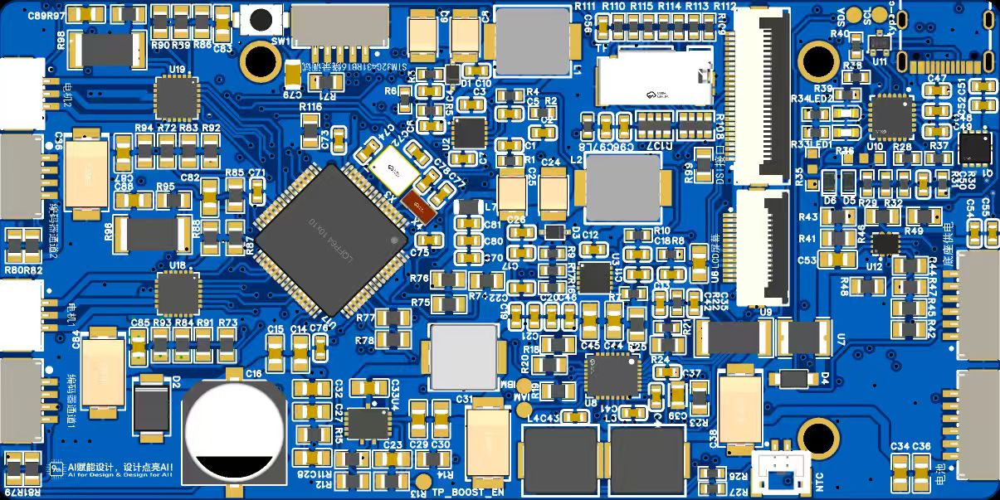

# 硬件设计

EdgeFocus 的硬件由一块 STM32MP257 核心板、自研载板、G431 云台副板与 STM32G030 手环组成。本目录保留可公开的设计源文件、网表与实拍图。

  
  
  

## 板块划分

| 板卡 | 主要器件 | 设计文件 |
| --- | --- | --- |
| 自研载板 | STM32MP257 核心板、RTL8723DU、CH334R、MAX98357A、ICS-43434、STUSB4500、MIPI DSI / SPI 屏、风扇接口、G431 接口 | `eda/carrier/edgefoucs_mainborad_v2.1.eprj2` |
| 云台及电源管理板 | STM32G431RBT6、双 AS5600、双 STSPIN830、Boost、ADC/DAC | `eda/gimbal-power/EdgeFouce_云台及电源管理.eprj` |
| 手环主板 | STM32G030C8T6、E104-BT52、SSD1306 OLED、振动马达、电池/充电 | `eda/band/`（BLEban 与早期 band 工程） |

## EDA 源文件（立创 EDA 专业版）

| 文件 | 说明 |
| --- | --- |
| `eda/carrier/edgefoucs_mainborad_v2.1.eprj2` | **自研载板 V2.1 完整工程**（原理图 / PCB，立创 EDA 专业版新格式） |
| `eda/gimbal-power/EdgeFouce_云台及电源管理.eprj` | 云台 + 电源管理板完整工程（原理图 / PCB） |
| `eda/band/BLEban.eprj2` | 手环板当前工程（新格式） |
| `eda/band/BLEban.eprj_backup` | 手环板旧格式备份 |
| `eda/band/edgefoucs——band.eprj2` | 手环板另一版本（新格式） |
| `eda/band/edgefoucs——band.eprj_backup` | 对应旧格式备份 |
| `eda/band/band.eprj` | 早期 ESP32-S3 手环方案 |

使用立创 EDA 专业版打开 `.eprj` / `.eprj2`；`.eprj_backup` 为编辑器自动备份，可在需要时改扩展名恢复。二进制工程文件已按 Git 二进制处理。

> 自研载板 V2.1 工程使用立创 EDA 专业版新格式（`.eprj2`）。仓库同时保留 2026-06/07 两版 Telesis 网表，便于在不打开编辑器时核对连接关系。

## 网表

| 文件 | 对应板卡 |
| --- | --- |
| `netlist/self-developed-carrier-v2.tel` | 自研载板 V2 |
| `netlist/self-developed-2026-07-15.tel` | 自研载板 2026-07-15 版本 |
| `netlist/gimbal-subboard.tel` | G431 云台副板 |
| `netlist/band-schematic-2026-06-07.tel` | 手环板 |

网表为 Telesis 格式（`$PACKAGES` / `$NETS`），可用支持该格式的 EDA 工具或脚本导入。

## 关键接口

| 链路 | 连接 |
| --- | --- |
| 摄像头 | USB（经 CH334R Hub），`/dev/video*` |
| Wi-Fi / BT | RTL8723DU，USB；`wlan0` / `hci0` |
| 云台 | UART4 115200 8N1；PD7 Enable、PD6 Fault（低有效）；PD4 为 BOOT0 |
| 手环 | BLE 0x180C / 0x2A56 |
| 风扇 | PB10 PWM（TIM17_CH1N，25 kHz，外部反相）、PB11 tach |
| 供电 | STUSB4500，I2C4（PD10/PD11，Linux `/dev/i2c-1`） |
| 显示 | MIPI DSI / SPI LCD，bring-up 未完成 |
| 音频 | I2S/SAI + MAX98357A，数字麦克风 ICS-43434 |

## 说明

- 板卡照片、PCB 图与设备图由作者拍摄。
- 复用设计前请先核对器件版本与网表，尤其是 PB10/PB11 与 CAN 的引脚冲突。
