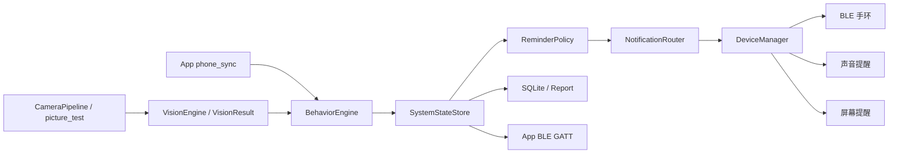

# EdgeFocus 智能专注辅助系统技术文档（比赛评委版）

> 文档用途：比赛作品提交与评委技术审阅  
> 当前版本：2026-07-08  
> 项目定位：面向学习场景的本地化智能专注辅助硬件系统  

## 1. 作品概述

EdgeFocus 是一套面向学生自习、备考、长时间阅读等学习场景的智能专注辅助系统。系统以“专注会话”为核心工作单元，结合主机摄像头视觉分析、手机 App 使用状态上报、主机本地行为判定和多通道提醒执行，帮助用户在学习过程中及时发现走神行为，并通过合适强度的提醒回到当前任务。

作品由手机 App、边缘主机、摄像头、可选云台副板、BLE 智能手环和本机提醒硬件组成。主机负责会话管理、视觉处理、行为分析、提醒策略、设备控制、报告生成和历史存储；App 负责用户操作、状态展示、手机使用状态采集、历史报告查看和反馈提交；手环作为低打扰提醒终端，接收主机写入的提醒指令并震动/OLED 提示。

系统的目标不是简单计时器，也不是单一摄像头识别 Demo，而是完成一个可解释、可演示、可扩展的学习专注闭环：

```text
用户启动专注会话
  -> 主机创建并接管 session_id
  -> 摄像头采集学习状态
  -> App 上报手机使用状态 phone_sync
  -> 主机行为层综合视觉与手机输入
  -> 策略层判断提醒等级与提醒方式
  -> 主机执行手环/屏幕/声音/手机提醒
  -> 会话结束后生成报告
  -> App 查看历史并提交反馈
```

## 2. 设计背景与问题分析

传统番茄钟或学习计时 App 通常只能记录时间，无法判断用户在计时过程中是否真正保持学习状态。单纯依赖手机端的 App 使用监测，也无法发现离座、视线偏离、趴桌或睡觉等非手机类走神行为。单纯依赖摄像头视觉分析，则无法准确判断用户是否正在刷娱乐应用或短视频。

EdgeFocus 的设计出发点是把“学习会话”作为中心，把多源信息汇聚到主机上统一判断：

- 摄像头负责采集用户是否在座、是否偏离、是否姿态异常、画面质量是否可用。
- 手机 App 负责上报前台应用和手机使用状态，例如学习类、普通使用、娱乐类干扰。
- 主机行为层负责综合两类输入，而不是把某一类输入直接等同于走神等级。
- 主机策略层负责决定是否提醒、提醒等级、提醒渠道和冷却时间。
- 手环、声音、屏幕、手机端提醒共同构成可配置提醒输出。

这种设计能避免单一传感器误判，并让系统更贴近真实学习场景：用户可能不看手机但离座了，也可能坐在座位上但在玩手机；不同情况需要不同程度、不同方式的提醒。

## 3. 系统总体架构

### 3.1 三端职责

| 组成 | 职责 | 边界 |
|---|---|---|
| 主机 | 会话权威端；负责摄像头采集、视觉分析、行为判断、提醒策略、设备控制、报告生成、历史存储、BLE GATT 服务 | 不把最终提醒等级交给 App；不依赖云端 |
| App | 用户操作端与展示端；负责发起会话、查看状态、上报手机使用、查看报告、提交反馈 | 不直连手环；不自行决定提醒等级 |
| 手环 | 提醒终端；接收主机写入 Alert 后震动/OLED 提示 | 不参与策略判断；当前无 ACK/Notify/电量上报 |
| 摄像头 | 视觉输入源 | 只提供图像输入，不直接决定提醒 |
| 云台副板 | 可选摄像头角度辅助模块，通过串口接受主机控制 | 当前作为可选能力，可被主机配置关闭 |

系统的数据权威关系为：

```text
主机 > App > 手环
```

主机是 session_id、会话阶段、专注统计、提醒计数、报告历史和反馈绑定关系的权威来源。App 本地显示与主机状态冲突时，以主机为准。

### 3.2 主机软件分层

主机程序采用 C++17 实现，按采集、分析、策略、设备、网络、存储和 UI 分层：

```text
focus_app/
  main.cpp        模块装配与启动参数
  app/            AppContext、SystemStateStore、SessionController
  camera/         摄像头采集与预览帧
  vision/         视觉推理、画面质量、Mock/图片测试输入
  behavior/       行为状态机、事件检测、风险评分
  policy/         提醒策略、模式管理、提醒渠道路由
  device/         手环、屏幕、声音、云台等硬件执行层
  network/        App BLE GATT JSON API、演示 HTTP 后台
  storage/        SQLite 持久化与报告生成
  ui/             主机本机小屏 UI 与触摸交互
  tests/          单元测试、模块测试、集成测试
```

主机内部核心数据流如下：



## 4. 核心主链路设计

EdgeFocus 的产品逻辑以一次专注会话为中心。会话阶段包括：

| 阶段 | 含义 |
|---|---|
| `idle` | 无活动会话，用户可选择或使用默认专注时长 |
| `precheck` | 会话已创建，正式计时前进行摄像头/云台/画面预检 |
| `focusing` | 正式专注阶段，开始计时并处理视觉和手机输入 |
| `paused` | 暂停阶段，不累计正式走神，不触发提醒 |

主流程为：

1. 用户通过 App 或主机屏幕启动会话。
2. 主机创建唯一 `session_id`，进入 `precheck`。
3. App 根据主机响应显示摄像头预检；如果主机响应包含云台能力字段，App 显示云台校准/控制区域。
4. 用户点击继续或跳过预检后，主机进入 `focusing`，正式倒计时从此刻开始。
5. 摄像头持续提供图像输入，视觉层输出用户姿态和画面质量。
6. App 周期上报 `phone_sync`，提供手机前台应用和干扰强度输入。
7. 行为层综合视觉输入和手机输入，得到当前 FocusState 与 BehaviorContext。
8. 策略层根据风险、冷却时间、当前模式和用户配置决定是否提醒。
9. 设备层执行提醒，例如手环震动、声音提示、屏幕闪烁或推送给手机端执行。
10. 会话结束后，主机生成报告并写入历史。
11. App 读取报告/历史，并将用户反馈写回主机。

## 5. 视觉与手机双输入行为分析

### 5.1 视觉输入

视觉链路用于判断用户是否仍处于学习状态。当前系统支持真实摄像头输入，也支持使用图片样本进行后链路测试。视觉层主要关注以下信息：

- 用户是否在画面中。
- 用户是否离座。
- 用户是否视线偏离。
- 用户是否趴桌、低头或姿态异常。
- 画面质量是否足够，例如距离、光照、清晰度和人脸位置。

系统不把视觉算法设计成必须一次性完美识别所有情况，而是先保证链路稳定、状态可观察、输出可解释。这样在硬件支架或摄像头角度尚未完全稳定时，也能通过图片样本验证行为层、策略层和报告链路。

### 5.2 手机输入

App 通过 `phone_sync` 向主机上报手机使用情况。典型字段包括：

```json
{
  "is_in_use": true,
  "app_category": "entertainment",
  "distraction_level": 2,
  "app_name": "com.example.video",
  "duration_sec": 120
}
```

系统对手机状态有明确边界：

- `PHONE_IN_USE`、`PHONE_IN_PLAYING`、`PHONE_IN_LEARNING` 是行为输入或状态，不是固定提醒等级。
- 娱乐类使用会增加风险，但不等于必然 `LEVEL_3`。
- 学习类手机使用进入 `PHONE_IN_LEARNING`，默认不按普通走神提醒。
- `phone_sync` 的响应只表示主机已收到输入，不代表最终提醒判断。

### 5.3 行为层输出

行为层将视觉结果和手机信号综合为当前 FocusState 和上下文信息。典型 FocusState 包括：

| 状态 | 含义 |
|---|---|
| `FOCUSED` | 当前保持专注 |
| `LOOKING_AWAY` | 视线偏离 |
| `AWAY` | 用户离座 |
| `SLEEPY_OR_SLUMPED` | 疲劳、趴桌或姿态异常 |
| `PHONE_IN_USE` | 手机普通使用参与判断 |
| `PHONE_IN_PLAYING` | 娱乐类手机使用参与判断 |
| `PHONE_IN_LEARNING` | 学习类手机使用 |
| `LOW_CONFIDENCE` | 视觉低置信，需要谨慎处理 |
| `PAUSED` | 会话暂停 |
| `CALIBRATING` | 会话预检中 |

策略层再根据这些状态、风险分数和冷却时间，输出最终提醒等级。

## 6. 提醒策略与多通道输出

### 6.1 提醒等级

主机策略层输出 `CommandLevel`：

| 等级 | 含义 |
|---|---|
| `NONE` | 不提醒 |
| `LEVEL_1` | 轻提醒 |
| `LEVEL_2` | 中提醒 |
| `LEVEL_3` | 强提醒 |
| `REST_SUGGESTION` | 休息建议 |

提醒等级由主机策略层统一决定，而不是由 App 或手环决定。策略层会考虑：

- 当前行为状态。
- 视觉信号与手机信号是否同时存在。
- 手机输入的干扰强度。
- 风险评分。
- 提醒冷却时间。
- 用户是否已经确认提醒。
- 当前会话阶段是否允许提醒。

### 6.2 normal 与 silent 模式

系统区分 normal 和 silent 两种提醒模式，但这两种模式只筛选提醒渠道，不改变提醒严重程度。

| 模式 | 默认渠道 |
|---|---|
| normal | 屏幕、手环、声音 |
| silent | 屏幕、手环 |

用户可以通过 App 配置 normal/silent 模式下启用哪些渠道。silent 模式不会把高等级提醒降级，只会避免使用声音等有声提醒方式。

### 6.3 提醒输出路由

提醒输出由 `NotificationRouter` 根据系统模式和用户偏好筛选，然后交给 `DeviceManager` 执行。当前设计支持：

- 手环震动提醒。
- 主机声音提示。
- 主机屏幕闪烁或提示。
- 手机端代替主机屏幕或声音提醒。

为了适配不同硬件版本，系统提供路由配置：

- `screen_output_route=board`：使用板载屏幕显示状态和提醒。
- `screen_output_route=phone`：板载屏幕整体不可用时，由 App 承担显示和屏幕类提醒。
- `sound_output_route=board`：使用板载声卡播放提示音。
- `sound_output_route=phone`：板载声卡不可用时，由 App 播放提示音。

这类配置用于硬件版本适配，不是普通用户日常随意切换的提醒偏好。

## 7. BLE 通信与协议

### 7.1 App 与主机

主机作为 BLE Peripheral / GATT Server，App 作为 BLE Central / GATT Client。

| 项目 | UUID | 方向 |
|---|---|---|
| Service | `0000FF00-0000-1000-8000-00805F9B34FB` | - |
| Write Characteristic | `0000FF01-0000-1000-8000-00805F9B34FB` | App 写主机 |
| Read/Notify Characteristic | `0000FF02-0000-1000-8000-00805F9B34FB` | 主机响应/推送 App |

App 发送 JSON 命令：

```json
{"cmd":"get_current_state","id":1,"data":{}}
```

主机返回：

```json
{"status":"success","id":1,"data":{}}
```

主机主动推送：

```json
{"cmd":"push_state","data":{}}
```

当前普通命令包括：

```text
get_device_status
get_current_state
get_today_summary
get_last_report
session_control
update_preferences
reminder_ack
phone_sync
get_console_data
session_feedback
get_session_history
get_preferences
```

当前主动推送包括：

```text
push_state
push_alert
push_session_end
push_timer_complete
```

### 7.2 主机与手环

主机作为 BLE Central，手环作为 BLE Peripheral。

| 项目 | UUID |
|---|---|
| 手环名称 | `EdgefocusBand` |
| Service | `0000180C-0000-1000-8000-00805F9B34FB` |
| Alert Characteristic | `00002A56-0000-1000-8000-00805F9B34FB` |

主机写入 Alert 二进制帧：

```text
byte[0] = 0x01
byte[1] = vibration_pattern
byte[2] = level
```

例如强提醒可以写入：

```text
01 03 03
```

手环当前只负责接收提醒并震动/OLED 显示，不提供 ACK、Notify、电量或状态上报。该限制不会影响当前比赛主链路，因为主机只需要完成 Alert 写入和本地诊断记录。

## 8. 数据存储、报告与反馈

主机使用 SQLite 存储会话、事件、偏好、历史和反馈。会话结束时，`SessionController` 负责收敛会话状态，生成报告字段并写入数据库。

报告核心字段：

| 字段 | 含义 |
|---|---|
| `session_id` | 会话唯一 ID |
| `total_duration` | 总时长 |
| `focus_duration` | 专注时长 |
| `distraction_count` | 分心次数 |
| `reminder_count` | 提醒次数 |
| `phone_distraction_count` | 手机干扰次数 |
| `feedback` | 用户反馈 |

同一个 `session_id` 必须贯穿：

```text
start
  -> current
  -> pause/resume
  -> end
  -> report
  -> history
  -> feedback
```

反馈值包括：

```text
too_much
too_little
just_right
```

反馈主要放在 App 端完成，因为主机小屏不适合复杂反馈交互；主机负责接收和持久化。

## 9. 云台与摄像头预检设计

云台功能用于辅助摄像头观察角度调整。当前设计中，云台不是普通用户单独打开的独立功能，而是会话启动后的预检环节之一。

App 启动会话后必须等待主机响应：

- 如果主机返回 `precheck.camera`，App 展示摄像头预检、画面预览、距离和姿态提示。
- 如果主机额外返回 `precheck.gimbal`，App 展示云台校准和小步控制。
- 如果主机配置关闭云台，或云台不在线、不安全、运动控制不可用，则主机不返回 `precheck.gimbal`，App 不展示云台功能。

这样可以避免把硬件离线、调试失败或不安全状态暴露给普通用户。即使云台功能被关闭，摄像头画面预览和距离/姿态引导仍然保留。

云台副板通过 UART 文本协议接收主机控制，主机侧提供状态查询、小步调整、停止、居中等控制入口。为了比赛演示稳定性，云台功能可以通过配置开关禁用，不影响会话、视觉、行为、提醒和报告主闭环。

## 10. 容错与硬件适配

EdgeFocus 面向自研硬件，因此特别重视“局部硬件失败不拖垮主流程”的设计。

| 异常情况 | 处理方式 |
|---|---|
| App 未连接 | 主机仍可独立启动会话、采集视觉、提醒和生成报告 |
| 手机未上报 | 行为层只缺少手机输入，不阻塞视觉链路 |
| 手环未连接 | 主机记录手环不可用，其他提醒渠道继续工作 |
| 声卡不可用 | 可配置为手机端播放声音，主机不阻塞 |
| 屏幕不可用 | 可配置为手机端承担显示和屏幕类提醒 |
| 云台不可用 | 不返回云台预检字段，主流程按摄像头预检继续 |
| 摄像头支架不稳定 | 可使用 `picture_test` 图片验证视觉后链路 |
| BLE 推送丢失 | App 可通过 `get_current_state` 同步主机权威状态 |

这种容错思路保证系统在比赛演示、硬件调试和代码提交阶段都能保持主链路可运行。

## 11. 隐私与本地化设计

EdgeFocus 采用本地优先设计。学习状态、摄像头结果、手机使用输入、会话报告和反馈数据均由主机本地处理并存储，不依赖云端服务器。这样可以带来三个优势：

1. 降低网络依赖，提高比赛演示和日常使用稳定性。
2. 减少敏感学习状态数据离开本地设备的风险。
3. 使主机在 App 临时断连时仍可独立工作。

App 与主机之间通过 BLE 传输结构化 JSON 命令，手环只接收主机写入的极简 Alert 帧，整体通信链路清晰可解释。

## 12. 已验证能力与当前完成度

当前已验证的主机与硬件能力包括：

- 主机 BLE GATT 服务以 `EdgeFocus` 广播，App 可通过 FF00/FF01/FF02 通信。
- 会话主流程已覆盖 `start`、`skip_precheck`、`phone_sync`、`pause`、`resume`、`end`、`get_last_report`、`get_session_history`、`session_feedback`。
- `/dev/spidev0.0` 可用，板载屏幕在开发系统上可点亮。
- ES8388 声卡可播放生成提示音，声音提醒采用提示音而不是语音播报。
- BLE 手环可连接为 `EdgefocusBand`，主机可写 `0x2A56` Alert，手环可震动。
- 摄像头可在开发板上打开并捕获真实画面。
- 真实 NPU 适配器可在会话启动后初始化。
- 板端模块测试覆盖 storage、behavior FSM、reminder policy、device manager、vision result、BLE GATT 等核心模块。

当前明确不作为已有能力承诺的内容：

- 手环 ACK、Notify、电量上报或状态读取。
- 云端同步或服务器后台。
- 完整 Dashboard 重构。
- 复杂校准失败原因分类。
- 云台在所有硬件状态下的稳定自动校准。

## 13. 技术创新点

1. **以会话为核心的多源专注闭环**  
   系统不是单点检测，而是围绕 session_id 完成从启动、采集、判断、提醒、结束、报告到反馈的闭环。

2. **视觉与手机使用状态融合判断**  
   摄像头负责观察用户物理状态，App 负责上报手机使用行为，主机行为层统一处理，减少单一输入误判。

3. **本地化边缘智能架构**  
   主机本地完成状态判断、策略决策和数据存储，降低网络依赖并保护学习数据隐私。

4. **提醒等级与提醒渠道解耦**  
   `PHONE_IN_PLAYING` 等行为输入不直接等于提醒等级；normal/silent 只控制渠道，不改变严重程度。

5. **多硬件版本适配能力**  
   屏幕、声卡、云台、手环都被设计为可观测、可旁路的设备能力，局部硬件问题不会阻塞主会话流程。

6. **App、主机、手环分工清晰**  
   主机是权威数据源，App 是操作与展示端，手环是提醒终端，避免端间职责混乱。

## 14. 比赛演示建议

建议比赛演示按以下顺序展示：

1. App 连接主机并启动专注会话。
2. 主机返回 `precheck`，App 展示摄像头预检/预览。
3. 用户点击继续或跳过预检，主机进入 `focusing`。
4. 摄像头画面或图片样本进入视觉链路。
5. App 上报娱乐类 `phone_sync`。
6. 主机行为层更新状态，策略层产生提醒。
7. 主机触发手环震动、屏幕或声音提醒。
8. 暂停/恢复会话，App 与主机状态同步。
9. 结束会话，主机生成报告。
10. App 查询历史/报告并提交反馈。

演示重点不是展示每个 UI 细节，而是证明主链路真实贯通：主机能接管会话，能处理多源走神输入，能输出提醒，能形成可查询的历史报告。

## 15. 后续扩展方向

在当前主链路稳定后，系统可以继续扩展：

- 优化视觉模型和多角度姿态识别。
- 完善云台自动初始化和角度推荐。
- 增加更丰富的 App 报告可视化。
- 加入长期学习趋势分析。
- 后续手环协议升级后，可加入电量、ACK 或状态上报。
- 根据用户反馈动态调整提醒灵敏度和冷却策略。

这些方向都建立在当前已形成的会话、行为、提醒、报告主架构之上，不会改变主机作为权威端的核心设计。

## 16. 总结

EdgeFocus 通过“本地边缘主机 + 手机 App + 摄像头视觉 + 多通道提醒 + 会话报告”的组合，把传统学习计时工具升级为可感知学习状态、可解释行为原因、可执行实时干预、可回看历史结果的智能专注辅助系统。

该作品的核心价值在于把真实学习场景中的多种走神来源统一到一个主机会话模型中：摄像头观察物理状态，App 观察手机使用状态，主机负责综合判断与提醒策略，手环/声音/屏幕/手机端完成不同打扰强度的反馈。系统不依赖云端，主链路可本地运行；同时通过清晰的协议和模块分层，为后续算法优化、硬件迭代和 App 体验完善留下扩展空间。
